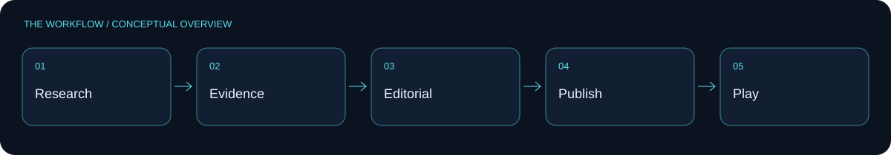
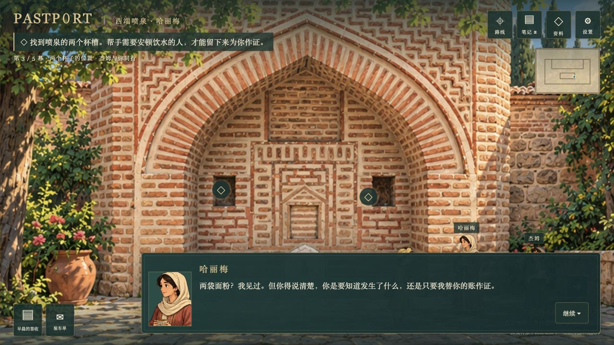
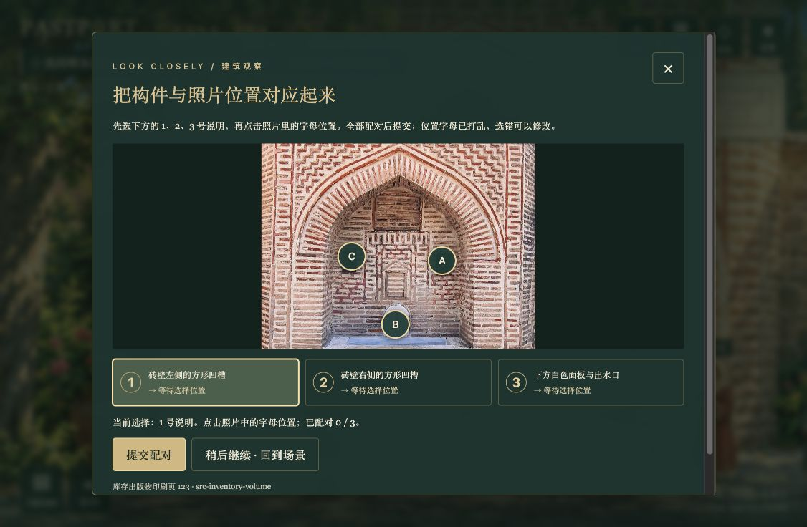

[](LICENSE)

<div align="center">


**A heritage framework for source-linked research, editorial workflows and interactive experiences. The 360° museum direction remains a development target.**

[Explore the documentation](#project-documentation) · [Browse source](https://github.com/Psyche0920/PastPort/tree/main)

</div>



## A window into the prototype

These screenshots come from the **Muradiye UI trial branch**, an experimental heritage scene. They illustrate the prototype, not completed main-branch museum integration.





[Explore the UI trial branch](https://github.com/Psyche0920/PastPort/tree/demo-muradiye-ui-trial) · [Adventure prototype source](https://github.com/Psyche0920/PastPort/blob/6e65a44b2d4fc26d8a925775d317a3660a609d8a/prototype/adventure.html) · [Immersive prototype source](https://github.com/Psyche0920/PastPort/blob/6e65a44b2d4fc26d8a925775d317a3660a609d8a/prototype/immersive.html)

<a id="project-documentation"></a>

# PastPort

Turn traceable heritage research into interactive games with characters, decisions, choices, and consequences. Python provides the workflow and shared services; native JavaScript implements game rules and browser playtests.

The approved direction is a single-player cartoon-style 360° museum with source-linked objects, story tasks and reusable gameplay plugins. The existing Python/JavaScript framework provides editorial workflow and native inspect/caseboard play. The generic plugin host and new museum integration are development targets, tracked in the plan.

## Team documentation

| Document | Read it for |
|---|---|
| [PastPort_PRD_CN](docs/PastPort_PRD_CN.md) / [PastPort_PRD_EN](docs/PastPort_PRD_EN.md) | One specification: product, technical implementation and topic details |
| [Documentation index](docs/README.md) | Role-based reading routes |
| [Implementation Guide](docs/IMPLEMENTATION_GUIDE.md) | Existing startup, APIs, operational recovery and checks |
| [Active Plan](docs/ACTIVE_PLAN.md) | Tasks, owners, dependencies, acceptance and blockers |
| [Decision Log](docs/DECISION_LOG.md) / [Change Log](docs/CHANGELOG.md) | Accepted rationale and verified deliveries from the initial baseline |
| [SDK reference](docs/technical/sdk-v1/README.md) | Fixed target schemas, plugin API and synthetic handoff examples |

wehan owns shared contracts/main/VR Studio; wcheung owns source/museum preparation; maslan owns Story Agent/game making/plugins. Coding Agents follow [AGENTS.md](AGENTS.md), start at the assigned task and read relevant PRD sections only. Shared contract changes have one owner. New targets are not claims of current runtime support.

## Modules and file responsibilities

Each module README lists the purpose of its direct source files. The PRD owns cross-module rules to avoid duplication.

| Module | Responsibility | Key files | Inventory |
| --- | --- | --- | --- |
| Package entry | Startup, type exports, shared diagnostics | `__main__.py` startup; `contracts.py` exports; `observability.py` JSON logging | [Package README](src/pastport/README.md) |
| domain | Framework-independent immutable contracts, validation, and identity | `modules.py` module messages; `evidence.py` evidence; `game.py` gameplay; `workflow.py` state/budgets | [domain](src/pastport/domain/README.md) |
| ports | Replaceable module, storage, model, and runtime boundaries | `modules.py` business Protocols; `execution.py` shared services; `resources.py` resource reads | [ports](src/pastport/ports/README.md) |
| application | Use cases, approvals/budgets, models/tools, assembly/publication, preview/saves | `service.py` editing use cases; `execution_runtime.py` service assembly; `publication.py` publication; `player_service.py` saves | [application](src/pastport/application/README.md) |
| adapters | I/O implementations for SQLite, files, providers, and Node processes | `database.py` business persistence; `content.py` local modules; `model_provider.py` providers; `player_process.py` JS bridge | [adapters](src/pastport/adapters/README.md) |
| workflow | Single-worker execution, persisted graph, and legal stage scheduling | `worker.py` execution/recovery; `stages.py` nodes; `branching.py` rework/evidence requests | [workflow](src/pastport/workflow/README.md) |
| player | Deterministic gameplay interpreter shared by browsers and Node | `runtime.mjs` atomic actions; `rules.mjs` conditions/effects; `runner.mjs` Python protocol entry | [player](src/pastport/player/README.md) |
| api | Authenticated HTTP, private resources, and browser workbench | `app.py` composition/routes; `private_views.py` previews/source text; `workbench.mjs` workbench; `request_logging.py` request correlation | [api](src/pastport/api/README.md) |
| development | Offline module, fault, browser acceptance, and contract-generation tools | `module_check.py` single module; `module_acceptance.py` four combinations; `fault_acceptance.py` faults; `browser_check.py` browser | [development](src/pastport/development/README.md) |
| Evidence SDK | Independent photo + historical PDF evidence-document workflow | `packages/evidence-sdk/` | [package and API](packages/evidence-sdk/README.md) |
| Matched Environment SDK | Independent matched-PDF + VR environment, 3D support and shared review | `packages/matched-environment-sdk/` | [package and API](packages/matched-environment-sdk/README.md) |
| Stylization SDK | Independent 360°/3D appearance post-processing and rendering | `packages/stylization-sdk/` | [package and API](packages/stylization-sdk/README.md) |

All three authoring SDKs are optional workspace distributions. Evidence handles
photo/PDF evidence documents. The Matched Environment SDK contains the complete matched environment
implementation, including its PDF-to-360° tour, 3D and shared-review capabilities. Stylization
separately packages the appearance-processing workflows added by
`environment-stylization`; it depends on Matched Environment's scene/review/execution contracts,
while Matched Environment does not depend on Stylization. The standalone PDF-to-VR branch alone
does not contain the 3D path. None of the SDKs contains the story Demo or claims
automatic story generation or Main runtime composition.

`tests/` contains behavior, contract, fault, and browser tests; `schemas/` contains generated contracts; `skills/` contains specialist methods; `tools/` contains repository checks; `references/` contains source references. Keep required provenance and runtime audit records. Use the short shared plan and logs; do not create per-change archives.

## Quick checks

Repository checks validate explicit Markdown/HTML anchors and registered PRD/reference files; missing links, obsolete parallel documents and incomplete module inventories still fail.

```bash
uv sync --locked --group dev
uv run --no-sync python tools/check_repository.py
uv run --no-sync python tools/check_handoff.py
uv run --no-sync python -m pastport.development.module_acceptance --output acceptance-artifacts/framework.json
```

See sections 3 and 14 of the [Implementation Guide](docs/IMPLEMENTATION_GUIDE.md) for complete startup and test commands. Runtime logs use safe JSON on stderr; remote log collection, retention/rotation, and production deployment are not enabled. Do not commit, push, merge, make paid calls, or deploy without authorization.


## Licensing

Project code is available under the [MIT License](LICENSE). Third-party assets retain their original licenses and attribution requirements; this license does not relicense third-party media, datasets, model weights, or trademarks.
