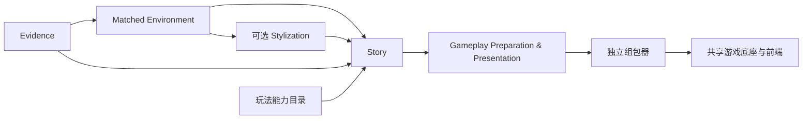
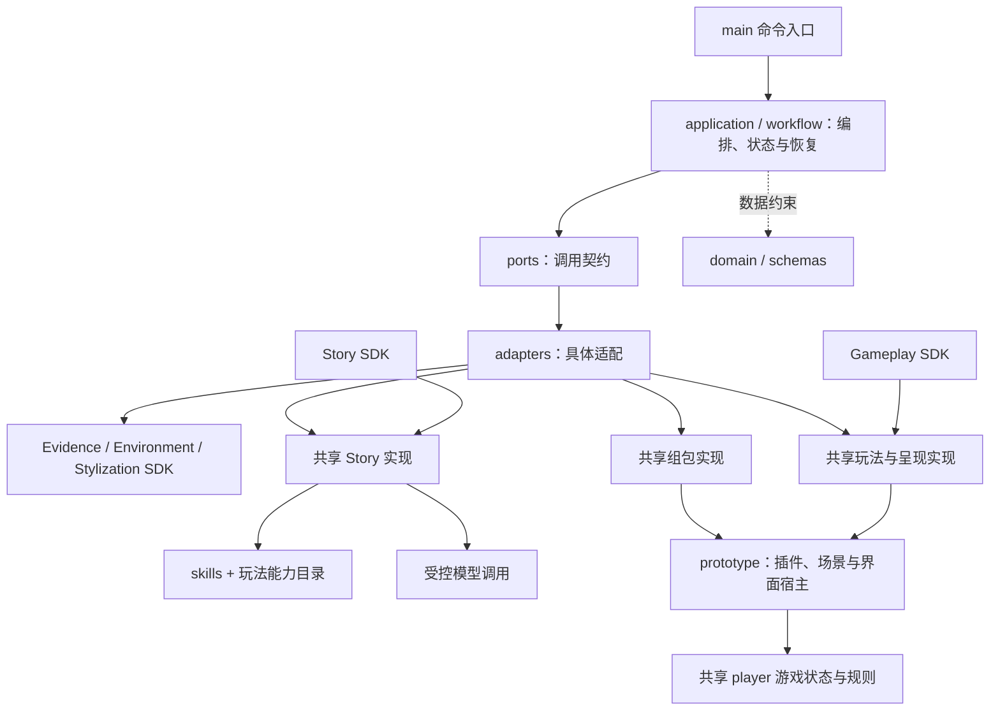

# PastPort

把原始史料、已匹配的博物馆环境和空间信息，转换为可浏览、可完成任务的遗址游戏。

**当前：五个 SDK 已与本地 main 集成；真实材料的保存结果复跑、组包与 3D 通关已验证。main 新入口目前只复跑已保存故事，不重新调用模型。源码通过 Git 管理；本地试玩产物不随源码发布。**

## 直接试玩

[打开本轮 3D 试玩](http://127.0.0.1:18838/?scene=3d)。恢复到测试结局时，点“重新开始”。链接仅在本机服务运行时可用。

当前工作区：`/Users/hanweijia/PastPort`。

服务已运行时直接打开链接；服务关闭后，在该目录执行：

```sh
PASTPORT_PORT=18838 node var/main-sdk-integration-20261101/run-02/game-3d/serve3d.mjs
```

保持终端打开；Ctrl+C 停止。**无需另外启动组包器服务，也不用把网址传给组包器。**

## 安装与复跑

需要 Python 3.12、uv、Node.js 和可用 WebGL 浏览器。私有 PDF、场景、审核数据及保存的 Story 不在 Git 仓库中；仅 clone 代码不会自动得到这些材料。

```sh
cd /Users/hanweijia/PastPort
uv sync --extra authoring --extra game-making
.venv/bin/pastport-game-trial --request var/main-sdk-integration-20261101/request-02.json
```

安装已完成时可跳过 `uv sync`。复跑命令自动完成：输入校验 → 保存故事复核 → 玩法准备 → 呈现绑定 → 组包 → 文件完整性检查。不新增模型调用。相同输入/实现可恢复已有阶段；改动后使用新输出目录，不能覆盖旧成果。

新故事生成是单独的 `pastport-story` 命令，使用模型额度，详见 Story SDK；本 README 的复跑命令不会启用它。其他机器需自行准备对应输入及请求 manifest。

## 架构与模块



main 用现有 LangGraph、SQLite 和 typed SDK 组织执行。Story 生成前同时考虑史料、审核文字/物件、空间导航和玩法能力；下游按同一份规则落实，不能改数量或偷偷换玩法。玩法、呈现和组包当前都是本地代码，不再调用模型。

| 模块 | 当前版本 | 说明与操作 |
|---|---|---|
| Evidence | 0.1.0 | [史料提取、来源与匹配文档](packages/evidence-sdk/README.md) |
| Matched Environment | 0.1.0 | [审核内容、VR/3D、挂载与导航](packages/matched-environment-sdk/README.md) |
| Stylization | 0.1.0 | [全景和 3D 外观处理](packages/stylization-sdk/README.md) |
| Story | 0.1.0rc4 | [剧情、任务、空间及玩法意图](packages/story-sdk/README.md) |
| Gameplay Preparation & Presentation | 0.1.0rc2 | [玩法参数、生命周期和呈现绑定](packages/gameplay-sdk/README.md) |
| 共享运行时 | 0.2.1rc4 | main 与两个下游 SDK 共用，不复制引擎 |

组包器是独立共享模块，尚未单独发行 SDK。当前支持已验证的双视点、资料阅读与来源判断后的矩形覆盖玩法，不代表任意小游戏都可直接接入。

## 目录与文件用途

五个 SDK 的文件结构与用途分别在各自 README 中（见上方模块链接）。下面直接列 main 和公共文件，每行同时显示层级与用途。

### 代码之间怎么连接



**目录是代码位置，SDK 是安装边界。** Story 和 Gameplay 的包提供调用入口，实现复用 `src/pastport/`；`prototype/story-agent-demo/` 仍承担当前宿主职责。它们不是三套独立游戏引擎。具体接口见技术 PRD，逐文件用途见下面清单。


<!-- BEGIN FILE INVENTORY -->
## 文件结构与用途

每个文件的用途直接写在同一行。以下覆盖本范围内的 **325 个维护文件**；依赖环境、缓存、私有产物和历史备份不属于源码清单。

```text
PastPort/
├── .github/
│   ├── workflows/
│   │   └── ci.yml  # GitHub Actions 持续集成：安装依赖并执行仓库检查与测试。
│   └── copilot-instructions.md  # Copilot 的仓库开发约束与规范入口。
├── docs/
│   └── TECHNICAL_PRD.md  # 当前唯一技术 PRD：main/SDK 职责、架构、技术栈、输入输出及验收边界。
├── prototype/
│   └── story-agent-demo/
│       ├── engine/
│       │   ├── actions.mjs  # 处理玩家动作，检查前置条件并生成状态变化与回执。
│       │   ├── context.mjs  # 建立游戏包对应的玩家上下文，校验身份、能力和规则。
│       │   ├── errors.mjs  # Safe operational errors never include source text, arbitrary keys or file paths.
│       │   ├── generated-schemas.mjs  # 由 Python 契约生成的玩家边界 Schema；应通过生成工具更新。
│       │   ├── rules.mjs  # 执行条件判断、规则匹配和效果计算。
│       │   ├── runtime.mjs  # 共享游戏状态引擎，按动作推进状态并返回结果。
│       │   └── validation.mjs  # Schema 校验、规范化序列化、内容哈希和集合一致性工具。
│       ├── app.css  # 试玩主界面的布局、对话、任务和玩法样式。
│       ├── app.mjs  # 试玩页面主控制器，连接对话、任务、插件、场景与操作。
│       ├── build-story-package.mjs  # 独立游戏构建入口：读取故事及绑定计划，检查资源并组装可运行包。
│       ├── cinematic-view.mjs  # 演出式视图控制：镜头、移动输入和物件交互。
│       ├── content.mjs  # Authored story and presentation data. All personal incidents are fictional.
│       ├── coverage.mjs  # 按实际拼板放置规则求解覆盖题，提前拒绝无解配置。
│       ├── dialogue.mjs  # Adapted from UI trial adventure.mjs speak/renderLine: one speaker, one line, Continue.
│       ├── gameplay-catalog.mjs  # 由共享能力 JSON 生成的浏览器能力目录，勿独立修改。
│       ├── gameplay.mjs  # 将任务玩法声明转换为已登记插件的绑定计划并校验身份。
│       ├── gameplay.test.mjs  # 玩法计划匹配与任务身份的自动回归测试。
│       ├── generated-story.mjs  # 将生成的 Story 输入校验并转换成宿主可用的剧情与任务。
│       ├── index.html  # 试玩宿主页面的 HTML 入口。
│       ├── interaction.mjs  # 协调物件点击、查看与接近动作，避免交互手势冲突。
│       ├── navigation.mjs  # 检查导航连接、度量空间和行走约束是否合法。
│       ├── plugins-contract.test.mjs  # 插件能力契约及配置的自动回归测试。
│       ├── plugins.mjs  # 本地 Activity 插件执行器，运行问答、归类、拼板等玩法并返回结果。
│       ├── prepared-game.mjs  # 读取玩法与呈现准备产物，检查故事、物件和能力目录身份后交给宿主。
│       ├── prepared-game.test.mjs  # 准备产物身份与宿主输入的自动回归测试。
│       ├── scene3d-bridge.mjs  # Story-side interaction contract; the scene host alone owns navigation.
│       ├── scene3d-bridge.test.mjs  # 3D 场景桥接与到达处理的自动回归测试。
│       ├── scene3d-navigation.mjs  # Preserve source navigation poses; screen bearings are camera-relative UI only.
│       ├── scene3d-runtime.js  # 注入独立 3D 视图的运行桥接，传递导航和剧情交互，不修改上游场景文件。
│       ├── scene3d-view.mjs  # 3D 宿主浏览器适配器，将场景交互接入现有剧情界面。
│       ├── serve3d.mjs  # 本地 3D 试玩 HTTP 服务，提供生成包及隔离场景资源。
│       ├── session.mjs  # 管理试玩会话、状态推进及存档恢复。
│       ├── shots.mjs  # Per-object staging data; floor masks are game presentation, not surveyed geometry.
│       ├── spatial-navigation.test.mjs  # 空间导航与移动约束的自动回归测试。
│       ├── story-package.mjs  # 故事包编译器，校验博物馆快照与契约并生成宿主输入。
│       ├── story-package.test.mjs  # 故事包编译与资源绑定的自动回归测试。
│       └── walkmesh.mjs  # Screen-independent walkability, path finding and character locomotion.
├── schemas/
│   ├── action-request.schema.json  # 自动生成的 ActionRequest JSON Schema，定义边界字段、类型和约束；通过契约工具更新。
│   ├── action-result.schema.json  # 自动生成的 ActionResult JSON Schema，定义边界字段、类型和约束；通过契约工具更新。
│   ├── action-vector.schema.json  # 自动生成的 ActionVector JSON Schema，定义边界字段、类型和约束；通过契约工具更新。
│   ├── artifact-ref.schema.json  # 自动生成的 ArtifactRef JSON Schema，定义边界字段、类型和约束；通过契约工具更新。
│   ├── assembly-request.schema.json  # 自动生成的 AssemblyRequest JSON Schema，定义边界字段、类型和约束；通过契约工具更新。
│   ├── assembly-result.schema.json  # 自动生成的 AssemblyResult JSON Schema，定义边界字段、类型和约束；通过契约工具更新。
│   ├── budget-policy.schema.json  # 自动生成的 BudgetPolicy JSON Schema，定义边界字段、类型和约束；通过契约工具更新。
│   ├── bundle.schema.json  # 自动生成的 PackageBundle JSON Schema，定义边界字段、类型和约束；通过契约工具更新。
│   ├── discover-request.schema.json  # 自动生成的 DiscoverRequest JSON Schema，定义边界字段、类型和约束；通过契约工具更新。
│   ├── discover-result.schema.json  # 自动生成的 ModuleResult[CandidateSetDraft] JSON Schema，定义边界字段、类型和约束；通过契约工具更新。
│   ├── draft-request.schema.json  # 自动生成的 DraftRequest JSON Schema，定义边界字段、类型和约束；通过契约工具更新。
│   ├── draft-result.schema.json  # 自动生成的 ModuleResult[NarrativeDraft] JSON Schema，定义边界字段、类型和约束；通过契约工具更新。
│   ├── evidence-request.schema.json  # 自动生成的 EvidenceRequest JSON Schema，定义边界字段、类型和约束；通过契约工具更新。
│   ├── evidence.schema.json  # 自动生成的 EvidencePackage JSON Schema，定义边界字段、类型和约束；通过契约工具更新。
│   ├── execution-metadata.schema.json  # 自动生成的 ExecutionMetadata JSON Schema，定义边界字段、类型和约束；通过契约工具更新。
│   ├── game.schema.json  # 自动生成的 GameContent JSON Schema，定义边界字段、类型和约束；通过契约工具更新。
│   ├── index-request.schema.json  # 自动生成的 IndexRequest JSON Schema，定义边界字段、类型和约束；通过契约工具更新。
│   ├── index-result.schema.json  # 自动生成的 ModuleResult[SourceIndexDraft] JSON Schema，定义边界字段、类型和约束；通过契约工具更新。
│   ├── inventory-request.schema.json  # 自动生成的 InventoryRequest JSON Schema，定义边界字段、类型和约束；通过契约工具更新。
│   ├── inventory-result.schema.json  # 自动生成的 ModuleResult[SourceManifestDraft] JSON Schema，定义边界字段、类型和约束；通过契约工具更新。
│   ├── narrative.schema.json  # 自动生成的 NarrativePackage JSON Schema，定义边界字段、类型和约束；通过契约工具更新。
│   ├── node-result.schema.json  # 自动生成的 NodeResult JSON Schema，定义边界字段、类型和约束；通过契约工具更新。
│   ├── player-state.schema.json  # 自动生成的 PlayerState JSON Schema，定义边界字段、类型和约束；通过契约工具更新。
│   ├── research-request.schema.json  # 自动生成的 ResearchRequest JSON Schema，定义边界字段、类型和约束；通过契约工具更新。
│   ├── research-result.schema.json  # 自动生成的 ModuleResult[EvidenceFindings] JSON Schema，定义边界字段、类型和约束；通过契约工具更新。
│   ├── review-decision.schema.json  # 自动生成的 ReviewDecision JSON Schema，定义边界字段、类型和约束；通过契约工具更新。
│   ├── review-request.schema.json  # 自动生成的 NarrativeReviewRequest JSON Schema，定义边界字段、类型和约束；通过契约工具更新。
│   ├── review-result.schema.json  # 自动生成的 ModuleResult[NarrativeReview] JSON Schema，定义边界字段、类型和约束；通过契约工具更新。
│   ├── revise-request.schema.json  # 自动生成的 ReviseRequest JSON Schema，定义边界字段、类型和约束；通过契约工具更新。
│   ├── revise-result.schema.json  # 自动生成的 ModuleResult[NarrativeDraft] JSON Schema，定义边界字段、类型和约束；通过契约工具更新。
│   ├── route.schema.json  # 自动生成的 RouteRecord JSON Schema，定义边界字段、类型和约束；通过契约工具更新。
│   ├── runtime-capabilities.schema.json  # 自动生成的 RuntimeCapabilities JSON Schema，定义边界字段、类型和约束；通过契约工具更新。
│   ├── runtime.schema.json  # 自动生成的 RuntimePackage JSON Schema，定义边界字段、类型和约束；通过契约工具更新。
│   ├── skill-result.schema.json  # 自动生成的 SkillResult[NarrativeDraft] JSON Schema，定义边界字段、类型和约束；通过契约工具更新。
│   ├── source-locator.schema.json  # 自动生成的 SourceLocator JSON Schema，定义边界字段、类型和约束；通过契约工具更新。
│   ├── tool-request.schema.json  # 自动生成的 ToolRequest JSON Schema，定义边界字段、类型和约束；通过契约工具更新。
│   ├── validation-report.schema.json  # 自动生成的 ValidationReport JSON Schema，定义边界字段、类型和约束；通过契约工具更新。
│   ├── validation-request.schema.json  # 自动生成的 PackageValidationRequest JSON Schema，定义边界字段、类型和约束；通过契约工具更新。
│   └── workflow-state.schema.json  # 自动生成的 WorkflowState JSON Schema，定义边界字段、类型和约束；通过契约工具更新。
├── skills/
│   ├── evidence-review/
│   │   ├── references/
│   │   │   └── review-examples.md  # 证据审查规则的示例与判定参考。
│   │   └── SKILL.md  # main 证据审查/研究工作流规则：出处、核实状态和证据边界。
│   ├── gameplay-preparation/
│   │   └── SKILL.md  # 玩法准备工作规范：匹配、配置、验证、空间及呈现职责边界。
│   └── narrative/
│       ├── references/
│       │   └── design-calibration.md  # 叙事设计校准参考，帮助检查任务意义、因果与表现质量。
│       └── SKILL.md  # Story 生成约束：史料、映射、空间、玩法能力与故事任务输出。
├── src/
│   └── pastport/
│       ├── adapters/
│       │   ├── __init__.py  # PastPort service components.
│       │   ├── assembly.py  # Build media manifests from reviewed asset identities; never from a prebuilt runtime template.
│       │   ├── codex_provider.py  # Story-only model transport using the official SDK and saved ChatGPT login.
│       │   ├── codex_traces.py  # Private local invocation evidence, separate from authoritative budget settlement.
│       │   ├── content.py  # Offline adapters for explicitly supplied authored content; no model generation is implied.
│       │   ├── database.py  # Short SQLite transactions with optimistic revisions and durable command consumption.
│       │   ├── environment_spatial.py  # Read explicitly registered SDK worlds into Story's typed spatial input.
│       │   ├── game_making.py  # Compose installed SDK entry points; preserve existing museum assets and Story.
│       │   ├── gameplay_catalog.py  # Load the one packaged capability catalog; malformed catalogs cannot authorize games.
│       │   ├── gameplay_verifier.py  # Verify only the registered local Demo Activity using a fixed Node runner.
│       │   ├── matched_environment.py  # Read one registered native environment without running uploaded code or changing reviews.
│       │   ├── model_narrative.py  # Story Agent adapter backed by the shared, metered model gateway.
│       │   ├── model_provider.py  # Bounded Responses HTTP adapter and explicit deterministic test provider.
│       │   ├── package_files.py  # Read regular local package files without following a file symlink or blocking on a pipe.
│       │   ├── pdf_text.py  # Optional pypdf extraction in a disposable process with explicit resource limits.
│       │   ├── player_process.py  # Bounded Node transport for the shared browser/headless preparation components.
│       │   ├── player_saves.py  # Durable, version-checked SQLite saves with one transaction for state and receipts.
│       │   ├── previews.py  # Private SQLite preview metadata and atomic player state, outside release storage.
│       │   ├── resources.py  # Explicit local asset catalog and source URI adapter, bounded to one configured directory.
│       │   ├── runtime_resources.py  # Resolve the single shared host distribution without requiring a checkout.
│       │   ├── skills.py  # Read only server-approved Skill paths and fingerprint every included file.
│       │   ├── story_3d.py  # Join approved shared assembly to the separately versioned local 3D delivery bridge.
│       │   ├── story_materials.py  # Normalize explicitly registered upstream exports without regenerating matches.
│       │   └── story_workflow.py  # Run the existing metered editorial graph up to its Story output boundary.
│       ├── api/
│       │   ├── __init__.py  # PastPort service components.
│       │   ├── api-client.mjs  # Stable operation identities. Rendering and automatic retry policy belong to the view controller.
│       │   ├── app.py  # Local authenticated editorial API with strict JSON transport and a durable background worker.
│       │   ├── player-view.mjs  # 后台玩家组件视图：渲染状态并提交玩家操作。
│       │   ├── private_views.py  # Private content routes; all bytes resolve through server-selected package/source identities.
│       │   ├── request_logging.py  # Request correlation without retaining URLs, bodies, headers or client identities.
│       │   ├── settings.py  # Server-side accounts and explicit test configuration.
│       │   ├── transport.py  # Bounded strict JSON request parsing shared by authenticated routes.
│       │   ├── views.mjs  # Safe DOM helpers; package and source text is never executable markup.
│       │   ├── workbench.css  # 审核工作台页面布局与样式。
│       │   ├── workbench.html  # 审核工作台页面结构与控件容器。
│       │   └── workbench.mjs  # 审核工作台浏览器控制器，连接后端接口与页面操作。
│       ├── application/
│       │   ├── __init__.py  # PastPort service components.
│       │   ├── activity.py  # Meter automatic workflow wall time once, excluding human and queue waiting.
│       │   ├── change_impact.py  # Version-bound mechanical comparison; uncertainty never grants human approval.
│       │   ├── environment_inputs.py  # Validate existing execution authority around explicitly injected local input reads.
│       │   ├── execution_guard.py  # Validate persisted server grants before any shared child operation.
│       │   ├── execution_models.py  # Pinned execution configuration and durable receipts, independent of provider SDKs.
│       │   ├── execution_runtime.py  # Composition root for grants, provider configuration and services given to module factories.
│       │   ├── game_making.py  # Checkpointed Main orchestration; SDKs retain their own internal execution authority.
│       │   ├── gameplay_preparation.py  # Derive supported source-reading mechanics without rewriting authored task meaning.
│       │   ├── model_gateway.py  # Account for a bounded model call before validating or returning its typed output.
│       │   ├── models.py  # Application records use clear names and reuse the frozen shared contracts.
│       │   ├── module_selection.py  # Explicit composition choices; injected implementations never silently fall back.
│       │   ├── narrative_rules.py  # Compile explicit story choice bindings into the existing deterministic rule engine.
│       │   ├── narrative_state.py  # Reconcile closed native Story state without inventing initial values or outcomes.
│       │   ├── operational_service.py  # Human interventions preserve spending facts, review history and execution limits.
│       │   ├── operations.py  # Authenticated intervention commands and immutable audit records.
│       │   ├── package_loader.py  # Load a runtime package against trusted identity and explicit consumer capabilities.
│       │   ├── player_components.py  # Bind shared JS preparation components to a trusted runtime package and release.
│       │   ├── player_preparation.py  # Typed preparation protocol, separate from committed player actions and saves.
│       │   ├── player_runtime.py  # Trusted shared-JS runtime contracts and the implementation of PlayerRuntimePort.
│       │   ├── player_service.py  # Saved player sessions; JS owns gameplay and the repository owns atomic durability.
│       │   ├── preview_normalization.py  # Mechanical repairs for explicitly authorized internal-preview model output.
│       │   ├── preview_service.py  # Preview-only assembly and sessions; no review or release mutations occur here.
│       │   ├── previews.py  # Typed private preview boundaries, independent of approval and publication.
│       │   ├── publication.py  # Stage durable immutable files, then atomically publish their recorded identity.
│       │   ├── reliability.py  # Typed authority, accounting and release records shared by local service boundaries.
│       │   ├── research_execution.py  # One bounded research role: durable steps, no tool-invented permissions or new questions.
│       │   ├── resources.py  # Enforce identity, size and raw-byte hashes for all injected resource readers.
│       │   ├── routing.py  # Application-owned legal routes and cumulative research/revision limits.
│       │   ├── service.py  # Application operations enforce identity, review authority and optimistic versions.
│       │   ├── source_tools.py  # Registered-source reading and deterministic local tools, bounded by frozen questions.
│       │   ├── source_views.py  # Read registered source bytes and saved extraction records without research/model calls.
│       │   ├── story_authoring.py  # Story-only checks and readable export; no plugin, frontend or assembly work.
│       │   ├── story_editing.py  # Stable game field locks and declared targets, shared by manual and module revisions.
│       │   ├── task_copy.py  # Reject repeated inventory counts that contradict the canonical task requirements.
│       │   ├── updates.py  # Revalidate immutable records rather than bypassing their boundary validators.
│       │   └── workflow_control.py  # Durable control manifests; module suggestions cannot grant approval or reset limits.
│       ├── data/
│       │   └── gameplay-capabilities.json  # 共享玩法能力目录；Story 创作约束、玩法编译和宿主校验使用同源能力声明。
│       ├── development/
│       │   ├── __init__.py  # Offline development tools; never production module fallbacks.
│       │   ├── acceptance_models.py  # Versioned development reports, separate from shared content and runtime contracts.
│       │   ├── acceptance_scenario.py  # Authenticated test-only workflow scenario for interchangeable offline ports.
│       │   ├── browser_check.py  # Run real-browser acceptance against a fresh synthetic localhost service.
│       │   ├── browser_fixture.py  # Dedicated synthetic localhost server for browser acceptance, never production data.
│       │   ├── fault_acceptance.py  # Run fixed F9 fault gates and retain a safe, version-bound local test report.
│       │   ├── module_acceptance.py  # Run the offline F9 acceptance kit with replaceable trusted local factories.
│       │   ├── module_check.py  # Run independent module smoke checks without an API, database or workflow worker.
│       │   ├── player_check.py  # Run F7 shared-JS conformance and report actual full action-vector results.
│       │   ├── player_contracts.py  # Export TypeScript declarations and the JSON schemas used by player components.
│       │   └── reference_modules.py  # Independent, request-bound synthetic ports for the offline acceptance kit.
│       ├── domain/
│       │   ├── __init__.py  # Framework-independent domain contracts.
│       │   ├── capabilities.py  # Explicit capabilities for the existing contract profile, independent of sample content.
│       │   ├── common.py  # Immutable wire contracts and content identity; no framework or provider imports.
│       │   ├── evidence.py  # Evidence candidates and snapshots; validation never grants human approval.
│       │   ├── game.py  # Bounded, declarative game data. This module does not interpret actions.
│       │   ├── game_making.py  # Private game-production inputs, with explicit reuse rather than implied generation.
│       │   ├── gameplay_preparation.py  # Gameplay preparation outputs are plans, never committed Story state or UI code.
│       │   ├── mechanics.py  # Shared task requirements and capability limits, independent of plugin implementations.
│       │   ├── modules.py  # Typed module messages for independent implementation against contract 0.1.0.
│       │   ├── narrative_repair.py  # Small narrative-state patches that leave authored prose and evidence untouched.
│       │   ├── package_loading.py  # Safe, stable failures for package consumers, independent of HTTP or storage.
│       │   ├── packages.py  # Cross-package contract checking, distinct from authorisation and runtime execution.
│       │   ├── player_saves.py  # Player save ownership and immutable persistence identities.
│       │   ├── resources.py  # Resource identities and local registrations, independent of provider or filesystem APIs.
│       │   ├── story_inputs.py  # Read-only, source-bound authoring input; not a new game wire or approval grant.
│       │   └── workflow.py  # Workflow messages express intent and observations, never authentication proof.
│       ├── player/
│       │   ├── __init__.py  # Shared browser/Node player engine, atomic action semantics and conformance utilities.
│       │   ├── actions.mjs  # 处理玩家动作，检查前置条件并生成状态变化与回执。
│       │   ├── context.mjs  # 建立游戏包对应的玩家上下文，校验身份、能力和规则。
│       │   ├── contracts.d.ts  # 由 Python 玩家契约生成的 TypeScript 类型声明。
│       │   ├── errors.mjs  # Safe operational errors never include source text, arbitrary keys or file paths.
│       │   ├── generated-schemas.mjs  # 由 Python 契约生成的玩家边界 Schema；应通过生成工具更新。
│       │   ├── preparation.d.mts  # 玩家组件准备接口的 TypeScript 类型声明。
│       │   ├── preparation.mjs  # 将已验证游戏包准备为共享玩家组件上下文。
│       │   ├── rules.mjs  # 执行条件判断、规则匹配和效果计算。
│       │   ├── runner.mjs  # Node JSON 协议入口，供 Python 调用共享玩家运行时。
│       │   ├── runtime.d.mts  # 玩家动作运行接口的 TypeScript 类型声明。
│       │   ├── runtime.mjs  # 共享游戏状态引擎，按动作推进状态并返回结果。
│       │   ├── validation.mjs  # Schema 校验、规范化序列化、内容哈希和集合一致性工具。
│       │   └── vectors.mjs  # 执行玩家动作一致性测试向量。
│       ├── ports/
│       │   ├── __init__.py  # Dependency-injected module boundaries.
│       │   ├── editorial.py  # Storage and content boundaries for application services and the workflow.
│       │   ├── execution.py  # Shared services supplied to independently constructed content modules.
│       │   ├── game_making.py  # Production-stage boundary; domain/application do not depend on SDK facades.
│       │   ├── gameplay_preparation.py  # A local plugin verifier cannot approve Story, geometry or global task completion.
│       │   ├── modules.py  # Process-local boundaries. No SDK, database, retry loop or fake success lives here.
│       │   ├── package_files.py  # Bounded file input for runtime package loading.
│       │   ├── player_preparation.py  # A typed process boundary; engine rules remain in the shared JavaScript implementation.
│       │   ├── player_saves.py  # Atomic player persistence, separate from the authoritative editorial review database.
│       │   ├── resources.py  # A provider-independent resource boundary; implementations enforce their own storage scope.
│       │   ├── source_text.py  # Optional text extraction over already verified registered-source bytes.
│       │   └── story_inputs.py  # Explicit read-only input injection; neither generation nor review mutation.
│       ├── workflow/
│       │   ├── __init__.py  # PastPort service components.
│       │   ├── branching.py  # Bounded research, revision and professional review within the existing graph nodes.
│       │   ├── stages.py  # Persist each stage result before graph checkpointing; human gates query business records.
│       │   └── worker.py  # One durable local graph executor. Business records remain the authority at human gates.
│       ├── __init__.py  # PastPort shared contracts.
│       ├── __main__.py  # Start one authenticated local editorial service.
│       ├── contracts.py  # Public schema registry; versions and wire names are part of the compatibility contract.
│       ├── game_trial_cli.py  # Run Main's provider-disabled paired-SDK integration from one explicit manifest.
│       ├── gameplay_cli.py  # Prepare supported gameplay from a locked Story run, without model or build calls.
│       ├── observability.py  # Application-owned JSON diagnostics; never a business audit or payload dump.
│       ├── py.typed  # PEP 561 类型标记，让安装方的类型检查器识别本包类型。
│       └── story_cli.py  # Run Story authoring only, using explicitly selected upstream outputs.
├── tests/
│   ├── browser/
│   │   └── workbench.test.mjs  # 工作台浏览器交互的自动回归测试。
│   ├── fixtures/
│   │   └── reference/
│   │       ├── action-request.json  # 玩家动作请求的测试夹具；用于契约及行为验证，不是正式项目数据。
│   │       ├── assembly-request.json  # 游戏装配请求的测试夹具；用于契约及行为验证，不是正式项目数据。
│   │       ├── assembly-result.json  # 游戏装配结果的测试夹具；用于契约及行为验证，不是正式项目数据。
│   │       ├── budget-policy.json  # 执行预算策略的测试夹具；用于契约及行为验证，不是正式项目数据。
│   │       ├── bundle.json  # 内容 bundle 与路线引用的测试夹具；用于契约及行为验证，不是正式项目数据。
│   │       ├── conflict-runtime.json  # 含规则效果冲突的运行包的测试夹具；用于契约及行为验证，不是正式项目数据。
│   │       ├── discover-request.json  # 候选发现请求的测试夹具；用于契约及行为验证，不是正式项目数据。
│   │       ├── discover-result.json  # 候选发现结果的测试夹具；用于契约及行为验证，不是正式项目数据。
│   │       ├── draft-request.json  # 正式故事草稿请求的测试夹具；用于契约及行为验证，不是正式项目数据。
│   │       ├── draft-result.json  # 正式故事草稿结果的测试夹具；用于契约及行为验证，不是正式项目数据。
│   │       ├── evidence.json  # 证据包的测试夹具；用于契约及行为验证，不是正式项目数据。
│   │       ├── execution-metadata.json  # 执行元数据的测试夹具；用于契约及行为验证，不是正式项目数据。
│   │       ├── index-request.json  # 史料索引请求的测试夹具；用于契约及行为验证，不是正式项目数据。
│   │       ├── index-result.json  # 史料索引结果的测试夹具；用于契约及行为验证，不是正式项目数据。
│   │       ├── invalid-cross-project.json  # 跨项目引用拒绝的测试夹具；用于契约及行为验证，不是正式项目数据。
│   │       ├── invalid-direction.json  # 无效方向引用拒绝的测试夹具；用于契约及行为验证，不是正式项目数据。
│   │       ├── invalid-empty-complete.json  # 空完成结果拒绝的测试夹具；用于契约及行为验证，不是正式项目数据。
│   │       ├── invalid-extra-field.json  # 额外字段拒绝的测试夹具；用于契约及行为验证，不是正式项目数据。
│   │       ├── invalid-negative-budget.json  # 负预算拒绝的测试夹具；用于契约及行为验证，不是正式项目数据。
│   │       ├── invalid-stale-bundle.json  # 过期 bundle 拒绝的测试夹具；用于契约及行为验证，不是正式项目数据。
│   │       ├── invalid-tool-narrative.json  # 无效工具/叙事边界拒绝的测试夹具；用于契约及行为验证，不是正式项目数据。
│   │       ├── invalid-untyped-budget.json  # 未正确类型化的预算拒绝的测试夹具；用于契约及行为验证，不是正式项目数据。
│   │       ├── inventory-request.json  # 物件清单请求的测试夹具；用于契约及行为验证，不是正式项目数据。
│   │       ├── inventory-result.json  # 物件清单结果的测试夹具；用于契约及行为验证，不是正式项目数据。
│   │       ├── manifest.json  # 样例文件、Schema 与预期有效性清单的测试夹具；用于契约及行为验证，不是正式项目数据。
│   │       ├── narrative.json  # 叙事包的测试夹具；用于契约及行为验证，不是正式项目数据。
│   │       ├── player-state.json  # 玩家状态的测试夹具；用于契约及行为验证，不是正式项目数据。
│   │       ├── reference-mapping.json  # 参考物件映射的测试夹具；用于契约及行为验证，不是正式项目数据。
│   │       ├── research-request.json  # 研究请求的测试夹具；用于契约及行为验证，不是正式项目数据。
│   │       ├── research-result.json  # 研究结果的测试夹具；用于契约及行为验证，不是正式项目数据。
│   │       ├── resources.json  # 注册资源目录的测试夹具；用于契约及行为验证，不是正式项目数据。
│   │       ├── review-request.json  # 审核请求的测试夹具；用于契约及行为验证，不是正式项目数据。
│   │       ├── review-result.json  # 审核结果的测试夹具；用于契约及行为验证，不是正式项目数据。
│   │       ├── revise-request.json  # 修订请求的测试夹具；用于契约及行为验证，不是正式项目数据。
│   │       ├── revise-result.json  # 修订结果的测试夹具；用于契约及行为验证，不是正式项目数据。
│   │       ├── route.json  # 路线包的测试夹具；用于契约及行为验证，不是正式项目数据。
│   │       ├── runtime.json  # 运行游戏包的测试夹具；用于契约及行为验证，不是正式项目数据。
│   │       ├── skill-result.json  # Skill 执行结果的测试夹具；用于契约及行为验证，不是正式项目数据。
│   │       ├── synthetic-hatch.svg  # 自动测试使用的合成纹理图，不是正式环境资产。
│   │       ├── synthetic-source.txt  # 仅供自动测试的合成史料文字，不是真实历史证据。
│   │       ├── validation-request.json  # 校验请求的测试夹具；用于契约及行为验证，不是正式项目数据。
│   │       ├── vector-effect-conflict.json  # 规则效果冲突的测试夹具；用于契约及行为验证，不是正式项目数据。
│   │       ├── vector-idempotency.json  # 重复动作幂等的测试夹具；用于契约及行为验证，不是正式项目数据。
│   │       ├── vector-locked_scene.json  # 锁定场景拒绝访问的测试夹具；用于契约及行为验证，不是正式项目数据。
│   │       ├── vector-stale_revision.json  # 过期版本拒绝的测试夹具；用于契约及行为验证，不是正式项目数据。
│   │       ├── vector-success.json  # 成功动作状态变化的测试夹具；用于契约及行为验证，不是正式项目数据。
│   │       └── workflow-state.json  # 工作流状态的测试夹具；用于契约及行为验证，不是正式项目数据。
│   ├── api-client.test.mjs  # 后台 API 客户端请求与错误的自动回归测试。
│   ├── player-components.test.mjs  # 玩家组件准备与运行边界的自动回归测试。
│   ├── player-runtime.test.mjs  # 共享玩家状态运行规则的自动回归测试。
│   ├── test_change_impact.py  # 回归测试：Actual version-bound diff without granting or rewriting approvals.
│   ├── test_codex_traces.py  # 回归测试：Codex lifecycle tests use a local SDK counterpart and make no model calls.
│   ├── test_contracts.py  # 回归测试：Executable wire and cross-package invariants, not historical or player validation.
│   ├── test_f9_faults.py  # 回归测试：F9 fault acceptance across injected modules and actual process death boundaries.
│   ├── test_fault_acceptance.py  # 回归测试：A saved fault gate must report failures, skips and empty suites honestly.
│   ├── test_game_making.py  # 回归测试：Main stage recovery must not repeat Story or accept stale inputs/resources.
│   ├── test_gameplay_preparation.py  # 回归测试：Gameplay planning preserves Story meaning and does not certify presentation.
│   ├── test_handoff_docs.py  # 回归测试：The user has one project entry, one technical PRD and five SDK guides.
│   ├── test_internal_preview_continuation.py  # 回归测试：Private continuation preserves uncertainty without giving publication authority.
│   ├── test_model_narrative.py  # 回归测试：Metered Story Agent adapter tests using deterministic local fixtures.
│   ├── test_model_provider.py  # 回归测试：Provider wire behavior is tested through HTTPX without contacting a paid API.
│   ├── test_module_acceptance.py  # 回归测试：Exercise the offline kit, rejection boundaries and isolated factory lifecycle.
│   ├── test_module_check.py  # 回归测试：Verify the standalone handoff checker rejects incorrect adapters without starting services.
│   ├── test_module_integration.py  # 回归测试：Replace either module and resource storage without modifying workflow internals.
│   ├── test_narrative_state.py  # 回归测试：State reconciliation changes dead stores only; live state is never guessed.
│   ├── test_observability.py  # 回归测试：Safe structured logs preserve correlation, cancellation and host configuration.
│   ├── test_operations.py  # 回归测试：F6 interventions use authenticated HTTP, durable SQLite and the real workflow worker.
│   ├── test_package_loader.py  # 回归测试：Package load boundaries: trusted hashes, unsupported gameplay and bounded file input.
│   ├── test_pdf_source_text.py  # 回归测试：PDF extraction stays optional, located, bounded and inside the shared read ledger.
│   ├── test_player_components.py  # 回归测试：Typed preparation components and trusted package bindings used by the F7 runtime.
│   ├── test_player_runtime.py  # 回归测试：Real JS, durable SQLite CAS, crash recovery and private HTTP session isolation.
│   ├── test_ports.py  # 回归测试：Module substitution against typed fixtures, independent of providers or a workflow graph.
│   ├── test_preview_normalization.py  # 回归测试：Preview repairs preserve meaning-bearing data and leave ambiguous cases unresolved.
│   ├── test_previews.py  # 回归测试：Actual draft previews before approval, private resources and isolation boundaries.
│   ├── test_reliability.py  # 回归测试：Fault injection at business commits, reservations and private publication boundaries.
│   ├── test_repository_checker.py  # 回归测试：Regression checks for real Markdown targets and false anchors in examples.
│   ├── test_repository_docs.py  # 回归测试：Keep explicit documentation anchors valid without hiding broken references.
│   ├── test_resources.py  # 回归测试：Resource storage is replaceable; identity, bounded reads and hashes stay enforced.
│   ├── test_sdk_boundaries.py  # 回归测试：Package installation cannot silently activate providers or reverse SDK dependencies.
│   ├── test_service.py  # 回归测试：Real SQLite, HTTP and LangGraph integration with explicitly synthetic content adapters.
│   ├── test_shared_execution.py  # 回归测试：Shared calls use real HTTP/SQLite/graph boundaries with explicit fake provider receipts.
│   ├── test_story_automation.py  # 回归测试：Story-only graph generates through its model port and never reaches game assembly.
│   ├── test_story_inputs.py  # 回归测试：Native input reads preserve scope, review state, manual edits and pinned revisions.
│   ├── test_workflow_branches.py  # 回归测试：Real HTTP/SQLite/graph branch tests with fixed, explicitly synthetic counterpart modules.
│   └── test_workflow_control.py  # 回归测试：Skill control translation preserves the frozen module vocabulary and human authority.
├── tools/
│   ├── check_contracts.py  # Export deterministic schemas or check committed schemas and complete wire samples.
│   ├── check_handoff.py  # Check the deliberately small current documentation contract.
│   ├── check_javascript.mjs  # Syntax and content-rendering guard for the native JS surfaces.
│   ├── check_repository.py  # Offline checks for repository guidance; this is not a product runtime test.
│   ├── gameplay_lifecycle.mjs  # 运行实际 Activity 配置、有解性及完成/失败/退出/恢复生命周期检查。
│   └── prepare_presentation.mjs  # 确定性合并故事、玩法计划和环境信息，生成视点、导航及界面绑定。
├── .gitattributes  # Git 文件属性与换行等仓库级规则。
├── .gitignore  # 排除本地环境、私有输入、运行产物和缓存，防止误提交。
├── .python-version  # 指定项目使用的 Python 版本。
├── AGENTS.md  # 开发代理的架构、实现、验证和文档维护约束。
├── LICENSE  # 本模块的许可证；分发源码或安装包时保留。
├── README.md  # 项目安装、启动、复跑和逐文件导航的统一入口。
├── package-lock.json  # 锁定 Node 依赖树和完整性，支持可复现安装。
├── package.json  # Node 工具依赖和检查、测试等脚本命令。
├── pyproject.toml  # 本项目的包名、依赖、命令入口与构建配置。
└── uv.lock  # 锁定 Python workspace 及第三方依赖解析版本。
```
<!-- END FILE INVENTORY -->

## 验证到哪里

| 检查 | 结果 |
|---|---|
| main Python 回归 | 523 项通过 |
| 严格类型检查 | 127 文件通过 |
| Schema/样例一致性 | 39 个契约通过 |
| JS 绑定与玩法检查 | 26 项通过，1 项无关私有夹具跳过 |
| 仓库外安装 | 六个发行文件共同安装、联跑及文件身份校验通过 |
| 真实材料与试玩 | 62 页原件导出、两点位、三任务、三块板、两结局自动检查和浏览器通关 |

本轮匹配、建模、转绘和故事生成均复用已有成果；重新执行的是读取复核、玩法准备、呈现和组包。未核实状态继续保留。新 main 入口的从零生成、更多材料/设备、性能成本及人类游戏质量验收仍未完成。

## 技术规范与交付位置

唯一统一说明：[技术 PRD · 1.0 初稿](docs/TECHNICAL_PRD.md)。包含 workflow architecture、tech stack、各模块输入输出、权限预算、恢复、测试和下一阶段。

本轮请求、验收记录、截图及 wheel 在 `var/main-sdk-integration-20261101/`，游戏包在其中的 `run-02/game-3d/`。这些是本地忽略产物，不是 GitHub 上已发布的文件。

项目许可证见 [LICENSE](LICENSE)。各 SDK 的来源与许可证通知随包保留；机器使用的 AGENTS/Skill 不是另一套用户操作指南。
