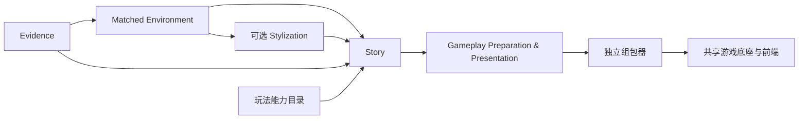
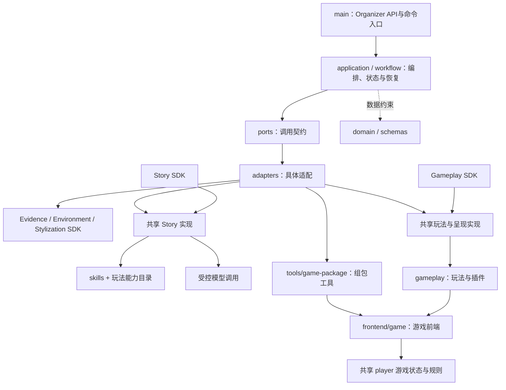

# PastPort

中文 · [English](README_EN.md)

把原始史料、已匹配的博物馆环境和空间信息，转换为可浏览、可完成任务的遗址游戏。

**当前：五个 SDK 已与本地 main 集成；真实材料的保存结果复跑、组包与 3D 通关已验证。命令行复跑不调用模型；Organizer分别提供缓存复用与明确授权后的新生成。源码通过 Git 管理；本地试玩产物不随源码发布。**

[决赛交接：wcheung、maslan 和 wehan](handoff.md#zh)

[初始申请书版本（PDF）](references/PastPort_ROOT_CODE_Application.pdf) · [申请书与比赛方向](handoff.md#初始申请书与比赛方向)

## 团队试玩交付

从[私有 GitHub Release](https://github.com/Psyche0920/PastPort/releases/tag/team-handover-2026-11-03)下载：

| 包 | 内容 |
| --- | --- |
| `wcheung.tar.gz` | 四二独立试玩《最后一段录音》，含 3D 场景、调查、线索回看和三个结局。交付记录原名 `42handover`。 |
| `maslan.tar.gz` | 主试玩《最后两袋》：沿用 `3d-test777` 的3D房间与30条穆拉迪耶资料，研究员复原虚构的1430年代账页案件；五个资料节点、四种调查玩法、三个关键选择、12种结局文本。[下载新版（maslan-demo-2026-11-05-r1）](https://github.com/Psyche0920/PastPort/releases/download/maslan-demo-2026-11-05-r1/maslan.tar.gz)；旧版独立玩家包仍在上方 Release。 |

**Maslan：穆拉迪遗址原始资料。** 文件夹内有原始 IDML、配套 `Links` 文件夹和章节 PDF。 [打开穆拉迪遗址资料文件夹](https://drive.google.com/drive/folders/18rlNGjpMhGuazgqqOUkJRDNbPEBIcTbh)

解压后进入同名目录，按 `OPEN.txt` 启动，使用支持 WebGL 的浏览器打开其中的本机地址。需要 Node.js。交付包独立于 Organizer 的本机记录。

**工作流程。** Main 和 SDK 的目标是基于素材生成可试玩、可编辑的游戏初版。团队可直接修改并试玩现有游戏包，验收后再将可复用的改进接回 Main 和 SDK。城市地图和面向公众的发布接入仍待建设和验证。详见[团队交接](handoff.md#zh)。

## 启动与使用

需要 Git、uv、Node.js 22+ 和支持 WebGL 的浏览器。以下命令用于 macOS、Linux；Windows 请使用 WSL2 的 Ubuntu 终端。在仓库根目录运行；仓库可以放在任意目录。

首次使用这台电脑：

```sh
git clone https://github.com/Psyche0920/PastPort.git
cd PastPort
uv sync --extra authoring --extra game-making
uv run python -m pastport organizer-init
```

私有仓库需要先取得 GitHub 访问权限。初始化会让你在终端输入并确认管理员密码，用户名为 `admin`。已有账号配置会被保留。首次安装需要联网下载依赖。

以后每次启动，在仓库根目录执行：

```sh
uv run python -m pastport organizer
```

打开 [Organizer 后台](http://127.0.0.1:18840/organizer/)，使用管理员账号登录。服务在当前终端前台运行，保持终端打开，按 Ctrl+C 停止。端口占用时检查已有服务；也可以用 `uv run python -m pastport organizer --port 18841`，并打开相应端口。

### Organizer：主办方入口

下载团队交付包，在「制作进度与交付」选择 `.tar.gz` 并点击「导入交付包」，再打开独立玩家预览。新电脑的历史记录从导入开始。

账号、上传、缓存和交付记录保存在当前仓库的 `var/organizer-integration/`。关闭服务后数据仍保留。换电脑时导入团队交付包或上传原始材料。账号配置和数据库包含私有数据，应单独备份。

可用 `--directory` 指定另一份本地配置目录；初始化与启动应使用同一路径。若存在 `catalog.json`，启动时自动读取；新电脑可以直接导入游戏包。需要从原始材料制作游戏时，按页面提供资料和模型授权。共享玩家资源可显式指定 `--player-assets /path/to/assets`。历史项目中登记的材料路径也需要在当前电脑可用。

已有3D上传：选择“原始 PDF + 照片 + 已有 SPZ / PLY 场景”，不勾默认资料，填写新项目编号并上传四类文件。保存后核对调用预算，再点“准备资料与环境”；后续按审核 → 故事 → 制作游戏继续。只在你明确授权后调用识别/故事模型，Marble为0。照片支持多张图片或ZIP；PLY须为二进制小端三角网格，需本机Chrome和Node.js进行取景。证据预算不足会在调用前停止；44张照片和62页PDF的首轮下限为43次，另需逐物件核验，不能用旧8次上限当整套预算。新路径的接线/模拟执行与单物件真实资料已检查，整套新材料的真实模型运行由上传测试验收。


新照片任务采用紧凑策略：每批2张，最多12个新物件、24条观察；名称、特征及解释按Schema限制长度，单批最多120秒或授权的更短时限。发现超过本批容量时报告不完整并停止，不把缺失当成功。旧策略与已付费回执保持原样，失败不自动重试；此限制已通过离线回归，尚未完成真实模型速度验收。

### 制作流程

1. **准备资料与环境**：选择下表中的材料起点。勾灰框复用整套默认资料和已有环境，零模型、零Marble调用；不勾则使用上传材料执行所选阶段，需要生成3D时单独授权Marble。完整原生3D环境不重复生成。
2. **资料与审核**：自动承接上一步。使用环境SDK的同一套VR/3D审核界面，核对照片、史料、介绍和审核状态；可在全景与3D中查看。介绍/审核共用，位置和导航各自保存。保存后自动同步当前输入，无需重复选项目或确认传递。
3. **准备故事**：旧故事先做来源、任务、玩法和空间兼容检查。通过即可复用；仅介绍发生待核对改动时需本人确认；关键依据或任务条件失效不能跳过。保存版本号变化而内容相同，不要求确认。也可明确授权SOL 6.1 Medium生成新故事，失败不自动重试。两种路径都在故事就绪后停下。
4. **制作游戏**：故事就绪后点击“开始制作”，执行玩法准备、呈现绑定、组包与资源检查；在“制作进度与交付”打开玩家预览。不会再生成环境或故事。

切换界面语言不翻译史料、介绍或故事，不保存表单或调用模型，也不丢弃未保存输入。体验目标时长是Story创作目标，不是制作耗时或精确游玩计时。

| 上传起点 | 环境阶段执行内容 | 已有成果 |
|---|---|---|
| 原始PDF + 照片（或ZIP）+ 同场景SPZ + 三角PLY | 本地导入/六向取景 → Evidence → 物件匹配挂载 | 不调用Marble；保留待审核状态与待校准状态 |
| 原始史料PDF + 现场物件照片 + 可选360°导览 | Evidence生成映射 → 环境匹配 → 3D | 缺导览时先保存映射，补导览并查看摘要后继续 |
| 原始PDF + 映射PDF + 360°导览 | 环境匹配 → 3D | 复用映射PDF |
| 原始PDF + 原生匹配VR包 | 校验导入 → 3D | 复用VR绑定、审核和导航 |
| 原始PDF + 原生已挂载双点位3D包 | 校验并导入 | 复用3D、物件、审核、位置和导航，不调用Marble |

默认选项使用已登记、同源且完整的PDF、照片、映射、VR/3D资料；后续故事仍需单独选择。跨PDF、文件变化、来源不一致或缺失时停止，不暗中换用缓存。上传包作为数据读取，不执行其中代码。**普通全景不等于已匹配VR，裸3D模型不等于已挂载环境**；新增“PDF＋照片＋SPZ/PLY”上传入口会先把裸模型转为可审核的挂载环境，再进入故事；裸模型本身仍不等于挂载完成。

### 本机保存位置

| 内容 | 当前保存位置与用途 |
|---|---|
| 制作记录与项目元数据 | `var/organizer-integration/server/organizer/organizer.sqlite3` |
| 上传、审核输入快照、故事与每次制作缓存 | `var/organizer-integration/server/organizer/`，按项目和任务隔离 |
| 可玩游戏包 | 对应任务 `jobs/<任务>/builds/<构建>/game-3d/`；以网页显示的实际路径为准 |
| 物件介绍与审核数据库 | 环境项目自己的 `pastport_matching.sqlite3`；“资料与审核”显示当前完整路径并可复制 |
| 当前默认资料登记 | `var/organizer-integration/catalog.json`，引用整套私有材料 |
| 运行与验收证据 | `var/organizer-integration/`；不随源码公开 |

游戏包是缓存里的最终成品，不是另一份完整重复缓存。关闭网页不会删除保存结果。页面显示的路径属于后台所在电脑。旧游戏包保持快照，审核变化不会即时改写已生成成品；需重新制作才能交付新版本。

### 保存结果复跑与独立试玩

维护者可用已保存故事复核并重新组包，不调用模型：

```sh
.venv/bin/pastport-game-trial --request var/runtime-layout-20261101/request-release.json
```

命令自动完成复核、玩法、呈现、组包与文件检查，不需另起组包服务。同一输入/实现可恢复；变化后采用新的输出目录，不覆盖旧输入锁或成品。该命令只复跑保存结果；新故事可从Organizer授权生成，SDK命令见各包说明。

保留的独立试玩基线为[本机3D试玩](http://127.0.0.1:18839/?scene=3d)，不等于Organizer最新任务。服务关闭时可启动：

```sh
PASTPORT_PORT=18839 node var/runtime-layout-20261101/release-run/game-3d/serve3d.mjs
```

日常使用Organizer任务自己的“打开玩家预览”，由main启动已登记的本机预览服务，无需猜构建路径。当前不是公网部署。

### 当前交付范围

历史记录按项目编号显示，已准备的项目提供“继续此项目”和“查看资料与审核”。当前项目选择按管理员身份保存在Organizer本机数据库中，刷新、重新登录和重启服务后可恢复；恢复只连接已有环境、审核和故事，不发起生成。资料审核的项目选择器保持可见。

Organizer支持单管理员登录、四种材料起点、整套默认复用、审核自动衔接、旧故事兼容检查、新故事生成、真实进度与成品入口。中英文手动切换已验证。缓存到游戏的零模型链路及已有环境的新故事有实际运行记录；逐种新材料完整调用Evidence/Marble的外部生成验收仍未全部完成。

Story新生成采用固定内容计划，由代码编译编号、状态、规则和引用；格式通过不代表故事好玩或历史内容获批。风格转绘SDK存在，但Organizer还没有新转绘操作，只能复用已有结果。User仍是现有游戏前端，本轮没有新增玩家账号或跨设备后台存档。源码是当前基线，既有wheel不自动包含后续源码修复，需要重新构建才能交付更新。

## 架构与模块



main 用现有 LangGraph、SQLite 和 typed SDK 组织执行。Story 生成前同时考虑史料、审核文字/物件、空间导航和玩法能力；下游按同一份规则落实，不能改数量或偷偷换玩法。玩法、呈现和组包当前都是本地代码，不再调用模型。

| 模块 | 当前版本 | 说明与操作 |
|---|---|---|
| Evidence | 0.1.0 | [史料提取、来源与匹配文档](packages/evidence-sdk/README.md) |
| Matched Environment | 0.1.0 | [审核内容、VR/3D、挂载与导航](packages/matched-environment-sdk/README.md) |
| Stylization | 0.1.0 | [全景和 3D 外观处理](packages/stylization-sdk/README.md) |
| Story | 0.1.0rc4 | [剧情、任务、空间及玩法意图](packages/story-sdk/README.md) |
| Gameplay Preparation & Presentation | 0.1.0rc2 | [玩法参数、生命周期和呈现绑定](packages/gameplay-sdk/README.md) |
| 共享运行时 | 0.2.1rc4 | main 与两个下游 SDK 共用，不复制引擎 |

制作端的关系是：main 调用 Story SDK 产出剧情任务，再调用玩法准备与呈现 SDK 产出配置和绑定，最后由独立组包器封装。SDK 是调用入口，部分实现由共享的 `pastport` 核心包提供。

玩家端只运行游戏包内的前端、玩法插件、JS 引擎及环境/故事数据；不运行 Python Story SDK 或玩法准备 SDK。玩法源码在 `gameplay/`，生成包目前携带完整的已登记玩法执行器，不做逐玩法代码裁剪。SDK 安装后读取随共享运行时携带的资源，不回本地源码仓库取文件。

组包器是独立共享模块，尚未单独发行 SDK。当前支持已验证的双视点、资料阅读与来源判断后的矩形覆盖玩法，不代表任意小游戏都可直接接入。

## 目录与文件用途

五个 SDK 的文件结构与用途分别在各自 README 中（见上方模块链接）。下面直接列 main 和公共文件，每行同时显示层级与用途。

### 代码之间怎么连接



**目录是代码位置，SDK 是安装边界。** Story 和 Gameplay 的包提供调用入口，实现复用 `src/pastport/`；游戏前端在 `frontend/game/`，玩法代码在 `gameplay/`，组包工具在 `tools/game-package/`，引擎权威源码在 `src/pastport/player/`。组包时按显式资源清单生成运行副本，不维护第二份引擎源码。具体接口见技术 PRD，逐文件用途见下面清单。


<!-- BEGIN FILE INVENTORY -->
## 文件结构与用途

目录和文件名称均可点击；同一行说明用途。SDK内部文件见各自README；本树列出 main 与公共维护文件。

<pre>
PastPort/
├── <a href=".github/">.github/</a>  — 开发工具约束与 GitHub 自动检查配置
│   ├── <a href=".github/workflows/">workflows/</a>  — GitHub Actions 持续集成任务
│   │   └── <a href=".github/workflows/ci.yml">ci.yml</a>  — GitHub Actions 持续集成：安装依赖并执行仓库检查与测试。
│   └── <a href=".github/copilot-instructions.md">copilot-instructions.md</a>  — Copilot 的仓库开发约束与规范入口。
├── <a href="docs/">docs/</a>  — 唯一技术 PRD：系统架构、接口和验收范围
│   ├── <a href="docs/TECHNICAL_PRD.md">TECHNICAL_PRD.md</a>  — 当前唯一技术 PRD：main/SDK 职责、架构、技术栈、输入输出及验收边界。
│   └── <a href="docs/TECHNICAL_PRD_EN.md">TECHNICAL_PRD_EN.md</a> — 同一技术规范的英文译本；架构、契约、启动方式与验收边界。
├── <a href="frontend/">frontend/</a>  — Organizer制作后台与User游戏界面的前端源码
│   ├── <a href="frontend/game/">game/</a>  — 现有User玩家界面：对话、任务、3D交互与会话；本轮不改
│   │   ├── <a href="frontend/game/app.css">app.css</a>  — 试玩主界面的布局、对话、任务和玩法样式。
│   │   ├── <a href="frontend/game/app.mjs">app.mjs</a>  — 试玩页面主控制器，连接对话、任务、插件、场景与操作。
│   │   ├── <a href="frontend/game/cinematic-view.mjs">cinematic-view.mjs</a>  — 演出式视图控制：镜头、移动输入和物件交互。
│   │   ├── <a href="frontend/game/dialogue.mjs">dialogue.mjs</a>  — Adapted from UI trial adventure.mjs speak/renderLine: one speaker, one line, Continue.
│   │   ├── <a href="frontend/game/index.html">index.html</a>  — 试玩宿主页面的 HTML 入口。
│   │   ├── <a href="frontend/game/interaction.mjs">interaction.mjs</a>  — 协调物件点击、查看与接近动作，避免交互手势冲突。
│   │   ├── <a href="frontend/game/navigation.mjs">navigation.mjs</a>  — 检查导航连接、度量空间和行走约束是否合法。
│   │   ├── <a href="frontend/game/scene3d-bridge.mjs">scene3d-bridge.mjs</a>  — Story-side interaction contract; the scene host alone owns navigation.
│   │   ├── <a href="frontend/game/scene3d-navigation.mjs">scene3d-navigation.mjs</a>  — Preserve source navigation poses; screen bearings are camera-relative UI only.
│   │   ├── <a href="frontend/game/scene3d-runtime.js">scene3d-runtime.js</a>  — 注入独立 3D 视图的运行桥接，传递导航和剧情交互，不修改上游场景文件。
│   │   ├── <a href="frontend/game/scene3d-view.mjs">scene3d-view.mjs</a>  — 3D 宿主浏览器适配器，将场景交互接入现有剧情界面。
│   │   ├── <a href="frontend/game/session.mjs">session.mjs</a>  — 管理试玩会话、状态推进及存档恢复。
│   │   └── <a href="frontend/game/walkmesh.mjs">walkmesh.mjs</a>  — Screen-independent walkability, path finding and character locomotion.
│   └── <a href="frontend/organizer/">organizer/</a>  — Organizer制作前端：认证、真实上传、登记材料复用/重新生成、执行进度与交付
│       ├── <a href="frontend/organizer/index.html">index.html</a>  — 由 main 的 /organizer/ 提供的真实制作页；需 HTTP 服务与登录。
│       ├── <a href="frontend/organizer/app.mjs">app.mjs</a>  — 按资料与环境→原审核后台→故事→最终玩法与组包编排；分别控制复用/新生成。
│       ├── <a href="frontend/organizer/i18n.mjs">i18n.mjs</a>  — Organizer中英文界面词库、手动切换和无刷新文本绑定；不翻译资料或表单内容。
│       ├── <a href="frontend/organizer/review.mjs">review.mjs</a>  — 嵌入原物件编号审核界面；处理审核保存通知、未保存状态和Story前版本确认。
│       ├── <a href="frontend/organizer/app.css">app.css</a>  — Organizer布局、响应式样式和操作状态。
│       └── <a href="frontend/organizer/sketch.html">sketch.html</a>  — Organizer交互设计源稿：四种材料起点、对应审核、复用进度与交付；尚未连接后台。
├── <a href="gameplay/">gameplay/</a>  — 玩法计划与呈现输入准备；复用插件和共享契约
│   ├── <a href="gameplay/plugins/">plugins/</a>  — 本地小游戏执行器、拼板求解与生成的玩法能力目录
│   │   ├── <a href="gameplay/plugins/coverage.mjs">coverage.mjs</a>  — 按实际拼板放置规则求解覆盖题，提前拒绝无解配置。
│   │   ├── <a href="gameplay/plugins/gameplay-catalog.mjs">gameplay-catalog.mjs</a>  — 由共享能力 JSON 生成的浏览器能力目录，勿独立修改。
│   │   └── <a href="gameplay/plugins/plugins.mjs">plugins.mjs</a>  — 本地 Activity 插件执行器，运行问答、归类、拼板等玩法并返回结果。
│   ├── <a href="gameplay/contracts.mjs">contracts.mjs</a>  — 玩法准备与组包共用的博物馆快照身份和领域错误；不依赖前端或组包编译器。
│   ├── <a href="gameplay/gameplay.mjs">gameplay.mjs</a>  — 将任务玩法声明转换为已登记插件的绑定计划并校验身份。
│   └── <a href="gameplay/prepared-game.mjs">prepared-game.mjs</a>  — 读取玩法与呈现准备产物，检查故事、物件和能力目录身份后交给宿主。
├── <a href="packages/">packages/</a>  — 五个独立 SDK；点击各包查看源码及专属 README
│   ├── <a href="packages/evidence-sdk/">evidence-sdk/</a>  — 证据 SDK：史料提取、照片观察、匹配与来源记录
│   ├── <a href="packages/gameplay-sdk/">gameplay-sdk/</a>  — 玩法准备与呈现 SDK：编译玩法配置并绑定视点、导航和界面
│   ├── <a href="packages/matched-environment-sdk/">matched-environment-sdk/</a>  — 环境 SDK：审核数据、VR/3D 挂载、导航与空间信息
│   ├── <a href="packages/story-sdk/">story-sdk/</a>  — Story SDK：根据史料、环境与玩法能力生成剧情和任务
│   └── <a href="packages/stylization-sdk/">stylization-sdk/</a>  — 转绘 SDK：保留环境结构，处理全景与三维外观
├── <a href="schemas/">schemas/</a>  — 由类型模型生成的 JSON Schema 边界契约
│   ├── <a href="schemas/action-request.schema.json">action-request.schema.json</a>  — 自动生成的 ActionRequest JSON Schema，定义边界字段、类型和约束；通过契约工具更新。
│   ├── <a href="schemas/action-result.schema.json">action-result.schema.json</a>  — 自动生成的 ActionResult JSON Schema，定义边界字段、类型和约束；通过契约工具更新。
│   ├── <a href="schemas/action-vector.schema.json">action-vector.schema.json</a>  — 自动生成的 ActionVector JSON Schema，定义边界字段、类型和约束；通过契约工具更新。
│   ├── <a href="schemas/artifact-ref.schema.json">artifact-ref.schema.json</a>  — 自动生成的 ArtifactRef JSON Schema，定义边界字段、类型和约束；通过契约工具更新。
│   ├── <a href="schemas/assembly-request.schema.json">assembly-request.schema.json</a>  — 自动生成的 AssemblyRequest JSON Schema，定义边界字段、类型和约束；通过契约工具更新。
│   ├── <a href="schemas/assembly-result.schema.json">assembly-result.schema.json</a>  — 自动生成的 AssemblyResult JSON Schema，定义边界字段、类型和约束；通过契约工具更新。
│   ├── <a href="schemas/budget-policy.schema.json">budget-policy.schema.json</a>  — 自动生成的 BudgetPolicy JSON Schema，定义边界字段、类型和约束；通过契约工具更新。
│   ├── <a href="schemas/bundle.schema.json">bundle.schema.json</a>  — 自动生成的 PackageBundle JSON Schema，定义边界字段、类型和约束；通过契约工具更新。
│   ├── <a href="schemas/discover-request.schema.json">discover-request.schema.json</a>  — 自动生成的 DiscoverRequest JSON Schema，定义边界字段、类型和约束；通过契约工具更新。
│   ├── <a href="schemas/discover-result.schema.json">discover-result.schema.json</a>  — 自动生成的 ModuleResult[CandidateSetDraft] JSON Schema，定义边界字段、类型和约束；通过契约工具更新。
│   ├── <a href="schemas/story-plan.schema.json">story-plan.schema.json</a>  — 内容计划的公开Schema，不含执行图编号、规则和状态声明。
│   ├── <a href="schemas/story-plan-result.schema.json">story-plan-result.schema.json</a>  — 固定内容计划生成结果及无法表达时的明确返回。
│   ├── <a href="schemas/draft-request.schema.json">draft-request.schema.json</a>  — 自动生成的 DraftRequest JSON Schema，定义边界字段、类型和约束；通过契约工具更新。
│   ├── <a href="schemas/draft-result.schema.json">draft-result.schema.json</a>  — 自动生成的 ModuleResult[NarrativeDraft] JSON Schema，定义边界字段、类型和约束；通过契约工具更新。
│   ├── <a href="schemas/evidence-request.schema.json">evidence-request.schema.json</a>  — 自动生成的 EvidenceRequest JSON Schema，定义边界字段、类型和约束；通过契约工具更新。
│   ├── <a href="schemas/evidence.schema.json">evidence.schema.json</a>  — 自动生成的 EvidencePackage JSON Schema，定义边界字段、类型和约束；通过契约工具更新。
│   ├── <a href="schemas/execution-metadata.schema.json">execution-metadata.schema.json</a>  — 自动生成的 ExecutionMetadata JSON Schema，定义边界字段、类型和约束；通过契约工具更新。
│   ├── <a href="schemas/game.schema.json">game.schema.json</a>  — 自动生成的 GameContent JSON Schema，定义边界字段、类型和约束；通过契约工具更新。
│   ├── <a href="schemas/index-request.schema.json">index-request.schema.json</a>  — 自动生成的 IndexRequest JSON Schema，定义边界字段、类型和约束；通过契约工具更新。
│   ├── <a href="schemas/index-result.schema.json">index-result.schema.json</a>  — 自动生成的 ModuleResult[SourceIndexDraft] JSON Schema，定义边界字段、类型和约束；通过契约工具更新。
│   ├── <a href="schemas/inventory-request.schema.json">inventory-request.schema.json</a>  — 自动生成的 InventoryRequest JSON Schema，定义边界字段、类型和约束；通过契约工具更新。
│   ├── <a href="schemas/inventory-result.schema.json">inventory-result.schema.json</a>  — 自动生成的 ModuleResult[SourceManifestDraft] JSON Schema，定义边界字段、类型和约束；通过契约工具更新。
│   ├── <a href="schemas/narrative.schema.json">narrative.schema.json</a>  — 自动生成的 NarrativePackage JSON Schema，定义边界字段、类型和约束；通过契约工具更新。
│   ├── <a href="schemas/node-result.schema.json">node-result.schema.json</a>  — 自动生成的 NodeResult JSON Schema，定义边界字段、类型和约束；通过契约工具更新。
│   ├── <a href="schemas/player-state.schema.json">player-state.schema.json</a>  — 自动生成的 PlayerState JSON Schema，定义边界字段、类型和约束；通过契约工具更新。
│   ├── <a href="schemas/research-request.schema.json">research-request.schema.json</a>  — 自动生成的 ResearchRequest JSON Schema，定义边界字段、类型和约束；通过契约工具更新。
│   ├── <a href="schemas/research-result.schema.json">research-result.schema.json</a>  — 自动生成的 ModuleResult[EvidenceFindings] JSON Schema，定义边界字段、类型和约束；通过契约工具更新。
│   ├── <a href="schemas/review-decision.schema.json">review-decision.schema.json</a>  — 自动生成的 ReviewDecision JSON Schema，定义边界字段、类型和约束；通过契约工具更新。
│   ├── <a href="schemas/review-request.schema.json">review-request.schema.json</a>  — 自动生成的 NarrativeReviewRequest JSON Schema，定义边界字段、类型和约束；通过契约工具更新。
│   ├── <a href="schemas/review-result.schema.json">review-result.schema.json</a>  — 自动生成的 ModuleResult[NarrativeReview] JSON Schema，定义边界字段、类型和约束；通过契约工具更新。
│   ├── <a href="schemas/revise-request.schema.json">revise-request.schema.json</a>  — 自动生成的 ReviseRequest JSON Schema，定义边界字段、类型和约束；通过契约工具更新。
│   ├── <a href="schemas/revise-result.schema.json">revise-result.schema.json</a>  — 自动生成的 ModuleResult[NarrativeDraft] JSON Schema，定义边界字段、类型和约束；通过契约工具更新。
│   ├── <a href="schemas/route.schema.json">route.schema.json</a>  — 自动生成的 RouteRecord JSON Schema，定义边界字段、类型和约束；通过契约工具更新。
│   ├── <a href="schemas/runtime-capabilities.schema.json">runtime-capabilities.schema.json</a>  — 自动生成的 RuntimeCapabilities JSON Schema，定义边界字段、类型和约束；通过契约工具更新。
│   ├── <a href="schemas/runtime.schema.json">runtime.schema.json</a>  — 自动生成的 RuntimePackage JSON Schema，定义边界字段、类型和约束；通过契约工具更新。
│   ├── <a href="schemas/skill-result.schema.json">skill-result.schema.json</a>  — 自动生成的 SkillResult[NarrativeDraft] JSON Schema，定义边界字段、类型和约束；通过契约工具更新。
│   ├── <a href="schemas/source-locator.schema.json">source-locator.schema.json</a>  — 自动生成的 SourceLocator JSON Schema，定义边界字段、类型和约束；通过契约工具更新。
│   ├── <a href="schemas/tool-request.schema.json">tool-request.schema.json</a>  — 自动生成的 ToolRequest JSON Schema，定义边界字段、类型和约束；通过契约工具更新。
│   ├── <a href="schemas/validation-report.schema.json">validation-report.schema.json</a>  — 自动生成的 ValidationReport JSON Schema，定义边界字段、类型和约束；通过契约工具更新。
│   ├── <a href="schemas/validation-request.schema.json">validation-request.schema.json</a>  — 自动生成的 PackageValidationRequest JSON Schema，定义边界字段、类型和约束；通过契约工具更新。
│   └── <a href="schemas/workflow-state.schema.json">workflow-state.schema.json</a>  — 自动生成的 WorkflowState JSON Schema，定义边界字段、类型和约束；通过契约工具更新。
├── <a href="skills/">skills/</a>  — 随共享运行时携带的工作流规则源文件
│   ├── <a href="skills/evidence-review/">evidence-review/</a>  — 证据核对与研究规则
│   │   ├── <a href="skills/evidence-review/references/">references/</a>  — 证据审核的判定示例
│   │   │   └── <a href="skills/evidence-review/references/review-examples.md">review-examples.md</a>  — 证据审查规则的示例与判定参考。
│   │   └── <a href="skills/evidence-review/SKILL.md">SKILL.md</a>  — main 证据审查/研究工作流规则：出处、核实状态和证据边界。
│   ├── <a href="skills/gameplay-preparation/">gameplay-preparation/</a>  — 玩法匹配、配置和呈现准备规则
│   │   └── <a href="skills/gameplay-preparation/SKILL.md">SKILL.md</a>  — 玩法准备工作规范：匹配、配置、验证、空间及呈现职责边界。
│   └── <a href="skills/narrative/">narrative/</a>  — 剧情与任务设计规则
│       ├── <a href="skills/narrative/references/">references/</a>  — 叙事设计质量校准参考
│       │   └── <a href="skills/narrative/references/design-calibration.md">design-calibration.md</a>  — 叙事设计校准参考，帮助检查任务意义、因果与表现质量。
│       └── <a href="skills/narrative/SKILL.md">SKILL.md</a>  — Story 生成约束：史料、映射、空间、玩法能力与故事任务输出。
├── <a href="src/">src/</a>  — 主项目与下游 SDK 共用的 Python 源码
│   └── <a href="src/pastport/">pastport/</a>  — 共享运行时：服务、编排、业务用例和游戏规则
│       ├── <a href="src/pastport/adapters/">adapters/</a>  — 具体实现与外部接线：模型、数据库、文件或 SDK
│       │   ├── <a href="src/pastport/adapters/organizer_processes.py">organizer_processes.py</a>  — 持有并关闭原生SDK子进程组；超时不自动重发。
│       │   ├── <a href="src/pastport/adapters/organizer_archives.py">organizer_archives.py</a>  — 有界解包、文件哈希、SQLite快照检查及隔离的轻量资源快照；上传程序不执行。
│       │   ├── <a href="src/pastport/adapters/organizer_native.py">organizer_native.py</a>  — 四种原生上传起点的SDK调用、共享审核保留、空间与史料输入导出。
│       │   ├── <a href="src/pastport/adapters/organizer_review.py">organizer_review.py</a>  — 复用环境SDK同源审核库、原审核页面、版本化编辑和本机新输入导出。
│       │   ├── <a href="src/pastport/adapters/organizer_review_environment.py">organizer_review_environment.py</a>  — 当前SDK的VR/3D环境查看、独立位置与导航编辑资源接线。
│       │   ├── <a href="src/pastport/adapters/passwords.py">passwords.py</a>  — 管理员密码的加盐派生、校验和安全格式检查。
│       │   ├── <a href="src/pastport/adapters/organizer_previews.py">organizer_previews.py</a>  — 拥有并关闭本机3D预览进程，分配监听端口与独立预览会话。
│       │   ├── <a href="src/pastport/adapters/organizer_store.py">organizer_store.py</a>  — Organizer项目和制作记录的SQLite持久化、连接释放及服务互斥。
│       │   ├── <a href="src/pastport/adapters/organizer_production.py">organizer_production.py</a>  — 已登记环境的 Story 新生成与缓存复跑，复用原有预算和组包链。
│       │   ├── <a href="src/pastport/adapters/__init__.py">__init__.py</a>  — PastPort service components.
│       │   ├── <a href="src/pastport/adapters/assembly.py">assembly.py</a>  — Build media manifests from reviewed asset identities; never from a prebuilt runtime template.
│       │   ├── <a href="src/pastport/adapters/codex_provider.py">codex_provider.py</a>  — Story-only model transport using the official SDK and saved ChatGPT login.
│       │   ├── <a href="src/pastport/adapters/codex_traces.py">codex_traces.py</a>  — Private local invocation evidence, separate from authoritative budget settlement.
│       │   ├── <a href="src/pastport/adapters/content.py">content.py</a>  — Offline adapters for explicitly supplied authored content; no model generation is implied.
│       │   ├── <a href="src/pastport/adapters/database.py">database.py</a>  — Short SQLite transactions with optimistic revisions and durable command consumption.
│       │   ├── <a href="src/pastport/adapters/environment_spatial.py">environment_spatial.py</a>  — Read explicitly registered SDK worlds into Story&#x27;s typed spatial input.
│       │   ├── <a href="src/pastport/adapters/game_making.py">game_making.py</a>  — Compose installed SDK entry points; preserve existing museum assets and Story.
│       │   ├── <a href="src/pastport/adapters/gameplay_catalog.py">gameplay_catalog.py</a>  — Load the one packaged capability catalog; malformed catalogs cannot authorize games.
│       │   ├── <a href="src/pastport/adapters/gameplay_verifier.py">gameplay_verifier.py</a>  — Verify only the registered local Demo Activity using a fixed Node runner.
│       │   ├── <a href="src/pastport/adapters/matched_environment.py">matched_environment.py</a>  — Read one registered native environment without running uploaded code or changing reviews.
│       │   ├── <a href="src/pastport/adapters/model_narrative.py">model_narrative.py</a>  — Story Agent adapter backed by the shared, metered model gateway.
│       │   ├── <a href="src/pastport/adapters/model_provider.py">model_provider.py</a>  — Bounded Responses HTTP adapter and explicit deterministic test provider.
│       │   ├── <a href="src/pastport/adapters/package_files.py">package_files.py</a>  — Read regular local package files without following a file symlink or blocking on a pipe.
│       │   ├── <a href="src/pastport/adapters/pdf_text.py">pdf_text.py</a>  — Optional pypdf extraction in a disposable process with explicit resource limits.
│       │   ├── <a href="src/pastport/adapters/player_process.py">player_process.py</a>  — Bounded Node transport for the shared browser/headless preparation components.
│       │   ├── <a href="src/pastport/adapters/player_saves.py">player_saves.py</a>  — Durable, version-checked SQLite saves with one transaction for state and receipts.
│       │   ├── <a href="src/pastport/adapters/previews.py">previews.py</a>  — Private SQLite preview metadata and atomic player state, outside release storage.
│       │   ├── <a href="src/pastport/adapters/resources.py">resources.py</a>  — Explicit local asset catalog and source URI adapter, bounded to one configured directory.
│       │   ├── <a href="src/pastport/adapters/runtime_resources.py">runtime_resources.py</a>  — Resolve the single shared host distribution without requiring a checkout.
│       │   ├── <a href="src/pastport/adapters/skills.py">skills.py</a>  — Read only server-approved Skill paths and fingerprint every included file.
│       │   ├── <a href="src/pastport/adapters/story_3d.py">story_3d.py</a>  — Join approved shared assembly to the separately versioned local 3D delivery bridge.
│       │   ├── <a href="src/pastport/adapters/story_reuse.py">story_reuse.py</a>  — 旧故事依赖检查与独立复用记录；不调用模型、不覆盖父故事。
│       │   ├── <a href="src/pastport/adapters/story_materials.py">story_materials.py</a>  — Normalize explicitly registered upstream exports without regenerating matches.
│       │   └── <a href="src/pastport/adapters/story_workflow.py">story_workflow.py</a>  — Run the existing metered editorial graph up to its Story output boundary.
│       ├── <a href="src/pastport/api/">api/</a>  — HTTP API、服务配置与工作台资源
│       │   ├── <a href="src/pastport/api/organizer.py">organizer.py</a>  — 沿用main账户的制作HTTP接口、真实上传、进度、恢复与预览接线。
│       │   ├── <a href="src/pastport/api/organizer_accounts.py">organizer_accounts.py</a>  — 单管理员账号密码登录、既有角色范围与一次性本机初始化。
│       │   ├── <a href="src/pastport/api/__init__.py">__init__.py</a>  — PastPort service components.
│       │   ├── <a href="src/pastport/api/api-client.mjs">api-client.mjs</a>  — Stable operation identities. Rendering and automatic retry policy belong to the view controller.
│       │   ├── <a href="src/pastport/api/app.py">app.py</a>  — Local authenticated editorial API with strict JSON transport and a durable background worker.
│       │   ├── <a href="src/pastport/api/player-view.mjs">player-view.mjs</a>  — 后台玩家组件视图：渲染状态并提交玩家操作。
│       │   ├── <a href="src/pastport/api/private_views.py">private_views.py</a>  — Private content routes; all bytes resolve through server-selected package/source identities.
│       │   ├── <a href="src/pastport/api/request_logging.py">request_logging.py</a>  — Request correlation without retaining URLs, bodies, headers or client identities.
│       │   ├── <a href="src/pastport/api/settings.py">settings.py</a>  — Server-side accounts and explicit test configuration.
│       │   ├── <a href="src/pastport/api/transport.py">transport.py</a>  — Bounded strict JSON request parsing shared by authenticated routes.
│       │   ├── <a href="src/pastport/api/views.mjs">views.mjs</a>  — Safe DOM helpers; package and source text is never executable markup.
│       │   ├── <a href="src/pastport/api/workbench.css">workbench.css</a>  — 审核工作台页面布局与样式。
│       │   ├── <a href="src/pastport/api/workbench.html">workbench.html</a>  — 审核工作台页面结构与控件容器。
│       │   └── <a href="src/pastport/api/workbench.mjs">workbench.mjs</a>  — 审核工作台浏览器控制器，连接后端接口与页面操作。
│       ├── <a href="src/pastport/application/">application/</a>  — 业务用例与执行流程
│       │   ├── <a href="src/pastport/application/source_lineage.py">source_lineage.py</a>  — 区分原史料与映射PDF，保留引用来源并处理缺失和歧义。
│       │   ├── <a href="src/pastport/application/organizer_cache.py">organizer_cache.py</a>  — 完整同源缓存包的逐文件哈希和跨阶段来源核对，禁止将不同PDF结果设为默认。
│       │   ├── <a href="src/pastport/application/organizer.py">organizer.py</a>  — 制作请求去重、输入指纹、项目权限、两种执行方式及中断恢复。
│       │   ├── <a href="src/pastport/application/__init__.py">__init__.py</a>  — PastPort service components.
│       │   ├── <a href="src/pastport/application/activity.py">activity.py</a>  — Meter automatic workflow wall time once, excluding human and queue waiting.
│       │   ├── <a href="src/pastport/application/change_impact.py">change_impact.py</a>  — Version-bound mechanical comparison; uncertainty never grants human approval.
│       │   ├── <a href="src/pastport/application/environment_inputs.py">environment_inputs.py</a>  — Validate existing execution authority around explicitly injected local input reads.
│       │   ├── <a href="src/pastport/application/execution_guard.py">execution_guard.py</a>  — Validate persisted server grants before any shared child operation.
│       │   ├── <a href="src/pastport/application/execution_models.py">execution_models.py</a>  — Pinned execution configuration and durable receipts, independent of provider SDKs.
│       │   ├── <a href="src/pastport/application/execution_runtime.py">execution_runtime.py</a>  — Composition root for grants, provider configuration and services given to module factories.
│       │   ├── <a href="src/pastport/application/game_making.py">game_making.py</a>  — Checkpointed Main orchestration; SDKs retain their own internal execution authority.
│       │   ├── <a href="src/pastport/application/gameplay_preparation.py">gameplay_preparation.py</a>  — Derive supported source-reading mechanics without rewriting authored task meaning.
│       │   ├── <a href="src/pastport/application/model_gateway.py">model_gateway.py</a>  — Account for a bounded model call before validating or returning its typed output.
│       │   ├── <a href="src/pastport/application/models.py">models.py</a>  — Application records use clear names and reuse the frozen shared contracts.
│       │   ├── <a href="src/pastport/application/module_selection.py">module_selection.py</a>  — Explicit composition choices; injected implementations never silently fall back.
│       │   ├── <a href="src/pastport/application/narrative_rules.py">narrative_rules.py</a>  — Compile explicit story choice bindings into the existing deterministic rule engine.
│       │   ├── <a href="src/pastport/application/narrative_state.py">narrative_state.py</a>  — Reconcile closed native Story state without inventing initial values or outcomes.
│       │   ├── <a href="src/pastport/application/operational_service.py">operational_service.py</a>  — Human interventions preserve spending facts, review history and execution limits.
│       │   ├── <a href="src/pastport/application/operations.py">operations.py</a>  — Authenticated intervention commands and immutable audit records.
│       │   ├── <a href="src/pastport/application/package_loader.py">package_loader.py</a>  — Load a runtime package against trusted identity and explicit consumer capabilities.
│       │   ├── <a href="src/pastport/application/player_components.py">player_components.py</a>  — Bind shared JS preparation components to a trusted runtime package and release.
│       │   ├── <a href="src/pastport/application/player_preparation.py">player_preparation.py</a>  — Typed preparation protocol, separate from committed player actions and saves.
│       │   ├── <a href="src/pastport/application/player_runtime.py">player_runtime.py</a>  — Trusted shared-JS runtime contracts and the implementation of PlayerRuntimePort.
│       │   ├── <a href="src/pastport/application/player_service.py">player_service.py</a>  — Saved player sessions; JS owns gameplay and the repository owns atomic durability.
│       │   ├── <a href="src/pastport/application/preview_normalization.py">preview_normalization.py</a>  — Mechanical repairs for explicitly authorized internal-preview model output.
│       │   ├── <a href="src/pastport/application/preview_service.py">preview_service.py</a>  — Preview-only assembly and sessions; no review or release mutations occur here.
│       │   ├── <a href="src/pastport/application/previews.py">previews.py</a>  — Typed private preview boundaries, independent of approval and publication.
│       │   ├── <a href="src/pastport/application/publication.py">publication.py</a>  — Stage durable immutable files, then atomically publish their recorded identity.
│       │   ├── <a href="src/pastport/application/reliability.py">reliability.py</a>  — Typed authority, accounting and release records shared by local service boundaries.
│       │   ├── <a href="src/pastport/application/research_execution.py">research_execution.py</a>  — One bounded research role: durable steps, no tool-invented permissions or new questions.
│       │   ├── <a href="src/pastport/application/resources.py">resources.py</a>  — Enforce identity, size and raw-byte hashes for all injected resource readers.
│       │   ├── <a href="src/pastport/application/routing.py">routing.py</a>  — Application-owned legal routes and cumulative research/revision limits.
│       │   ├── <a href="src/pastport/application/service.py">service.py</a>  — Application operations enforce identity, review authority and optimistic versions.
│       │   ├── <a href="src/pastport/application/source_tools.py">source_tools.py</a>  — Registered-source reading and deterministic local tools, bounded by frozen questions.
│       │   ├── <a href="src/pastport/application/source_views.py">source_views.py</a>  — Read registered source bytes and saved extraction records without research/model calls.
│       │   ├── <a href="src/pastport/application/story_compiler.py">story_compiler.py</a>  — 将内容计划编译为任务、规则、状态、语言键与一致的下游引用。
│       │   ├── <a href="src/pastport/application/story_plan_schema.py">story_plan_schema.py</a>  — 生成前将内容选择限制到已登记的物件和史料。
│       │   ├── <a href="src/pastport/application/story_authoring.py">story_authoring.py</a>  — Story-only checks and readable export; no plugin, frontend or assembly work.
│       │   ├── <a href="src/pastport/application/story_reference_contract.py">story_reference_contract.py</a>  — 从已锁定Evidence编译模型可选引用键，限制内部ID重复填写并校验返回值。
│       │   ├── <a href="src/pastport/application/story_editing.py">story_editing.py</a>  — Stable game field locks and declared targets, shared by manual and module revisions.
│       │   ├── <a href="src/pastport/application/task_copy.py">task_copy.py</a>  — Reject repeated inventory counts that contradict the canonical task requirements.
│       │   ├── <a href="src/pastport/application/updates.py">updates.py</a>  — Revalidate immutable records rather than bypassing their boundary validators.
│       │   └── <a href="src/pastport/application/workflow_control.py">workflow_control.py</a>  — Durable control manifests; module suggestions cannot grant approval or reset limits.
│       ├── <a href="src/pastport/data/">data/</a>  — 共享运行时携带的数据与玩法能力目录
│       │   └── <a href="src/pastport/data/gameplay-capabilities.json">gameplay-capabilities.json</a>  — 共享玩法能力目录；Story 创作约束、玩法编译和宿主校验使用同源能力声明。
│       ├── <a href="src/pastport/development/">development/</a>  — 开发用离线、故障、浏览器和模块验收工具
│       │   ├── <a href="src/pastport/development/__init__.py">__init__.py</a>  — Offline development tools; never production module fallbacks.
│       │   ├── <a href="src/pastport/development/acceptance_models.py">acceptance_models.py</a>  — Versioned development reports, separate from shared content and runtime contracts.
│       │   ├── <a href="src/pastport/development/acceptance_scenario.py">acceptance_scenario.py</a>  — Authenticated test-only workflow scenario for interchangeable offline ports.
│       │   ├── <a href="src/pastport/development/browser_check.py">browser_check.py</a>  — Run real-browser acceptance against a fresh synthetic localhost service.
│       │   ├── <a href="src/pastport/development/browser_fixture.py">browser_fixture.py</a>  — Dedicated synthetic localhost server for browser acceptance, never production data.
│       │   ├── <a href="src/pastport/development/fault_acceptance.py">fault_acceptance.py</a>  — Run fixed F9 fault gates and retain a safe, version-bound local test report.
│       │   ├── <a href="src/pastport/development/module_acceptance.py">module_acceptance.py</a>  — Run the offline F9 acceptance kit with replaceable trusted local factories.
│       │   ├── <a href="src/pastport/development/module_check.py">module_check.py</a>  — Run independent module smoke checks without an API, database or workflow worker.
│       │   ├── <a href="src/pastport/development/player_check.py">player_check.py</a>  — Run F7 shared-JS conformance and report actual full action-vector results.
│       │   ├── <a href="src/pastport/development/player_contracts.py">player_contracts.py</a>  — Export TypeScript declarations and the JSON schemas used by player components.
│       │   └── <a href="src/pastport/development/reference_modules.py">reference_modules.py</a>  — Independent, request-bound synthetic ports for the offline acceptance kit.
│       ├── <a href="src/pastport/domain/">domain/</a>  — 领域模型、身份及数据约束
│       │   ├── <a href="src/pastport/domain/organizer_inputs.py">organizer_inputs.py</a>  — 上传输入、有限授权、阶段结果及准备环境的不可变数据契约。
│       │   ├── <a href="src/pastport/domain/organizer_review.py">organizer_review.py</a>  — 审核资料、来源绑定、版本化修改和确认输入的不可变契约。
│       │   ├── <a href="src/pastport/domain/organizer.py">organizer.py</a>  — 项目材料、缓存目录、执行请求、状态和四起点计划的不可变契约。
│       │   ├── <a href="src/pastport/domain/__init__.py">__init__.py</a>  — Framework-independent domain contracts.
│       │   ├── <a href="src/pastport/domain/capabilities.py">capabilities.py</a>  — Explicit capabilities for the existing contract profile, independent of sample content.
│       │   ├── <a href="src/pastport/domain/common.py">common.py</a>  — Immutable wire contracts and content identity; no framework or provider imports.
│       │   ├── <a href="src/pastport/domain/evidence.py">evidence.py</a>  — Evidence candidates and snapshots; validation never grants human approval.
│       │   ├── <a href="src/pastport/domain/game.py">game.py</a>  — Bounded, declarative game data. This module does not interpret actions.
│       │   ├── <a href="src/pastport/domain/game_making.py">game_making.py</a>  — Private game-production inputs, with explicit reuse rather than implied generation.
│       │   ├── <a href="src/pastport/domain/gameplay_preparation.py">gameplay_preparation.py</a>  — Gameplay preparation outputs are plans, never committed Story state or UI code.
│       │   ├── <a href="src/pastport/domain/mechanics.py">mechanics.py</a>  — Shared task requirements and capability limits, independent of plugin implementations.
│       │   ├── <a href="src/pastport/domain/story_reuse.py">story_reuse.py</a>  — 兼容检查结论、任务冲突及父故事和当前环境的版本凭据。
│       │   ├── <a href="src/pastport/domain/story_plan.py">story_plan.py</a>  — 模型只写剧情、任务与选择后果的固定结构，不允许自写执行规则。
│       │   ├── <a href="src/pastport/domain/modules.py">modules.py</a>  — Typed module messages for independent implementation against contract 0.1.0.
│       │   ├── <a href="src/pastport/domain/narrative_repair.py">narrative_repair.py</a>  — Small narrative-state patches that leave authored prose and evidence untouched.
│       │   ├── <a href="src/pastport/domain/package_loading.py">package_loading.py</a>  — Safe, stable failures for package consumers, independent of HTTP or storage.
│       │   ├── <a href="src/pastport/domain/packages.py">packages.py</a>  — Cross-package contract checking, distinct from authorisation and runtime execution.
│       │   ├── <a href="src/pastport/domain/player_saves.py">player_saves.py</a>  — Player save ownership and immutable persistence identities.
│       │   ├── <a href="src/pastport/domain/resources.py">resources.py</a>  — Resource identities and local registrations, independent of provider or filesystem APIs.
│       │   ├── <a href="src/pastport/domain/story_inputs.py">story_inputs.py</a>  — Read-only, source-bound authoring input; not a new game wire or approval grant.
│       │   └── <a href="src/pastport/domain/workflow.py">workflow.py</a>  — Workflow messages express intent and observations, never authentication proof.
│       ├── <a href="src/pastport/player/">player/</a>  — 共享 JavaScript 游戏状态、规则与动作运行时
│       │   ├── <a href="src/pastport/player/__init__.py">__init__.py</a>  — Shared browser/Node player engine, atomic action semantics and conformance utilities.
│       │   ├── <a href="src/pastport/player/actions.mjs">actions.mjs</a>  — 处理玩家动作，检查前置条件并生成状态变化与回执。
│       │   ├── <a href="src/pastport/player/context.mjs">context.mjs</a>  — 建立游戏包对应的玩家上下文，校验身份、能力和规则。
│       │   ├── <a href="src/pastport/player/contracts.d.ts">contracts.d.ts</a>  — 由 Python 玩家契约生成的 TypeScript 类型声明。
│       │   ├── <a href="src/pastport/player/errors.mjs">errors.mjs</a>  — Safe operational errors never include source text, arbitrary keys or file paths.
│       │   ├── <a href="src/pastport/player/generated-schemas.mjs">generated-schemas.mjs</a>  — 由 Python 契约生成的玩家边界 Schema；应通过生成工具更新。
│       │   ├── <a href="src/pastport/player/preparation.d.mts">preparation.d.mts</a>  — 玩家组件准备接口的 TypeScript 类型声明。
│       │   ├── <a href="src/pastport/player/preparation.mjs">preparation.mjs</a>  — 将已验证游戏包准备为共享玩家组件上下文。
│       │   ├── <a href="src/pastport/player/rules.mjs">rules.mjs</a>  — 执行条件判断、规则匹配和效果计算。
│       │   ├── <a href="src/pastport/player/runner.mjs">runner.mjs</a>  — Node JSON 协议入口，供 Python 调用共享玩家运行时。
│       │   ├── <a href="src/pastport/player/runtime.d.mts">runtime.d.mts</a>  — 玩家动作运行接口的 TypeScript 类型声明。
│       │   ├── <a href="src/pastport/player/runtime.mjs">runtime.mjs</a>  — 共享游戏状态引擎，按动作推进状态并返回结果。
│       │   ├── <a href="src/pastport/player/validation.mjs">validation.mjs</a>  — Schema 校验、规范化序列化、内容哈希和集合一致性工具。
│       │   └── <a href="src/pastport/player/vectors.mjs">vectors.mjs</a>  — 执行玩家动作一致性测试向量。
│       ├── <a href="src/pastport/ports/">ports/</a>  — 业务依赖的 Protocol 接口契约
│       │   ├── <a href="src/pastport/ports/organizer_inputs.py">organizer_inputs.py</a>  — 可替换的原生材料准备与用量读取边界。
│       │   ├── <a href="src/pastport/ports/story_reuse.py">story_reuse.py</a>  — 主流程与旧故事兼容实现之间的类型化调用契约。
│       │   ├── <a href="src/pastport/ports/organizer_review.py">organizer_review.py</a>  — 可替换审核读取、写入、原界面和新环境导出接口。
│       │   ├── <a href="src/pastport/ports/organizer.py">organizer.py</a>  — 可替换的制作执行与元数据持久化边界。
│       │   ├── <a href="src/pastport/ports/__init__.py">__init__.py</a>  — Dependency-injected module boundaries.
│       │   ├── <a href="src/pastport/ports/editorial.py">editorial.py</a>  — Storage and content boundaries for application services and the workflow.
│       │   ├── <a href="src/pastport/ports/execution.py">execution.py</a>  — Shared services supplied to independently constructed content modules.
│       │   ├── <a href="src/pastport/ports/game_making.py">game_making.py</a>  — Production-stage boundary; domain/application do not depend on SDK facades.
│       │   ├── <a href="src/pastport/ports/gameplay_preparation.py">gameplay_preparation.py</a>  — A local plugin verifier cannot approve Story, geometry or global task completion.
│       │   ├── <a href="src/pastport/ports/modules.py">modules.py</a>  — Process-local boundaries. No SDK, database, retry loop or fake success lives here.
│       │   ├── <a href="src/pastport/ports/package_files.py">package_files.py</a>  — Bounded file input for runtime package loading.
│       │   ├── <a href="src/pastport/ports/player_preparation.py">player_preparation.py</a>  — A typed process boundary; engine rules remain in the shared JavaScript implementation.
│       │   ├── <a href="src/pastport/ports/player_saves.py">player_saves.py</a>  — Atomic player persistence, separate from the authoritative editorial review database.
│       │   ├── <a href="src/pastport/ports/resources.py">resources.py</a>  — A provider-independent resource boundary; implementations enforce their own storage scope.
│       │   ├── <a href="src/pastport/ports/source_text.py">source_text.py</a>  — Optional text extraction over already verified registered-source bytes.
│       │   └── <a href="src/pastport/ports/story_inputs.py">story_inputs.py</a>  — Explicit read-only input injection; neither generation nor review mutation.
│       ├── <a href="src/pastport/workflow/">workflow/</a>  — 工作流节点、阶段路由与恢复
│       │   ├── <a href="src/pastport/workflow/__init__.py">__init__.py</a>  — PastPort service components.
│       │   ├── <a href="src/pastport/workflow/branching.py">branching.py</a>  — Bounded research, revision and professional review within the existing graph nodes.
│       │   ├── <a href="src/pastport/workflow/stages.py">stages.py</a>  — Persist each stage result before graph checkpointing; human gates query business records.
│       │   └── <a href="src/pastport/workflow/worker.py">worker.py</a>  — One durable local graph executor. Business records remain the authority at human gates.
│       ├── <a href="src/pastport/__init__.py">__init__.py</a>  — PastPort shared contracts.
│       ├── <a href="src/pastport/__main__.py">__main__.py</a>  — Start one authenticated local editorial service.
│       ├── <a href="src/pastport/account_cli.py">account_cli.py</a>  — 可选管理员密码维护命令；普通工作人员仍在网页登录。
│       ├── <a href="src/pastport/contracts.py">contracts.py</a>  — Public schema registry; versions and wire names are part of the compatibility contract.
│       ├── <a href="src/pastport/game_trial_cli.py">game_trial_cli.py</a>  — Run Main&#x27;s provider-disabled paired-SDK integration from one explicit manifest.
│       ├── <a href="src/pastport/gameplay_cli.py">gameplay_cli.py</a>  — Prepare supported gameplay from a locked Story run, without model or build calls.
│       ├── <a href="src/pastport/observability.py">observability.py</a>  — Application-owned JSON diagnostics; never a business audit or payload dump.
│       ├── <a href="src/pastport/py.typed">py.typed</a>  — PEP 561 类型标记，让安装方的类型检查器识别本包类型。
│       └── <a href="src/pastport/story_cli.py">story_cli.py</a>  — Run Story authoring only, using explicitly selected upstream outputs.
├── <a href="tests/">tests/</a>  — main 的自动回归测试与测试夹具
│   ├── <a href="tests/test_source_lineage.py">test_source_lineage.py</a>  — 原史料页码投射、引用歧义与同源OCR缺页保留检查。
│   ├── <a href="tests/test_organizer_inputs.py">test_organizer_inputs.py</a>  — 四起点HTTP及SDK路由、补材料恢复和不可信归档回归。
│   ├── <a href="tests/test_organizer_previews.py">test_organizer_previews.py</a>  — 真实Node预览的会话隔离、监听继承与资源关闭检查。
│   ├── <a href="tests/test_organizer_cache.py">test_organizer_cache.py</a>  — 完整缓存、防跨PDF混用、单文件变化及默认项完整性回归。
│   ├── <a href="tests/test_organizer.py">test_organizer.py</a>  — 制作API的权限、输入、缓存/新生成、去重与恢复测试。
│   ├── <a href="tests/test_organizer_i18n.mjs">test_organizer_i18n.mjs</a>  — 中英文手动切换、动态状态和原始资料保护检查。
│   ├── <a href="tests/test_organizer_review.py">test_organizer_review.py</a>  — 原审核页面接线、权限、版本冲突、审核历史和Story前确认回归。
│   ├── <a href="tests/test_organizer_accounts.py">test_organizer_accounts.py</a>  — 管理员账号密码、既有权限和会话安全回归。
│   ├── <a href="tests/browser/">browser/</a>  — 浏览器工作台交互测试
│   │   └── <a href="tests/browser/workbench.test.mjs">workbench.test.mjs</a>  — 工作台浏览器交互的自动回归测试。
│   ├── <a href="tests/fixtures/">fixtures/</a>  — 自动测试专用输入与预期数据
│   │   ├── <a href="tests/fixtures/game/">game/</a>  — 旧故事与空间目标的测试样例；不参与正式游戏构建
│   │   │   ├── <a href="tests/fixtures/game/content.mjs">content.mjs</a>  — Authored story and presentation data. All personal incidents are fictional.
│   │   │   └── <a href="tests/fixtures/game/shots.mjs">shots.mjs</a>  — Per-object staging data; floor masks are game presentation, not surveyed geometry.
│   │   └── <a href="tests/fixtures/reference/">reference/</a>  — Schema、工作流及玩家状态的合成参考样例
│   │       ├── <a href="tests/fixtures/reference/action-request.json">action-request.json</a>  — 玩家动作请求的测试夹具；用于契约及行为验证，不是正式项目数据。
│   │       ├── <a href="tests/fixtures/reference/assembly-request.json">assembly-request.json</a>  — 游戏装配请求的测试夹具；用于契约及行为验证，不是正式项目数据。
│   │       ├── <a href="tests/fixtures/reference/assembly-result.json">assembly-result.json</a>  — 游戏装配结果的测试夹具；用于契约及行为验证，不是正式项目数据。
│   │       ├── <a href="tests/fixtures/reference/budget-policy.json">budget-policy.json</a>  — 执行预算策略的测试夹具；用于契约及行为验证，不是正式项目数据。
│   │       ├── <a href="tests/fixtures/reference/bundle.json">bundle.json</a>  — 内容 bundle 与路线引用的测试夹具；用于契约及行为验证，不是正式项目数据。
│   │       ├── <a href="tests/fixtures/reference/conflict-runtime.json">conflict-runtime.json</a>  — 含规则效果冲突的运行包的测试夹具；用于契约及行为验证，不是正式项目数据。
│   │       ├── <a href="tests/fixtures/reference/discover-request.json">discover-request.json</a>  — 候选发现请求的测试夹具；用于契约及行为验证，不是正式项目数据。
│   │       ├── <a href="tests/fixtures/reference/discover-result.json">discover-result.json</a>  — 候选发现结果的测试夹具；用于契约及行为验证，不是正式项目数据。
│   │       ├── <a href="tests/fixtures/reference/draft-request.json">draft-request.json</a>  — 正式故事草稿请求的测试夹具；用于契约及行为验证，不是正式项目数据。
│   │       ├── <a href="tests/fixtures/reference/draft-result.json">draft-result.json</a>  — 正式故事草稿结果的测试夹具；用于契约及行为验证，不是正式项目数据。
│   │       ├── <a href="tests/fixtures/reference/evidence.json">evidence.json</a>  — 证据包的测试夹具；用于契约及行为验证，不是正式项目数据。
│   │       ├── <a href="tests/fixtures/reference/execution-metadata.json">execution-metadata.json</a>  — 执行元数据的测试夹具；用于契约及行为验证，不是正式项目数据。
│   │       ├── <a href="tests/fixtures/reference/index-request.json">index-request.json</a>  — 史料索引请求的测试夹具；用于契约及行为验证，不是正式项目数据。
│   │       ├── <a href="tests/fixtures/reference/index-result.json">index-result.json</a>  — 史料索引结果的测试夹具；用于契约及行为验证，不是正式项目数据。
│   │       ├── <a href="tests/fixtures/reference/invalid-cross-project.json">invalid-cross-project.json</a>  — 跨项目引用拒绝的测试夹具；用于契约及行为验证，不是正式项目数据。
│   │       ├── <a href="tests/fixtures/reference/invalid-direction.json">invalid-direction.json</a>  — 无效方向引用拒绝的测试夹具；用于契约及行为验证，不是正式项目数据。
│   │       ├── <a href="tests/fixtures/reference/invalid-empty-complete.json">invalid-empty-complete.json</a>  — 空完成结果拒绝的测试夹具；用于契约及行为验证，不是正式项目数据。
│   │       ├── <a href="tests/fixtures/reference/invalid-extra-field.json">invalid-extra-field.json</a>  — 额外字段拒绝的测试夹具；用于契约及行为验证，不是正式项目数据。
│   │       ├── <a href="tests/fixtures/reference/invalid-negative-budget.json">invalid-negative-budget.json</a>  — 负预算拒绝的测试夹具；用于契约及行为验证，不是正式项目数据。
│   │       ├── <a href="tests/fixtures/reference/invalid-stale-bundle.json">invalid-stale-bundle.json</a>  — 过期 bundle 拒绝的测试夹具；用于契约及行为验证，不是正式项目数据。
│   │       ├── <a href="tests/fixtures/reference/invalid-tool-narrative.json">invalid-tool-narrative.json</a>  — 无效工具/叙事边界拒绝的测试夹具；用于契约及行为验证，不是正式项目数据。
│   │       ├── <a href="tests/fixtures/reference/invalid-untyped-budget.json">invalid-untyped-budget.json</a>  — 未正确类型化的预算拒绝的测试夹具；用于契约及行为验证，不是正式项目数据。
│   │       ├── <a href="tests/fixtures/reference/inventory-request.json">inventory-request.json</a>  — 物件清单请求的测试夹具；用于契约及行为验证，不是正式项目数据。
│   │       ├── <a href="tests/fixtures/reference/inventory-result.json">inventory-result.json</a>  — 物件清单结果的测试夹具；用于契约及行为验证，不是正式项目数据。
│   │       ├── <a href="tests/fixtures/reference/manifest.json">manifest.json</a>  — 样例文件、Schema 与预期有效性清单的测试夹具；用于契约及行为验证，不是正式项目数据。
│   │       ├── <a href="tests/fixtures/reference/narrative.json">narrative.json</a>  — 叙事包的测试夹具；用于契约及行为验证，不是正式项目数据。
│   │       ├── <a href="tests/fixtures/reference/player-state.json">player-state.json</a>  — 玩家状态的测试夹具；用于契约及行为验证，不是正式项目数据。
│   │       ├── <a href="tests/fixtures/reference/reference-mapping.json">reference-mapping.json</a>  — 参考物件映射的测试夹具；用于契约及行为验证，不是正式项目数据。
│   │       ├── <a href="tests/fixtures/reference/research-request.json">research-request.json</a>  — 研究请求的测试夹具；用于契约及行为验证，不是正式项目数据。
│   │       ├── <a href="tests/fixtures/reference/research-result.json">research-result.json</a>  — 研究结果的测试夹具；用于契约及行为验证，不是正式项目数据。
│   │       ├── <a href="tests/fixtures/reference/resources.json">resources.json</a>  — 注册资源目录的测试夹具；用于契约及行为验证，不是正式项目数据。
│   │       ├── <a href="tests/fixtures/reference/review-request.json">review-request.json</a>  — 审核请求的测试夹具；用于契约及行为验证，不是正式项目数据。
│   │       ├── <a href="tests/fixtures/reference/review-result.json">review-result.json</a>  — 审核结果的测试夹具；用于契约及行为验证，不是正式项目数据。
│   │       ├── <a href="tests/fixtures/reference/revise-request.json">revise-request.json</a>  — 修订请求的测试夹具；用于契约及行为验证，不是正式项目数据。
│   │       ├── <a href="tests/fixtures/reference/revise-result.json">revise-result.json</a>  — 修订结果的测试夹具；用于契约及行为验证，不是正式项目数据。
│   │       ├── <a href="tests/fixtures/reference/route.json">route.json</a>  — 路线包的测试夹具；用于契约及行为验证，不是正式项目数据。
│   │       ├── <a href="tests/fixtures/reference/runtime.json">runtime.json</a>  — 运行游戏包的测试夹具；用于契约及行为验证，不是正式项目数据。
│   │       ├── <a href="tests/fixtures/reference/skill-result.json">skill-result.json</a>  — Skill 执行结果的测试夹具；用于契约及行为验证，不是正式项目数据。
│   │       ├── <a href="tests/fixtures/reference/synthetic-hatch.svg">synthetic-hatch.svg</a>  — 自动测试使用的合成纹理图，不是正式环境资产。
│   │       ├── <a href="tests/fixtures/reference/synthetic-source.txt">synthetic-source.txt</a>  — 仅供自动测试的合成史料文字，不是真实历史证据。
│   │       ├── <a href="tests/fixtures/reference/validation-request.json">validation-request.json</a>  — 校验请求的测试夹具；用于契约及行为验证，不是正式项目数据。
│   │       ├── <a href="tests/fixtures/reference/vector-effect-conflict.json">vector-effect-conflict.json</a>  — 规则效果冲突的测试夹具；用于契约及行为验证，不是正式项目数据。
│   │       ├── <a href="tests/fixtures/reference/vector-idempotency.json">vector-idempotency.json</a>  — 重复动作幂等的测试夹具；用于契约及行为验证，不是正式项目数据。
│   │       ├── <a href="tests/fixtures/reference/vector-locked_scene.json">vector-locked_scene.json</a>  — 锁定场景拒绝访问的测试夹具；用于契约及行为验证，不是正式项目数据。
│   │       ├── <a href="tests/fixtures/reference/vector-stale_revision.json">vector-stale_revision.json</a>  — 过期版本拒绝的测试夹具；用于契约及行为验证，不是正式项目数据。
│   │       ├── <a href="tests/fixtures/reference/vector-success.json">vector-success.json</a>  — 成功动作状态变化的测试夹具；用于契约及行为验证，不是正式项目数据。
│   │       └── <a href="tests/fixtures/reference/workflow-state.json">workflow-state.json</a>  — 工作流状态的测试夹具；用于契约及行为验证，不是正式项目数据。
│   ├── <a href="tests/game/">game/</a>  — 游戏前端、插件、导航和组包资源的自动回归测试
│   │   ├── <a href="tests/game/gameplay.test.mjs">gameplay.test.mjs</a>  — 玩法计划匹配与任务身份的自动回归测试。
│   │   ├── <a href="tests/game/plugins-contract.test.mjs">plugins-contract.test.mjs</a>  — 插件能力契约及配置的自动回归测试。
│   │   ├── <a href="tests/game/prepared-game.test.mjs">prepared-game.test.mjs</a>  — 准备产物身份与宿主输入的自动回归测试。
│   │   ├── <a href="tests/game/runtime-assets.test.mjs">runtime-assets.test.mjs</a>  — 验证组包使用权威引擎、导入不越界、场景注入上下文及拒绝覆盖已有文件。
│   │   ├── <a href="tests/game/scene3d-bridge.test.mjs">scene3d-bridge.test.mjs</a>  — 3D 场景桥接与到达处理的自动回归测试。
│   │   ├── <a href="tests/game/spatial-navigation.test.mjs">spatial-navigation.test.mjs</a>  — 空间导航与移动约束的自动回归测试。
│   │   └── <a href="tests/game/story-package.test.mjs">story-package.test.mjs</a>  — 故事包编译与资源绑定的自动回归测试。
│   ├── <a href="tests/api-client.test.mjs">api-client.test.mjs</a>  — 后台 API 客户端请求与错误的自动回归测试。
│   ├── <a href="tests/player-components.test.mjs">player-components.test.mjs</a>  — 玩家组件准备与运行边界的自动回归测试。
│   ├── <a href="tests/player-runtime.test.mjs">player-runtime.test.mjs</a>  — 共享玩家状态运行规则的自动回归测试。
│   ├── <a href="tests/test_change_impact.py">test_change_impact.py</a>  — 回归测试：Actual version-bound diff without granting or rewriting approvals.
│   ├── <a href="tests/test_codex_traces.py">test_codex_traces.py</a>  — 回归测试：Codex lifecycle tests use a local SDK counterpart and make no model calls.
│   ├── <a href="tests/test_contracts.py">test_contracts.py</a>  — 回归测试：Executable wire and cross-package invariants, not historical or player validation.
│   ├── <a href="tests/test_f9_faults.py">test_f9_faults.py</a>  — 回归测试：F9 fault acceptance across injected modules and actual process death boundaries.
│   ├── <a href="tests/test_fault_acceptance.py">test_fault_acceptance.py</a>  — 回归测试：A saved fault gate must report failures, skips and empty suites honestly.
│   ├── <a href="tests/test_game_making.py">test_game_making.py</a>  — 回归测试：Main stage recovery must not repeat Story or accept stale inputs/resources.
│   ├── <a href="tests/test_gameplay_preparation.py">test_gameplay_preparation.py</a>  — 回归测试：Gameplay planning preserves Story meaning and does not certify presentation.
│   ├── <a href="tests/test_handoff_docs.py">test_handoff_docs.py</a>  — 回归测试：The user has one project entry, one technical PRD and five SDK guides.
│   ├── <a href="tests/test_internal_preview_continuation.py">test_internal_preview_continuation.py</a>  — 回归测试：Private continuation preserves uncertainty without giving publication authority.
│   ├── <a href="tests/test_model_narrative.py">test_model_narrative.py</a>  — 回归测试：Metered Story Agent adapter tests using deterministic local fixtures.
│   ├── <a href="tests/test_model_provider.py">test_model_provider.py</a>  — 回归测试：Provider wire behavior is tested through HTTPX without contacting a paid API.
│   ├── <a href="tests/test_module_acceptance.py">test_module_acceptance.py</a>  — 回归测试：Exercise the offline kit, rejection boundaries and isolated factory lifecycle.
│   ├── <a href="tests/test_module_check.py">test_module_check.py</a>  — 回归测试：Verify the standalone handoff checker rejects incorrect adapters without starting services.
│   ├── <a href="tests/test_module_integration.py">test_module_integration.py</a>  — 回归测试：Replace either module and resource storage without modifying workflow internals.
│   ├── <a href="tests/test_narrative_state.py">test_narrative_state.py</a>  — 回归测试：State reconciliation changes dead stores only; live state is never guessed.
│   ├── <a href="tests/test_observability.py">test_observability.py</a>  — 回归测试：Safe structured logs preserve correlation, cancellation and host configuration.
│   ├── <a href="tests/test_operations.py">test_operations.py</a>  — 回归测试：F6 interventions use authenticated HTTP, durable SQLite and the real workflow worker.
│   ├── <a href="tests/test_package_loader.py">test_package_loader.py</a>  — 回归测试：Package load boundaries: trusted hashes, unsupported gameplay and bounded file input.
│   ├── <a href="tests/test_pdf_source_text.py">test_pdf_source_text.py</a>  — 回归测试：PDF extraction stays optional, located, bounded and inside the shared read ledger.
│   ├── <a href="tests/test_player_components.py">test_player_components.py</a>  — 回归测试：Typed preparation components and trusted package bindings used by the F7 runtime.
│   ├── <a href="tests/test_player_runtime.py">test_player_runtime.py</a>  — 回归测试：Real JS, durable SQLite CAS, crash recovery and private HTTP session isolation.
│   ├── <a href="tests/test_ports.py">test_ports.py</a>  — 回归测试：Module substitution against typed fixtures, independent of providers or a workflow graph.
│   ├── <a href="tests/test_preview_normalization.py">test_preview_normalization.py</a>  — 回归测试：Preview repairs preserve meaning-bearing data and leave ambiguous cases unresolved.
│   ├── <a href="tests/test_previews.py">test_previews.py</a>  — 回归测试：Actual draft previews before approval, private resources and isolation boundaries.
│   ├── <a href="tests/test_reliability.py">test_reliability.py</a>  — 回归测试：Fault injection at business commits, reservations and private publication boundaries.
│   ├── <a href="tests/test_repository_checker.py">test_repository_checker.py</a>  — 回归测试：Regression checks for real Markdown targets and false anchors in examples.
│   ├── <a href="tests/test_repository_docs.py">test_repository_docs.py</a>  — 回归测试：Keep explicit documentation anchors valid without hiding broken references.
│   ├── <a href="tests/test_resources.py">test_resources.py</a>  — 回归测试：Resource storage is replaceable; identity, bounded reads and hashes stay enforced.
│   ├── <a href="tests/test_sdk_boundaries.py">test_sdk_boundaries.py</a>  — 回归测试：Package installation cannot silently activate providers or reverse SDK dependencies.
│   ├── <a href="tests/test_service.py">test_service.py</a>  — 回归测试：Real SQLite, HTTP and LangGraph integration with explicitly synthetic content adapters.
│   ├── <a href="tests/test_shared_execution.py">test_shared_execution.py</a>  — 回归测试：Shared calls use real HTTP/SQLite/graph boundaries with explicit fake provider receipts.
│   ├── <a href="tests/test_story_reuse.py">test_story_reuse.py</a>  — 验证位置、审核、史料和介绍修改后的复用、冲突拦截与授权。
│   ├── <a href="tests/test_story_plan.py">test_story_plan.py</a>  — 验证内容计划编译、真实JS通关、原回执保留及非法结构不重试。
│   ├── <a href="tests/test_story_automation.py">test_story_automation.py</a>  — 回归测试：Story-only graph generates through its model port and never reaches game assembly.
│   ├── <a href="tests/test_story_inputs.py">test_story_inputs.py</a>  — 回归测试：Native input reads preserve scope, review state, manual edits and pinned revisions.
│   ├── <a href="tests/test_story_reference_contract.py">test_story_reference_contract.py</a>  — 验证已登记引用可生成、内部ID被输出Schema排除、空范围和变更Schema被拦截。
│   ├── <a href="tests/test_workflow_branches.py">test_workflow_branches.py</a>  — 回归测试：Real HTTP/SQLite/graph branch tests with fixed, explicitly synthetic counterpart modules.
│   └── <a href="tests/test_workflow_control.py">test_workflow_control.py</a>  — 回归测试：Skill control translation preserves the frozen module vocabulary and human authority.
├── <a href="tools/">tools/</a>  — 契约、仓库、文档、玩法生命周期与呈现工具
│   ├── <a href="tools/game-package/">game-package/</a>  — 独立组包工具：故事适配、资源发布、封装和试玩服务
│   │   ├── <a href="tools/game-package/build-story-package.mjs">build-story-package.mjs</a>  — 独立游戏构建入口：读取故事及绑定计划，检查资源并组装可运行包。
│   │   ├── <a href="tools/game-package/generated-story.mjs">generated-story.mjs</a>  — 将生成的 Story 输入校验并转换成宿主可用的剧情与任务。
│   │   ├── <a href="tools/game-package/runtime-assets.mjs">runtime-assets.mjs</a>  — 显式游戏资源清单与发布器：从各模块收集源码，重定位浏览器导入并保持生成包布局。
│   │   ├── <a href="tools/game-package/serve3d.mjs">serve3d.mjs</a>  — 本地 3D 试玩 HTTP 服务，提供生成包及隔离场景资源。
│   │   └── <a href="tools/game-package/story-package.mjs">story-package.mjs</a>  — 故事包编译器，校验博物馆快照与契约并生成宿主输入。
│   ├── <a href="tools/check_contracts.py">check_contracts.py</a>  — Export deterministic schemas or check committed schemas and complete wire samples.
│   ├── <a href="tools/check_handoff.py">check_handoff.py</a>  — Check the deliberately small current documentation contract.
│   ├── <a href="tools/check_javascript.mjs">check_javascript.mjs</a>  — Syntax and content-rendering guard for the native JS surfaces.
│   ├── <a href="tools/check_repository.py">check_repository.py</a>  — Offline checks for repository guidance; this is not a product runtime test.
│   ├── <a href="tools/gameplay_lifecycle.mjs">gameplay_lifecycle.mjs</a>  — 运行实际 Activity 配置、有解性及完成/失败/退出/恢复生命周期检查。
│   └── <a href="tools/prepare_presentation.mjs">prepare_presentation.mjs</a>  — 确定性合并故事、玩法计划和环境信息，生成视点、导航及界面绑定。
├── <a href=".gitattributes">.gitattributes</a>  — Git 文件属性与换行等仓库级规则。
├── <a href=".gitignore">.gitignore</a>  — 排除本地环境、私有输入、运行产物和缓存，防止误提交。
├── <a href=".python-version">.python-version</a>  — 指定项目使用的 Python 版本。
├── <a href="AGENTS.md">AGENTS.md</a>  — 开发代理的架构、实现、验证和文档维护约束。
├── <a href="handoff.md">handoff.md</a>  — 中英双语决赛交接。
├── <a href="LICENSE">LICENSE</a>  — 本模块的许可证；分发源码或安装包时保留。
├── <a href="README.md">README.md</a>  — 项目安装、启动、复跑和逐文件导航的统一入口。
├── <a href="README_EN.md">README_EN.md</a> — 根README的英文译本，包含完整可点击目录树和逐文件用途。
├── <a href="package-lock.json">package-lock.json</a>  — 锁定 Node 依赖树和完整性，支持可复现安装。
├── <a href="package.json">package.json</a>  — Node 工具依赖和检查、测试等脚本命令。
├── <a href="pyproject.toml">pyproject.toml</a>  — 本项目的包名、依赖、命令入口与构建配置。
└── <a href="uv.lock">uv.lock</a>  — 锁定 Python workspace 及第三方依赖解析版本。
</pre>
<!-- END FILE INVENTORY -->

## 技术规范

[技术PRD · 当前唯一初稿](docs/TECHNICAL_PRD.md)说明workflow architecture、技术栈、main与SDK的输入输出、权限、预算、恢复和验收边界。各SDK的开发与使用细节见上方包内README。当前运行证据在忽略的本机 `var/organizer-integration/`；历史发行包和回退试玩仍保留在 `var/runtime-layout-20261101/`，不把旧发行文件当作最新源码的安装包。

Admin制作流程已按用户授权取消累计token用量停机阈值，照片/史料与环境匹配均继续记录真实用量，不再因默认25万或旧100万阈值停止。已授权调用次数、超时、输入与史料校验、未知用量恢复保护仍保留。当前任务恢复采用新输出修订，复用成功回执，保留旧PDF及原始授权记录；独立SDK调用默认仍遵守其显式grant。

[变更记录](CHANGELOG.md)
