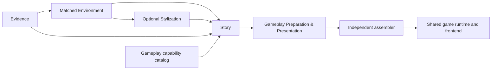
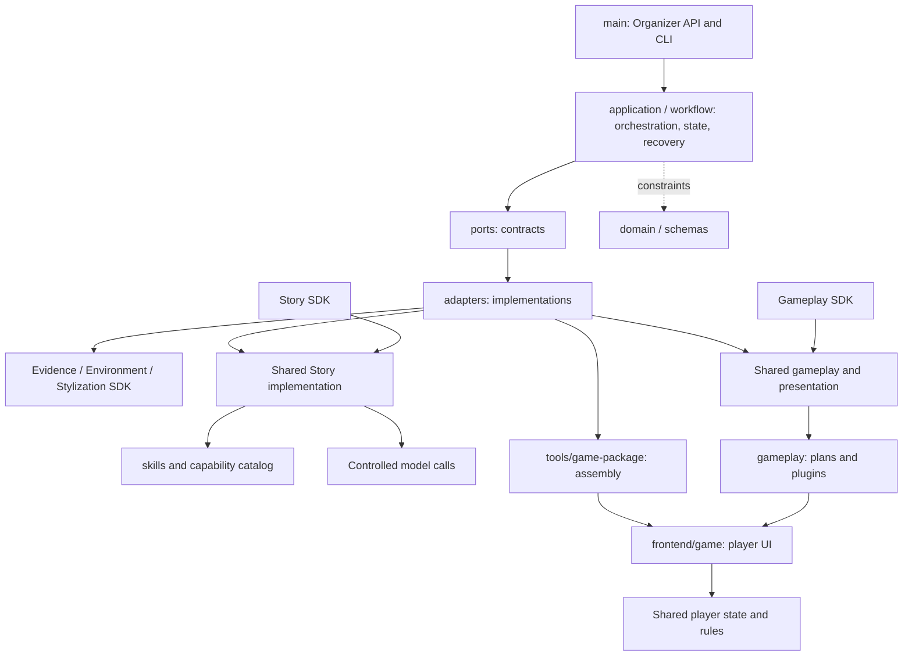

# PastPort

[中文](README.md) · English

Turn original historical sources, matched museum environments and spatial information into heritage games that can be explored and completed through tasks.

**Current status: five SDKs are integrated with local main. Saved-real-material replay, assembly and 3D completion have been verified. CLI replay makes no model calls; Organizer supports saved-result reuse and explicitly authorized generation separately. Source is managed in Git; private preview artifacts are not published with it.**

[Development handoff: wcheung / maslan ownership, source locations, inputs/outputs and tasks](handoff.md)

## Team playable handoff

Download from the [private GitHub Release](https://github.com/Psyche0920/PastPort/releases/tag/team-handover-2026-11-03).

| Package | Contents |
| --- | --- |
| `wcheung.tar.gz` | The 42 standalone demo *The Last Recording*, including the 3D scene, investigation, clue review and three endings. The delivery record was previously named `42handover`. |
| `maslan.tar.gz` | The standalone player bundle from completed Organizer job `3d-test777`. |

Extract the archive, enter the matching directory and follow `OPEN.txt`. Open the local address in a WebGL-capable browser. Node.js is required. The bundles are separate from local Organizer job records.

## Startup and use

The application repository is `/Users/hanweijia/PastPort`; its local main source is the baseline. Requires Python 3.12, uv, Node.js and a WebGL-capable browser.

For initial installation or dependency changes; skip if already installed:

```sh
cd /Users/hanweijia/PastPort
uv sync --extra authoring --extra game-making
```

### Organizer: organizer-facing entry

[Open local Organizer](http://127.0.0.1:18840/organizer/). If already running, open it rather than starting another instance. Otherwise use the existing CLI below, without relying on a temporary startup script:

```sh
cd /Users/hanweijia/PastPort
.venv/bin/python -m pastport \
  --accounts var/organizer-integration/staff-accounts.json \
  --data-directory var/organizer-integration/server \
  --organizer-catalog var/organizer-integration/catalog.json \
  --organizer-player-assets "/Users/hanweijia/Documents/ChatGPT/PastPort/work/main-integration/var/sdk-real-material-20261031-01/story-authoring/game-3d-open-roof-v3/assets" \
  --evidence-mode disabled --narrative-mode disabled --resources-mode disabled \
  --port 18840
```

After starting Organizer and signing in, go to **Production Progress and Delivery**. Open **3D Review Preview** on the `3d-test777` 3D review history entry. Organizer starts and manages the local preview, which contains 30 candidate positions. To prepare Story from the same version, select **Continue This Project** on that card and proceed to Story preparation. The scene and Story inputs use private data stored in the local job directory.

This uses existing private configuration and the administrator account on this computer; it creates no new account. Sign in with the existing username/password, without a token. Manually choose Chinese / English in the upper-right corner; the preference survives refresh. Service restart requires login again. Keep the terminal open; Ctrl+C stops it. If the port is occupied, check whether the service is already running rather than terminating unknown processes.

The `disabled` options disable older editorial demo channels, not explicitly authorized Organizer SDK generation. Current player assets remain registered in the local materials directory shown above. They are private input dependencies, not another application repository, and are absent from a Git clone. On another machine, supply private configuration/materials/player resources and replace the paths. Do not copy or publish account configuration, API keys or private materials.


Existing-3D uploads: select “Original PDF + photos + existing SPZ / PLY scene”, leave defaults unchecked, enter a new project ID and upload all four inputs. Save, review the finite call budgets, then prepare the environment. Continue through review → Story → game build. Recognition/Story calls require explicit consent; Marble calls are zero. Photos accept images or ZIP; PLY must be a binary little-endian triangle mesh. Local Chrome and Node.js are required for capture. An insufficient Evidence budget stops before dispatch: 44 photos and 62 PDF pages require at least 43 first-pass calls, plus per-object verification. The old eight-call default is not a full-set budget. Wiring/simulated execution and a real single-object handoff have been checked; a fresh full-set model run remains upload-test acceptance.


New photo jobs use a compact policy: two photos per batch, at most 12 new entities and 24 sightings, schema-bounded names/features/explanations, and a 120-second deadline or the shorter authorized timeout. Overflow is reported as incomplete and stops acceptance. Existing policies and paid receipts stay unchanged; failures are not automatically retried. These bounds have offline regression evidence, not fresh-model speed acceptance.

### Production workflow

1. **Prepare materials and environment:** select an entry point from the table below. Check the grey box to reuse the complete default materials/environment with zero model/Marble calls. Unchecked uses uploads at the selected stage; separately authorize Marble when 3D generation is required. Complete native 3D inputs are not regenerated.
2. **Materials and review:** automatically consume the previous output. Use the environment SDK's shared VR/3D workbench for photos, evidence, descriptions and review state, with panorama/3D links. Descriptions/review are shared; positions/navigation are saved separately. Saved changes automatically update current inputs, without project reselection or transfer confirmation.
3. **Prepare Story:** first check saved-story provenance, tasks, gameplay and spatial compatibility. A pass permits reuse. Introduction-only changes needing review require human confirmation; invalid critical evidence/task conditions cannot be bypassed. A new saved revision with identical content needs no confirmation. Alternatively, explicitly authorize SOL 6.1 Medium for a new story, without automatic retry. Both paths stop at Story readiness.
4. **Build game:** once Story is ready, click Build game to prepare gameplay, bind presentation, assemble and check resources. Open the player preview from Progress & delivery. The environment and Story are not regenerated.

Switching interface language does not translate evidence/descriptions/stories, submit forms, call models or discard unsaved input. Target play time is a Story creative goal, not generation time or exact timed play.

| Upload entry point | Environment-stage execution | Reused output |
|---|---|---|
| Original historical PDF + site object photos + optional 360° tour | Evidence mapping → environment matching → 3D | Without a tour, save mapping, add the tour and review the recovery summary before continuing |
| Original PDF + mapping PDF + 360° tour | Environment matching → 3D | Mapping PDF |
| Original PDF + native matched-VR archive | Validate/import → 3D | VR bindings, review and navigation |
| Original PDF + native mounted two-view 3D archive | Validate/import | 3D, objects, review, positions/navigation; no Marble calls |

Defaults use a complete registered same-source PDF/photo/mapping/VR/3D set; Story is selected separately. Changed files, mixed PDFs, missing data or inconsistent provenance stop execution without cache substitution. Uploaded packages are data, not executable code. **An ordinary panorama is not matched VR; a raw model is not a mounted environment.** The new PDF + photos + SPZ/PLY upload path prepares a mounted, reviewable environment before Story; the raw model alone is still not a mounted environment.

### Local storage

| Content | Current location/purpose |
|---|---|
| Production/project records | `var/organizer-integration/server/organizer/organizer.sqlite3` |
| Uploads, reviewed snapshots, Story and task caches | `var/organizer-integration/server/organizer/`, isolated by project/task |
| Playable game | Task `jobs/<task>/builds/<build>/game-3d/`; use the actual path shown on the page |
| Object descriptions/reviews | Environment project's `pastport_matching.sqlite3`; Materials & review displays/copies its full path |
| Default registration | `var/organizer-integration/catalog.json`, referencing complete private materials |
| Run/acceptance evidence | `var/organizer-integration/`, excluded from published source |

The game is the final artifact within its cache, not another complete duplicate. Closing the page does not delete records. Paths belong to the server computer. Existing game bundles retain their snapshots; review edits require another build to appear in a new delivery.

### Saved-result replay and independent preview

Maintainers can revalidate a saved Story and assemble again without models:

```sh
cd /Users/hanweijia/PastPort
.venv/bin/pastport-game-trial --request var/runtime-layout-20261101/request-release.json
```

The command revalidates, prepares gameplay/presentation, assembles and checks files without a separate assembly service. Identical inputs/implementation can resume; changes need a new output directory without overwriting locks/games. This command only replays saved output. Authorize new stories through Organizer; see SDK guides for SDK commands.

The retained [local 3D fallback](http://127.0.0.1:18839/?scene=3d) is not the latest Organizer task. If stopped, launch it with:

```sh
PASTPORT_PORT=18839 node var/runtime-layout-20261101/release-run/game-3d/serve3d.mjs
```

Normally use each Organizer task's Open player preview button; main starts the registered local preview service, avoiding guessed build paths. This is not a public deployment.

### Current delivery scope

History identifies each project and offers Continue this project and View materials and review for saved results. The active selection is stored per authenticated operator in the local Organizer database and restored after refresh, login or service restart. Restoration connects saved environment, review and Story state without starting generation. The review project selector stays visible.

Organizer supports single-admin login, four material starts, complete default reuse, automatic review handoff, saved-story compatibility, new Story, real progress and game access. Manual Chinese/English selection has been checked. Zero-call cache-to-game execution and new Story from registered environments have real run evidence. Fresh external Evidence/Marble execution for every material path has not been fully accepted.

New Story uses a fixed content plan; code generates IDs, states, rules and references. Valid structure does not mean engaging narrative or approved historical content. Stylization has an SDK, but Organizer can only reuse existing appearance results rather than request new ones. User remains the existing game frontend; no new player accounts/cross-device saves were added. Current source is the baseline; old wheels require rebuilding to include later fixes.

## Architecture and modules



main uses existing LangGraph, SQLite and typed SDKs. Before generation, Story considers evidence, reviewed text/objects, space/navigation and gameplay capabilities together. Downstream modules implement the same rules without changing quantities or substituting mechanics. Gameplay, presentation and assembly use local code without further model calls.

| Module | Current version | Guide |
|---|---|---|
| Evidence | 0.1.0 | [Extraction, provenance and matching documents](packages/evidence-sdk/README.md) |
| Matched Environment | 0.1.0 | [Review, VR/3D placement and navigation](packages/matched-environment-sdk/README.md) |
| Stylization | 0.1.0 | [Panorama and 3D appearance](packages/stylization-sdk/README.md) |
| Story | 0.1.0rc4 | [Narrative, tasks, spatial/gameplay intents](packages/story-sdk/README.md) |
| Gameplay Preparation & Presentation | 0.1.0rc2 | [Parameters, lifecycle and presentation](packages/gameplay-sdk/README.md) |
| Shared runtime | 0.2.1rc4 | Shared by main and downstream SDKs without engine duplication |

Production: main calls Story for narrative/tasks, then Gameplay Preparation & Presentation for configuration/bindings, then the independent assembler. SDKs are entry points; some implementation resides in shared `pastport`.

Players run only bundled frontend, plugins, JS engine and environment/story data, not the Python SDKs. Gameplay source is in `gameplay/`; current bundles include the complete registered executor rather than pruning individual mechanics. Installed SDKs use bundled runtime resources, not files fetched from the source checkout.

The assembler is independent/shared but not separately distributed as an SDK. Verified scope includes two views, reading, source judgment and rectangular coverage, not arbitrary minigame integration.

## Directory and file purposes

Each of the five SDK READMEs documents its internal files (links above). The tree below covers main and shared files, with hierarchy and purpose on the same line.

### How the source connects



**Folders are source locations; SDKs are installation boundaries.** Story and Gameplay expose facades backed by `src/pastport/`. Player UI lives in `frontend/game/`, gameplay in `gameplay/`, assembly in `tools/game-package/`, and the authoritative engine in `src/pastport/player/`. Assembly creates runtime copies using an explicit resource list, not another maintained engine. See the technical PRD for interfaces and the inventory below for every file.

<!-- BEGIN FILE INVENTORY -->
## File structure and purposes

Directory and file names are clickable; each line states its purpose. SDK internals are documented in their package READMEs. This tree covers main and shared maintained files.

<pre>
PastPort/
├── <a href=".github/">.github/</a>  — Developer-tool rules and GitHub automated checks
│   ├── <a href=".github/workflows/">workflows/</a>  — GitHub Actions continuous integration workflows
│   │   └── <a href=".github/workflows/ci.yml">ci.yml</a>  — GitHub Actions CI: install dependencies and run repository checks and tests.
│   └── <a href=".github/copilot-instructions.md">copilot-instructions.md</a>  — Repository development rules and specification entry for Copilot.
├── <a href="docs/">docs/</a>  — Single technical specification: architecture, interfaces and acceptance scope
│   ├── <a href="docs/TECHNICAL_PRD.md">TECHNICAL_PRD.md</a>  — Current technical specification: main/SDK responsibilities, architecture, technology, inputs/outputs and acceptance boundaries.
│   └── <a href="docs/TECHNICAL_PRD_EN.md">TECHNICAL_PRD_EN.md</a> — English translation of the same technical specification; architecture, contracts, startup and acceptance boundaries.
├── <a href="frontend/">frontend/</a>  — Frontend source for Organizer production and the User game interface
│   ├── <a href="frontend/game/">game/</a>  — Existing User interface: dialogue, tasks, 3D interaction and sessions; unchanged in this phase
│   │   ├── <a href="frontend/game/app.css">app.css</a>  — Preview layout and styles for dialogue, tasks and gameplay.
│   │   ├── <a href="frontend/game/app.mjs">app.mjs</a>  — Main preview controller connecting dialogue, tasks, plugins, scenes and actions.
│   │   ├── <a href="frontend/game/cinematic-view.mjs">cinematic-view.mjs</a>  — Cinematic view controls: camera, movement input and object interaction.
│   │   ├── <a href="frontend/game/dialogue.mjs">dialogue.mjs</a>  — Adapted from UI trial adventure.mjs speak/renderLine: one speaker, one line, Continue.
│   │   ├── <a href="frontend/game/index.html">index.html</a>  — HTML entry for the preview host.
│   │   ├── <a href="frontend/game/interaction.mjs">interaction.mjs</a>  — Coordinates object clicks, inspection and approach actions to avoid gesture conflicts.
│   │   ├── <a href="frontend/game/navigation.mjs">navigation.mjs</a>  — Validates navigation links, metric space and walking constraints.
│   │   ├── <a href="frontend/game/scene3d-bridge.mjs">scene3d-bridge.mjs</a>  — Story-side interaction contract; the scene host alone owns navigation.
│   │   ├── <a href="frontend/game/scene3d-navigation.mjs">scene3d-navigation.mjs</a>  — Preserve source navigation poses; screen bearings are camera-relative UI only.
│   │   ├── <a href="frontend/game/scene3d-runtime.js">scene3d-runtime.js</a>  — Runtime bridge injected into independent 3D views; carries navigation and narrative interaction without modifying upstream scenes.
│   │   ├── <a href="frontend/game/scene3d-view.mjs">scene3d-view.mjs</a>  — Browser adapter connecting 3D host interaction to the existing narrative UI.
│   │   ├── <a href="frontend/game/session.mjs">session.mjs</a>  — Manages preview sessions, state progression and save recovery.
│   │   └── <a href="frontend/game/walkmesh.mjs">walkmesh.mjs</a>  — Screen-independent walkability, path finding and character locomotion.
│   └── <a href="frontend/organizer/">organizer/</a>  — Organizer frontend: authentication, actual uploads, registered-material reuse/regeneration, progress and delivery
│       ├── <a href="frontend/organizer/index.html">index.html</a>  — Actual production page served by main at /organizer/; requires the HTTP service and login.
│       ├── <a href="frontend/organizer/app.mjs">app.mjs</a>  — Orchestrates materials/environment, existing review, Story, then gameplay/assembly; controls reuse and generation separately.
│       ├── <a href="frontend/organizer/i18n.mjs">i18n.mjs</a>  — Organizer Chinese/English UI catalog, manual selection and in-place text binding; leaves source and form content unchanged.
│       ├── <a href="frontend/organizer/review.mjs">review.mjs</a>  — Embeds the existing numbered-object review UI; handles save notifications, unsaved edits and input revision checks before Story.
│       ├── <a href="frontend/organizer/app.css">app.css</a>  — Organizer layout, responsive styling and action states.
│       └── <a href="frontend/organizer/sketch.html">sketch.html</a>  — Organizer design sketch: four material starts, corresponding review, reuse/progress/delivery; not connected to the backend.
├── <a href="gameplay/">gameplay/</a>  — Gameplay plans and presentation input preparation using plugins and shared contracts
│   ├── <a href="gameplay/plugins/">plugins/</a>  — Local minigame executor, coverage solver and generated capability catalog
│   │   ├── <a href="gameplay/plugins/coverage.mjs">coverage.mjs</a>  — Solves coverage using actual placement rules and rejects unsolvable configurations before play.
│   │   ├── <a href="gameplay/plugins/gameplay-catalog.mjs">gameplay-catalog.mjs</a>  — Browser capability catalog generated from shared capability JSON; do not edit independently.
│   │   └── <a href="gameplay/plugins/plugins.mjs">plugins.mjs</a>  — Local Activity executor for quizzes, classification, coverage and other registered mechanics; returns results.
│   ├── <a href="gameplay/contracts.mjs">contracts.mjs</a>  — Museum snapshot identity and domain errors shared by preparation/assembly; no dependency on frontend or assembly compiler.
│   ├── <a href="gameplay/gameplay.mjs">gameplay.mjs</a>  — Compiles task gameplay declarations into registered plugin bindings and checks identity.
│   └── <a href="gameplay/prepared-game.mjs">prepared-game.mjs</a>  — Reads prepared gameplay/presentation, checks story/object/catalog identities and hands off to the host.
├── <a href="packages/">packages/</a>  — Five independent SDKs; follow each package for its source and README
│   ├── <a href="packages/evidence-sdk/">evidence-sdk/</a>  — Evidence SDK: source extraction, photo observations, matching and provenance
│   ├── <a href="packages/gameplay-sdk/">gameplay-sdk/</a>  — Gameplay Preparation & Presentation SDK: compile configuration and bind views, navigation and UI
│   ├── <a href="packages/matched-environment-sdk/">matched-environment-sdk/</a>  — Environment SDK: review data, VR/3D placement, navigation and spatial information
│   ├── <a href="packages/story-sdk/">story-sdk/</a>  — Story SDK: generate narrative/tasks from evidence, environment and gameplay capabilities
│   └── <a href="packages/stylization-sdk/">stylization-sdk/</a>  — Stylization SDK: panorama/3D appearance while retaining environment structure
├── <a href="schemas/">schemas/</a>  — JSON Schema boundary contracts generated from typed models
│   ├── <a href="schemas/action-request.schema.json">action-request.schema.json</a>  — Generated ActionRequest JSON Schema for boundary fields, types and constraints; update through the contract tools.
│   ├── <a href="schemas/action-result.schema.json">action-result.schema.json</a>  — Generated ActionResult JSON Schema for boundary fields, types and constraints; update through the contract tools.
│   ├── <a href="schemas/action-vector.schema.json">action-vector.schema.json</a>  — Generated ActionVector JSON Schema for boundary fields, types and constraints; update through the contract tools.
│   ├── <a href="schemas/artifact-ref.schema.json">artifact-ref.schema.json</a>  — Generated ArtifactRef JSON Schema for boundary fields, types and constraints; update through the contract tools.
│   ├── <a href="schemas/assembly-request.schema.json">assembly-request.schema.json</a>  — Generated AssemblyRequest JSON Schema for boundary fields, types and constraints; update through the contract tools.
│   ├── <a href="schemas/assembly-result.schema.json">assembly-result.schema.json</a>  — Generated AssemblyResult JSON Schema for boundary fields, types and constraints; update through the contract tools.
│   ├── <a href="schemas/budget-policy.schema.json">budget-policy.schema.json</a>  — Generated BudgetPolicy JSON Schema for boundary fields, types and constraints; update through the contract tools.
│   ├── <a href="schemas/bundle.schema.json">bundle.schema.json</a>  — Generated PackageBundle JSON Schema for boundary fields, types and constraints; update through the contract tools.
│   ├── <a href="schemas/discover-request.schema.json">discover-request.schema.json</a>  — Generated DiscoverRequest JSON Schema for boundary fields, types and constraints; update through the contract tools.
│   ├── <a href="schemas/discover-result.schema.json">discover-result.schema.json</a>  — Generated ModuleResult[CandidateSetDraft] JSON Schema for boundary fields, types and constraints; update through the contract tools.
│   ├── <a href="schemas/story-plan.schema.json">story-plan.schema.json</a>  — Public content-plan schema excluding executable graph IDs, rules and state declarations.
│   ├── <a href="schemas/story-plan-result.schema.json">story-plan-result.schema.json</a>  — Fixed content-plan result and explicit response for unrepresentable requirements.
│   ├── <a href="schemas/draft-request.schema.json">draft-request.schema.json</a>  — Generated DraftRequest JSON Schema for boundary fields, types and constraints; update through the contract tools.
│   ├── <a href="schemas/draft-result.schema.json">draft-result.schema.json</a>  — Generated ModuleResult[NarrativeDraft] JSON Schema for boundary fields, types and constraints; update through the contract tools.
│   ├── <a href="schemas/evidence-request.schema.json">evidence-request.schema.json</a>  — Generated EvidenceRequest JSON Schema for boundary fields, types and constraints; update through the contract tools.
│   ├── <a href="schemas/evidence.schema.json">evidence.schema.json</a>  — Generated EvidencePackage JSON Schema for boundary fields, types and constraints; update through the contract tools.
│   ├── <a href="schemas/execution-metadata.schema.json">execution-metadata.schema.json</a>  — Generated ExecutionMetadata JSON Schema for boundary fields, types and constraints; update through the contract tools.
│   ├── <a href="schemas/game.schema.json">game.schema.json</a>  — Generated GameContent JSON Schema for boundary fields, types and constraints; update through the contract tools.
│   ├── <a href="schemas/index-request.schema.json">index-request.schema.json</a>  — Generated IndexRequest JSON Schema for boundary fields, types and constraints; update through the contract tools.
│   ├── <a href="schemas/index-result.schema.json">index-result.schema.json</a>  — Generated ModuleResult[SourceIndexDraft] JSON Schema for boundary fields, types and constraints; update through the contract tools.
│   ├── <a href="schemas/inventory-request.schema.json">inventory-request.schema.json</a>  — Generated InventoryRequest JSON Schema for boundary fields, types and constraints; update through the contract tools.
│   ├── <a href="schemas/inventory-result.schema.json">inventory-result.schema.json</a>  — Generated ModuleResult[SourceManifestDraft] JSON Schema for boundary fields, types and constraints; update through the contract tools.
│   ├── <a href="schemas/narrative.schema.json">narrative.schema.json</a>  — Generated NarrativePackage JSON Schema for boundary fields, types and constraints; update through the contract tools.
│   ├── <a href="schemas/node-result.schema.json">node-result.schema.json</a>  — Generated NodeResult JSON Schema for boundary fields, types and constraints; update through the contract tools.
│   ├── <a href="schemas/player-state.schema.json">player-state.schema.json</a>  — Generated PlayerState JSON Schema for boundary fields, types and constraints; update through the contract tools.
│   ├── <a href="schemas/research-request.schema.json">research-request.schema.json</a>  — Generated ResearchRequest JSON Schema for boundary fields, types and constraints; update through the contract tools.
│   ├── <a href="schemas/research-result.schema.json">research-result.schema.json</a>  — Generated ModuleResult[EvidenceFindings] JSON Schema for boundary fields, types and constraints; update through the contract tools.
│   ├── <a href="schemas/review-decision.schema.json">review-decision.schema.json</a>  — Generated ReviewDecision JSON Schema for boundary fields, types and constraints; update through the contract tools.
│   ├── <a href="schemas/review-request.schema.json">review-request.schema.json</a>  — Generated NarrativeReviewRequest JSON Schema for boundary fields, types and constraints; update through the contract tools.
│   ├── <a href="schemas/review-result.schema.json">review-result.schema.json</a>  — Generated ModuleResult[NarrativeReview] JSON Schema for boundary fields, types and constraints; update through the contract tools.
│   ├── <a href="schemas/revise-request.schema.json">revise-request.schema.json</a>  — Generated ReviseRequest JSON Schema for boundary fields, types and constraints; update through the contract tools.
│   ├── <a href="schemas/revise-result.schema.json">revise-result.schema.json</a>  — Generated ModuleResult[NarrativeDraft] JSON Schema for boundary fields, types and constraints; update through the contract tools.
│   ├── <a href="schemas/route.schema.json">route.schema.json</a>  — Generated RouteRecord JSON Schema for boundary fields, types and constraints; update through the contract tools.
│   ├── <a href="schemas/runtime-capabilities.schema.json">runtime-capabilities.schema.json</a>  — Generated RuntimeCapabilities JSON Schema for boundary fields, types and constraints; update through the contract tools.
│   ├── <a href="schemas/runtime.schema.json">runtime.schema.json</a>  — Generated RuntimePackage JSON Schema for boundary fields, types and constraints; update through the contract tools.
│   ├── <a href="schemas/skill-result.schema.json">skill-result.schema.json</a>  — Generated SkillResult[NarrativeDraft] JSON Schema for boundary fields, types and constraints; update through the contract tools.
│   ├── <a href="schemas/source-locator.schema.json">source-locator.schema.json</a>  — Generated SourceLocator JSON Schema for boundary fields, types and constraints; update through the contract tools.
│   ├── <a href="schemas/tool-request.schema.json">tool-request.schema.json</a>  — Generated ToolRequest JSON Schema for boundary fields, types and constraints; update through the contract tools.
│   ├── <a href="schemas/validation-report.schema.json">validation-report.schema.json</a>  — Generated ValidationReport JSON Schema for boundary fields, types and constraints; update through the contract tools.
│   ├── <a href="schemas/validation-request.schema.json">validation-request.schema.json</a>  — Generated PackageValidationRequest JSON Schema for boundary fields, types and constraints; update through the contract tools.
│   └── <a href="schemas/workflow-state.schema.json">workflow-state.schema.json</a>  — Generated WorkflowState JSON Schema for boundary fields, types and constraints; update through the contract tools.
├── <a href="skills/">skills/</a>  — Workflow policy sources bundled with the shared runtime
│   ├── <a href="skills/evidence-review/">evidence-review/</a>  — Evidence review and research rules
│   │   ├── <a href="skills/evidence-review/references/">references/</a>  — Evidence-review decision examples
│   │   │   └── <a href="skills/evidence-review/references/review-examples.md">review-examples.md</a>  — Examples and decision references for evidence review.
│   │   └── <a href="skills/evidence-review/SKILL.md">SKILL.md</a>  — main evidence/research policy: provenance, verification status and evidence boundaries.
│   ├── <a href="skills/gameplay-preparation/">gameplay-preparation/</a>  — Gameplay matching, configuration and presentation preparation rules
│   │   └── <a href="skills/gameplay-preparation/SKILL.md">SKILL.md</a>  — Gameplay preparation policy: matching, configuration, verification, space and presentation boundaries.
│   └── <a href="skills/narrative/">narrative/</a>  — Narrative and task design rules
│       ├── <a href="skills/narrative/references/">references/</a>  — Narrative quality calibration references
│       │   └── <a href="skills/narrative/references/design-calibration.md">design-calibration.md</a>  — Narrative calibration references for task meaning, causality and presentation quality.
│       └── <a href="skills/narrative/SKILL.md">SKILL.md</a>  — Story generation constraints: evidence, mappings, space, capabilities and narrative/task outputs.
├── <a href="src/">src/</a>  — Python source shared by main and downstream SDKs
│   └── <a href="src/pastport/">pastport/</a>  — Shared runtime: services, orchestration, use cases and game rules
│       ├── <a href="src/pastport/adapters/">adapters/</a>  — Concrete implementations and integrations: models, databases, files or SDKs
│       │   ├── <a href="src/pastport/adapters/organizer_processes.py">organizer_processes.py</a>  — Owns/cleans up native SDK process groups; does not automatically redispatch on timeout.
│       │   ├── <a href="src/pastport/adapters/organizer_archives.py">organizer_archives.py</a>  — Bounded extraction, file hashes, SQLite snapshot checks and isolated lightweight resource snapshots; uploaded programs never execute.
│       │   ├── <a href="src/pastport/adapters/organizer_native.py">organizer_native.py</a>  — SDK calls for four native upload starts, retained shared review, and spatial/source input export.
│       │   ├── <a href="src/pastport/adapters/organizer_review.py">organizer_review.py</a>  — Reuses the environment SDK's same-source review authority/UI, revisioned edits and local input export.
│       │   ├── <a href="src/pastport/adapters/organizer_review_environment.py">organizer_review_environment.py</a>  — Current SDK VR/3D viewers and resource routing for separate position/navigation editing.
│       │   ├── <a href="src/pastport/adapters/passwords.py">passwords.py</a>  — Salted administrator password derivation, verification and safe format checks.
│       │   ├── <a href="src/pastport/adapters/organizer_previews.py">organizer_previews.py</a>  — Owns/closes local 3D preview processes and allocates ports and isolated sessions.
│       │   ├── <a href="src/pastport/adapters/organizer_store.py">organizer_store.py</a>  — SQLite persistence for Organizer projects/jobs, connection cleanup and service mutual exclusion.
│       │   ├── <a href="src/pastport/adapters/organizer_production.py">organizer_production.py</a>  — Fresh Story/replay for registered environments through existing budget and assembly mechanisms.
│       │   ├── <a href="src/pastport/adapters/__init__.py">__init__.py</a>  — PastPort service components.
│       │   ├── <a href="src/pastport/adapters/assembly.py">assembly.py</a>  — Build media manifests from reviewed asset identities; never from a prebuilt runtime template.
│       │   ├── <a href="src/pastport/adapters/codex_provider.py">codex_provider.py</a>  — Story-only model transport using the official SDK and saved ChatGPT login.
│       │   ├── <a href="src/pastport/adapters/codex_traces.py">codex_traces.py</a>  — Private local invocation evidence, separate from authoritative budget settlement.
│       │   ├── <a href="src/pastport/adapters/content.py">content.py</a>  — Offline adapters for explicitly supplied authored content; no model generation is implied.
│       │   ├── <a href="src/pastport/adapters/database.py">database.py</a>  — Short SQLite transactions with optimistic revisions and durable command consumption.
│       │   ├── <a href="src/pastport/adapters/environment_spatial.py">environment_spatial.py</a>  — Read explicitly registered SDK worlds into Story&#x27;s typed spatial input.
│       │   ├── <a href="src/pastport/adapters/game_making.py">game_making.py</a>  — Compose installed SDK entry points; preserve existing museum assets and Story.
│       │   ├── <a href="src/pastport/adapters/gameplay_catalog.py">gameplay_catalog.py</a>  — Load the one packaged capability catalog; malformed catalogs cannot authorize games.
│       │   ├── <a href="src/pastport/adapters/gameplay_verifier.py">gameplay_verifier.py</a>  — Verify only the registered local Demo Activity using a fixed Node runner.
│       │   ├── <a href="src/pastport/adapters/matched_environment.py">matched_environment.py</a>  — Read one registered native environment without running uploaded code or changing reviews.
│       │   ├── <a href="src/pastport/adapters/model_narrative.py">model_narrative.py</a>  — Story Agent adapter backed by the shared, metered model gateway.
│       │   ├── <a href="src/pastport/adapters/model_provider.py">model_provider.py</a>  — Bounded Responses HTTP adapter and explicit deterministic test provider.
│       │   ├── <a href="src/pastport/adapters/package_files.py">package_files.py</a>  — Read regular local package files without following a file symlink or blocking on a pipe.
│       │   ├── <a href="src/pastport/adapters/pdf_text.py">pdf_text.py</a>  — Optional pypdf extraction in a disposable process with explicit resource limits.
│       │   ├── <a href="src/pastport/adapters/player_process.py">player_process.py</a>  — Bounded Node transport for the shared browser/headless preparation components.
│       │   ├── <a href="src/pastport/adapters/player_saves.py">player_saves.py</a>  — Durable, version-checked SQLite saves with one transaction for state and receipts.
│       │   ├── <a href="src/pastport/adapters/previews.py">previews.py</a>  — Private SQLite preview metadata and atomic player state, outside release storage.
│       │   ├── <a href="src/pastport/adapters/resources.py">resources.py</a>  — Explicit local asset catalog and source URI adapter, bounded to one configured directory.
│       │   ├── <a href="src/pastport/adapters/runtime_resources.py">runtime_resources.py</a>  — Resolve the single shared host distribution without requiring a checkout.
│       │   ├── <a href="src/pastport/adapters/skills.py">skills.py</a>  — Read only server-approved Skill paths and fingerprint every included file.
│       │   ├── <a href="src/pastport/adapters/story_3d.py">story_3d.py</a>  — Join approved shared assembly to the separately versioned local 3D delivery bridge.
│       │   ├── <a href="src/pastport/adapters/story_reuse.py">story_reuse.py</a>  — Saved-story dependency checks and separate reuse records; no model calls or parent-story overwrite.
│       │   ├── <a href="src/pastport/adapters/story_materials.py">story_materials.py</a>  — Normalize explicitly registered upstream exports without regenerating matches.
│       │   └── <a href="src/pastport/adapters/story_workflow.py">story_workflow.py</a>  — Run the existing metered editorial graph up to its Story output boundary.
│       ├── <a href="src/pastport/api/">api/</a>  — HTTP API, service configuration and workbench resources
│       │   ├── <a href="src/pastport/api/organizer.py">organizer.py</a>  — Production HTTP API using main accounts, actual uploads, progress, recovery and preview integration.
│       │   ├── <a href="src/pastport/api/organizer_accounts.py">organizer_accounts.py</a>  — Single-admin password login, existing role scopes and one-time local setup.
│       │   ├── <a href="src/pastport/api/__init__.py">__init__.py</a>  — PastPort service components.
│       │   ├── <a href="src/pastport/api/api-client.mjs">api-client.mjs</a>  — Stable operation identities. Rendering and automatic retry policy belong to the view controller.
│       │   ├── <a href="src/pastport/api/app.py">app.py</a>  — Local authenticated editorial API with strict JSON transport and a durable background worker.
│       │   ├── <a href="src/pastport/api/player-view.mjs">player-view.mjs</a>  — Player component view in the workbench: renders state and submits player actions.
│       │   ├── <a href="src/pastport/api/private_views.py">private_views.py</a>  — Private content routes; all bytes resolve through server-selected package/source identities.
│       │   ├── <a href="src/pastport/api/request_logging.py">request_logging.py</a>  — Request correlation without retaining URLs, bodies, headers or client identities.
│       │   ├── <a href="src/pastport/api/settings.py">settings.py</a>  — Server-side accounts and explicit test configuration.
│       │   ├── <a href="src/pastport/api/transport.py">transport.py</a>  — Bounded strict JSON request parsing shared by authenticated routes.
│       │   ├── <a href="src/pastport/api/views.mjs">views.mjs</a>  — Safe DOM helpers; package and source text is never executable markup.
│       │   ├── <a href="src/pastport/api/workbench.css">workbench.css</a>  — Review workbench layout and styles.
│       │   ├── <a href="src/pastport/api/workbench.html">workbench.html</a>  — Review workbench HTML structure and control containers.
│       │   └── <a href="src/pastport/api/workbench.mjs">workbench.mjs</a>  — Review workbench browser controller connecting APIs and page actions.
│       ├── <a href="src/pastport/application/">application/</a>  — Business use cases and execution flow
│       │   ├── <a href="src/pastport/application/source_lineage.py">source_lineage.py</a>  — Separates original and mapping PDFs, preserving reference provenance and unresolved ambiguity/gaps.
│       │   ├── <a href="src/pastport/application/organizer_cache.py">organizer_cache.py</a>  — Per-file hashes and cross-stage provenance for complete same-source caches; prevents mixing results from different PDFs.
│       │   ├── <a href="src/pastport/application/organizer.py">organizer.py</a>  — Request deduplication, input fingerprints, project authorization, two execution modes and recovery.
│       │   ├── <a href="src/pastport/application/__init__.py">__init__.py</a>  — PastPort service components.
│       │   ├── <a href="src/pastport/application/activity.py">activity.py</a>  — Meter automatic workflow wall time once, excluding human and queue waiting.
│       │   ├── <a href="src/pastport/application/change_impact.py">change_impact.py</a>  — Version-bound mechanical comparison; uncertainty never grants human approval.
│       │   ├── <a href="src/pastport/application/environment_inputs.py">environment_inputs.py</a>  — Validate existing execution authority around explicitly injected local input reads.
│       │   ├── <a href="src/pastport/application/execution_guard.py">execution_guard.py</a>  — Validate persisted server grants before any shared child operation.
│       │   ├── <a href="src/pastport/application/execution_models.py">execution_models.py</a>  — Pinned execution configuration and durable receipts, independent of provider SDKs.
│       │   ├── <a href="src/pastport/application/execution_runtime.py">execution_runtime.py</a>  — Composition root for grants, provider configuration and services given to module factories.
│       │   ├── <a href="src/pastport/application/game_making.py">game_making.py</a>  — Checkpointed Main orchestration; SDKs retain their own internal execution authority.
│       │   ├── <a href="src/pastport/application/gameplay_preparation.py">gameplay_preparation.py</a>  — Derive supported source-reading mechanics without rewriting authored task meaning.
│       │   ├── <a href="src/pastport/application/model_gateway.py">model_gateway.py</a>  — Account for a bounded model call before validating or returning its typed output.
│       │   ├── <a href="src/pastport/application/models.py">models.py</a>  — Application records use clear names and reuse the frozen shared contracts.
│       │   ├── <a href="src/pastport/application/module_selection.py">module_selection.py</a>  — Explicit composition choices; injected implementations never silently fall back.
│       │   ├── <a href="src/pastport/application/narrative_rules.py">narrative_rules.py</a>  — Compile explicit story choice bindings into the existing deterministic rule engine.
│       │   ├── <a href="src/pastport/application/narrative_state.py">narrative_state.py</a>  — Reconcile closed native Story state without inventing initial values or outcomes.
│       │   ├── <a href="src/pastport/application/operational_service.py">operational_service.py</a>  — Human interventions preserve spending facts, review history and execution limits.
│       │   ├── <a href="src/pastport/application/operations.py">operations.py</a>  — Authenticated intervention commands and immutable audit records.
│       │   ├── <a href="src/pastport/application/package_loader.py">package_loader.py</a>  — Load a runtime package against trusted identity and explicit consumer capabilities.
│       │   ├── <a href="src/pastport/application/player_components.py">player_components.py</a>  — Bind shared JS preparation components to a trusted runtime package and release.
│       │   ├── <a href="src/pastport/application/player_preparation.py">player_preparation.py</a>  — Typed preparation protocol, separate from committed player actions and saves.
│       │   ├── <a href="src/pastport/application/player_runtime.py">player_runtime.py</a>  — Trusted shared-JS runtime contracts and the implementation of PlayerRuntimePort.
│       │   ├── <a href="src/pastport/application/player_service.py">player_service.py</a>  — Saved player sessions; JS owns gameplay and the repository owns atomic durability.
│       │   ├── <a href="src/pastport/application/preview_normalization.py">preview_normalization.py</a>  — Mechanical repairs for explicitly authorized internal-preview model output.
│       │   ├── <a href="src/pastport/application/preview_service.py">preview_service.py</a>  — Preview-only assembly and sessions; no review or release mutations occur here.
│       │   ├── <a href="src/pastport/application/previews.py">previews.py</a>  — Typed private preview boundaries, independent of approval and publication.
│       │   ├── <a href="src/pastport/application/publication.py">publication.py</a>  — Stage durable immutable files, then atomically publish their recorded identity.
│       │   ├── <a href="src/pastport/application/reliability.py">reliability.py</a>  — Typed authority, accounting and release records shared by local service boundaries.
│       │   ├── <a href="src/pastport/application/research_execution.py">research_execution.py</a>  — One bounded research role: durable steps, no tool-invented permissions or new questions.
│       │   ├── <a href="src/pastport/application/resources.py">resources.py</a>  — Enforce identity, size and raw-byte hashes for all injected resource readers.
│       │   ├── <a href="src/pastport/application/routing.py">routing.py</a>  — Application-owned legal routes and cumulative research/revision limits.
│       │   ├── <a href="src/pastport/application/service.py">service.py</a>  — Application operations enforce identity, review authority and optimistic versions.
│       │   ├── <a href="src/pastport/application/source_tools.py">source_tools.py</a>  — Registered-source reading and deterministic local tools, bounded by frozen questions.
│       │   ├── <a href="src/pastport/application/source_views.py">source_views.py</a>  — Read registered source bytes and saved extraction records without research/model calls.
│       │   ├── <a href="src/pastport/application/story_compiler.py">story_compiler.py</a>  — Compiles content plans into tasks, rules, state, locale keys and consistent downstream references.
│       │   ├── <a href="src/pastport/application/story_plan_schema.py">story_plan_schema.py</a>  — Constrains content selections to registered objects/evidence before generation.
│       │   ├── <a href="src/pastport/application/story_authoring.py">story_authoring.py</a>  — Story-only checks and readable export; no plugin, frontend or assembly work.
│       │   ├── <a href="src/pastport/application/story_reference_contract.py">story_reference_contract.py</a>  — Compiles allowed reference keys from locked Evidence, reduces redundant internal IDs and validates results.
│       │   ├── <a href="src/pastport/application/story_editing.py">story_editing.py</a>  — Stable game field locks and declared targets, shared by manual and module revisions.
│       │   ├── <a href="src/pastport/application/task_copy.py">task_copy.py</a>  — Reject repeated inventory counts that contradict the canonical task requirements.
│       │   ├── <a href="src/pastport/application/updates.py">updates.py</a>  — Revalidate immutable records rather than bypassing their boundary validators.
│       │   └── <a href="src/pastport/application/workflow_control.py">workflow_control.py</a>  — Durable control manifests; module suggestions cannot grant approval or reset limits.
│       ├── <a href="src/pastport/data/">data/</a>  — Data and gameplay catalog bundled by the shared runtime
│       │   └── <a href="src/pastport/data/gameplay-capabilities.json">gameplay-capabilities.json</a>  — Shared capabilities used consistently by Story constraints, gameplay compilation and host validation.
│       ├── <a href="src/pastport/development/">development/</a>  — Development tools for offline, fault, browser and module acceptance checks
│       │   ├── <a href="src/pastport/development/__init__.py">__init__.py</a>  — Offline development tools; never production module fallbacks.
│       │   ├── <a href="src/pastport/development/acceptance_models.py">acceptance_models.py</a>  — Versioned development reports, separate from shared content and runtime contracts.
│       │   ├── <a href="src/pastport/development/acceptance_scenario.py">acceptance_scenario.py</a>  — Authenticated test-only workflow scenario for interchangeable offline ports.
│       │   ├── <a href="src/pastport/development/browser_check.py">browser_check.py</a>  — Run real-browser acceptance against a fresh synthetic localhost service.
│       │   ├── <a href="src/pastport/development/browser_fixture.py">browser_fixture.py</a>  — Dedicated synthetic localhost server for browser acceptance, never production data.
│       │   ├── <a href="src/pastport/development/fault_acceptance.py">fault_acceptance.py</a>  — Run fixed F9 fault gates and retain a safe, version-bound local test report.
│       │   ├── <a href="src/pastport/development/module_acceptance.py">module_acceptance.py</a>  — Run the offline F9 acceptance kit with replaceable trusted local factories.
│       │   ├── <a href="src/pastport/development/module_check.py">module_check.py</a>  — Run independent module smoke checks without an API, database or workflow worker.
│       │   ├── <a href="src/pastport/development/player_check.py">player_check.py</a>  — Run F7 shared-JS conformance and report actual full action-vector results.
│       │   ├── <a href="src/pastport/development/player_contracts.py">player_contracts.py</a>  — Export TypeScript declarations and the JSON schemas used by player components.
│       │   └── <a href="src/pastport/development/reference_modules.py">reference_modules.py</a>  — Independent, request-bound synthetic ports for the offline acceptance kit.
│       ├── <a href="src/pastport/domain/">domain/</a>  — Domain models, identities and data constraints
│       │   ├── <a href="src/pastport/domain/organizer_inputs.py">organizer_inputs.py</a>  — Immutable contracts for uploaded inputs, bounded authorization, stage results and environment preparation.
│       │   ├── <a href="src/pastport/domain/organizer_review.py">organizer_review.py</a>  — Immutable review material, provenance binding, revisioned-edit and input-confirmation contracts.
│       │   ├── <a href="src/pastport/domain/organizer.py">organizer.py</a>  — Immutable project/material/cache/request/state contracts and four-start plans.
│       │   ├── <a href="src/pastport/domain/__init__.py">__init__.py</a>  — Framework-independent domain contracts.
│       │   ├── <a href="src/pastport/domain/capabilities.py">capabilities.py</a>  — Explicit capabilities for the existing contract profile, independent of sample content.
│       │   ├── <a href="src/pastport/domain/common.py">common.py</a>  — Immutable wire contracts and content identity; no framework or provider imports.
│       │   ├── <a href="src/pastport/domain/evidence.py">evidence.py</a>  — Evidence candidates and snapshots; validation never grants human approval.
│       │   ├── <a href="src/pastport/domain/game.py">game.py</a>  — Bounded, declarative game data. This module does not interpret actions.
│       │   ├── <a href="src/pastport/domain/game_making.py">game_making.py</a>  — Private game-production inputs, with explicit reuse rather than implied generation.
│       │   ├── <a href="src/pastport/domain/gameplay_preparation.py">gameplay_preparation.py</a>  — Gameplay preparation outputs are plans, never committed Story state or UI code.
│       │   ├── <a href="src/pastport/domain/mechanics.py">mechanics.py</a>  — Shared task requirements and capability limits, independent of plugin implementations.
│       │   ├── <a href="src/pastport/domain/story_reuse.py">story_reuse.py</a>  — Compatibility conclusions, task conflicts and revision-bound parent-story/current-environment proof.
│       │   ├── <a href="src/pastport/domain/story_plan.py">story_plan.py</a>  — Fixed model-authored narrative/task/choice content; disallows model-authored executable rules.
│       │   ├── <a href="src/pastport/domain/modules.py">modules.py</a>  — Typed module messages for independent implementation against contract 0.1.0.
│       │   ├── <a href="src/pastport/domain/narrative_repair.py">narrative_repair.py</a>  — Small narrative-state patches that leave authored prose and evidence untouched.
│       │   ├── <a href="src/pastport/domain/package_loading.py">package_loading.py</a>  — Safe, stable failures for package consumers, independent of HTTP or storage.
│       │   ├── <a href="src/pastport/domain/packages.py">packages.py</a>  — Cross-package contract checking, distinct from authorisation and runtime execution.
│       │   ├── <a href="src/pastport/domain/player_saves.py">player_saves.py</a>  — Player save ownership and immutable persistence identities.
│       │   ├── <a href="src/pastport/domain/resources.py">resources.py</a>  — Resource identities and local registrations, independent of provider or filesystem APIs.
│       │   ├── <a href="src/pastport/domain/story_inputs.py">story_inputs.py</a>  — Read-only, source-bound authoring input; not a new game wire or approval grant.
│       │   └── <a href="src/pastport/domain/workflow.py">workflow.py</a>  — Workflow messages express intent and observations, never authentication proof.
│       ├── <a href="src/pastport/player/">player/</a>  — Shared JavaScript game state, rules and action runtime
│       │   ├── <a href="src/pastport/player/__init__.py">__init__.py</a>  — Shared browser/Node player engine, atomic action semantics and conformance utilities.
│       │   ├── <a href="src/pastport/player/actions.mjs">actions.mjs</a>  — Handles actions, checks preconditions and produces state changes/receipts.
│       │   ├── <a href="src/pastport/player/context.mjs">context.mjs</a>  — Builds player context for a package and validates identity, capabilities and rules.
│       │   ├── <a href="src/pastport/player/contracts.d.ts">contracts.d.ts</a>  — TypeScript declarations generated from Python player contracts.
│       │   ├── <a href="src/pastport/player/errors.mjs">errors.mjs</a>  — Safe operational errors never include source text, arbitrary keys or file paths.
│       │   ├── <a href="src/pastport/player/generated-schemas.mjs">generated-schemas.mjs</a>  — Player boundary schemas generated from Python contracts; update through the generator.
│       │   ├── <a href="src/pastport/player/preparation.d.mts">preparation.d.mts</a>  — TypeScript declarations for player preparation interfaces.
│       │   ├── <a href="src/pastport/player/preparation.mjs">preparation.mjs</a>  — Prepares a verified package as shared player-component context.
│       │   ├── <a href="src/pastport/player/rules.mjs">rules.mjs</a>  — Evaluates conditions, matches rules and calculates effects.
│       │   ├── <a href="src/pastport/player/runner.mjs">runner.mjs</a>  — Node JSON protocol entry allowing Python to call the shared player runtime.
│       │   ├── <a href="src/pastport/player/runtime.d.mts">runtime.d.mts</a>  — TypeScript declarations for player action execution.
│       │   ├── <a href="src/pastport/player/runtime.mjs">runtime.mjs</a>  — Shared game engine advancing state through actions and returning results.
│       │   ├── <a href="src/pastport/player/validation.mjs">validation.mjs</a>  — Schema validation, canonical serialization, content hashes and set consistency utilities.
│       │   └── <a href="src/pastport/player/vectors.mjs">vectors.mjs</a>  — Executes player action conformance vectors.
│       ├── <a href="src/pastport/ports/">ports/</a>  — Protocol interfaces for business dependencies
│       │   ├── <a href="src/pastport/ports/organizer_inputs.py">organizer_inputs.py</a>  — Replaceable native-material preparation and usage-reading boundary.
│       │   ├── <a href="src/pastport/ports/story_reuse.py">story_reuse.py</a>  — Typed boundary between main orchestration and saved-story compatibility.
│       │   ├── <a href="src/pastport/ports/organizer_review.py">organizer_review.py</a>  — Replaceable review read/write, original-UI and environment-export ports.
│       │   ├── <a href="src/pastport/ports/organizer.py">organizer.py</a>  — Replaceable production execution and metadata persistence boundaries.
│       │   ├── <a href="src/pastport/ports/__init__.py">__init__.py</a>  — Dependency-injected module boundaries.
│       │   ├── <a href="src/pastport/ports/editorial.py">editorial.py</a>  — Storage and content boundaries for application services and the workflow.
│       │   ├── <a href="src/pastport/ports/execution.py">execution.py</a>  — Shared services supplied to independently constructed content modules.
│       │   ├── <a href="src/pastport/ports/game_making.py">game_making.py</a>  — Production-stage boundary; domain/application do not depend on SDK facades.
│       │   ├── <a href="src/pastport/ports/gameplay_preparation.py">gameplay_preparation.py</a>  — A local plugin verifier cannot approve Story, geometry or global task completion.
│       │   ├── <a href="src/pastport/ports/modules.py">modules.py</a>  — Process-local boundaries. No SDK, database, retry loop or fake success lives here.
│       │   ├── <a href="src/pastport/ports/package_files.py">package_files.py</a>  — Bounded file input for runtime package loading.
│       │   ├── <a href="src/pastport/ports/player_preparation.py">player_preparation.py</a>  — A typed process boundary; engine rules remain in the shared JavaScript implementation.
│       │   ├── <a href="src/pastport/ports/player_saves.py">player_saves.py</a>  — Atomic player persistence, separate from the authoritative editorial review database.
│       │   ├── <a href="src/pastport/ports/resources.py">resources.py</a>  — A provider-independent resource boundary; implementations enforce their own storage scope.
│       │   ├── <a href="src/pastport/ports/source_text.py">source_text.py</a>  — Optional text extraction over already verified registered-source bytes.
│       │   └── <a href="src/pastport/ports/story_inputs.py">story_inputs.py</a>  — Explicit read-only input injection; neither generation nor review mutation.
│       ├── <a href="src/pastport/workflow/">workflow/</a>  — Workflow nodes, stage routing and recovery
│       │   ├── <a href="src/pastport/workflow/__init__.py">__init__.py</a>  — PastPort service components.
│       │   ├── <a href="src/pastport/workflow/branching.py">branching.py</a>  — Bounded research, revision and professional review within the existing graph nodes.
│       │   ├── <a href="src/pastport/workflow/stages.py">stages.py</a>  — Persist each stage result before graph checkpointing; human gates query business records.
│       │   └── <a href="src/pastport/workflow/worker.py">worker.py</a>  — One durable local graph executor. Business records remain the authority at human gates.
│       ├── <a href="src/pastport/__init__.py">__init__.py</a>  — PastPort shared contracts.
│       ├── <a href="src/pastport/__main__.py">__main__.py</a>  — Start one authenticated local editorial service.
│       ├── <a href="src/pastport/account_cli.py">account_cli.py</a>  — Optional administrator password maintenance command; staff use web login.
│       ├── <a href="src/pastport/contracts.py">contracts.py</a>  — Public schema registry; versions and wire names are part of the compatibility contract.
│       ├── <a href="src/pastport/game_trial_cli.py">game_trial_cli.py</a>  — Run Main&#x27;s provider-disabled paired-SDK integration from one explicit manifest.
│       ├── <a href="src/pastport/gameplay_cli.py">gameplay_cli.py</a>  — Prepare supported gameplay from a locked Story run, without model or build calls.
│       ├── <a href="src/pastport/observability.py">observability.py</a>  — Application-owned JSON diagnostics; never a business audit or payload dump.
│       ├── <a href="src/pastport/py.typed">py.typed</a>  — PEP 561 marker exposing installed package types to type checkers.
│       └── <a href="src/pastport/story_cli.py">story_cli.py</a>  — Run Story authoring only, using explicitly selected upstream outputs.
├── <a href="tests/">tests/</a>  — main regression tests and fixtures
│   ├── <a href="tests/test_source_lineage.py">test_source_lineage.py</a>  — Checks original-source page projection, reference ambiguity and retention of same-source OCR gaps.
│   ├── <a href="tests/test_organizer_inputs.py">test_organizer_inputs.py</a>  — Four-start HTTP/SDK routing, missing-material recovery and untrusted archive regressions.
│   ├── <a href="tests/test_organizer_previews.py">test_organizer_previews.py</a>  — Actual Node preview session isolation, listener inheritance and cleanup checks.
│   ├── <a href="tests/test_organizer_cache.py">test_organizer_cache.py</a>  — Complete caches, cross-PDF isolation, single-file changes and default-bundle integrity tests.
│   ├── <a href="tests/test_organizer.py">test_organizer.py</a>  — Production API authorization, inputs, reuse/generation, deduplication and recovery tests.
│   ├── <a href="tests/test_organizer_i18n.mjs">test_organizer_i18n.mjs</a>  — Manual Chinese/English selection, dynamic status and original-content preservation checks.
│   ├── <a href="tests/test_organizer_review.py">test_organizer_review.py</a>  — Original review UI integration, authorization, revision conflicts, history and pre-Story checks.
│   ├── <a href="tests/test_organizer_accounts.py">test_organizer_accounts.py</a>  — Administrator password login, existing permissions and session-security tests.
│   ├── <a href="tests/browser/">browser/</a>  — Workbench browser interaction tests
│   │   └── <a href="tests/browser/workbench.test.mjs">workbench.test.mjs</a>  — Automated workbench browser interaction regression tests.
│   ├── <a href="tests/fixtures/">fixtures/</a>  — Inputs and expected data reserved for automated tests
│   │   ├── <a href="tests/fixtures/game/">game/</a>  — Legacy story/spatial-target examples; excluded from production builds
│   │   │   ├── <a href="tests/fixtures/game/content.mjs">content.mjs</a>  — Authored story and presentation data. All personal incidents are fictional.
│   │   │   └── <a href="tests/fixtures/game/shots.mjs">shots.mjs</a>  — Per-object staging data; floor masks are game presentation, not surveyed geometry.
│   │   └── <a href="tests/fixtures/reference/">reference/</a>  — Synthetic reference examples for schemas, workflow and player state
│   │       ├── <a href="tests/fixtures/reference/action-request.json">action-request.json</a>  — Player action request fixture for contract/behavior verification, not production project data.
│   │       ├── <a href="tests/fixtures/reference/assembly-request.json">assembly-request.json</a>  — Game assembly request fixture for contract/behavior verification, not production project data.
│   │       ├── <a href="tests/fixtures/reference/assembly-result.json">assembly-result.json</a>  — Game assembly result fixture for contract/behavior verification, not production project data.
│   │       ├── <a href="tests/fixtures/reference/budget-policy.json">budget-policy.json</a>  — Execution budget policy fixture for contract/behavior verification, not production project data.
│   │       ├── <a href="tests/fixtures/reference/bundle.json">bundle.json</a>  — Content bundle and route references fixture for contract/behavior verification, not production project data.
│   │       ├── <a href="tests/fixtures/reference/conflict-runtime.json">conflict-runtime.json</a>  — Runtime package with conflicting rule effects fixture for contract/behavior verification, not production project data.
│   │       ├── <a href="tests/fixtures/reference/discover-request.json">discover-request.json</a>  — Candidate discovery request fixture for contract/behavior verification, not production project data.
│   │       ├── <a href="tests/fixtures/reference/discover-result.json">discover-result.json</a>  — Candidate discovery result fixture for contract/behavior verification, not production project data.
│   │       ├── <a href="tests/fixtures/reference/draft-request.json">draft-request.json</a>  — Narrative draft request fixture for contract/behavior verification, not production project data.
│   │       ├── <a href="tests/fixtures/reference/draft-result.json">draft-result.json</a>  — Narrative draft result fixture for contract/behavior verification, not production project data.
│   │       ├── <a href="tests/fixtures/reference/evidence.json">evidence.json</a>  — Evidence package fixture for contract/behavior verification, not production project data.
│   │       ├── <a href="tests/fixtures/reference/execution-metadata.json">execution-metadata.json</a>  — Execution metadata fixture for contract/behavior verification, not production project data.
│   │       ├── <a href="tests/fixtures/reference/index-request.json">index-request.json</a>  — Source index request fixture for contract/behavior verification, not production project data.
│   │       ├── <a href="tests/fixtures/reference/index-result.json">index-result.json</a>  — Source index result fixture for contract/behavior verification, not production project data.
│   │       ├── <a href="tests/fixtures/reference/invalid-cross-project.json">invalid-cross-project.json</a>  — Cross-project reference rejection fixture for contract/behavior verification, not production project data.
│   │       ├── <a href="tests/fixtures/reference/invalid-direction.json">invalid-direction.json</a>  — Invalid direction reference rejection fixture for contract/behavior verification, not production project data.
│   │       ├── <a href="tests/fixtures/reference/invalid-empty-complete.json">invalid-empty-complete.json</a>  — Empty completion rejection fixture for contract/behavior verification, not production project data.
│   │       ├── <a href="tests/fixtures/reference/invalid-extra-field.json">invalid-extra-field.json</a>  — Extra-field rejection fixture for contract/behavior verification, not production project data.
│   │       ├── <a href="tests/fixtures/reference/invalid-negative-budget.json">invalid-negative-budget.json</a>  — Negative-budget rejection fixture for contract/behavior verification, not production project data.
│   │       ├── <a href="tests/fixtures/reference/invalid-stale-bundle.json">invalid-stale-bundle.json</a>  — Stale-bundle rejection fixture for contract/behavior verification, not production project data.
│   │       ├── <a href="tests/fixtures/reference/invalid-tool-narrative.json">invalid-tool-narrative.json</a>  — Invalid tool/narrative boundary rejection fixture for contract/behavior verification, not production project data.
│   │       ├── <a href="tests/fixtures/reference/invalid-untyped-budget.json">invalid-untyped-budget.json</a>  — Untyped-budget rejection fixture for contract/behavior verification, not production project data.
│   │       ├── <a href="tests/fixtures/reference/inventory-request.json">inventory-request.json</a>  — Object inventory request fixture for contract/behavior verification, not production project data.
│   │       ├── <a href="tests/fixtures/reference/inventory-result.json">inventory-result.json</a>  — Object inventory result fixture for contract/behavior verification, not production project data.
│   │       ├── <a href="tests/fixtures/reference/manifest.json">manifest.json</a>  — Example file/schema/expected-validity manifest fixture for contract/behavior verification, not production project data.
│   │       ├── <a href="tests/fixtures/reference/narrative.json">narrative.json</a>  — Narrative package fixture for contract/behavior verification, not production project data.
│   │       ├── <a href="tests/fixtures/reference/player-state.json">player-state.json</a>  — Player state fixture for contract/behavior verification, not production project data.
│   │       ├── <a href="tests/fixtures/reference/reference-mapping.json">reference-mapping.json</a>  — Reference object mapping fixture for contract/behavior verification, not production project data.
│   │       ├── <a href="tests/fixtures/reference/research-request.json">research-request.json</a>  — Research request fixture for contract/behavior verification, not production project data.
│   │       ├── <a href="tests/fixtures/reference/research-result.json">research-result.json</a>  — Research result fixture for contract/behavior verification, not production project data.
│   │       ├── <a href="tests/fixtures/reference/resources.json">resources.json</a>  — Registered resource catalog fixture for contract/behavior verification, not production project data.
│   │       ├── <a href="tests/fixtures/reference/review-request.json">review-request.json</a>  — Review request fixture for contract/behavior verification, not production project data.
│   │       ├── <a href="tests/fixtures/reference/review-result.json">review-result.json</a>  — Review result fixture for contract/behavior verification, not production project data.
│   │       ├── <a href="tests/fixtures/reference/revise-request.json">revise-request.json</a>  — Revision request fixture for contract/behavior verification, not production project data.
│   │       ├── <a href="tests/fixtures/reference/revise-result.json">revise-result.json</a>  — Revision result fixture for contract/behavior verification, not production project data.
│   │       ├── <a href="tests/fixtures/reference/route.json">route.json</a>  — Route package fixture for contract/behavior verification, not production project data.
│   │       ├── <a href="tests/fixtures/reference/runtime.json">runtime.json</a>  — Runtime game package fixture for contract/behavior verification, not production project data.
│   │       ├── <a href="tests/fixtures/reference/skill-result.json">skill-result.json</a>  — Skill execution result fixture for contract/behavior verification, not production project data.
│   │       ├── <a href="tests/fixtures/reference/synthetic-hatch.svg">synthetic-hatch.svg</a>  — Synthetic test texture, not a production environment asset.
│   │       ├── <a href="tests/fixtures/reference/synthetic-source.txt">synthetic-source.txt</a>  — Synthetic source text for automated tests, not actual historical evidence.
│   │       ├── <a href="tests/fixtures/reference/validation-request.json">validation-request.json</a>  — Validation request fixture for contract/behavior verification, not production project data.
│   │       ├── <a href="tests/fixtures/reference/vector-effect-conflict.json">vector-effect-conflict.json</a>  — Rule-effect conflict fixture for contract/behavior verification, not production project data.
│   │       ├── <a href="tests/fixtures/reference/vector-idempotency.json">vector-idempotency.json</a>  — Duplicate-action idempotency fixture for contract/behavior verification, not production project data.
│   │       ├── <a href="tests/fixtures/reference/vector-locked_scene.json">vector-locked_scene.json</a>  — Locked-scene access rejection fixture for contract/behavior verification, not production project data.
│   │       ├── <a href="tests/fixtures/reference/vector-stale_revision.json">vector-stale_revision.json</a>  — Stale-version rejection fixture for contract/behavior verification, not production project data.
│   │       ├── <a href="tests/fixtures/reference/vector-success.json">vector-success.json</a>  — Successful action state transition fixture for contract/behavior verification, not production project data.
│   │       └── <a href="tests/fixtures/reference/workflow-state.json">workflow-state.json</a>  — Workflow state fixture for contract/behavior verification, not production project data.
│   ├── <a href="tests/game/">game/</a>  — Game frontend, plugin, navigation and assembly-resource regression tests
│   │   ├── <a href="tests/game/gameplay.test.mjs">gameplay.test.mjs</a>  — Gameplay plan matching and task-identity regression tests.
│   │   ├── <a href="tests/game/plugins-contract.test.mjs">plugins-contract.test.mjs</a>  — Plugin capability contract/configuration regression tests.
│   │   ├── <a href="tests/game/prepared-game.test.mjs">prepared-game.test.mjs</a>  — Preparation artifact identity and host-input regression tests.
│   │   ├── <a href="tests/game/runtime-assets.test.mjs">runtime-assets.test.mjs</a>  — Verifies canonical engine use, bounded imports, scene injection context and refusal to overwrite existing files.
│   │   ├── <a href="tests/game/scene3d-bridge.test.mjs">scene3d-bridge.test.mjs</a>  — 3D scene bridge and arrival-handling regression tests.
│   │   ├── <a href="tests/game/spatial-navigation.test.mjs">spatial-navigation.test.mjs</a>  — Spatial navigation and movement-constraint regression tests.
│   │   └── <a href="tests/game/story-package.test.mjs">story-package.test.mjs</a>  — Story package compilation and resource-binding regression tests.
│   ├── <a href="tests/api-client.test.mjs">api-client.test.mjs</a>  — Backend API client request/error regression tests.
│   ├── <a href="tests/player-components.test.mjs">player-components.test.mjs</a>  — Player component preparation and runtime-boundary regression tests.
│   ├── <a href="tests/player-runtime.test.mjs">player-runtime.test.mjs</a>  — Shared player state/rule regression tests.
│   ├── <a href="tests/test_change_impact.py">test_change_impact.py</a>  — Regression test: Actual version-bound diff without granting or rewriting approvals.
│   ├── <a href="tests/test_codex_traces.py">test_codex_traces.py</a>  — Regression test: Codex lifecycle tests use a local SDK counterpart and make no model calls.
│   ├── <a href="tests/test_contracts.py">test_contracts.py</a>  — Regression test: Executable wire and cross-package invariants, not historical or player validation.
│   ├── <a href="tests/test_f9_faults.py">test_f9_faults.py</a>  — Regression test: F9 fault acceptance across injected modules and actual process death boundaries.
│   ├── <a href="tests/test_fault_acceptance.py">test_fault_acceptance.py</a>  — Regression test: A saved fault gate must report failures, skips and empty suites honestly.
│   ├── <a href="tests/test_game_making.py">test_game_making.py</a>  — Regression test: Main stage recovery must not repeat Story or accept stale inputs/resources.
│   ├── <a href="tests/test_gameplay_preparation.py">test_gameplay_preparation.py</a>  — Regression test: Gameplay planning preserves Story meaning and does not certify presentation.
│   ├── <a href="tests/test_handoff_docs.py">test_handoff_docs.py</a>  — Regression test: The user has one project entry, one technical PRD and five SDK guides.
│   ├── <a href="tests/test_internal_preview_continuation.py">test_internal_preview_continuation.py</a>  — Regression test: Private continuation preserves uncertainty without giving publication authority.
│   ├── <a href="tests/test_model_narrative.py">test_model_narrative.py</a>  — Regression test: Metered Story Agent adapter tests using deterministic local fixtures.
│   ├── <a href="tests/test_model_provider.py">test_model_provider.py</a>  — Regression test: Provider wire behavior is tested through HTTPX without contacting a paid API.
│   ├── <a href="tests/test_module_acceptance.py">test_module_acceptance.py</a>  — Regression test: Exercise the offline kit, rejection boundaries and isolated factory lifecycle.
│   ├── <a href="tests/test_module_check.py">test_module_check.py</a>  — Regression test: Verify the standalone handoff checker rejects incorrect adapters without starting services.
│   ├── <a href="tests/test_module_integration.py">test_module_integration.py</a>  — Regression test: Replace either module and resource storage without modifying workflow internals.
│   ├── <a href="tests/test_narrative_state.py">test_narrative_state.py</a>  — Regression test: State reconciliation changes dead stores only; live state is never guessed.
│   ├── <a href="tests/test_observability.py">test_observability.py</a>  — Regression test: Safe structured logs preserve correlation, cancellation and host configuration.
│   ├── <a href="tests/test_operations.py">test_operations.py</a>  — Regression test: F6 interventions use authenticated HTTP, durable SQLite and the real workflow worker.
│   ├── <a href="tests/test_package_loader.py">test_package_loader.py</a>  — Regression test: Package load boundaries: trusted hashes, unsupported gameplay and bounded file input.
│   ├── <a href="tests/test_pdf_source_text.py">test_pdf_source_text.py</a>  — Regression test: PDF extraction stays optional, located, bounded and inside the shared read ledger.
│   ├── <a href="tests/test_player_components.py">test_player_components.py</a>  — Regression test: Typed preparation components and trusted package bindings used by the F7 runtime.
│   ├── <a href="tests/test_player_runtime.py">test_player_runtime.py</a>  — Regression test: Real JS, durable SQLite CAS, crash recovery and private HTTP session isolation.
│   ├── <a href="tests/test_ports.py">test_ports.py</a>  — Regression test: Module substitution against typed fixtures, independent of providers or a workflow graph.
│   ├── <a href="tests/test_preview_normalization.py">test_preview_normalization.py</a>  — Regression test: Preview repairs preserve meaning-bearing data and leave ambiguous cases unresolved.
│   ├── <a href="tests/test_previews.py">test_previews.py</a>  — Regression test: Actual draft previews before approval, private resources and isolation boundaries.
│   ├── <a href="tests/test_reliability.py">test_reliability.py</a>  — Regression test: Fault injection at business commits, reservations and private publication boundaries.
│   ├── <a href="tests/test_repository_checker.py">test_repository_checker.py</a>  — Regression test: Regression checks for real Markdown targets and false anchors in examples.
│   ├── <a href="tests/test_repository_docs.py">test_repository_docs.py</a>  — Regression test: Keep explicit documentation anchors valid without hiding broken references.
│   ├── <a href="tests/test_resources.py">test_resources.py</a>  — Regression test: Resource storage is replaceable; identity, bounded reads and hashes stay enforced.
│   ├── <a href="tests/test_sdk_boundaries.py">test_sdk_boundaries.py</a>  — Regression test: Package installation cannot silently activate providers or reverse SDK dependencies.
│   ├── <a href="tests/test_service.py">test_service.py</a>  — Regression test: Real SQLite, HTTP and LangGraph integration with explicitly synthetic content adapters.
│   ├── <a href="tests/test_shared_execution.py">test_shared_execution.py</a>  — Regression test: Shared calls use real HTTP/SQLite/graph boundaries with explicit fake provider receipts.
│   ├── <a href="tests/test_story_reuse.py">test_story_reuse.py</a>  — Verifies reuse, conflict rejection and authorization after position, review, evidence and description edits.
│   ├── <a href="tests/test_story_plan.py">test_story_plan.py</a>  — Verifies plan compilation, actual JS completion, original receipts and no retry for invalid structures.
│   ├── <a href="tests/test_story_automation.py">test_story_automation.py</a>  — Regression test: Story-only graph generates through its model port and never reaches game assembly.
│   ├── <a href="tests/test_story_inputs.py">test_story_inputs.py</a>  — Regression test: Native input reads preserve scope, review state, manual edits and pinned revisions.
│   ├── <a href="tests/test_story_reference_contract.py">test_story_reference_contract.py</a>  — Verifies registered references, exclusion of internal IDs from output schema and rejection of empty scopes/changed schemas.
│   ├── <a href="tests/test_workflow_branches.py">test_workflow_branches.py</a>  — Regression test: Real HTTP/SQLite/graph branch tests with fixed, explicitly synthetic counterpart modules.
│   └── <a href="tests/test_workflow_control.py">test_workflow_control.py</a>  — Regression test: Skill control translation preserves the frozen module vocabulary and human authority.
├── <a href="tools/">tools/</a>  — Contract, repository, documentation, gameplay lifecycle and presentation tools
│   ├── <a href="tools/game-package/">game-package/</a>  — Independent assembly tools: story adaptation, resource publication, packaging and preview
│   │   ├── <a href="tools/game-package/build-story-package.mjs">build-story-package.mjs</a>  — Standalone build entry reading Story/bindings, checking resources and assembling a runnable bundle.
│   │   ├── <a href="tools/game-package/generated-story.mjs">generated-story.mjs</a>  — Validates generated Story input and converts it into host narrative/tasks.
│   │   ├── <a href="tools/game-package/runtime-assets.mjs">runtime-assets.mjs</a>  — Explicit game-resource manifest/publisher collecting module source, relocating browser imports and preserving bundle layout.
│   │   ├── <a href="tools/game-package/serve3d.mjs">serve3d.mjs</a>  — Local 3D preview HTTP service serving the bundle and isolated scene resources.
│   │   └── <a href="tools/game-package/story-package.mjs">story-package.mjs</a>  — Story package compiler validating museum snapshots/contracts and generating host input.
│   ├── <a href="tools/check_contracts.py">check_contracts.py</a>  — Export deterministic schemas or check committed schemas and complete wire samples.
│   ├── <a href="tools/check_handoff.py">check_handoff.py</a>  — Check the deliberately small current documentation contract.
│   ├── <a href="tools/check_javascript.mjs">check_javascript.mjs</a>  — Syntax and content-rendering guard for the native JS surfaces.
│   ├── <a href="tools/check_repository.py">check_repository.py</a>  — Offline checks for repository guidance; this is not a product runtime test.
│   ├── <a href="tools/gameplay_lifecycle.mjs">gameplay_lifecycle.mjs</a>  — Checks actual Activity configuration, solvability and completion/failure/exit/recovery lifecycle.
│   └── <a href="tools/prepare_presentation.mjs">prepare_presentation.mjs</a>  — Deterministically combines Story, gameplay and environment into view/navigation/UI bindings.
├── <a href=".gitattributes">.gitattributes</a>  — Repository Git attributes, line endings and related rules.
├── <a href=".gitignore">.gitignore</a>  — Excludes local environments, private inputs, generated artifacts and caches from Git.
├── <a href=".python-version">.python-version</a>  — Pins the project Python version.
├── <a href="AGENTS.md">AGENTS.md</a>  — Architecture, implementation, verification and documentation rules for coding agents.
├── <a href="handoff.md">handoff.md</a>  — Ownership, source locations, inputs/outputs, compatibility rules and next tasks for wcheung and maslan.
├── <a href="LICENSE">LICENSE</a>  — Module license; retain in source/package distributions.
├── <a href="README.md">README.md</a>  — Project entry for installation, startup, replay and per-file navigation.
├── <a href="README_EN.md">README_EN.md</a> — English translation of the root README, including the complete linked file inventory.
├── <a href="package-lock.json">package-lock.json</a>  — Pins the Node dependency tree/integrity for reproducible installation.
├── <a href="package.json">package.json</a>  — Node tooling dependencies and check/test scripts.
├── <a href="pyproject.toml">pyproject.toml</a>  — Project package identity, dependencies, commands and build configuration.
└── <a href="uv.lock">uv.lock</a>  — Locks Python workspace and third-party dependency resolution.
</pre>
<!-- END FILE INVENTORY -->

## Technical specification

The [Technical PRD: current initial specification](docs/TECHNICAL_PRD_EN.md) defines workflow architecture, technology, main/SDK inputs and outputs, permissions, budgets, recovery and acceptance. SDK READMEs above cover development and usage. Current evidence remains in ignored local `var/organizer-integration/`. Historical wheels/fallback previews remain in `var/runtime-layout-20261101/`; do not treat old distributions as packages of current source.

The Admin production workflow disables cumulative recorded-token stop thresholds under explicit user authorization for both Evidence and environment matching. Actual usage remains recorded. Authorized call counts, timeouts, source validation and unknown-usage recovery checks remain enforced. Continuation creates a new output revision and reuses successful receipts, preserving old PDFs and original grants. Standalone SDK execution still honors its explicit grant by default.

[Change history](CHANGELOG.md)
