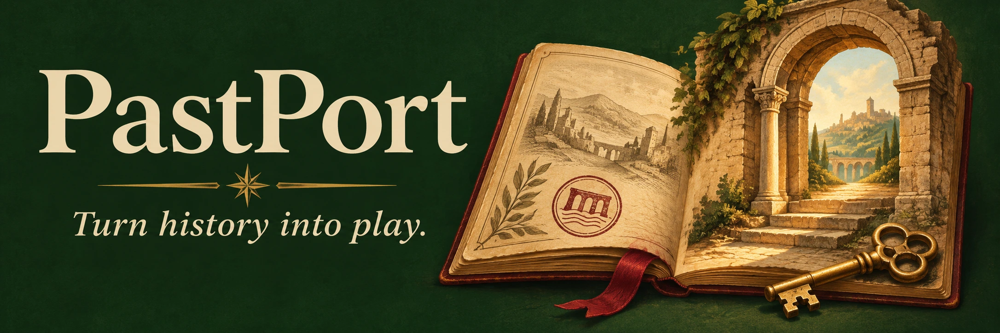
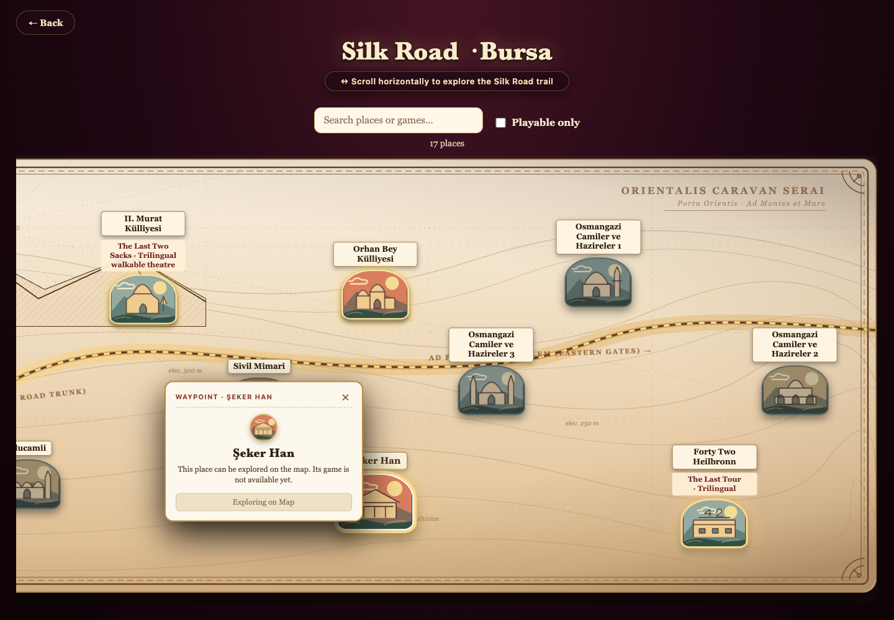
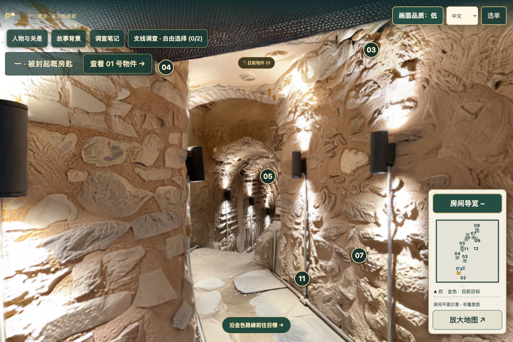
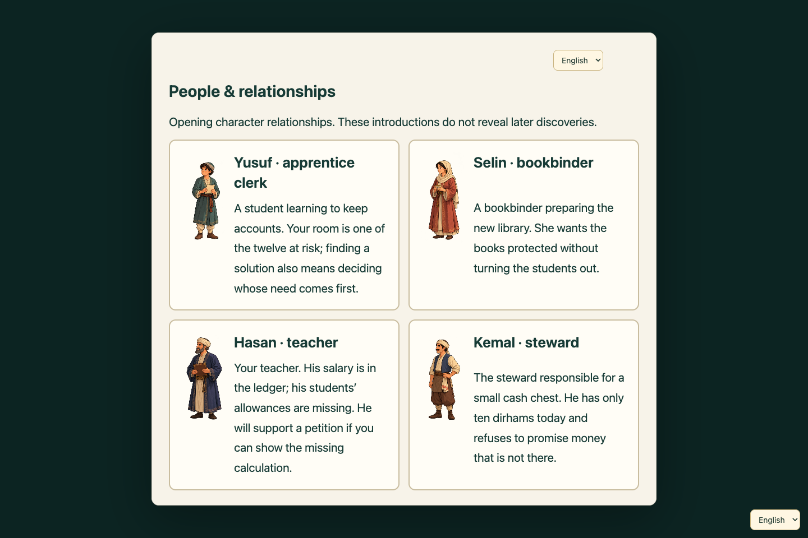
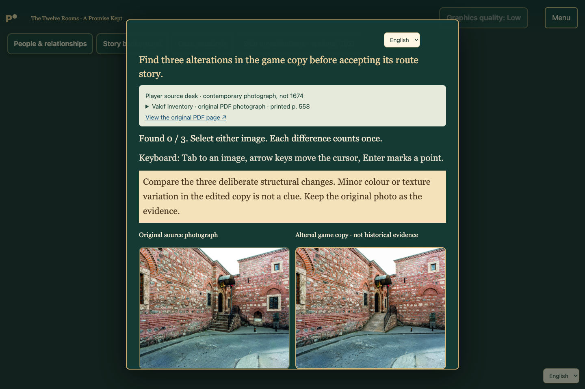

<div align="center">



# PastPort

**把历史变成故事，让探索与选择带你走进去。**

[English](README.md) · 中文

[观看 Demo](#demo) &nbsp; / &nbsp; [看看怎么玩](#experience) &nbsp; / &nbsp; [本地启动](#run-locally)

</div>

<a id="demo"></a>

## 先看看效果

<table>
<tr>
<td width="50%" align="center">
<a href="https://drive.google.com/file/d/1m5JBXLTCtL9ITxiZJSNey-Ev8xvFqccy/view?usp=sharing"></a>
<br><a href="https://drive.google.com/file/d/1m5JBXLTCtL9ITxiZJSNey-Ev8xvFqccy/view?usp=sharing"><strong>观看 Demo 视频</strong></a>
</td>
<td width="50%" align="center">
<a href="https://docs.google.com/presentation/d/1AGZIhHhWdMs3ogOZTk8CjLOHduYBt1xg/edit?slide=id.p1#slide=id.p1"></a>
<br><a href="https://docs.google.com/presentation/d/1AGZIhHhWdMs3ogOZTk8CjLOHduYBt1xg/edit?slide=id.p1#slide=id.p1"><strong>查看演示 PPT</strong></a>
</td>
</tr>
</table>

视频无需登录。完整 PPT 需要查看权限。

<a id="experience"></a>

## 选一个地方，跟着线索走，作出你的选择。

PastPort 将历史资料转化为互动三维故事。你可以探索场所、认识虚构角色，在调查与选择中了解故事背后的证据。

### 发现一处遗址



### 走进三维空间



<table>
<tr>
<td width="50%" valign="top">
<a href=".github/showcase/characters.webp"></a>
<h3>认识故事里的人</h3>
了解人物关系，以及他们各自在意的事。
</td>
<td width="50%" valign="top">
<a href=".github/showcase/investigate.webp"></a>
<h3>亲手调查线索</h3>
对照史料原照与修改后的游戏图片，找出差异。
</td>
</tr>
</table>

**史料有出处，故事有虚构，两者分清楚。** 历史背景保留来源；人物和情节属于虚构。Eyne Bey Demo 使用另一处 Şeker Han 扫描作为三维舞台。顶部横幅是品牌插画，不是历史复原图。

<a id="run-locally"></a>

## 本地启动

[下载主展示游戏](https://github.com/Psyche0920/PastPort/releases/download/eyne-bey-seker-han-demo-2026-11-08-r2/eyne-bey-seker-han.tar.gz) · [查看所有发行版](https://github.com/Psyche0920/PastPort/releases)

<details>
<summary>展开安装与启动步骤</summary>

需要 Git、uv、Python 3.12、Node.js 22.13+ 和支持 WebGL 的浏览器。

### 首次安装

```sh
git clone https://github.com/Psyche0920/PastPort.git
cd PastPort
uv sync --extra authoring --extra game-making
uv run python -m pastport organizer-init
```

按终端提示创建本机管理员账号。已有账号和项目数据会保留。

### 启动制作与审核后台

```sh
uv run python -m pastport organizer
```

打开 [Organizer](http://127.0.0.1:18840/organizer/) 并登录。

### 另开一个终端，启动玩家平台

```sh
node frontend/player/server.mjs
```

打开[玩家地图](http://127.0.0.1:18851/)。先在 Organizer 导入游戏并发布到一个地点，再从地图进入。两个终端均需保持运行；按 Ctrl+C 分别停止服务。

每套本机安装分别保存文件、账号和存档。更新仓库不会在不同电脑间同步这些数据。

</details>

<details>
<summary>项目说明</summary>

PastPort 是一个黑客松原型，内容正式发布前仍需人工审核。

[维护文档](docs/TECHNICAL_PRD.md) · [历史归档](https://github.com/Psyche0920/PastPort/tree/archive/hackathon-docs-2026-11-11) · [MIT 许可证](LICENSE)

</details>

---

由 **Mert Aslan、Weijia Han 和 Weng Man Cheung** 为 ROOT&CODE Hackathon 制作，感谢 **42 Heilbronn** 的支持。
