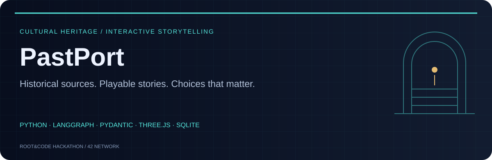
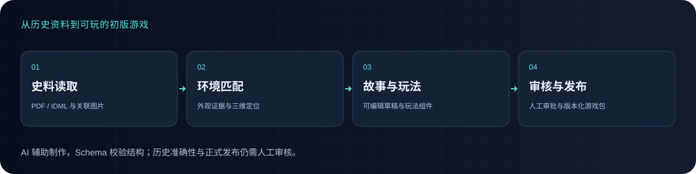
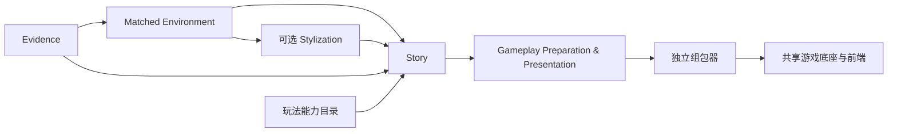
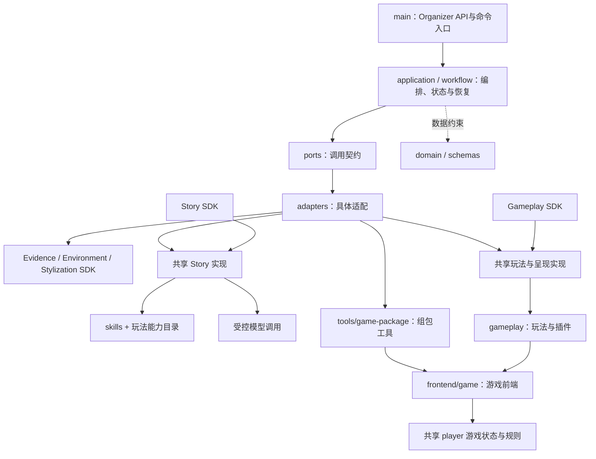

# PastPort

<div align="center">



**将历史资料转化为互动三维故事，让玩家通过探索与选择走进历史。**

中文 · [English](README.md)

[观看 Demo](#demo) · [演示 PPT](#presentation) · [快速启动](#启动与使用) · [架构与模块](#架构与模块) · [文件结构](#文件结构与用途)

</div>

<a id="demo"></a>

## 看看 PastPort 如何运行

[](https://drive.google.com/file/d/1m5JBXLTCtL9ITxiZJSNey-Ev8xvFqccy/view?usp=sharing)

**[▶ 观看完整 Demo](https://drive.google.com/file/d/1m5JBXLTCtL9ITxiZJSNey-Ev8xvFqccy/view?usp=sharing)** · 点击封面在 Google Drive 播放。

Demo 展示游戏体验；当前正式流程与独立试验的范围见下方项目文档，视频不代表所有效果均由通用生成器自动完成。

<a id="presentation"></a>

## 演示 PPT

[](https://docs.google.com/presentation/d/1AGZIhHhWdMs3ogOZTk8CjLOHduYBt1xg/edit?slide=id.p1#slide=id.p1)

**[打开 Google Slides 演示稿](https://docs.google.com/presentation/d/1AGZIhHhWdMs3ogOZTk8CjLOHduYBt1xg/edit?slide=id.p1#slide=id.p1)**



| 资料与证据 | 制作与审核 | 玩家体验 |
| --- | --- | --- |
| 读取 PDF / IDML，保留原文、图片引用与出处 | Organizer 串联五个 SDK，分阶段生成、审核和组包 | 在三维空间探索、阅读线索并作出故事选择 |

AI 主要辅助制作；代码与 Schema 校验数据，人工核对历史内容并审批发布。史料、虚构情节和替代扫描空间需要明确区分。

<a id="project-documentation"></a>

## 项目文档与当前范围

把原始史料、已匹配的博物馆环境和空间信息，转换为可浏览、可完成任务的遗址游戏。

**当前：五个 SDK 已与本地 main 集成；真实材料的保存结果复跑、组包与 3D 通关已验证。命令行复跑不调用模型；Organizer分别提供缓存复用与明确授权后的新生成。源码通过 Git 管理；本地试玩产物不随源码发布。**

正式 IDML 流程读取原文和关联图片，识别场景物件，再匹配、独立复核并定位候选。原生场景入口使用 IDML + SPZ + 三角网格 PLY；Links 配图可选，缺图时保留图片证据缺口。环境准备完成后停下，不自动生成故事。

匹配只接受有来源支持的同物外观证据，不输出功能类比。细节模糊可记为局限，但主要结构矛盾或位置证据不足仍保留未确认。模型确认不代替人工审批。文字优先定向查找与移动取景复核尚未接入正式入口。

## 当前游戏发行版

| 游戏 | 当前列出的最新版本 | 下载 |
| --- | --- | --- |
| 《十二间房 · 未完的承诺》 | Eyne Bey r2 · 中文 / English / Türkçe | [游戏包](https://github.com/Psyche0920/PastPort/releases/download/eyne-bey-seker-han-demo-2026-11-08-r2/eyne-bey-seker-han.tar.gz) |
| 《最后两袋》 | 三语可行走剧场 | [游戏包](https://github.com/Psyche0920/PastPort/releases/download/muradiye-ui-trial-2026-11-07-trilingual/muradiye-ui-trial.tar.gz) |
| The Last Tour | 四二场景三语版 | [游戏包](https://github.com/Psyche0920/PastPort/releases/download/wcheung-demo-2026-11-07-trilingual/wcheung.tar.gz) |

在 Organizer「制作进度与交付 → 导入交付包」导入 `.tar.gz`，再明确选择站点和版本发布。GitHub 的 Source code 下载项不是游戏包。拉取源码不会同步私有任务、上传材料、账号或存档。

Eyne Bey 游戏的史料主体为布尔萨经学院，采用伊斯坦布尔 Şeker Han 地下室扫描作为替代舞台；虚构剧情、修改后的拼图图片与原始证据分别标明。这是独立打磨的成品包，不代表通用生成器对任意输入都有同等效果。发行检查不代替人工历史／剧情审核，也不证明实机稳定帧率；下载包不代表本机地图已发布该版本。

## 启动与使用

需要 Git、uv、Node.js 22.13+ 和支持 WebGL 的浏览器。以下命令用于 macOS、Linux；Windows 请使用 WSL2 的 Ubuntu 终端。在仓库根目录运行；仓库可以放在任意目录。

首次使用这台电脑：

```sh
git clone https://github.com/Psyche0920/PastPort.git
cd PastPort
uv sync --extra authoring --extra game-making
uv run python -m pastport organizer-init
```

私有仓库需要先取得 GitHub 访问权限。初始化会让你在终端输入并确认管理员密码，用户名为 `admin`。已有账号配置会被保留。首次安装需要联网下载依赖。

以后每次启动，在仓库根目录执行：

```sh
uv run python -m pastport organizer
```

打开 [Organizer 后台](http://127.0.0.1:18840/organizer/)，使用管理员账号登录。服务在当前终端前台运行，保持终端打开，按 Ctrl+C 停止。端口占用时检查已有服务；也可以用 `uv run python -m pastport organizer --port 18841`，并打开相应端口。


### 三个入口的关系

Main 是 Python 核心程序与工作流，Organizer 是 Main 提供的制作／审核界面，不需要另起第三个 Main 服务。玩家平台是独立 Node.js 服务。正常本机演示使用两个终端；需要公网访问时，再开第三个终端运行共享入口。

### 更新已有安装

先在仓库根目录运行 `git status`，保留自己的修改，再更新代码及 Python 依赖：

```sh
git pull --ff-only origin main
uv sync --extra authoring --extra game-making
```

拉取后应由服务持有人在对应终端按 Ctrl+C，再按下文重启需要更新的服务；刷新网页不能替换运行中的 Python／Node.js 后端。已有安装不必反复运行 `organizer-init`，也不要为更新代码删除数据目录。Git 仅同步源码，不会传输上传文件、游戏包、账号或存档。

### 本机玩家端：第二个终端

保持 Organizer 运行，另开终端，在同一个仓库根目录执行：

```sh
node frontend/player/server.mjs
```

打开 [玩家平台](http://127.0.0.1:18851/)。玩家自行注册／登录；玩家账号不是 Organizer 管理员账号。地图只启动已发布版本，导入游戏包后仍需在 Organizer 选择站点并发布。玩家端端口占用时，可使用 `PLAYER_PORT=18861 node frontend/player/server.mjs`。Node.js 需要支持内置 `node:sqlite`（建议 Node.js 22.13+ 或更新的 LTS）。

### 数据保存在哪里

默认 Organizer 数据位于 `var/organizer-integration/server/organizer/`，玩家账号、印章和已同步存档位于 `frontend/player/.local/players.sqlite`，上传资源和游戏包另存为文件。浏览器仍有本地运行状态／缓存；只有服务端确认后，才算账号进度已同步。分别在不同电脑启动 Organizer／玩家服务，会形成各自独立的数据，不会自动合并。

Cloudflare Tunnel 只将公网请求转发到本机，不是把程序或数据库部署到云端。其他人通过同一个 STAFF 入口上传的材料、通过 PLAYER 入口成功同步的账号进度，均保存在主机的相应数据目录。主机须保持运行和联网。

### 不同 Wi-Fi：临时共享本机服务

使用 `--share-organizer` 前，必须先在另一个终端启动 Organizer 并保持运行。共享命令在建立隧道之前检查本机后台端口与管理员初始化状态；未启动或端口错误会给出明确提示。共享命令报错退出后，本次打印的临时链接也会关闭，修正后需重跑获取新链接。后台使用18841时运行 `node frontend/player/remote.mjs --share-organizer --organizer-port 18841`。

先按上文在自己的终端启动 Organizer，并至少启动过一次玩家平台（建立玩家数据目录）。本机需装好 [cloudflared](https://developers.cloudflare.com/tunnel/get-started/quick-tunnels/)；macOS 可用 `brew install cloudflared`。然后在仓库根目录另开终端：

```sh
node frontend/player/remote.mjs --share-organizer
```

终端打印两个临时 HTTPS 入口：**PLAYER** 发给玩家，**STAFF** 只发给队友，用原 Organizer 账号登录。所有人访问这台主机的同一份历史、发布和玩家数据库；队友不用在自己的电脑重新启动另一套服务或导入已发布的包。原本的本机服务继续运行，远程玩家服务使用本机 18852 端口；占用时加 `--port 18853`，Organizer 改端口时加 `--organizer-port 18841`。只分享玩家平台可去掉 `--share-organizer`。

`ORGANIZER_DATA` 和 `PLAYER_DATA` 如有自定义，运行共享命令时仍须指向原来的数据目录。共享命令要求已有玩家数据库和 Organizer 目录，不自动创建空的替代库。它只启动本命令拥有的远程服务和隧道，Ctrl+C 会关闭这些子进程，不关闭原有本机 Organizer/玩家服务，不删除数据。

每个已发布游戏按需使用独立的临时 HTTPS 隧道，保留原包的绝对资源路径，人物对话、3D、音视频与账号存档消息连接到正确的平台 Origin。游戏与后台账号位于不同 Origin。HTTPS 玩家会话 cookie 启用 Secure；后台入口只转发 `/organizer/`，保留登录/修改来源校验，并禁止远程管理员初始化。**远程私有预览地址尚未适配**；在主机导入后发布，再从 PLAYER 地图打开验证。通过 STAFF 入口上传的游戏包会分块传输，不受隧道单次请求的大小上限影响。

这是临时联调入口：主机需保持联网和唤醒、终端需保持打开；重启共享命令会换地址，但原数据保留。地址不是账号密码保护的替代物，STAFF 不应公开转发。旧 UI Trial 已通过独立的事件日志格式保存到账号，恢复时由原引擎重放校验。正式长期服务、固定域名和完整双设备验收仍按技术 PRD 第14节执行。

若出现域名无法解析，先检查访问设备的网络/DNS，不要用关闭来源校验或修改游戏指向本机来绕过。Quick Tunnels 的临时地址、无可用性保证、200 个在途请求限制及不支持 SSE 见 [Cloudflare 官方说明](https://developers.cloudflare.com/tunnel/get-started/quick-tunnels/)。

### 共享游戏包：上传、获取、修改、发布

所有成员登录同一个 Organizer（本机或 STAFF 入口），在「制作进度与交付」操作同一份游戏包、版本和发布；列表与玩家地图每 4 秒自动更新，无需重新导入或手动刷新。

1. **上传**：在「共享游戏包」选择 `.tar.gz`，点击「导入交付包」。文件按 16 MB 分块上传（低于隧道的单次请求上限），显示进度、断点重试与成功或失败结果；包内代码不会运行。同名包已存在时，改用该包卡片上的「提交新版」。
2. **获取**：卡片上的「下载当前版」返回提交时的原文件，可直接重新导入。「查看配套资料」列出包内可编辑文件（如 `authoring/`）；后台没有保存的原始史料、匹配结果会标为“缺失”。
3. **修改并提交新版**：解包、修改，再以同名文件夹重新打包（`tar -czf maslan.tar.gz maslan`），然后在原卡片点击「提交新版（基于第 N 版）」。无需重跑 main 流程或调用模型。若他人已先提交更新的版本，你的提交会被拒绝且文件不保存，请先下载最新版合并修改。
4. **版本**：每次提交都是新的不可变版本，旧版保留并可下载；「设为当前版本」用于恢复上一版。
5. **发布与回退**：在卡片选择站点和版本，点击「发布到玩家地图」。「玩家地图发布」显示各站点当前版本，可「回退到上一次发布」。若期间他人发布了其他版本，本次发布会被拒绝。发布或回退都不会删除玩家存档和奖章。
6. **玩家**：已开始的一局固定在开局时的版本。地点发布新版后，玩家可选「继续上次进度（旧版）」或「体验新版（另开新存档）」。游戏页显示“正在同步”“已同步到账号”“未同步”或“存档冲突”；只有服务器确认后才显示“已同步”。旧版 UI Trial（`muradiye-ui-trial`）同样保存到账号。

**备份、恢复与数据保护**：`uv run python -m pastport organizer-backup --output var/backups/2026-11-05` 会生成一致的备份，包含两套数据库、游戏包、发布记录和账号文件（含密码哈希，须私下保存）。恢复演练可在另一个端口启动：`uv run python -m pastport organizer --directory var/backups/2026-11-05 --port 18841`，以及 `PLAYER_PORT=18861 PLAYER_DATA=var/backups/2026-11-05/player ORGANIZER_DATA=var/backups/2026-11-05/server/organizer node frontend/player/server.mjs`。持久目录丢失或指向另一份数据时，Organizer 和玩家服务会拒绝启动，不会新建空库替代原数据。

### Organizer：主办方入口

Organizer 的「制作进度与交付」分为「游戏包」「地图发布」「制作记录」三个页签：游戏包管理试玩、下载、配套资料与新版；地图发布查看线上版本；制作记录可按项目编号或状态查找。版本历史、提交新版和技术路径默认折叠。仅归档制作历史不会删除包文件；已归档记录仍可按原编号解析，保持游戏包下载、预览和资料关联。 已发布卡片提供「解除发布」，确认后按当前版本核对，仅移除站点与游戏的关联；地图节点、包文件、发布历史、玩家存档和奖章均保留。解除成功后，卡片立即从「地图发布」移除；后续刷新失败或旧请求迟到也不会恢复旧卡片。玩家地图刷新后不再提供该入口，已打开的游戏不会强制关闭。

下载团队交付包，在「制作进度与交付」选择 `.tar.gz` 并点击「导入交付包」，再打开独立玩家预览。新电脑的历史记录从导入开始。已完成且可预览的交付卡片均可选择地图站点发布。

账号、上传、缓存和交付记录保存在当前仓库的 `var/organizer-integration/`。关闭服务后数据仍保留。换电脑时导入团队交付包或上传原始材料。账号配置和数据库包含私有数据，应单独备份。

可用 `--directory` 指定另一份本地配置目录；初始化与启动应使用同一路径。若存在 `catalog.json`，启动时自动读取；新电脑可以直接导入游戏包。需要从原始材料制作游戏时，按页面提供资料和模型授权。播放器附加资源为可选项；未指定时，后台自动创建数据目录下的 `organizer/player-assets` 空目录，不会阻挡资料与环境准备。自定义资源可显式指定 `--player-assets /path/to/assets`。历史项目中登记的材料路径也需要在当前电脑可用。

已有3D上传：选择“原始 PDF + 照片 + 已有 SPZ / PLY 场景”，不勾默认资料，填写新项目编号并上传四类文件。保存后核对调用预算，再点“准备资料与环境”；后续按审核 → 故事 → 制作游戏继续。只在你明确授权后调用识别/故事模型，Marble为0。照片支持多张图片或ZIP；PLY须为二进制小端三角网格，需本机Chrome和Node.js进行取景。证据预算不足会在调用前停止；44张照片和62页PDF的首轮下限为43次，另需逐物件核验，不能用旧8次上限当整套预算。新路径的接线/模拟执行与单物件真实资料已检查，整套新材料的真实模型运行由上传测试验收。


新照片任务采用紧凑策略：每批2张，最多12个新物件、24条观察；名称、特征及解释按Schema限制长度，单批最多120秒或授权的更短时限。发现超过本批容量时报告不完整并停止，不把缺失当成功。旧策略与已付费回执保持原样，失败不自动重试；此限制已通过离线回归，尚未完成真实模型速度验收。

PDF 资料逐页提取全文和行号，不再逐页生成图片；仅扫描／明显乱码页临时渲染并用本地 Tesseract OCR。保留原文件、PDF 页序号、页内起止行号和原文引用；行号按固定提取版本生成。OCR 需要本机安装 Tesseract 和对应语言数据，可用 `PASTPORT_OCR_LANGUAGES=eng+chi_sim+tur` 指定已安装语言。环境准备仍在环境就绪时停止，不自动生成故事。

### 制作流程

1. **准备资料与环境**：选择下表中的材料起点。勾灰框复用整套默认资料和已有环境，零模型、零Marble调用；不勾则使用上传材料执行所选阶段，需要生成3D时单独授权Marble。完整原生3D环境不重复生成。
2. **资料与审核**：自动承接上一步。使用环境SDK的同一套VR/3D审核界面，核对照片、史料、介绍和审核状态；可在全景与3D中查看。介绍/审核共用，位置和导航各自保存。保存后自动同步当前输入，无需重复选项目或确认传递。
3. **准备故事**：旧故事先做来源、任务、玩法和空间兼容检查。通过即可复用；仅介绍发生待核对改动时需本人确认；关键依据或任务条件失效不能跳过。保存版本号变化而内容相同，不要求确认。也可明确授权SOL 6.1 High生成新故事，失败不自动重试。两种路径都在故事就绪后停下。
4. **制作游戏**：故事就绪后点击“开始制作”，执行玩法准备、呈现绑定、组包与资源检查；在“制作进度与交付”打开玩家预览。不会再生成环境或故事。

Organizer 的语言选择只翻译操作界面，不改写史料、介绍或 Story 创作内容，不提交表单、调用模型或丢弃未保存输入。 Organizer 和玩家地图均可选简体中文 / English / Türkçe；从地图启动时把所选语言传给游戏。本机三语游戏现包括穆拉迪耶《最后两袋》可行走剧场和四二节点《The Last Tour》（wcheung）：对白、编译后任务目标、标牌、笔记、结局及游戏聊天线索图三语显示；史料原图与专名保留原样。其他游戏不变；已打开的游戏需退出后从地图重新打开新版。旧版存档继续对应旧版。体验目标时长是Story创作目标，不是制作耗时或精确游玩计时。

| 上传起点 | 环境阶段执行内容 | 已有成果 |
|---|---|---|
| 原始PDF + 照片（或ZIP）+ 同场景SPZ + 三角PLY | 本地导入/六向取景 → Evidence → 物件匹配挂载 | 不调用Marble；保留待审核状态与待校准状态 |
| PDF资料（普通文档或展签）+ 同场景SPZ + 三角PLY | 所有PDF统一：3D派生观察图 → Evidence识别、史料关联与引文核验 → 3D挂载与交接 | 在 Admin 选“PDF 资料 + 已有 SPZ 和 PLY 场景”，保存后点“准备资料与环境”，完成后核对资料，再分别准备故事和开始制作；网页不提供整链快捷按钮，不额外要求照片，不调用Marble。 |
| 原始史料PDF + 现场物件照片 + 可选360°导览 | Evidence生成映射 → 环境匹配 → 3D | 缺导览时先保存映射，补导览并查看摘要后继续 |
| 原始PDF + 映射PDF + 360°导览 | 环境匹配 → 3D | 复用映射PDF |
| 原始PDF + 原生匹配VR包 | 校验导入 → 3D | 复用VR绑定、审核和导航 |
| 原始PDF + 原生已挂载双点位3D包 | 校验并导入 | 复用3D、物件、审核、位置和导航，不调用Marble |

默认选项使用已登记、同源且完整的PDF、照片、映射、VR/3D资料；后续故事仍需单独选择。跨PDF、文件变化、来源不一致或缺失时停止，不暗中换用缓存。上传包作为数据读取，不执行其中代码。**普通全景不等于已匹配VR，裸3D模型不等于已挂载环境**；新增“PDF＋照片＋SPZ/PLY”上传入口会先把裸模型转为可审核的挂载环境，再进入故事；裸模型本身仍不等于挂载完成。

### 本机保存位置

| 内容 | 当前保存位置与用途 |
|---|---|
| 制作记录与项目元数据 | `var/organizer-integration/server/organizer/organizer.sqlite3` |
| 上传、审核输入快照、故事与每次制作缓存 | `var/organizer-integration/server/organizer/`，按项目和任务隔离 |
| 可玩游戏包 | 对应任务 `jobs/<任务>/builds/<构建>/game-3d/`；以网页显示的实际路径为准 |
| 物件介绍与审核数据库 | 环境项目自己的 `pastport_matching.sqlite3`；“资料与审核”显示当前完整路径并可复制 |
| 当前默认资料登记 | `var/organizer-integration/catalog.json`，引用整套私有材料 |
| 运行与验收证据 | `var/organizer-integration/`；不随源码公开 |

游戏包是缓存里的最终成品，不是另一份完整重复缓存。关闭网页不会删除保存结果。页面显示的路径属于后台所在电脑。旧游戏包保持快照，审核变化不会即时改写已生成成品；需重新制作才能交付新版本。

### 保存结果复跑与独立试玩

维护者可用已保存故事复核并重新组包，不调用模型：

```sh
.venv/bin/pastport-game-trial --request var/runtime-layout-20261101/request-release.json
```

命令自动完成复核、玩法、呈现、组包与文件检查，不需另起组包服务。同一输入/实现可恢复；变化后采用新的输出目录，不覆盖旧输入锁或成品。该命令只复跑保存结果；新故事可从Organizer授权生成，SDK命令见各包说明。

保留的独立试玩基线为[本机3D试玩](http://127.0.0.1:18839/?scene=3d)，不等于Organizer最新任务。服务关闭时可启动：

```sh
PASTPORT_PORT=18839 node var/runtime-layout-20261101/release-run/game-3d/serve3d.mjs
```

日常使用Organizer任务自己的“打开玩家预览”，由main启动已登记的本机预览服务，无需猜构建路径。当前不是公网部署。

### 当前交付范围

历史记录按项目编号显示，已准备的项目提供“继续此项目”和“查看资料与审核”。当前项目选择按管理员身份保存在Organizer本机数据库中，刷新、重新登录和重启服务后可恢复；恢复只连接已有环境、审核和故事，不发起生成。资料审核的项目选择器保持可见。

Organizer支持单管理员登录、四种材料起点、整套默认复用、审核自动衔接、旧故事兼容检查、新故事生成、真实进度与成品入口。中英文手动切换已验证。缓存到游戏的零模型链路及已有环境的新故事有实际运行记录；逐种新材料完整调用Evidence/Marble的外部生成验收仍未全部完成。

Story新生成采用固定内容计划，由代码编译编号、状态、规则和引用；格式通过不代表故事好玩或历史内容获批。风格转绘SDK存在，但Organizer还没有新转绘操作，只能复用已有结果。玩家地图现已使用独立账号与 SQLite 存档；共享后端的设备可恢复同账号、站点及发布版本的游戏进度，具体启动及边界见文末。源码是当前基线，既有wheel不自动包含后续源码修复，需要重新构建才能交付更新。

## 架构与模块



main 用现有 LangGraph、SQLite 和 typed SDK 组织执行。Story 生成前同时考虑史料、审核文字/物件、空间导航和玩法能力；下游按同一份规则落实，不能改数量或偷偷换玩法。玩法、呈现和组包当前都是本地代码，不再调用模型。

| 模块 | 当前版本 | 说明与操作 |
|---|---|---|
| Evidence | 0.1.0 | [史料提取、来源与匹配文档](packages/evidence-sdk/README.md) |
| Matched Environment | 0.1.0 | [审核内容、VR/3D、挂载与导航](packages/matched-environment-sdk/README.md) |
| Stylization | 0.1.0 | [全景和 3D 外观处理](packages/stylization-sdk/README.md) |
| Story | 0.1.0rc4 | [剧情、任务、空间及玩法意图](packages/story-sdk/README.md) |
| Gameplay Preparation & Presentation | 0.1.0rc2 | [玩法参数、生命周期和呈现绑定](packages/gameplay-sdk/README.md) |
| 共享运行时 | 0.2.1rc4 | main 与两个下游 SDK 共用，不复制引擎 |

制作端的关系是：main 调用 Story SDK 产出剧情任务，再调用玩法准备与呈现 SDK 产出配置和绑定，最后由独立组包器封装。SDK 是调用入口，部分实现由共享的 `pastport` 核心包提供。

玩家端只运行游戏包内的前端、玩法插件、JS 引擎及环境/故事数据；不运行 Python Story SDK 或玩法准备 SDK。玩法源码在 `gameplay/`，生成包目前携带完整的已登记玩法执行器，不做逐玩法代码裁剪。SDK 安装后读取随共享运行时携带的资源，不回本地源码仓库取文件。

组包器是独立共享模块，尚未单独发行 SDK。当前支持已验证的双视点、资料阅读与来源判断后的矩形覆盖玩法，不代表任意小游戏都可直接接入。

## 目录与文件用途

五个 SDK 的文件结构与用途分别在各自 README 中（见上方模块链接）。下面直接列 main 和公共文件，每行同时显示层级与用途。

### 代码之间怎么连接



**目录是代码位置，SDK 是安装边界。** Story 和 Gameplay 的包提供调用入口，实现复用 `src/pastport/`；游戏前端在 `frontend/game/`，玩法代码在 `gameplay/`，组包工具在 `tools/game-package/`，引擎权威源码在 `src/pastport/player/`。组包时按显式资源清单生成运行副本，不维护第二份引擎源码。具体接口见技术 PRD，逐文件用途见下面清单。


<!-- BEGIN FILE INVENTORY -->
## 文件结构与用途

目录和文件名称均可点击；同一行说明用途。SDK内部文件见各自README；本树列出 main 与公共维护文件。

<pre>
PastPort/
├── <a href=".github/">.github/</a>  — 开发工具约束与 GitHub 自动检查配置
│   ├── <a href=".github/workflows/">workflows/</a>  — GitHub Actions 持续集成任务
│   │   └── <a href=".github/workflows/ci.yml">ci.yml</a>  — GitHub Actions 持续集成：安装依赖并执行仓库检查与测试。
│   ├── <a href=".github/showcase/">showcase/</a>  — GitHub 展示图片，不属于程序运行时资源
│   │   ├── <a href=".github/showcase/hero.svg">hero.svg</a>  — 与 GoalCoach 风格统一的项目封面
│   │   ├── <a href=".github/showcase/presentation-cover.png">presentation-cover.png</a>  — 演示稿真实首页，用于 PPT 的可点击封面
│   │   ├── <a href=".github/showcase/demo.svg">demo.svg</a>  — 指向 Demo 视频的可点击封面
│   │   ├── <a href=".github/showcase/workflow-zh.svg">workflow-zh.svg</a>  — 中文制作流程概览
│   │   └── <a href=".github/showcase/workflow-en.svg">workflow-en.svg</a>  — 同一制作流程的英文版
│   └── <a href=".github/copilot-instructions.md">copilot-instructions.md</a>  — Copilot 的仓库开发约束与规范入口。
├── <a href="docs/">docs/</a>  — 唯一技术 PRD：系统架构、接口和验收范围
│   ├── <a href="docs/TECHNICAL_PRD.md">TECHNICAL_PRD.md</a>  — 当前唯一技术 PRD：main/SDK 职责、架构、技术栈、输入输出及验收边界。
│   └── <a href="docs/TECHNICAL_PRD_EN.md">TECHNICAL_PRD_EN.md</a>  — 同一技术规范的英文译本；架构、契约、启动方式与验收边界。
├── <a href="frontend/">frontend/</a>  — Organizer制作后台与User游戏界面的前端源码
│   ├── <a href="frontend/game/">game/</a>  — 游戏宿主：对话、任务、调查活动、3D 交互、导航和会话。
│   │   ├── <a href="frontend/game/app.css">app.css</a>  — 试玩主界面的布局、对话、任务和玩法样式。
│   │   ├── <a href="frontend/game/app.mjs">app.mjs</a>  — 试玩页面主控制器，连接对话、任务、插件、场景与操作。
│   │   ├── <a href="frontend/game/cinematic-view.mjs">cinematic-view.mjs</a>  — 演出式视图控制：镜头、移动输入和物件交互。
│   │   ├── <a href="frontend/game/dialogue.mjs">dialogue.mjs</a>  — 改编既有试玩的逐句对话展示：每次一名说话者、一句话，点击继续。
│   │   ├── <a href="frontend/game/game-locale.mjs">game-locale.mjs</a>  — 游戏展示文案的语言转换，复用玩家端词库而不修改剧情状态。
│   │   ├── <a href="frontend/game/index.html">index.html</a>  — 试玩宿主页面的 HTML 入口。
│   │   ├── <a href="frontend/game/interaction.mjs">interaction.mjs</a>  — 协调物件点击、查看与接近动作，避免交互手势冲突。
│   │   ├── <a href="frontend/game/investigation-view.mjs">investigation-view.mjs</a>  — 渲染找不同、时间线、拼图和场景查找界面，连接玩家操作与宿主回调。
│   │   ├── <a href="frontend/game/navigation.mjs">navigation.mjs</a>  — 检查导航连接、度量空间和行走约束是否合法。
│   │   ├── <a href="frontend/game/room-minimap.mjs">room-minimap.mjs</a>  — 绘制受场景坐标约束的二维小地图与物件提示，不授予史料观察凭证。
│   │   ├── <a href="frontend/game/scene-preparation.mjs">scene-preparation.mjs</a>  — 管理用户启动的场景预加载、LOD 准备、进度和超时。
│   │   ├── <a href="frontend/game/scene3d-bridge.mjs">scene3d-bridge.mjs</a>  — 剧情侧的交互契约；导航由场景宿主统一控制。
│   │   ├── <a href="frontend/game/scene3d-navigation.mjs">scene3d-navigation.mjs</a>  — 保留来源导航位姿；屏幕方向提示仅相对当前相机计算。
│   │   ├── <a href="frontend/game/scene3d-runtime.js">scene3d-runtime.js</a>  — 注入独立 3D 视图的运行桥接，传递导航和剧情交互，不修改上游场景文件。
│   │   ├── <a href="frontend/game/scene3d-view.mjs">scene3d-view.mjs</a>  — 3D 宿主浏览器适配器，将场景交互接入现有剧情界面。
│   │   ├── <a href="frontend/game/session.mjs">session.mjs</a>  — 管理试玩会话、状态推进及存档恢复。
│   │   ├── <a href="frontend/game/slice-continuation.mjs">slice-continuation.mjs</a>  — 用同一游戏引擎重放、核验并继续绑定游戏包的存档。
│   │   ├── <a href="frontend/game/startup-options.mjs">startup-options.mjs</a>  — 保存设备侧自动 LOD 偏好，不改变剧情或存档权威状态。
│   │   └── <a href="frontend/game/walkmesh.mjs">walkmesh.mjs</a>  — 独立于屏幕显示的可行走性判断、寻路与角色移动。
│   ├── <a href="frontend/organizer/">organizer/</a>  — Organizer制作前端：认证、真实上传、登记材料复用/重新生成、执行进度与交付
│   │   ├── <a href="frontend/organizer/app.css">app.css</a>  — Organizer布局、响应式样式和操作状态。
│   │   ├── <a href="frontend/organizer/app.mjs">app.mjs</a>  — 按资料与环境→原审核后台→故事→最终玩法与组包编排；分别控制复用/新生成。
│   │   ├── <a href="frontend/organizer/i18n.mjs">i18n.mjs</a>  — 后台简中、英文、土耳其语词库及动态绑定；审核展示译文独立切换，保留原文及编辑值。
│   │   ├── <a href="frontend/organizer/index.html">index.html</a>  — 由 main 的 /organizer/ 提供的真实制作页；需 HTTP 服务与登录。
│   │   ├── <a href="frontend/organizer/review.mjs">review.mjs</a>  — 嵌入同源审核页，读取展示译文缓存，处理未保存修改、保存通知及后续输入同步。
│   │   └── <a href="frontend/organizer/sketch.html">sketch.html</a>  — Organizer交互设计源稿：四种材料起点、对应审核、复用进度与交付；尚未连接后台。
│   └── <a href="frontend/player/">player/</a>  — 玩家地图、账号、印章及账号进度同步
│       ├── <a href="frontend/player/app.mjs">app.mjs</a>  — 地图、账户、发布试玩及存档同步界面。
│       ├── <a href="frontend/player/cloud-saves.mjs">cloud-saves.mjs</a>  — 玩家、站点和版本隔离的 SQLite 存档仓储，支持修订冲突检查及旧局归档后重置。
│       ├── <a href="frontend/player/completion-verifier.mjs">completion-verifier.mjs</a>  — 核验同版本存档、必需任务与结局条件，控制是否允许发章。
│       ├── <a href="frontend/player/data-identity.mjs">data-identity.mjs</a>  — 将玩家数据库身份绑定到 Organizer 部署，拒绝误指向或丢失的数据目录。
│       ├── <a href="frontend/player/game-display-locale.mjs">game-display-locale.mjs</a>  — 不改引擎状态的游戏三语显示层。
│       ├── <a href="frontend/player/game-display-locales.json">game-display-locales.json</a>  — 简体中文、英文和土耳其语显示词库。
│       ├── <a href="frontend/player/game-save-bridge.mjs">game-save-bridge.mjs</a>  — 游戏启动前恢复存档并桥接原有保存点。
│       ├── <a href="frontend/player/illustrations.mjs">illustrations.mjs</a>  — 地图节点与奖章插画。
│       ├── <a href="frontend/player/index.html">index.html</a>  — 玩家平台 HTML 入口。
│       ├── <a href="frontend/player/network.mjs">network.mjs</a>  — 校验浏览器 Origin，管理临时 Cloudflare 隧道和子进程关闭。
│       ├── <a href="frontend/player/organizer-gateway.mjs">organizer-gateway.mjs</a>  — 检查后台可用性，只转发受认证的 Organizer 路由，不暴露初始化入口。
│       ├── <a href="frontend/player/remote.mjs">remote.mjs</a>  — 前台运行公网共享入口，协调玩家服务、后台网关与临时隧道。
│       ├── <a href="frontend/player/save-sync.mjs">save-sync.mjs</a>  — 合并写入、顺序保存、冲突与显式重试。
│       ├── <a href="frontend/player/server.mjs">server.mjs</a>  — 玩家 HTTP 服务、SQLite 账号与游戏加载。
│       ├── <a href="frontend/player/sites.json">sites.json</a>  — 与 Organizer 发布选择共享的地图站点目录。
│       ├── <a href="frontend/player/sites.mjs">sites.mjs</a>  — 读取地图站点。
│       └── <a href="frontend/player/style.css">style.css</a>  — 玩家地图和护照样式。
├── <a href="gameplay/">gameplay/</a>  — 玩法计划与呈现输入准备；复用插件和共享契约
│   ├── <a href="gameplay/plugins/">plugins/</a>  — 本地小游戏执行器、拼板求解与生成的玩法能力目录
│   │   ├── <a href="gameplay/plugins/coverage.mjs">coverage.mjs</a>  — 按实际拼板放置规则求解覆盖题，提前拒绝无解配置。
│   │   ├── <a href="gameplay/plugins/gameplay-catalog.mjs">gameplay-catalog.mjs</a>  — 由共享能力 JSON 生成的浏览器能力目录，勿独立修改。
│   │   ├── <a href="gameplay/plugins/investigation.mjs">investigation.mjs</a>  — 定义并校验调查类玩法配置，处理有限的本地活动状态。
│   │   └── <a href="gameplay/plugins/plugins.mjs">plugins.mjs</a>  — 本地 Activity 插件执行器，运行问答、归类、拼板等玩法并返回结果。
│   ├── <a href="gameplay/contracts.mjs">contracts.mjs</a>  — 玩法准备与组包共用的博物馆快照身份和领域错误；不依赖前端或组包编译器。
│   ├── <a href="gameplay/gameplay.mjs">gameplay.mjs</a>  — 将任务玩法声明转换为已登记插件的绑定计划并校验身份。
│   ├── <a href="gameplay/prepared-game.mjs">prepared-game.mjs</a>  — 读取玩法与呈现准备产物，检查故事、物件和能力目录身份后交给宿主。
│   └── <a href="gameplay/story-presentation.mjs">story-presentation.mjs</a>  — 从已校验剧情生成开场、人物和呈现文案，不泄露隐藏目标。
├── <a href="packages/">packages/</a>  — 五个独立 SDK；点击各包查看源码及专属 README
│   ├── <a href="packages/evidence-sdk/">evidence-sdk/</a>  — 证据 SDK：史料提取、照片观察、匹配与来源记录
│   ├── <a href="packages/gameplay-sdk/">gameplay-sdk/</a>  — 玩法准备与呈现 SDK：编译玩法配置并绑定视点、导航和界面
│   ├── <a href="packages/matched-environment-sdk/">matched-environment-sdk/</a>  — 环境 SDK：审核数据、VR/3D 挂载、导航与空间信息
│   ├── <a href="packages/story-sdk/">story-sdk/</a>  — Story SDK：根据史料、环境与玩法能力生成剧情和任务
│   └── <a href="packages/stylization-sdk/">stylization-sdk/</a>  — 转绘 SDK：保留环境结构，处理全景与三维外观
├── <a href="schemas/">schemas/</a>  — 由类型模型生成的 JSON Schema 边界契约
│   ├── <a href="schemas/action-request.schema.json">action-request.schema.json</a>  — 自动生成的 ActionRequest JSON Schema，定义边界字段、类型和约束；通过契约工具更新。
│   ├── <a href="schemas/action-result.schema.json">action-result.schema.json</a>  — 自动生成的 ActionResult JSON Schema，定义边界字段、类型和约束；通过契约工具更新。
│   ├── <a href="schemas/action-vector.schema.json">action-vector.schema.json</a>  — 自动生成的 ActionVector JSON Schema，定义边界字段、类型和约束；通过契约工具更新。
│   ├── <a href="schemas/artifact-ref.schema.json">artifact-ref.schema.json</a>  — 自动生成的 ArtifactRef JSON Schema，定义边界字段、类型和约束；通过契约工具更新。
│   ├── <a href="schemas/assembly-request.schema.json">assembly-request.schema.json</a>  — 自动生成的 AssemblyRequest JSON Schema，定义边界字段、类型和约束；通过契约工具更新。
│   ├── <a href="schemas/assembly-result.schema.json">assembly-result.schema.json</a>  — 自动生成的 AssemblyResult JSON Schema，定义边界字段、类型和约束；通过契约工具更新。
│   ├── <a href="schemas/branch-story-plan-result.schema.json">branch-story-plan-result.schema.json</a>  — 分支剧情生成结果的 JSON Schema，约束候选、覆盖和内容结构。
│   ├── <a href="schemas/branch-story-plan.schema.json">branch-story-plan.schema.json</a>  — 分支剧情计划的 JSON Schema，约束路线、覆盖及调查设计。
│   ├── <a href="schemas/budget-policy.schema.json">budget-policy.schema.json</a>  — 自动生成的 BudgetPolicy JSON Schema，定义边界字段、类型和约束；通过契约工具更新。
│   ├── <a href="schemas/bundle.schema.json">bundle.schema.json</a>  — 自动生成的 PackageBundle JSON Schema，定义边界字段、类型和约束；通过契约工具更新。
│   ├── <a href="schemas/discover-request.schema.json">discover-request.schema.json</a>  — 自动生成的 DiscoverRequest JSON Schema，定义边界字段、类型和约束；通过契约工具更新。
│   ├── <a href="schemas/discover-result.schema.json">discover-result.schema.json</a>  — 自动生成的 ModuleResult[CandidateSetDraft] JSON Schema，定义边界字段、类型和约束；通过契约工具更新。
│   ├── <a href="schemas/draft-request.schema.json">draft-request.schema.json</a>  — 自动生成的 DraftRequest JSON Schema，定义边界字段、类型和约束；通过契约工具更新。
│   ├── <a href="schemas/draft-result.schema.json">draft-result.schema.json</a>  — 自动生成的 ModuleResult[NarrativeDraft] JSON Schema，定义边界字段、类型和约束；通过契约工具更新。
│   ├── <a href="schemas/evidence-request.schema.json">evidence-request.schema.json</a>  — 自动生成的 EvidenceRequest JSON Schema，定义边界字段、类型和约束；通过契约工具更新。
│   ├── <a href="schemas/evidence.schema.json">evidence.schema.json</a>  — 自动生成的 EvidencePackage JSON Schema，定义边界字段、类型和约束；通过契约工具更新。
│   ├── <a href="schemas/execution-metadata.schema.json">execution-metadata.schema.json</a>  — 自动生成的 ExecutionMetadata JSON Schema，定义边界字段、类型和约束；通过契约工具更新。
│   ├── <a href="schemas/game.schema.json">game.schema.json</a>  — 自动生成的 GameContent JSON Schema，定义边界字段、类型和约束；通过契约工具更新。
│   ├── <a href="schemas/index-request.schema.json">index-request.schema.json</a>  — 自动生成的 IndexRequest JSON Schema，定义边界字段、类型和约束；通过契约工具更新。
│   ├── <a href="schemas/index-result.schema.json">index-result.schema.json</a>  — 自动生成的 ModuleResult[SourceIndexDraft] JSON Schema，定义边界字段、类型和约束；通过契约工具更新。
│   ├── <a href="schemas/inventory-request.schema.json">inventory-request.schema.json</a>  — 自动生成的 InventoryRequest JSON Schema，定义边界字段、类型和约束；通过契约工具更新。
│   ├── <a href="schemas/inventory-result.schema.json">inventory-result.schema.json</a>  — 自动生成的 ModuleResult[SourceManifestDraft] JSON Schema，定义边界字段、类型和约束；通过契约工具更新。
│   ├── <a href="schemas/narrative.schema.json">narrative.schema.json</a>  — 自动生成的 NarrativePackage JSON Schema，定义边界字段、类型和约束；通过契约工具更新。
│   ├── <a href="schemas/node-result.schema.json">node-result.schema.json</a>  — 自动生成的 NodeResult JSON Schema，定义边界字段、类型和约束；通过契约工具更新。
│   ├── <a href="schemas/player-state.schema.json">player-state.schema.json</a>  — 自动生成的 PlayerState JSON Schema，定义边界字段、类型和约束；通过契约工具更新。
│   ├── <a href="schemas/research-request.schema.json">research-request.schema.json</a>  — 自动生成的 ResearchRequest JSON Schema，定义边界字段、类型和约束；通过契约工具更新。
│   ├── <a href="schemas/research-result.schema.json">research-result.schema.json</a>  — 自动生成的 ModuleResult[EvidenceFindings] JSON Schema，定义边界字段、类型和约束；通过契约工具更新。
│   ├── <a href="schemas/review-decision.schema.json">review-decision.schema.json</a>  — 自动生成的 ReviewDecision JSON Schema，定义边界字段、类型和约束；通过契约工具更新。
│   ├── <a href="schemas/review-request.schema.json">review-request.schema.json</a>  — 自动生成的 NarrativeReviewRequest JSON Schema，定义边界字段、类型和约束；通过契约工具更新。
│   ├── <a href="schemas/review-result.schema.json">review-result.schema.json</a>  — 自动生成的 ModuleResult[NarrativeReview] JSON Schema，定义边界字段、类型和约束；通过契约工具更新。
│   ├── <a href="schemas/revise-request.schema.json">revise-request.schema.json</a>  — 自动生成的 ReviseRequest JSON Schema，定义边界字段、类型和约束；通过契约工具更新。
│   ├── <a href="schemas/revise-result.schema.json">revise-result.schema.json</a>  — 自动生成的 ModuleResult[NarrativeDraft] JSON Schema，定义边界字段、类型和约束；通过契约工具更新。
│   ├── <a href="schemas/route.schema.json">route.schema.json</a>  — 自动生成的 RouteRecord JSON Schema，定义边界字段、类型和约束；通过契约工具更新。
│   ├── <a href="schemas/runtime-capabilities.schema.json">runtime-capabilities.schema.json</a>  — 自动生成的 RuntimeCapabilities JSON Schema，定义边界字段、类型和约束；通过契约工具更新。
│   ├── <a href="schemas/runtime.schema.json">runtime.schema.json</a>  — 自动生成的 RuntimePackage JSON Schema，定义边界字段、类型和约束；通过契约工具更新。
│   ├── <a href="schemas/skill-result.schema.json">skill-result.schema.json</a>  — 自动生成的 SkillResult[NarrativeDraft] JSON Schema，定义边界字段、类型和约束；通过契约工具更新。
│   ├── <a href="schemas/source-locator.schema.json">source-locator.schema.json</a>  — 自动生成的 SourceLocator JSON Schema，定义边界字段、类型和约束；通过契约工具更新。
│   ├── <a href="schemas/story-plan-result.schema.json">story-plan-result.schema.json</a>  — 固定内容计划生成结果及无法表达时的明确返回。
│   ├── <a href="schemas/story-plan.schema.json">story-plan.schema.json</a>  — 内容计划的公开Schema，不含执行图编号、规则和状态声明。
│   ├── <a href="schemas/tool-request.schema.json">tool-request.schema.json</a>  — 自动生成的 ToolRequest JSON Schema，定义边界字段、类型和约束；通过契约工具更新。
│   ├── <a href="schemas/validation-report.schema.json">validation-report.schema.json</a>  — 自动生成的 ValidationReport JSON Schema，定义边界字段、类型和约束；通过契约工具更新。
│   ├── <a href="schemas/validation-request.schema.json">validation-request.schema.json</a>  — 自动生成的 PackageValidationRequest JSON Schema，定义边界字段、类型和约束；通过契约工具更新。
│   └── <a href="schemas/workflow-state.schema.json">workflow-state.schema.json</a>  — 自动生成的 WorkflowState JSON Schema，定义边界字段、类型和约束；通过契约工具更新。
├── <a href="skills/">skills/</a>  — 随共享运行时携带的工作流规则源文件
│   ├── <a href="skills/environment-localization-review/">environment-localization-review/</a>  — 目录：environment-localization-review
│   │   └── <a href="skills/environment-localization-review/SKILL.md">SKILL.md</a>  — 环境定位、落点和空间关系复核规则；不负责批准历史或发布。
│   ├── <a href="skills/evidence-review/">evidence-review/</a>  — 证据核对与研究规则
│   │   ├── <a href="skills/evidence-review/references/">references/</a>  — 证据审核的判定示例
│   │   │   └── <a href="skills/evidence-review/references/review-examples.md">review-examples.md</a>  — 证据审查规则的示例与判定参考。
│   │   └── <a href="skills/evidence-review/SKILL.md">SKILL.md</a>  — main 证据审查/研究工作流规则：出处、核实状态和证据边界。
│   ├── <a href="skills/gameplay-preparation/">gameplay-preparation/</a>  — 玩法匹配、配置和呈现准备规则
│   │   ├── <a href="skills/gameplay-preparation/assets/">assets/</a>  — 目录：assets
│   │   │   └── <a href="skills/gameplay-preparation/assets/investigation-blueprint.template.json">investigation-blueprint.template.json</a>  — 调查玩法蓝图模板，显式记录资源身份、来源与虚构属性。
│   │   ├── <a href="skills/gameplay-preparation/references/">references/</a>  — 目录：references
│   │   │   └── <a href="skills/gameplay-preparation/references/investigation-patterns.md">investigation-patterns.md</a>  — 找不同、时间线、图像复原及场景查找的设计规则。
│   │   └── <a href="skills/gameplay-preparation/SKILL.md">SKILL.md</a>  — 玩法准备工作规范：匹配、配置、验证、空间及呈现职责边界。
│   └── <a href="skills/narrative/">narrative/</a>  — 剧情与任务设计规则
│       ├── <a href="skills/narrative/references/">references/</a>  — 叙事设计质量校准参考
│       │   ├── <a href="skills/narrative/references/compiled-plan.md">compiled-plan.md</a>  — 当前内容计划输出契约，限制模型只生成内容，不生成引擎规则或权威身份。
│       │   ├── <a href="skills/narrative/references/design-calibration.md">design-calibration.md</a>  — 叙事设计校准参考，帮助检查任务意义、因果与表现质量。
│       │   └── <a href="skills/narrative/references/legacy-graph.md">legacy-graph.md</a>  — 旧剧情图格式的兼容参考，不是当前编译计划生成入口。
│       └── <a href="skills/narrative/SKILL.md">SKILL.md</a>  — Story 生成约束：史料、映射、空间、玩法能力与故事任务输出。
├── <a href="src/">src/</a>  — 主项目与下游 SDK 共用的 Python 源码
│   └── <a href="src/pastport/">pastport/</a>  — 共享运行时：服务、编排、业务用例和游戏规则
│       ├── <a href="src/pastport/adapters/">adapters/</a>  — 具体实现与外部接线：模型、数据库、文件或 SDK
│       │   ├── <a href="src/pastport/adapters/__init__.py">__init__.py</a>  — PastPort 服务组件的包入口。
│       │   ├── <a href="src/pastport/adapters/assembly.py">assembly.py</a>  — 依据经过审核的资源身份构建媒体清单，不使用预制运行时模板代替。
│       │   ├── <a href="src/pastport/adapters/codex_provider.py">codex_provider.py</a>  — 仅供故事阶段使用的模型适配器，采用官方 SDK 和已有 ChatGPT 登录。
│       │   ├── <a href="src/pastport/adapters/codex_traces.py">codex_traces.py</a>  — 保存本机私有调用证据，与权威预算结算记录分开。
│       │   ├── <a href="src/pastport/adapters/content.py">content.py</a>  — 适配明确提供的本地创作内容，不隐含执行模型生成。
│       │   ├── <a href="src/pastport/adapters/database.py">database.py</a>  — 以短事务、乐观版本号及持久命令记录管理 SQLite 数据。
│       │   ├── <a href="src/pastport/adapters/environment_spatial.py">environment_spatial.py</a>  — 将明确登记的 SDK 场景转换为故事阶段的类型化空间输入。
│       │   ├── <a href="src/pastport/adapters/game_making.py">game_making.py</a>  — 组合已安装 SDK 的调用入口，保留现有博物馆资源与故事。
│       │   ├── <a href="src/pastport/adapters/gameplay_catalog.py">gameplay_catalog.py</a>  — 加载唯一打包的玩法能力目录；格式错误的目录不能授权玩法。
│       │   ├── <a href="src/pastport/adapters/gameplay_verifier.py">gameplay_verifier.py</a>  — 通过固定 Node.js 执行器验证已登记的本地演示活动。
│       │   ├── <a href="src/pastport/adapters/matched_environment.py">matched_environment.py</a>  — 读取已登记的原生环境，不执行上传代码或修改审核结果。
│       │   ├── <a href="src/pastport/adapters/model_narrative.py">model_narrative.py</a>  — 通过共享且计量用量的模型网关适配故事创作任务。
│       │   ├── <a href="src/pastport/adapters/model_provider.py">model_provider.py</a>  — 提供受约束的 Responses HTTP 调用及显式选择的确定性测试实现。
│       │   ├── <a href="src/pastport/adapters/organizer_archives.py">organizer_archives.py</a>  — 有界解包、文件哈希、SQLite快照检查及隔离的轻量资源快照；上传程序不执行。
│       │   ├── <a href="src/pastport/adapters/organizer_delivery.py">organizer_delivery.py</a>  — 校验并导入已有游戏包，不执行压缩包内的代码。
│       │   ├── <a href="src/pastport/adapters/organizer_map.py">organizer_map.py</a>  — 将有权限的游戏版本绑定到地图站点，保存发布历史与回退信息。
│       │   ├── <a href="src/pastport/adapters/organizer_native.py">organizer_native.py</a>  — 四种原生上传起点的SDK调用、共享审核保留、空间与史料输入导出。
│       │   ├── <a href="src/pastport/adapters/organizer_packages.py">organizer_packages.py</a>  — 管理共享包、分块上传、不可变版本、当前指针和并发冲突。
│       │   ├── <a href="src/pastport/adapters/organizer_previews.py">organizer_previews.py</a>  — 拥有并关闭本机3D预览进程，分配监听端口与独立预览会话。
│       │   ├── <a href="src/pastport/adapters/organizer_processes.py">organizer_processes.py</a>  — 持有并关闭原生SDK子进程组；超时不自动重发。
│       │   ├── <a href="src/pastport/adapters/organizer_production.py">organizer_production.py</a>  — 已登记环境的 Story 新生成与缓存复跑，复用原有预算和组包链。
│       │   ├── <a href="src/pastport/adapters/organizer_review.py">organizer_review.py</a>  — 复用环境SDK同源审核库、原审核页面、版本化编辑和本机新输入导出。
│       │   ├── <a href="src/pastport/adapters/organizer_review_environment.py">organizer_review_environment.py</a>  — 当前SDK的VR/3D环境查看、独立位置与导航编辑资源接线。
│       │   ├── <a href="src/pastport/adapters/organizer_store.py">organizer_store.py</a>  — Organizer项目和制作记录的SQLite持久化、连接释放及服务互斥。
│       │   ├── <a href="src/pastport/adapters/package_files.py">package_files.py</a>  — 读取常规本地包文件，不跟随文件符号链接或阻塞于管道。
│       │   ├── <a href="src/pastport/adapters/passwords.py">passwords.py</a>  — 管理员密码的加盐派生、校验和安全格式检查。
│       │   ├── <a href="src/pastport/adapters/pdf_text.py">pdf_text.py</a>  — 在有资源限制的临时进程中使用可选 pypdf 提取文字。
│       │   ├── <a href="src/pastport/adapters/player_process.py">player_process.py</a>  — 以受约束的 Node.js 进程调用共享浏览器及无界面准备组件。
│       │   ├── <a href="src/pastport/adapters/player_saves.py">player_saves.py</a>  — 使用版本检查和单一事务持久保存玩家状态与操作回执。
│       │   ├── <a href="src/pastport/adapters/previews.py">previews.py</a>  — 独立于发布存储，保存私有预览元数据及原子化玩家状态。
│       │   ├── <a href="src/pastport/adapters/resources.py">resources.py</a>  — 在指定目录范围内提供本地资源目录和来源 URI 适配。
│       │   ├── <a href="src/pastport/adapters/review_display_locales.py">review_display_locales.py</a>  — 收集审核展示字段，以原文哈希缓存英土译文，执行有预算的翻译并保留原记录。
│       │   ├── <a href="src/pastport/adapters/runtime_resources.py">runtime_resources.py</a>  — 解析唯一共享宿主发行资源，无需依赖源码检出目录。
│       │   ├── <a href="src/pastport/adapters/skills.py">skills.py</a>  — 只读取服务端批准的 skill 路径，并为所包含的文件计算指纹。
│       │   ├── <a href="src/pastport/adapters/story_3d.py">story_3d.py</a>  — 将已批准的共享组包结果接入独立版本管理的本机 3D 交付桥接。
│       │   ├── <a href="src/pastport/adapters/story_materials.py">story_materials.py</a>  — 标准化明确登记的上游导出，不重新生成匹配。
│       │   ├── <a href="src/pastport/adapters/story_reuse.py">story_reuse.py</a>  — 旧故事依赖检查与独立复用记录；不调用模型、不覆盖父故事。
│       │   └── <a href="src/pastport/adapters/story_workflow.py">story_workflow.py</a>  — 运行既有且计量用量的内容工作流，止于故事输出边界。
│       ├── <a href="src/pastport/api/">api/</a>  — HTTP API、服务配置与工作台资源
│       │   ├── <a href="src/pastport/api/__init__.py">__init__.py</a>  — PastPort 服务组件的包入口。
│       │   ├── <a href="src/pastport/api/api-client.mjs">api-client.mjs</a>  — 维护稳定的操作身份；渲染与自动重试策略由界面控制器负责。
│       │   ├── <a href="src/pastport/api/app.py">app.py</a>  — 提供本机认证 API、严格 JSON 传输及持久后台工作流执行器。
│       │   ├── <a href="src/pastport/api/organizer.py">organizer.py</a>  — 沿用main账户的制作HTTP接口、真实上传、进度、恢复与预览接线。
│       │   ├── <a href="src/pastport/api/organizer_accounts.py">organizer_accounts.py</a>  — 单管理员账号密码登录、既有角色范围与一次性本机初始化。
│       │   ├── <a href="src/pastport/api/player-view.mjs">player-view.mjs</a>  — 后台玩家组件视图：渲染状态并提交玩家操作。
│       │   ├── <a href="src/pastport/api/private_views.py">private_views.py</a>  — 提供私有内容路由；所有资源均通过服务端选定的包或来源身份解析。
│       │   ├── <a href="src/pastport/api/request_logging.py">request_logging.py</a>  — 关联请求诊断，不保留网址、正文、请求头或客户端身份。
│       │   ├── <a href="src/pastport/api/settings.py">settings.py</a>  — 定义服务端账号及显式测试配置。
│       │   ├── <a href="src/pastport/api/transport.py">transport.py</a>  — 为认证路由提供统一的限量、严格 JSON 请求解析。
│       │   ├── <a href="src/pastport/api/views.mjs">views.mjs</a>  — 提供安全的 DOM 辅助函数，不将包内容或史料文字作为可执行标记。
│       │   ├── <a href="src/pastport/api/workbench.css">workbench.css</a>  — 审核工作台页面布局与样式。
│       │   ├── <a href="src/pastport/api/workbench.html">workbench.html</a>  — 审核工作台页面结构与控件容器。
│       │   └── <a href="src/pastport/api/workbench.mjs">workbench.mjs</a>  — 审核工作台浏览器控制器，连接后端接口与页面操作。
│       ├── <a href="src/pastport/application/">application/</a>  — 业务用例与执行流程
│       │   ├── <a href="src/pastport/application/__init__.py">__init__.py</a>  — PastPort 服务组件的包入口。
│       │   ├── <a href="src/pastport/application/activity.py">activity.py</a>  — 统计自动工作流的实际经过时间，排除人工与排队等待且避免重复计量。
│       │   ├── <a href="src/pastport/application/change_impact.py">change_impact.py</a>  — 按固定版本机械比较变更影响；不确定结果不能授予人工批准。
│       │   ├── <a href="src/pastport/application/environment_inputs.py">environment_inputs.py</a>  — 在明确注入的本地输入读取过程中核对已有执行授权。
│       │   ├── <a href="src/pastport/application/execution_guard.py">execution_guard.py</a>  — 在执行共享子操作前校验持久保存的服务端授权。
│       │   ├── <a href="src/pastport/application/execution_models.py">execution_models.py</a>  — 定义固定的执行配置与持久回执，不依赖具体模型供应商 SDK。
│       │   ├── <a href="src/pastport/application/execution_runtime.py">execution_runtime.py</a>  — 组合授权、模型配置及供模块工厂使用的共享服务。
│       │   ├── <a href="src/pastport/application/game_making.py">game_making.py</a>  — 游戏制作的 LangGraph 编排：Story、玩法、呈现、组包节点及检查点恢复；SDK 保留内部执行权威。
│       │   ├── <a href="src/pastport/application/gameplay_preparation.py">gameplay_preparation.py</a>  — 推导受支持的来源阅读玩法，不改写作者定义的任务含义。
│       │   ├── <a href="src/pastport/application/model_gateway.py">model_gateway.py</a>  — 在校验或返回类型化输出前记录受限模型调用的用量。
│       │   ├── <a href="src/pastport/application/models.py">models.py</a>  — 定义命名明确的应用层记录，复用共享的不可变契约。
│       │   ├── <a href="src/pastport/application/module_selection.py">module_selection.py</a>  — 显式选择模块组合；注入实现不能静默切换备用实现。
│       │   ├── <a href="src/pastport/application/narrative_rules.py">narrative_rules.py</a>  — 将明确的剧情选择绑定编译到既有确定性规则引擎。
│       │   ├── <a href="src/pastport/application/narrative_state.py">narrative_state.py</a>  — 核对原生故事状态，不擅自补造初始值或结局。
│       │   ├── <a href="src/pastport/application/operational_service.py">operational_service.py</a>  — 处理人工干预，同时保留实际消耗、审核历史和执行上限。
│       │   ├── <a href="src/pastport/application/operations.py">operations.py</a>  — 定义经过认证的干预命令及不可变审计记录。
│       │   ├── <a href="src/pastport/application/organizer.py">organizer.py</a>  — 制作请求去重、输入指纹、项目权限、两种执行方式及中断恢复。
│       │   ├── <a href="src/pastport/application/organizer_cache.py">organizer_cache.py</a>  — 完整同源缓存包的逐文件哈希和跨阶段来源核对，禁止将不同PDF结果设为默认。
│       │   ├── <a href="src/pastport/application/package_loader.py">package_loader.py</a>  — 依据可信身份及明确的使用方能力加载运行包。
│       │   ├── <a href="src/pastport/application/player_components.py">player_components.py</a>  — 将共享 JavaScript 准备组件绑定到可信运行包与发布版本。
│       │   ├── <a href="src/pastport/application/player_preparation.py">player_preparation.py</a>  — 定义类型化准备协议，与已提交的玩家动作和存档分开。
│       │   ├── <a href="src/pastport/application/player_runtime.py">player_runtime.py</a>  — 定义可信共享 JavaScript 运行时契约，并实现玩家运行时端口。
│       │   ├── <a href="src/pastport/application/player_service.py">player_service.py</a>  — 管理已保存的玩家会话；玩法由 JavaScript 执行，原子持久化由仓储负责。
│       │   ├── <a href="src/pastport/application/preview_normalization.py">preview_normalization.py</a>  — 对明确授权的内部预览模型输出执行机械性修复。
│       │   ├── <a href="src/pastport/application/preview_service.py">preview_service.py</a>  — 仅组装预览及会话，不修改审核或发布记录。
│       │   ├── <a href="src/pastport/application/previews.py">previews.py</a>  — 定义类型化私有预览边界，与批准和发布分开。
│       │   ├── <a href="src/pastport/application/publication.py">publication.py</a>  — 先持久写入不可变文件，再原子发布其记录身份。
│       │   ├── <a href="src/pastport/application/reliability.py">reliability.py</a>  — 定义本地服务边界共享的授权、用量和发布记录。
│       │   ├── <a href="src/pastport/application/research_execution.py">research_execution.py</a>  — 执行单一受限研究角色并持久保存步骤；工具不能自行授权或扩展问题。
│       │   ├── <a href="src/pastport/application/resources.py">resources.py</a>  — 为所有注入的资源读取器强制检查身份、大小和原始字节哈希。
│       │   ├── <a href="src/pastport/application/routing.py">routing.py</a>  — 由应用层控制允许的路由及累计研究、修订次数限制。
│       │   ├── <a href="src/pastport/application/service.py">service.py</a>  — 应用操作统一执行身份、审核权限及乐观版本检查。
│       │   ├── <a href="src/pastport/application/source_lineage.py">source_lineage.py</a>  — 区分原史料与映射PDF，保留引用来源并处理缺失和歧义。
│       │   ├── <a href="src/pastport/application/source_tools.py">source_tools.py</a>  — 提供已登记来源读取及确定性本地工具，限定在已固定的问题范围内。
│       │   ├── <a href="src/pastport/application/source_views.py">source_views.py</a>  — 读取已登记的来源字节及已有提取记录，不进行研究或模型调用。
│       │   ├── <a href="src/pastport/application/story_authoring.py">story_authoring.py</a>  — 仅检查并导出故事，不执行插件、前端或组包工作。
│       │   ├── <a href="src/pastport/application/story_branch_compiler.py">story_branch_compiler.py</a>  — 将互斥调查路线编译为共享引擎规则，不另写一套游戏引擎。
│       │   ├── <a href="src/pastport/application/story_compiler.py">story_compiler.py</a>  — 将内容计划编译为任务、规则、状态、语言键与一致的下游引用。
│       │   ├── <a href="src/pastport/application/story_editing.py">story_editing.py</a>  — 提供稳定的游戏字段锁和声明的修改目标，供人工与模块修订共用。
│       │   ├── <a href="src/pastport/application/story_plan_schema.py">story_plan_schema.py</a>  — 生成前将内容选择限制到已登记的物件和史料。
│       │   ├── <a href="src/pastport/application/story_reference_contract.py">story_reference_contract.py</a>  — 从已锁定Evidence编译模型可选引用键，限制内部ID重复填写并校验返回值。
│       │   ├── <a href="src/pastport/application/task_copy.py">task_copy.py</a>  — 拒绝与权威任务要求矛盾的重复物品数量描述。
│       │   ├── <a href="src/pastport/application/updates.py">updates.py</a>  — 重新校验不可变记录，不绕过边界验证器直接更新。
│       │   └── <a href="src/pastport/application/workflow_control.py">workflow_control.py</a>  — 持久保存控制清单；模块建议不能授予批准或重置执行限制。
│       ├── <a href="src/pastport/data/">data/</a>  — 共享运行时携带的数据与玩法能力目录
│       │   └── <a href="src/pastport/data/gameplay-capabilities.json">gameplay-capabilities.json</a>  — 共享玩法能力目录；Story 创作约束、玩法编译和宿主校验使用同源能力声明。
│       ├── <a href="src/pastport/development/">development/</a>  — 开发用离线、故障、浏览器和模块验收工具
│       │   ├── <a href="src/pastport/development/__init__.py">__init__.py</a>  — 离线开发工具包入口，不能作为生产模块的备用实现。
│       │   ├── <a href="src/pastport/development/acceptance_models.py">acceptance_models.py</a>  — 定义版本化开发报告，与共享内容及运行时契约分开。
│       │   ├── <a href="src/pastport/development/acceptance_scenario.py">acceptance_scenario.py</a>  — 提供经过认证、仅供测试的工作流场景，使用可替换的离线端口。
│       │   ├── <a href="src/pastport/development/browser_check.py">browser_check.py</a>  — 对新建的合成本机服务执行真实浏览器验收。
│       │   ├── <a href="src/pastport/development/browser_fixture.py">browser_fixture.py</a>  — 为浏览器验收提供专用合成本机服务，不接触生产数据。
│       │   ├── <a href="src/pastport/development/fault_acceptance.py">fault_acceptance.py</a>  — 运行固定的 F9 故障检查，保留安全且绑定版本的本地测试报告。
│       │   ├── <a href="src/pastport/development/module_acceptance.py">module_acceptance.py</a>  — 通过可替换的可信本地工厂运行离线 F9 验收工具。
│       │   ├── <a href="src/pastport/development/module_check.py">module_check.py</a>  — 不启动 API、数据库或工作流执行器，独立运行模块冒烟检查。
│       │   ├── <a href="src/pastport/development/player_check.py">player_check.py</a>  — 运行 F7 共享 JavaScript 一致性检查并报告完整动作向量的实际结果。
│       │   ├── <a href="src/pastport/development/player_contracts.py">player_contracts.py</a>  — 导出玩家组件使用的 TypeScript 声明及 JSON Schema。
│       │   └── <a href="src/pastport/development/reference_modules.py">reference_modules.py</a>  — 为离线验收提供独立、绑定请求的合成端口实现。
│       ├── <a href="src/pastport/domain/">domain/</a>  — 领域模型、身份及数据约束
│       │   ├── <a href="src/pastport/domain/__init__.py">__init__.py</a>  — 不依赖框架的领域契约包入口。
│       │   ├── <a href="src/pastport/domain/capabilities.py">capabilities.py</a>  — 声明现有契约配置中的明确能力，不依赖示例内容。
│       │   ├── <a href="src/pastport/domain/common.py">common.py</a>  — 定义不可变传输契约和内容身份，不导入框架或模型供应商实现。
│       │   ├── <a href="src/pastport/domain/evidence.py">evidence.py</a>  — 定义证据候选与快照；通过校验不等于获得人工批准。
│       │   ├── <a href="src/pastport/domain/game.py">game.py</a>  — 定义受约束的声明式游戏数据，不在此解释或执行玩家动作。
│       │   ├── <a href="src/pastport/domain/game_making.py">game_making.py</a>  — 定义私有游戏制作输入，明确复用边界而不隐含执行新生成。
│       │   ├── <a href="src/pastport/domain/gameplay_preparation.py">gameplay_preparation.py</a>  — 定义玩法准备输出计划，不提交故事状态或生成界面代码。
│       │   ├── <a href="src/pastport/domain/investigation_plan.py">investigation_plan.py</a>  — 定义并校验 Story 调查设计的数据类、资源路径、对象编号和约束。
│       │   ├── <a href="src/pastport/domain/mechanics.py">mechanics.py</a>  — 定义共享任务要求和能力上限，不依赖具体插件实现。
│       │   ├── <a href="src/pastport/domain/modules.py">modules.py</a>  — 定义契约 0.1.0 的类型化模块消息，供各实现独立接入。
│       │   ├── <a href="src/pastport/domain/narrative_repair.py">narrative_repair.py</a>  — 定义小范围剧情状态补丁，不改动作者文案或证据。
│       │   ├── <a href="src/pastport/domain/organizer.py">organizer.py</a>  — 项目材料、缓存目录、执行请求、状态和四起点计划的不可变契约。
│       │   ├── <a href="src/pastport/domain/organizer_inputs.py">organizer_inputs.py</a>  — 上传输入、有限授权、阶段结果及准备环境的不可变数据契约。
│       │   ├── <a href="src/pastport/domain/organizer_review.py">organizer_review.py</a>  — 审核资料、来源绑定、版本化修改和确认输入的不可变契约。
│       │   ├── <a href="src/pastport/domain/package_loading.py">package_loading.py</a>  — 定义包使用方的安全、稳定错误，与 HTTP 和存储实现无关。
│       │   ├── <a href="src/pastport/domain/packages.py">packages.py</a>  — 执行跨包契约检查，与授权和运行时执行分开。
│       │   ├── <a href="src/pastport/domain/player_saves.py">player_saves.py</a>  — 定义玩家存档归属及不可变持久化身份。
│       │   ├── <a href="src/pastport/domain/resources.py">resources.py</a>  — 定义资源身份及本地登记，不依赖供应商或文件系统接口。
│       │   ├── <a href="src/pastport/domain/story_inputs.py">story_inputs.py</a>  — 定义只读、绑定来源的创作输入，不创建新游戏传输契约或授予批准。
│       │   ├── <a href="src/pastport/domain/story_plan.py">story_plan.py</a>  — 模型只写剧情、任务与选择后果的固定结构，不允许自写执行规则。
│       │   ├── <a href="src/pastport/domain/story_reuse.py">story_reuse.py</a>  — 兼容检查结论、任务冲突及父故事和当前环境的版本凭据。
│       │   └── <a href="src/pastport/domain/workflow.py">workflow.py</a>  — 定义工作流意图与观察消息，消息本身不能作为认证凭证。
│       ├── <a href="src/pastport/player/">player/</a>  — 共享 JavaScript 游戏状态、规则与动作运行时
│       │   ├── <a href="src/pastport/player/__init__.py">__init__.py</a>  — 共享浏览器与 Node.js 玩家引擎、原子动作语义及一致性工具的包入口。
│       │   ├── <a href="src/pastport/player/actions.mjs">actions.mjs</a>  — 处理玩家动作，检查前置条件并生成状态变化与回执。
│       │   ├── <a href="src/pastport/player/context.mjs">context.mjs</a>  — 建立游戏包对应的玩家上下文，校验身份、能力和规则。
│       │   ├── <a href="src/pastport/player/contracts.d.ts">contracts.d.ts</a>  — 由 Python 玩家契约生成的 TypeScript 类型声明。
│       │   ├── <a href="src/pastport/player/errors.mjs">errors.mjs</a>  — 提供安全运行错误，不泄露史料正文、任意键名或文件路径。
│       │   ├── <a href="src/pastport/player/generated-schemas.mjs">generated-schemas.mjs</a>  — 由 Python 契约生成的玩家边界 Schema；应通过生成工具更新。
│       │   ├── <a href="src/pastport/player/preparation.d.mts">preparation.d.mts</a>  — 玩家组件准备接口的 TypeScript 类型声明。
│       │   ├── <a href="src/pastport/player/preparation.mjs">preparation.mjs</a>  — 将已验证游戏包准备为共享玩家组件上下文。
│       │   ├── <a href="src/pastport/player/rules.mjs">rules.mjs</a>  — 执行条件判断、规则匹配和效果计算。
│       │   ├── <a href="src/pastport/player/runner.mjs">runner.mjs</a>  — Node JSON 协议入口，供 Python 调用共享玩家运行时。
│       │   ├── <a href="src/pastport/player/runtime.d.mts">runtime.d.mts</a>  — 玩家动作运行接口的 TypeScript 类型声明。
│       │   ├── <a href="src/pastport/player/runtime.mjs">runtime.mjs</a>  — 共享游戏状态引擎，按动作推进状态并返回结果。
│       │   ├── <a href="src/pastport/player/validation.mjs">validation.mjs</a>  — Schema 校验、规范化序列化、内容哈希和集合一致性工具。
│       │   └── <a href="src/pastport/player/vectors.mjs">vectors.mjs</a>  — 执行玩家动作一致性测试向量。
│       ├── <a href="src/pastport/ports/">ports/</a>  — 业务依赖的 Protocol 接口契约
│       │   ├── <a href="src/pastport/ports/__init__.py">__init__.py</a>  — 通过依赖注入连接模块边界的端口包入口。
│       │   ├── <a href="src/pastport/ports/editorial.py">editorial.py</a>  — 定义应用服务及工作流所需的存储与内容端口。
│       │   ├── <a href="src/pastport/ports/execution.py">execution.py</a>  — 定义供独立内容模块使用的共享执行服务。
│       │   ├── <a href="src/pastport/ports/game_making.py">game_making.py</a>  — 定义制作阶段调用边界，使领域层和应用层不依赖 SDK 外观接口。
│       │   ├── <a href="src/pastport/ports/gameplay_preparation.py">gameplay_preparation.py</a>  — 定义本地插件验证端口；不能批准故事、几何或全局任务完成状态。
│       │   ├── <a href="src/pastport/ports/modules.py">modules.py</a>  — 定义进程内模块边界，不包含 SDK、数据库、重试循环或伪造成功结果。
│       │   ├── <a href="src/pastport/ports/organizer.py">organizer.py</a>  — 可替换的制作执行与元数据持久化边界。
│       │   ├── <a href="src/pastport/ports/organizer_inputs.py">organizer_inputs.py</a>  — 可替换的原生材料准备与用量读取边界。
│       │   ├── <a href="src/pastport/ports/organizer_review.py">organizer_review.py</a>  — 可替换审核读取、写入、原界面和新环境导出接口。
│       │   ├── <a href="src/pastport/ports/package_files.py">package_files.py</a>  — 定义运行包加载所需的受约束文件输入端口。
│       │   ├── <a href="src/pastport/ports/player_preparation.py">player_preparation.py</a>  — 定义类型化进程边界；引擎规则保留在共享 JavaScript 实现中。
│       │   ├── <a href="src/pastport/ports/player_saves.py">player_saves.py</a>  — 定义玩家原子持久化端口，与权威内容审核数据库分开。
│       │   ├── <a href="src/pastport/ports/resources.py">resources.py</a>  — 定义独立于供应商的资源端口，由具体实现约束存储范围。
│       │   ├── <a href="src/pastport/ports/source_text.py">source_text.py</a>  — 定义对已验证登记来源字节的可选文字提取端口。
│       │   ├── <a href="src/pastport/ports/story_inputs.py">story_inputs.py</a>  — 定义显式只读输入注入，不执行生成或修改审核记录。
│       │   └── <a href="src/pastport/ports/story_reuse.py">story_reuse.py</a>  — 主流程与旧故事兼容实现之间的类型化调用契约。
│       ├── <a href="src/pastport/workflow/">workflow/</a>  — 工作流节点、阶段路由与恢复
│       │   ├── <a href="src/pastport/workflow/__init__.py">__init__.py</a>  — PastPort 服务组件的包入口。
│       │   ├── <a href="src/pastport/workflow/branching.py">branching.py</a>  — 在既有图节点内执行受约束的研究、修订和专业复核。
│       │   ├── <a href="src/pastport/workflow/stages.py">stages.py</a>  — 在保存图检查点前持久保存阶段结果；人工关口查询业务记录。
│       │   └── <a href="src/pastport/workflow/worker.py">worker.py</a>  — 通用 LangGraph 执行器：注册节点、阶段路由和检查点恢复，人工关口仍以业务记录为准。
│       ├── <a href="src/pastport/__init__.py">__init__.py</a>  — PastPort 共享契约的包入口。
│       ├── <a href="src/pastport/__main__.py">__main__.py</a>  — 启动经过认证的本机内容服务。
│       ├── <a href="src/pastport/account_cli.py">account_cli.py</a>  — 可选管理员密码维护命令；普通工作人员仍在网页登录。
│       ├── <a href="src/pastport/contracts.py">contracts.py</a>  — 维护公开 Schema 注册表；版本与传输名称属于兼容性契约。
│       ├── <a href="src/pastport/game_trial_cli.py">game_trial_cli.py</a>  — 依据显式清单运行 Main 与 SDK 的集成复用，不启用模型供应商调用。
│       ├── <a href="src/pastport/gameplay_cli.py">gameplay_cli.py</a>  — 从已锁定的故事结果准备受支持的玩法，不调用模型或执行构建。
│       ├── <a href="src/pastport/observability.py">observability.py</a>  — 提供应用管理的 JSON 诊断，不替代业务审计或转储输入正文。
│       ├── <a href="src/pastport/organizer_cli.py">organizer_cli.py</a>  — Organizer 初始化与启动命令、目录及端口参数，以及备份入口。
│       ├── <a href="src/pastport/organizer_data.py">organizer_data.py</a>  — 核对持久目录身份，创建包含数据库与资源的一致性备份。
│       ├── <a href="src/pastport/organizer_init.py">organizer_init.py</a>  — 在终端创建本机管理员配置，校验密码并保留已有账号。
│       ├── <a href="src/pastport/py.typed">py.typed</a>  — PEP 561 类型标记，让安装方的类型检查器识别本包类型。
│       └── <a href="src/pastport/story_cli.py">story_cli.py</a>  — 仅运行故事创作，使用明确选定的上游输出。
├── <a href="tests/">tests/</a>  — main 的自动回归测试与测试夹具
│   ├── <a href="tests/browser/">browser/</a>  — 浏览器工作台交互测试
│   │   └── <a href="tests/browser/workbench.test.mjs">workbench.test.mjs</a>  — 工作台浏览器交互的自动回归测试。
│   ├── <a href="tests/fixtures/">fixtures/</a>  — 自动测试专用输入与预期数据
│   │   ├── <a href="tests/fixtures/game/">game/</a>  — 旧故事与空间目标的测试样例；不参与正式游戏构建
│   │   │   ├── <a href="tests/fixtures/game/content.mjs">content.mjs</a>  — 测试用故事及呈现数据；其中的个人经历均为虚构。
│   │   │   └── <a href="tests/fixtures/game/shots.mjs">shots.mjs</a>  — 测试用物件演出配置；地板遮罩属于游戏呈现，不是测绘几何。
│   │   └── <a href="tests/fixtures/reference/">reference/</a>  — Schema、工作流及玩家状态的合成参考样例
│   │       ├── <a href="tests/fixtures/reference/action-request.json">action-request.json</a>  — 玩家动作请求的测试夹具；用于契约及行为验证，不是正式项目数据。
│   │       ├── <a href="tests/fixtures/reference/assembly-request.json">assembly-request.json</a>  — 游戏装配请求的测试夹具；用于契约及行为验证，不是正式项目数据。
│   │       ├── <a href="tests/fixtures/reference/assembly-result.json">assembly-result.json</a>  — 游戏装配结果的测试夹具；用于契约及行为验证，不是正式项目数据。
│   │       ├── <a href="tests/fixtures/reference/budget-policy.json">budget-policy.json</a>  — 执行预算策略的测试夹具；用于契约及行为验证，不是正式项目数据。
│   │       ├── <a href="tests/fixtures/reference/bundle.json">bundle.json</a>  — 内容 bundle 与路线引用的测试夹具；用于契约及行为验证，不是正式项目数据。
│   │       ├── <a href="tests/fixtures/reference/conflict-runtime.json">conflict-runtime.json</a>  — 含规则效果冲突的运行包的测试夹具；用于契约及行为验证，不是正式项目数据。
│   │       ├── <a href="tests/fixtures/reference/discover-request.json">discover-request.json</a>  — 候选发现请求的测试夹具；用于契约及行为验证，不是正式项目数据。
│   │       ├── <a href="tests/fixtures/reference/discover-result.json">discover-result.json</a>  — 候选发现结果的测试夹具；用于契约及行为验证，不是正式项目数据。
│   │       ├── <a href="tests/fixtures/reference/draft-request.json">draft-request.json</a>  — 正式故事草稿请求的测试夹具；用于契约及行为验证，不是正式项目数据。
│   │       ├── <a href="tests/fixtures/reference/draft-result.json">draft-result.json</a>  — 正式故事草稿结果的测试夹具；用于契约及行为验证，不是正式项目数据。
│   │       ├── <a href="tests/fixtures/reference/evidence.json">evidence.json</a>  — 证据包的测试夹具；用于契约及行为验证，不是正式项目数据。
│   │       ├── <a href="tests/fixtures/reference/execution-metadata.json">execution-metadata.json</a>  — 执行元数据的测试夹具；用于契约及行为验证，不是正式项目数据。
│   │       ├── <a href="tests/fixtures/reference/index-request.json">index-request.json</a>  — 史料索引请求的测试夹具；用于契约及行为验证，不是正式项目数据。
│   │       ├── <a href="tests/fixtures/reference/index-result.json">index-result.json</a>  — 史料索引结果的测试夹具；用于契约及行为验证，不是正式项目数据。
│   │       ├── <a href="tests/fixtures/reference/invalid-cross-project.json">invalid-cross-project.json</a>  — 跨项目引用拒绝的测试夹具；用于契约及行为验证，不是正式项目数据。
│   │       ├── <a href="tests/fixtures/reference/invalid-direction.json">invalid-direction.json</a>  — 无效方向引用拒绝的测试夹具；用于契约及行为验证，不是正式项目数据。
│   │       ├── <a href="tests/fixtures/reference/invalid-empty-complete.json">invalid-empty-complete.json</a>  — 空完成结果拒绝的测试夹具；用于契约及行为验证，不是正式项目数据。
│   │       ├── <a href="tests/fixtures/reference/invalid-extra-field.json">invalid-extra-field.json</a>  — 额外字段拒绝的测试夹具；用于契约及行为验证，不是正式项目数据。
│   │       ├── <a href="tests/fixtures/reference/invalid-negative-budget.json">invalid-negative-budget.json</a>  — 负预算拒绝的测试夹具；用于契约及行为验证，不是正式项目数据。
│   │       ├── <a href="tests/fixtures/reference/invalid-stale-bundle.json">invalid-stale-bundle.json</a>  — 过期 bundle 拒绝的测试夹具；用于契约及行为验证，不是正式项目数据。
│   │       ├── <a href="tests/fixtures/reference/invalid-tool-narrative.json">invalid-tool-narrative.json</a>  — 无效工具/叙事边界拒绝的测试夹具；用于契约及行为验证，不是正式项目数据。
│   │       ├── <a href="tests/fixtures/reference/invalid-untyped-budget.json">invalid-untyped-budget.json</a>  — 未正确类型化的预算拒绝的测试夹具；用于契约及行为验证，不是正式项目数据。
│   │       ├── <a href="tests/fixtures/reference/inventory-request.json">inventory-request.json</a>  — 物件清单请求的测试夹具；用于契约及行为验证，不是正式项目数据。
│   │       ├── <a href="tests/fixtures/reference/inventory-result.json">inventory-result.json</a>  — 物件清单结果的测试夹具；用于契约及行为验证，不是正式项目数据。
│   │       ├── <a href="tests/fixtures/reference/manifest.json">manifest.json</a>  — 样例文件、Schema 与预期有效性清单的测试夹具；用于契约及行为验证，不是正式项目数据。
│   │       ├── <a href="tests/fixtures/reference/narrative.json">narrative.json</a>  — 叙事包的测试夹具；用于契约及行为验证，不是正式项目数据。
│   │       ├── <a href="tests/fixtures/reference/player-state.json">player-state.json</a>  — 玩家状态的测试夹具；用于契约及行为验证，不是正式项目数据。
│   │       ├── <a href="tests/fixtures/reference/reference-mapping.json">reference-mapping.json</a>  — 参考物件映射的测试夹具；用于契约及行为验证，不是正式项目数据。
│   │       ├── <a href="tests/fixtures/reference/research-request.json">research-request.json</a>  — 研究请求的测试夹具；用于契约及行为验证，不是正式项目数据。
│   │       ├── <a href="tests/fixtures/reference/research-result.json">research-result.json</a>  — 研究结果的测试夹具；用于契约及行为验证，不是正式项目数据。
│   │       ├── <a href="tests/fixtures/reference/resources.json">resources.json</a>  — 注册资源目录的测试夹具；用于契约及行为验证，不是正式项目数据。
│   │       ├── <a href="tests/fixtures/reference/review-request.json">review-request.json</a>  — 审核请求的测试夹具；用于契约及行为验证，不是正式项目数据。
│   │       ├── <a href="tests/fixtures/reference/review-result.json">review-result.json</a>  — 审核结果的测试夹具；用于契约及行为验证，不是正式项目数据。
│   │       ├── <a href="tests/fixtures/reference/revise-request.json">revise-request.json</a>  — 修订请求的测试夹具；用于契约及行为验证，不是正式项目数据。
│   │       ├── <a href="tests/fixtures/reference/revise-result.json">revise-result.json</a>  — 修订结果的测试夹具；用于契约及行为验证，不是正式项目数据。
│   │       ├── <a href="tests/fixtures/reference/route.json">route.json</a>  — 路线包的测试夹具；用于契约及行为验证，不是正式项目数据。
│   │       ├── <a href="tests/fixtures/reference/runtime.json">runtime.json</a>  — 运行游戏包的测试夹具；用于契约及行为验证，不是正式项目数据。
│   │       ├── <a href="tests/fixtures/reference/skill-result.json">skill-result.json</a>  — Skill 执行结果的测试夹具；用于契约及行为验证，不是正式项目数据。
│   │       ├── <a href="tests/fixtures/reference/synthetic-hatch.svg">synthetic-hatch.svg</a>  — 自动测试使用的合成纹理图，不是正式环境资产。
│   │       ├── <a href="tests/fixtures/reference/synthetic-source.txt">synthetic-source.txt</a>  — 仅供自动测试的合成史料文字，不是真实历史证据。
│   │       ├── <a href="tests/fixtures/reference/validation-request.json">validation-request.json</a>  — 校验请求的测试夹具；用于契约及行为验证，不是正式项目数据。
│   │       ├── <a href="tests/fixtures/reference/vector-effect-conflict.json">vector-effect-conflict.json</a>  — 规则效果冲突的测试夹具；用于契约及行为验证，不是正式项目数据。
│   │       ├── <a href="tests/fixtures/reference/vector-idempotency.json">vector-idempotency.json</a>  — 重复动作幂等的测试夹具；用于契约及行为验证，不是正式项目数据。
│   │       ├── <a href="tests/fixtures/reference/vector-locked_scene.json">vector-locked_scene.json</a>  — 锁定场景拒绝访问的测试夹具；用于契约及行为验证，不是正式项目数据。
│   │       ├── <a href="tests/fixtures/reference/vector-stale_revision.json">vector-stale_revision.json</a>  — 过期版本拒绝的测试夹具；用于契约及行为验证，不是正式项目数据。
│   │       ├── <a href="tests/fixtures/reference/vector-success.json">vector-success.json</a>  — 成功动作状态变化的测试夹具；用于契约及行为验证，不是正式项目数据。
│   │       └── <a href="tests/fixtures/reference/workflow-state.json">workflow-state.json</a>  — 工作流状态的测试夹具；用于契约及行为验证，不是正式项目数据。
│   ├── <a href="tests/game/">game/</a>  — 游戏前端、插件、导航和组包资源的自动回归测试
│   │   ├── <a href="tests/game/compiled-branches.mjs">compiled-branches.mjs</a>  — 分支编译后经共享规则执行的前端验收夹具。
│   │   ├── <a href="tests/game/gameplay.test.mjs">gameplay.test.mjs</a>  — 玩法计划匹配与任务身份的自动回归测试。
│   │   ├── <a href="tests/game/investigation-view.test.mjs">investigation-view.test.mjs</a>  — 调查活动界面的操作、渲染及宿主回调回归。
│   │   ├── <a href="tests/game/investigation.test.mjs">investigation.test.mjs</a>  — 调查玩法配置、状态变化及场景交互规则回归。
│   │   ├── <a href="tests/game/onboarding-minimap.test.mjs">onboarding-minimap.test.mjs</a>  — 开场 LOD 偏好、小地图坐标与显示边界回归。
│   │   ├── <a href="tests/game/plugins-contract.test.mjs">plugins-contract.test.mjs</a>  — 插件能力契约及配置的自动回归测试。
│   │   ├── <a href="tests/game/prepared-game.test.mjs">prepared-game.test.mjs</a>  — 准备产物身份与宿主输入的自动回归测试。
│   │   ├── <a href="tests/game/runtime-assets.test.mjs">runtime-assets.test.mjs</a>  — 验证组包使用权威引擎、导入不越界、场景注入上下文及拒绝覆盖已有文件。
│   │   ├── <a href="tests/game/scene-preparation.test.mjs">scene-preparation.test.mjs</a>  — 场景准备、请求身份、进度状态与对话展示回归。
│   │   ├── <a href="tests/game/scene3d-bridge.test.mjs">scene3d-bridge.test.mjs</a>  — 3D 场景桥接与到达处理的自动回归测试。
│   │   ├── <a href="tests/game/spatial-navigation.test.mjs">spatial-navigation.test.mjs</a>  — 空间导航与移动约束的自动回归测试。
│   │   └── <a href="tests/game/story-package.test.mjs">story-package.test.mjs</a>  — 故事包编译与资源绑定的自动回归测试。
│   ├── <a href="tests/api-client.test.mjs">api-client.test.mjs</a>  — 后台 API 客户端请求与错误的自动回归测试。
│   ├── <a href="tests/organizer-status-i18n.test.mjs">organizer-status-i18n.test.mjs</a>  — 后台动态状态英土翻译及保留原编号、原文的回归。
│   ├── <a href="tests/player-completion-verifier.test.mjs">player-completion-verifier.test.mjs</a>  — 真实玩家服务对过早结局、有效通关和重新开局的验证回归。
│   ├── <a href="tests/player-completion.test.mjs">player-completion.test.mjs</a>  — 游戏通关消息与账号隔离桥接回归。
│   ├── <a href="tests/player-components.test.mjs">player-components.test.mjs</a>  — 玩家组件准备与运行边界的自动回归测试。
│   ├── <a href="tests/player-i18n.test.mjs">player-i18n.test.mjs</a>  — 三语覆盖、动态标签和游戏编号保持检查。
│   ├── <a href="tests/player-platform-saves.test.mjs">player-platform-saves.test.mjs</a>  — 玩家平台账号存档、修订冲突及发布版本隔离回归。
│   ├── <a href="tests/player-remote.test.mjs">player-remote.test.mjs</a>  — 公网共享启动、后台网关、Origin 与隧道生命周期回归。
│   ├── <a href="tests/player-runtime.test.mjs">player-runtime.test.mjs</a>  — 共享玩家状态运行规则的自动回归测试。
│   ├── <a href="tests/review-display-i18n.test.mjs">review-display-i18n.test.mjs</a>  — 审核字段语言切换、原文恢复及编辑值保留回归。
│   ├── <a href="tests/test_change_impact.py">test_change_impact.py</a>  — 回归测试：Actual version-bound diff without granting or rewriting approvals.
│   ├── <a href="tests/test_codex_traces.py">test_codex_traces.py</a>  — 回归测试：Codex lifecycle tests use a local SDK counterpart and make no model calls.
│   ├── <a href="tests/test_contracts.py">test_contracts.py</a>  — 回归测试：Executable wire and cross-package invariants, not historical or player validation.
│   ├── <a href="tests/test_evidence_cli_policy.py">test_evidence_cli_policy.py</a>  — 证据 CLI 新任务策略固定及调用账本初始化回归。
│   ├── <a href="tests/test_evidence_environment_index.py">test_evidence_environment_index.py</a>  — 证据交接只向环境导入暴露有支持依据的编号对象。
│   ├── <a href="tests/test_evidence_native_handoff.py">test_evidence_native_handoff.py</a>  — 结构化证据直接交给环境审核，不重新读 PDF 或改写引用。
│   ├── <a href="tests/test_f9_faults.py">test_f9_faults.py</a>  — 回归测试：F9 fault acceptance across injected modules and actual process death boundaries.
│   ├── <a href="tests/test_fault_acceptance.py">test_fault_acceptance.py</a>  — 回归测试：A saved fault gate must report failures, skips and empty suites honestly.
│   ├── <a href="tests/test_game_making.py">test_game_making.py</a>  — 回归测试：Main stage recovery must not repeat Story or accept stale inputs/resources.
│   ├── <a href="tests/test_gameplay_preparation.py">test_gameplay_preparation.py</a>  — 回归测试：Gameplay planning preserves Story meaning and does not certify presentation.
│   ├── <a href="tests/test_handoff_docs.py">test_handoff_docs.py</a>  — 回归测试：The user has one project entry, one technical PRD and five SDK guides.
│   ├── <a href="tests/test_internal_preview_continuation.py">test_internal_preview_continuation.py</a>  — 回归测试：Private continuation preserves uncertainty without giving publication authority.
│   ├── <a href="tests/test_model_narrative.py">test_model_narrative.py</a>  — 回归测试：Metered Story Agent adapter tests using deterministic local fixtures.
│   ├── <a href="tests/test_model_provider.py">test_model_provider.py</a>  — 回归测试：Provider wire behavior is tested through HTTPX without contacting a paid API.
│   ├── <a href="tests/test_module_acceptance.py">test_module_acceptance.py</a>  — 回归测试：Exercise the offline kit, rejection boundaries and isolated factory lifecycle.
│   ├── <a href="tests/test_module_check.py">test_module_check.py</a>  — 回归测试：Verify the standalone handoff checker rejects incorrect adapters without starting services.
│   ├── <a href="tests/test_module_integration.py">test_module_integration.py</a>  — 回归测试：Replace either module and resource storage without modifying workflow internals.
│   ├── <a href="tests/test_narrative_state.py">test_narrative_state.py</a>  — 回归测试：State reconciliation changes dead stores only; live state is never guessed.
│   ├── <a href="tests/test_observability.py">test_observability.py</a>  — 回归测试：Safe structured logs preserve correlation, cancellation and host configuration.
│   ├── <a href="tests/test_operations.py">test_operations.py</a>  — 回归测试：F6 interventions use authenticated HTTP, durable SQLite and the real workflow worker.
│   ├── <a href="tests/test_optional_source_click.mjs">test_optional_source_click.mjs</a>  — 可选资料可阅读，但不因此授予主线任务观察权限。
│   ├── <a href="tests/test_organizer.py">test_organizer.py</a>  — 制作API的权限、输入、缓存/新生成、去重与恢复测试。
│   ├── <a href="tests/test_organizer_accounts.py">test_organizer_accounts.py</a>  — 管理员账号密码、既有权限和会话安全回归。
│   ├── <a href="tests/test_organizer_archived_history.py">test_organizer_archived_history.py</a>  — 归档历史仍可被保留包引用，不破坏历史身份。
│   ├── <a href="tests/test_organizer_cache.py">test_organizer_cache.py</a>  — 完整缓存、防跨PDF混用、单文件变化及默认项完整性回归。
│   ├── <a href="tests/test_organizer_cli.py">test_organizer_cli.py</a>  — 可移植启动、已有账号保留及本机服务参数回归。
│   ├── <a href="tests/test_organizer_delivery_ui.mjs">test_organizer_delivery_ui.mjs</a>  — 交付卡片、共享游戏包与发布操作的前端回归。
│   ├── <a href="tests/test_organizer_i18n.mjs">test_organizer_i18n.mjs</a>  — 中英土手动切换、动态状态和原始资料保护检查。
│   ├── <a href="tests/test_organizer_init.py">test_organizer_init.py</a>  — 首次管理员初始化、密码校验及已有配置保护回归。
│   ├── <a href="tests/test_organizer_inputs.py">test_organizer_inputs.py</a>  — 四起点HTTP及SDK路由、补材料恢复和不可信归档回归。
│   ├── <a href="tests/test_organizer_packages.py">test_organizer_packages.py</a>  — 分块上传、包版本、并发冲突、恢复与发布比较交换回归。
│   ├── <a href="tests/test_organizer_pdf_scene.py">test_organizer_pdf_scene.py</a>  — 普通 PDF 与场景输入准入、来源保留及环境停止边界回归。
│   ├── <a href="tests/test_organizer_pdf_scene_ui.mjs">test_organizer_pdf_scene_ui.mjs</a>  — PDF 场景入口、环境准备按钮和审核选择的前端回归。
│   ├── <a href="tests/test_organizer_previews.py">test_organizer_previews.py</a>  — 真实Node预览的会话隔离、监听继承与资源关闭检查。
│   ├── <a href="tests/test_organizer_review.py">test_organizer_review.py</a>  — 原审核页面接线、权限、版本冲突、审核历史和Story前确认回归。
│   ├── <a href="tests/test_organizer_review_context.mjs">test_organizer_review_context.mjs</a>  — 切换项目后旧审核上下文不再读取或应用数据。
│   ├── <a href="tests/test_organizer_static_delivery.py">test_organizer_static_delivery.py</a>  — 二维静态游戏复用已有交付、权限、预览和发布契约。
│   ├── <a href="tests/test_package_loader.py">test_package_loader.py</a>  — 回归测试：Package load boundaries: trusted hashes, unsupported gameplay and bounded file input.
│   ├── <a href="tests/test_pdf_source_text.py">test_pdf_source_text.py</a>  — 回归测试：PDF extraction stays optional, located, bounded and inside the shared read ledger.
│   ├── <a href="tests/test_pdf_text_ocr.py">test_pdf_text_ocr.py</a>  — PDF 全页文字提取、扫描或乱码页 OCR 与出处保留回归。
│   ├── <a href="tests/test_player_components.py">test_player_components.py</a>  — 回归测试：Typed preparation components and trusted package bindings used by the F7 runtime.
│   ├── <a href="tests/test_player_runtime.py">test_player_runtime.py</a>  — 回归测试：Real JS, durable SQLite CAS, crash recovery and private HTTP session isolation.
│   ├── <a href="tests/test_ports.py">test_ports.py</a>  — 回归测试：Module substitution against typed fixtures, independent of providers or a workflow graph.
│   ├── <a href="tests/test_preview_normalization.py">test_preview_normalization.py</a>  — 回归测试：Preview repairs preserve meaning-bearing data and leave ambiguous cases unresolved.
│   ├── <a href="tests/test_previews.py">test_previews.py</a>  — 回归测试：Actual draft previews before approval, private resources and isolation boundaries.
│   ├── <a href="tests/test_reliability.py">test_reliability.py</a>  — 回归测试：Fault injection at business commits, reservations and private publication boundaries.
│   ├── <a href="tests/test_repository_checker.py">test_repository_checker.py</a>  — 回归测试：Regression checks for real Markdown targets and false anchors in examples.
│   ├── <a href="tests/test_repository_docs.py">test_repository_docs.py</a>  — 回归测试：Keep explicit documentation anchors valid without hiding broken references.
│   ├── <a href="tests/test_resources.py">test_resources.py</a>  — 回归测试：Resource storage is replaceable; identity, bounded reads and hashes stay enforced.
│   ├── <a href="tests/test_review_display_locales.py">test_review_display_locales.py</a>  — 译文缓存绑定、权限、原数据不变及自动翻译成功与中断回归。
│   ├── <a href="tests/test_sdk_boundaries.py">test_sdk_boundaries.py</a>  — 回归测试：Package installation cannot silently activate providers or reverse SDK dependencies.
│   ├── <a href="tests/test_service.py">test_service.py</a>  — 回归测试：Real SQLite, HTTP and LangGraph integration with explicitly synthetic content adapters.
│   ├── <a href="tests/test_shared_execution.py">test_shared_execution.py</a>  — 回归测试：Shared calls use real HTTP/SQLite/graph boundaries with explicit fake provider receipts.
│   ├── <a href="tests/test_source_lineage.py">test_source_lineage.py</a>  — 原史料页码投射、引用歧义与同源OCR缺页保留检查。
│   ├── <a href="tests/test_story_automation.py">test_story_automation.py</a>  — 回归测试：Story-only graph generates through its model port and never reaches game assembly.
│   ├── <a href="tests/test_story_branches.py">test_story_branches.py</a>  — 受预算约束的分支计划经编译和真实宿主执行的回归。
│   ├── <a href="tests/test_story_inputs.py">test_story_inputs.py</a>  — 回归测试：Native input reads preserve scope, review state, manual edits and pinned revisions.
│   ├── <a href="tests/test_story_plan.py">test_story_plan.py</a>  — 验证内容计划编译、真实JS通关、原回执保留及非法结构不重试。
│   ├── <a href="tests/test_story_reference_contract.py">test_story_reference_contract.py</a>  — 验证已登记引用可生成、内部ID被输出Schema排除、空范围和变更Schema被拦截。
│   ├── <a href="tests/test_story_reuse.py">test_story_reuse.py</a>  — 验证位置、审核、史料和介绍修改后的复用、冲突拦截与授权。
│   ├── <a href="tests/test_story_turkish.py">test_story_turkish.py</a>  — 英文与土耳其语故事计划的真实 SDK 编译回归。
│   ├── <a href="tests/test_workflow_branches.py">test_workflow_branches.py</a>  — 回归测试：Real HTTP/SQLite/graph branch tests with fixed, explicitly synthetic counterpart modules.
│   └── <a href="tests/test_workflow_control.py">test_workflow_control.py</a>  — 回归测试：Skill control translation preserves the frozen module vocabulary and human authority.
├── <a href="tools/">tools/</a>  — 契约、仓库、文档、玩法生命周期与呈现工具
│   ├── <a href="tools/game-package/">game-package/</a>  — 独立组包工具：故事适配、资源发布、封装和试玩服务
│   │   ├── <a href="tools/game-package/build-story-package.mjs">build-story-package.mjs</a>  — 独立游戏构建入口：读取故事及绑定计划，检查资源并组装可运行包。
│   │   ├── <a href="tools/game-package/generated-story.mjs">generated-story.mjs</a>  — 将生成的 Story 输入校验并转换成宿主可用的剧情与任务。
│   │   ├── <a href="tools/game-package/investigation-blueprint.mjs">investigation-blueprint.mjs</a>  — 校验调查蓝图和资源来源，并编译为已有玩法及剧情配置。
│   │   ├── <a href="tools/game-package/player-completion.mjs">player-completion.mjs</a>  — 通用通关回执桥接、已知旧运行时适配与账号缓存隔离。
│   │   ├── <a href="tools/game-package/runtime-assets.mjs">runtime-assets.mjs</a>  — 显式游戏资源清单与发布器：从各模块收集源码，重定位浏览器导入并保持生成包布局。
│   │   ├── <a href="tools/game-package/serve3d.mjs">serve3d.mjs</a>  — 本地 3D 试玩 HTTP 服务，提供生成包及隔离场景资源。
│   │   └── <a href="tools/game-package/story-package.mjs">story-package.mjs</a>  — 故事包编译器，校验博物馆快照与契约并生成宿主输入。
│   ├── <a href="tools/check_contracts.py">check_contracts.py</a>  — 导出确定性 Schema，或核对已提交的 Schema 和完整传输示例。
│   ├── <a href="tools/check_handoff.py">check_handoff.py</a>  — 检查当前明确限定的文档契约。
│   ├── <a href="tools/check_javascript.mjs">check_javascript.mjs</a>  — 检查 JavaScript 语法及界面内容渲染安全约束。
│   ├── <a href="tools/check_repository.py">check_repository.py</a>  — 离线检查仓库规范，不代表产品运行测试。
│   ├── <a href="tools/gameplay_lifecycle.mjs">gameplay_lifecycle.mjs</a>  — 运行实际 Activity 配置、有解性及完成/失败/退出/恢复生命周期检查。
│   └── <a href="tools/prepare_presentation.mjs">prepare_presentation.mjs</a>  — 确定性合并故事、玩法计划和环境信息，生成视点、导航及界面绑定。
├── <a href=".gitattributes">.gitattributes</a>  — Git 文件属性与换行等仓库级规则。
├── <a href=".gitignore">.gitignore</a>  — 排除本地环境、私有输入、运行产物和缓存，防止误提交。
├── <a href=".python-version">.python-version</a>  — 指定项目使用的 Python 版本。
├── <a href="AGENTS.md">AGENTS.md</a>  — 开发代理的架构、实现、验证和文档维护约束。
├── <a href="LICENSE">LICENSE</a>  — 本模块的许可证；分发源码或安装包时保留。
├── <a href="package-lock.json">package-lock.json</a>  — 锁定 Node 依赖树和完整性，支持可复现安装。
├── <a href="package.json">package.json</a>  — Node 工具依赖和检查、测试等脚本命令。
├── <a href="PastPort_Shared_Game_Platform_Acceptance_ZH.docx">PastPort_Shared_Game_Platform_Acceptance_ZH.docx</a>  — 共享游戏平台的历史验收文档快照；当前规范以技术 PRD 为准。
├── <a href="pyproject.toml">pyproject.toml</a>  — 本项目的包名、依赖、命令入口与构建配置。
├── <a href="README.md">README.md</a>  — GitHub 默认英文入口，包含安装、启动、复跑和逐文件导航。
├── <a href="README_ZH.md">README_ZH.md</a>  — 同一 README 的中文版，包含完整可点击目录树和逐文件用途。
└── <a href="uv.lock">uv.lock</a>  — 锁定 Python workspace 及第三方依赖解析版本。
</pre>
<!-- END FILE INVENTORY -->

## 技术规范

[技术PRD · 当前唯一初稿](docs/TECHNICAL_PRD.md)说明workflow architecture、技术栈、main与SDK的输入输出、权限、预算、恢复和验收边界。各SDK的开发与使用细节见上方包内README。当前运行证据在忽略的本机 `var/organizer-integration/`；历史发行包和回退试玩仍保留在 `var/runtime-layout-20261101/`，不把旧发行文件当作最新源码的安装包。

Admin制作流程已按用户授权取消累计token用量停机阈值，照片/史料与环境匹配均继续记录真实用量，不再因默认25万或旧100万阈值停止。已授权调用次数、超时、输入与史料校验、未知用量恢复保护仍保留。当前任务恢复采用新输出修订，复用成功回执，保留旧PDF及原始授权记录；独立SDK调用默认仍遵守其显式grant。

[比赛交接、初始提案与开发记录归档](https://github.com/Psyche0920/PastPort/tree/archive/hackathon-docs-2026-11-11) · 仅作历史参考，不作为当前启动说明。

玩家地图在另一终端从仓库根目录运行 `node frontend/player/server.mjs`（Node.js 22.13+），打开 http://127.0.0.1:18851/ 。默认读取本仓库 Organizer 的数据目录；自定义部署需通过 `ORGANIZER_DATA` 指向相同的 `server/organizer` 目录。所有已完成且能打开独立玩家预览的交付卡片，均可选择站点并「发布到玩家地图」。发布后刷新地图，对应站点点亮；同一站点再次发布会切到新版本，其他站点保持原有版本。玩家登录独立于工作人员登录。通关奖章需要非空结局编号。GameSession 游戏还须先同步同版本存档，后端用共用引擎核对任务、必需路线与有效结局；仅打开或发送结局消息不能发章。撤回印章后，下次点开关卡会自动从第一次游玩的开场开始，无须点击「重新开始」；已完成旧档先原样归档，未完成的新局仍正常续玩，通关后再次发章。旧二维包仍使用受限的结局事件／已固定摘要的 UI 桥接，不属于服务端逐步裁定。


地图新增独立 **Şeker Han** 节点（`sekerhan`，伊斯坦布尔 Hobyar；[名称来源](https://www.istanbulansiklopedisi.org/handle/rek/30238)）。在 Admin 的站点选择器中选择 **Şeker Han**，再明确发布所选游戏版本；新增节点本身不绑定游戏，也不改动 Eğitim Yapıları。已运行的玩家服务需重启后刷新地图，才能读取更新的站点目录。

玩家账号、登录、印章与游戏进度保存在 `frontend/player/.local/players.sqlite`；用 `PLAYER_DATA` 指定固定数据目录，服务重启时继续使用同一路径。备份时应包含 SQLite 的完整一致性备份，不能只复制运行中的主数据库而遗漏 WAL。不要提交数据库或账号文件。

从地图登录后进入游戏，会自动恢复此账号、站点及已发布版本的存档；调查、选择、小游戏和游戏原有保存点会自动同步，返回地图前等待保存完成。状态栏显示保存/失败；失败可重试并下载未同步存档。另一页面或设备已更新时拒绝旧版本覆盖，需要返回地图重新打开；重开游戏会同步清除本版本进度。新发布版本从新存档开始，旧版存档保留，不自动强行迁移。未绑定账号的旧浏览器存档保留在原处，不自动认领。

当前支持已有 `GameSession` 格式的游戏及其续幕存档，仍由同一个游戏引擎校验恢复内容；不兼容的自定义包明确显示仅本机存档。后端接收经过格式校验的客户端快照，并非防作弊的服务端动作裁定。通关印章与进度是独立记录。跨设备必须访问同一后端与同一数据目录；默认 loopback 启动是本机开发模式，并未部署互联网云服务。关闭/刷新时会尝试同步并提示未保存；强制关闭、断网时只有已确认保存的进度保证能从服务器恢复。


Organizer 交付导入和地图发布同时支持现有 3D 包及静态二维包。二维包在根目录提供 `index.html` 与 `pastport-player.json`（`format: pastport-static-v1`、`entrypoint: 包内相对 HTML 路径`）；入口必须存在且不能越出包目录。预览沿用可信启动器、独立端口及后台登录校验，不运行导入包里的服务端脚本。原始 `muradiye-ui-trial-2026-11-05-r1` 下载包来自 `demo-muradiye-ui-trial` 的 UI Trial 历史交付，包内入口已为《最后两袋》可行走剧场（与上方三语版分开），保留人物动画、玩法与素材，可在交付卡片选择地图站点发布。该旧版通过独立适配器（`authored-adventure-v1`，按运行时文件摘要识别）保存到玩家账号：保存完整事件流与位置，恢复时仍由原引擎按版本校验并重放，不与 `GameSession` 共用格式；平台已自动适配这份原版的结局显示：实际出现结局后发送当前玩家运行回执，护照发章并计入排行榜；普通阅读不会发章，同一站点重复完成不重复计分。已知旧版按运行时文件摘要识别，不修改原始剧情；新静态游戏通过 `pastport:completed` 事件提供非空 `endingId`。未知运行时不能仅凭“能打开”冒充已通关。本机缓存仍按玩家/站点/发布版本分开。


### 游戏包、后台历史与玩家平台如何共享

同一部署中的链路为：**游戏包 → Organizer 导入/生成历史 → 选择站点发布 → 玩家地图打开该发布版本 → 玩家账号保存进度、印章和排名**。Organizer 与玩家平台通过 `ORGANIZER_DATA` 指向同一份 `server/organizer` 数据，读取对应的发布记录与游戏文件；玩家端不需要登录 Organizer，也不需要每人下载、上传或导入游戏包。后台历史仍按工作人员权限和项目归属过滤，公众玩家只能访问已发布内容。

| 场景 | 是否需要单独交付游戏包 |
|---|---|
| 同一平台后台已有该包，新增玩家游玩 | 不需要。后台导入一次并发布，玩家统一从地图打开。 |
| 同一平台更新游戏版本 | 管理员导入或生成新版，再发布到所选站点；玩家进入该站点时读取新发布版本。不同版本存档不强行混用。 |
| 队友在自己的电脑独立运行 Organizer | 需要从 GitHub Release 下载游戏包并导入；各自的本机历史和数据库不会自动合并。 |
| 把本机平台迁到新的部署环境 | 将所需游戏包导入新后台，或单独迁移完整持久数据及资产；玩家数据库另行安全备份/迁移。 |

`git push/pull` 只同步源码和说明，不同步游戏文件、Organizer 历史、上传资料、玩家数据库或密码。GitHub Release 用于团队交付与换电脑；同一平台内已导入游戏的玩家访问不依赖反复下载 Release。

共享方式为主机运行 + 临时隧道（见上文“不同 Wi-Fi”），并非固定域名的云部署。`PLAYER_DATA` 持久保存玩家账号、存档及印章，与 Organizer 工作人员账号/制作历史分开。要让多台真实设备共用同一平台，需要完成统一服务部署，并将目前返回的回环游戏地址改为客户端可访问的资源路由；仅复制网页或把 `127.0.0.1` 端口开放出去不会自动实现跨设备访问。当前任务没有执行公开部署。

新生成游戏以 English / Türkçe 为目标语言。故事、任务、开场及结局按语言表编译；原始史料引文保留来源文本。旧中英存档继续按原版本读取。

后台语言覆盖系统状态、兼容检查和错误提示；审核内嵌页只翻译界面标签及明确的状态模板，物件名称、史料原文和编辑内容保持原样。未知句子不会用单字“无”等片段替换，避免出现“None法／Yok法”。已打开的旧页面需要刷新以加载更新后的词库。

审核页的物件名称、识别特征和判断说明支持独立的英文／土耳其语显示译文，跟随界面语言切换，悬停可查看原文。译文按原文哈希缓存，不覆盖来源、编号、审核事件或编辑框；打开页面和切换语言只读缓存。新上传任务自动生成译文；旧项目缺失译文可通过单独翻译操作补齐（仅文本、最多 8 次调用／256 段），不重新识别；旧服务需要重启才能加载接口。

SDK 审核模板现已直接包含展示译文与候选状态标记，既有 444 和新生成审核页复用同一显示路径。运行中的旧后台必须重启以加载 `/display-locales`；只刷新旧进程不能加载新的 Python 接口。新上传任务在生成阶段自动准备自由文本译文；旧项目缺失缓存时保留原文并提供补译操作，不在打开页面时静默调用模型。

新建上传任务经模型授权后，在环境准备结束前自动生成审核内容英文和土耳其语显示译文，无需再手动点击翻译。此阶段仅处理已有审核文本，最多额外 8 次文本调用／200000 tokens／256 段，并计入任务调用统计；不识别图片、不生成故事。译文独立缓存，原文、编号、审核记录及编辑框不变。翻译未完成不标记环境准备完成，保留回执供显式恢复，未知用量不自动重发。旧项目缺失译文仍可单独补译。
