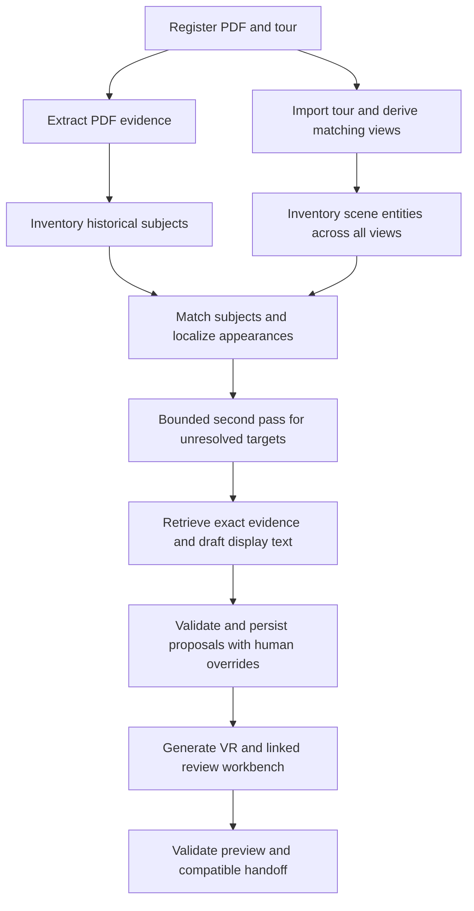

# PDF-to-VR Automation — Standalone Implementation PRD

Owner: wehan. Status: implementation specification; automatic end-to-end acceptance pending. Scope: a clean standalone implementation in the PastPort repository, compatible with main's target interfaces. Functional acceptance comes from the existing campus/Muradiye demo and the corrections made while building it.

## 1. Product and branch decision

Accept a heritage PDF and a photographed panorama tour. Produce an immediately usable VR preview with stable numbered hotspots, evidence-backed popup drafts and a linked editable review workbench. Review may follow generation; it is not a mandatory gate for opening an internal draft preview. Export structured museum data for later main integration.

Start with a new empty-content branch and independent root history. Do not copy main's application implementation: main's code has not implemented all of its accepted PRD. Use that PRD for interface compatibility and the demonstrated workflow for functional behavior. Reuse demonstrated behavior, extraction/projection methods and appropriately bounded components where inspection proves useful; do not infer that all existing code is reusable or unusable.

This document specifies implementation; its presence does not make the automatic pipeline executable. The first branch delivery is documentation. Development follows the slices in section 12.

### 1.1 Contract baseline and precedence

The main compatibility reference was observed at commit `5dd5f32119392b80451aeef92988dcad7cca92a1` when this specification was written. This commit is a reference only, not the standalone branch parent.

The authoritative integration target is main's bilingual `docs/PastPort_PRD_CN.md` / `docs/PastPort_PRD_EN.md`, specifically 2.1–2.3, 2.6, 2.8 and 2.11, with `docs/technical/sdk-v1/sdk-contracts.schema.json` and the owner-specific reference checker. The inspected remote English PRD blob is `c143970c0e57787ea6958a9b5f2b27357eb377c0`. The inspected remote SDK schema blob is `7c3ff2c307fb0541b50fcdabcbfc4f0d9d5d27d5`. Freeze the actual main commit and schema hash before implementation and include them in compatibility receipts; a PRD blob is not a commit SHA.

| Concern | Authority | Consequence |
|---|---|---|
| Public types, IDs, reference/version semantics and module signatures | Main PRD and frozen SDK reference | Preserve the existing envelope and interfaces; report incompatible output explicitly |
| Numbered viewing, popup editing, drag persistence and optional review | This PRD and accepted demo behavior | Implement the behavior, regardless of whether old main code already supports it |
| Historical assertions | Registered PDF evidence and separately cited enrichment | Do not infer history from visual similarity or a task idea |
| Current progress | Actual run, artifact and browser evidence | Documentation, generated output and verified behavior are different statuses |

If demo behavior exceeds a public schema, retain the richer editorial state locally and adapt a valid subset. Do not silently widen the shared contract. Changes to public schemas require main-owner coordination and versioning.

### 1.2 Standalone branch and later integration

Keep the standalone Python namespace `pastport_pdf_vr`, application composition and development data separate from main's `pastport` package. Start with the PRD and a short README; implementation adds only the code, contracts, migrations and checks needed by this pipeline. Do not copy the old framework wholesale or ship real editorial databases/private source media in Git.

The independent root intentionally has no main application files. It must not be merged by replacing main's tree or by blindly allowing unrelated histories. After standalone acceptance, create an integration branch from the then-current main, bring over selected new module files and apply explicit adapter/migration changes. Prove no unrelated main files are deleted and run main's compatibility/regression checks before a normal integration PR. The standalone branch is a development boundary, not a promise of conflict-free merging.

## 2. Inputs, outputs and product boundaries

### 2.1 Required inputs

1. A PDF registered with immutable bytes, hash, version, language, page count and source identity.
2. A connected VR tour export, preferably the complete ZIP; accept a supported tour HTML plus required assets. Preserve navigation, original panoramas, view IDs and angular conventions.
3. A project/run configuration: project/site identity, input representation, bounded processing limits, configured model/provider and runtime policy. This is configuration, not extra authoring work for each object.

Optional inputs include source photographs, an existing evidence snapshot and an explicitly supplied demo-proxy assignment fixture. Raw panorama images without connections need an explicit import profile; do not invent navigation or assume two viewpoints are the universal case.

### 2.2 Generated results

| Result | Required contents |
|---|---|
| VR draft preview | Preserved scene connections, transparent numbered hotspots, click-to-open current text, explicit position-edit mode and drag-release autosave |
| Linked review workbench | Object sightings, source image/region, original text/context, translation, claim scope, proposed/displayed text, independent review and edit history |
| Machine handoff | Versioned `SourceCorpus`, `TourPackage` and compatible `MuseumPackage`, registered asset references and validation findings |
| Run receipt | Input/model/prompt/policy versions, completed stages, inspected views, explicit gaps, cache/retry state, actual usage and validation evidence |

Keep one stable workbench entry and one stable VR entry for each project. Show the current run/revision. Comparison PDFs are optional secondary exports; the pipeline is not required to generate a new intermediate PDF before it can match VR.

The initial deliverable is an internal photographic museum preview, not a complete story/game, public release or cartoon-style completion. Retain the photographic/stylized state in export metadata; stylization is a later compatible adapter. Publication approval remains separate from draft availability.

### 2.3 Existing synthetic demo versus real-site recognition

The campus panoramas and original Muradiye PDF depict different physical sites. Replaying this demonstration requires the explicitly registered proxy assignments or the derived comparison PDF containing campus photographs. Declare which input representation is used. An imported fixture demonstrates assembly and preservation, not new model matching. Never silently read the old database's coordinates or mappings and claim fresh PDF-only recognition.

For real-site inputs, identify actual shared heritage subjects. Do not add automatic proxy invention to the default flow. Future reuse should normally need only PDF, tour and configuration. A missing historical facility or an invisible event may remain useful background without becoming a physical hotspot.

## 3. Architecture

Use LangGraph as a fixed workflow. Nodes call deterministic application services or a configured model; there is initially no autonomous planning/tool-selection agent. Conditional routing and retry limits are defined in code. A future node may acquire a bounded agent internally without replacing the graph or persistence authority.

| Layer | Responsibility | Boundary |
|---|---|---|
| Domain | Immutable typed identities, observations, evidence scopes, proposals, overrides and revisions | No LangGraph/provider/database imports |
| Ports | Corpus reader, tour importer, projection, semantic execution, editorial repository and presentation contracts | Explicit Protocols and typed results; no unvalidated dictionaries across layers |
| Application | Stage services, stable identity resolution, bounded repair, override authority and assembly | Framework-independent use cases |
| Adapters | PDF rendering/OCR, panorama projection, metered model gateway, SQLite and Pannellum | Bounded I/O and deterministic cleanup |
| Workflow | Fixed LangGraph transitions, checkpoints, cancellation and stage recovery | Stores typed references and stage results, not an alternative editorial database |
| API/UI | Project-scoped workbench, popup read/edit and marker movement | Calls application services; no direct model or SQL work in view handlers |
| Main bridge | Convert validated internal results to main target contracts | Frozen schema validation and explicit integration findings |

LangGraph checkpoint state holds run identity, input hashes, configuration version, result references, attempt counters and errors. File assets, quoted evidence, review decisions and human overrides live in registered storage/business records. A checkpoint cannot approve content or undo a committed edit. Persist business output before graph advancement; reconcile replay by idempotency key.

### 3.1 Concrete module boundaries for the first implementation

The initial executable is one local process with one project writer and one fixed graph per run. The HTTP service submits commands to the application; it does not start a second graph owner for the same project. Use a process lock plus transactional command claiming. Separate checkpoint and editorial SQLite files: restoring graph state must not restore over editorial decisions.

| Module | Owns | Calls through ports | Must not own |
|---|---|---|---|
| `domain` | Validated IDs, refs, regions, evidence scopes, revisions and immutable result types | Nothing outside the domain | SQL, paths to user files, SDK clients, graph routing |
| `application.inputs` | Input registration and project/version consistency | Asset store, PDF reader, tour reader | Provider calls or tour-script execution |
| `application.recognition` | Inventory reconciliation, persistent identity links and per-view dispositions | Semantic execution, projection, identity repository | Allocating identity from model array order |
| `application.evidence` | Passage retrieval, quote selectors, subject/scope validation and draft creation | Corpus repository, semantic execution | Updating original quotations during copy edits |
| `application.editorial` | Human text/position overrides, conflict checks and effective-value resolution | Editorial unit of work | Checkpoint state as approval authority |
| `application.exports` | One-revision snapshot, reference closure and staged export | Snapshot repository, asset store, main bridge | Reading arbitrary live rows during a frozen export |
| `workflow` | Fixed stage scheduling, joins, attempts and cancellation | Application stage services | Raw SQL, direct provider calls or historical judgments |
| `adapters` | Files, SQLite, PDF/projection libraries, model transport and usage receipts | External libraries | Global business policy or a second identity system |
| `api` and `web` | Transport validation, editing controls and Pannellum integration | Application use cases | Historical source reassignment by marker drag |
| `integration` | Main-specific DTO conversion and frozen reference validation | Registered resources and counterpart types | Parallel definitions of canonical main SDK types |

These are package responsibilities, not a requirement for one class/file per row. Group cohesive small services; introduce a Protocol only at an actual I/O, persistence or replaceable execution boundary. Construct adapters in the composition root and inject them inward. Keep framework-specific request/context objects outside domain services.

### 3.2 Internal port operations and ownership

The following operation names are standalone design contracts, not additions to main's public API. Every request/result is an explicit immutable dataclass or strict Pydantic model; JSON decoding is validated at the adapter edge.

| Port | Minimum operations and typed result | Authority |
|---|---|---|
| Asset store | Register bytes → immutable asset ref; open registered ref → bounded byte stream | Asset hash/version and project scope |
| PDF reader | Extract registered document/profile → page/text/image-region references and extraction issues | Exact source representation, not inferred subjects |
| Tour reader | Import registered tour/profile → tour draft and import issues | Source IDs, view/media identity and connections |
| Projection | Derive views → transform-bound references; map selected region → spherical location | Coordinate convention and transforms |
| Semantic executor | Execute typed stage request plus execution grant → validated proposal and usage receipt | Allowed image/input references, output schema, budget and cancellation |
| Editorial repository/unit of work | Resolve identities; commit proposals; save expected-version override; read effective records | Business revisions, unique keys, human authority and audit |
| Snapshot repository | Freeze expected project revision → immutable snapshot ref | A consistent read of included effective values |
| Stage repository | Claim stage/input key; record attempt; complete with result refs; record failure | Durable stage receipts before checkpoint advancement |
| Main bridge | Convert snapshot → candidate SDK payloads; validate → compatibility findings | Pinned external schema and cross-reference rules |

Keep proposal generation and proposal application separate. The executor cannot call edit services or allocate persistent object numbers. The application checks supplied refs and reconciles identities before committing proposals. An uncertain model response never triggers entity merge, history approval or a destructive rewrite implicitly.

### 3.3 Graph execution and recovery contract

For the first runnable slice use a sequential fixed graph, preserving the stages in section 5. This avoids a premature parallel scheduler. When PDF and tour preparation later run concurrently, recognition starts only after both result references are durably present; use an explicit all-predecessor join, not separate edges that can launch matching twice.

The first graph state needs only the project/run identity and graph-definition version; stage services read bound inputs and receipts from the business repository. Larger typed state is permitted only for a demonstrated scheduling need. Do not checkpoint raw images, API secrets, whole documents or live human override values.

Run states are queued, running, completed, completed_with_gaps, failed, cancelled and recovery_required. Stage receipts distinguish pending, running, completed, failed, cancelled and dispatch_unknown. A model transport timeout with uncertain dispatch becomes dispatch_unknown/recovery_required; it is not an automatic free retry. A failed record can create an explicit coverage gap while other validated records continue. Run completion and public artifact state are separate axes.

Within one stage: verify bindings/cancellation → reuse matching successful receipt or claim work → reserve bounded execution if needed → persist response and usage → validate typed output → commit result references → checkpoint/advance. A restart after business commit but before checkpoint reads the saved receipt instead of repeating the effect. Permanent malformed input fails directly; transient pre-dispatch errors have bounded retry; schema repair consumes the same explicit stage budget.

The graph starts on registered command submission, not on opening a VR page or clicking a marker. Viewing/editing existing results remains available when no generation worker is running. Any later autonomous agent is encapsulated inside the semantic-execution boundary and has no direct editorial or publication authority.

## 4. Main interface and compatibility contract

### 4.1 Required public handoff

| Main contract | Producer or adapter responsibility |
|---|---|
| `SourceCorpus` | Records contain `record_id, image, text, language, locator, association_state, association_basis`; images/text may be missing only consistently with association state |
| `SourceLocator` | Keep source/version/hash, real PDF page index, optional printed page and precise paragraph/region; never use a fixed printed-page offset |
| `TourPackage` | Preserve `source_schema_version, tour_id, first_view_id, views, connections`; stable view identity, original asset and panorama revision |
| `MuseumPackage` | Emit source/tour references, state, views/connections, objects/entries/anchors and explicit unresolved/unmatched records |
| `MuseumEntry` | Readable text, object identity, language, source record IDs and supported claim references |
| `MuseumAnchor` | Stable anchor/object/view, panorama hash, angles, radius, match state, visual check, legible features and basis references |
| `ModuleResult[T]` | Existing outcome/payload/issues/evidence_requests/changed_ids/reason semantics at main boundary; no competing public success envelope |

SDK target remains `pastport-sdk` schema `1.0.0`; shared plugin API remains `1.0.0`; target core/runtime wire is `0.2.0`. None of these references proves old main wire `0.1.0` already supports the new museum. The standalone pipeline does not alter plugin or gameplay contracts.

Resource references are registered `AssetRef(resource_id, version, sha256)` values, not absolute laptop paths. Artifact references preserve project, kind, schema, content version and hash. Use main's canonical serialization rules for artifact payload hashes; separately hash actual file bytes. Reject unknown fields, invalid references and non-finite numbers.

### 4.2 Module entrypoints

Adapt to the main PRD's async methods with typed requests and `ExecutionContext`:

| Method | Request | Result payload |
|---|---|---|
| `MuseumPort.import_tour` | `TourImportRequest(request_id, project_id, tour_source_ref)` | `TourPackage` |
| `MuseumPort.prepare` | `MuseumPrepareRequest(request_id, project_id, source_corpus_ref, tour_ref, style_config_ref)` | `MuseumPackage` |
| `MuseumPort.validate` | `MuseumValidateRequest(request_id, project_id, museum_ref)` | Existing `ValidationReport` |

PDF reading supplies a registered `SourceCorpus` via source inventory/reading adapters; do not change `MuseumPrepareRequest` to accept arbitrary filesystem paths. The standalone composition may expose a convenience run use case that registers PDF/tour inputs and invokes those stages.

Keep offline `build(fixtures: Path)` distinct from application `build(services: ModuleServices)`. Frozen reference schemas/examples are compatibility counterparts, not fake production modules. Until main provides implemented shared Python types, use explicit internal types and validate the serialized boundary against its frozen reference. Replace the bridge with actual shared imports during integration; do not maintain a divergent second canonical SDK.

### 4.3 Important adaptation cases

- The demo browser drag control clamps pitch to −85…+85, while its persistence API accepts −90…+90. The frozen SDK `MuseumAnchor` permits −85…+85. Align new model proposals, API validation and UI with the public range. Preserve any pre-existing out-of-range local edit as a migration finding; do not silently clamp it, export invalid JSON or modify the shared schema.
- The public `MuseumObject` requires source record IDs. A visible but historically unbound chair remains a local scene entity with an honest unbound popup. Do not invent source records to export it as a supported heritage object.
- `ready_for_review` is not human historical or publication approval. AI candidates may appear in an explicitly labelled draft preview; they must not automatically become confirmed public anchors.
- Multiple appearances of one object share `object_id` but have distinct anchor/view identities. Local editor numeric labels map to stable string IDs; array order is not identity.
- Detailed source/claim scopes, drafts, human overrides, audit events and visibility reasons are local editorial records. Export only fields admitted by the shared schema; use registered references for richer evidence.

### 4.4 Exact compatibility gaps and integration dependencies

| Boundary | Inspected target/current difference | Standalone implementation decision | Main integration condition |
|---|---|---|---|
| Shared Python museum DTOs | Target schema/PRD defines museum types; inspected main ports do not yet supply the target MuseumPort methods | Keep validated internal records; serialize through one bridge against the frozen schema | Use owner-generated shared types once available; prove equivalent serialized payloads |
| Image execution | Current main ModelRequest has research/story roles and input refs; target asks for typed image/candidate-view support | Define injected image-stage execution with explicit assets/output schema and metering | Shared owner supplies compatible media request, stage grants and gateway capability; no direct paid SDK bypass |
| Rich editorial records | SDK object/entry/anchor schemas reject extra fields | Retain identity candidates, overrides and review history in project storage | Export admitted fields and resolvable evidence refs only |
| Bare panoramas | Main tour requires first view, stable views and explicit connections | Raw images require an explicit supported import profile; no invented links | Validate exact TourPackage semantics, including departure/arrival conventions |
| Draft preview | Candidates and unbound scene targets are useful in the demo | Show local target state truthfully without fabricated evidence | Export only valid source-backed objects; retain candidate/visual-check status |
| Live popup text | Demo reads newest effective copy | Editing updates the live project revision | Frozen MuseumEntry text changes only through a new snapshot/version |
| Coordinate conventions | Local storage and renderer can accept wider values than the shared anchor schema | New API, model validation and UI consistently enforce SDK bounds | Validate projected markers and cross-view hashes, not just angle ranges |
| Photographic preview | Main's larger product includes cartoon-style display | Deliver honest photographic display with registered assets first | Preserve display_kind; do not declare stylization complete |

The bridge maps scoped scene IDs to SDK string IDs, maintains stable object/view/anchor aliases and validates each referenced source record. `SourceRecord.association_state` admits linked/candidate/text_only/image_only; internal visibility outcomes such as occluded or not_inspected must not be inserted into this enum. SDK museum state admits draft/ready_for_review; run failures and approval states stay outside that field.

Schema acceptance is necessary but insufficient. Validate project equality across all refs; unique objects/views/anchors; entry/anchor object existence; view/connection closure; source IDs; source/tour version/hash bindings; available media and claim references. A rejected entity must also remove or explain dependent exported entries/anchors. Do not leave dangling references while claiming a valid subset.

### 4.5 Compatibility receipt and fixed counterpart

Record the main commit, PRD/schema/checker file hashes, standalone code version, export snapshot/ref/hash, bridge version and each check result. Keep structural validation, semantic cross-reference checks, real-material/browser checks and main runtime integration as separate results. A schema-valid JSON fixture cannot establish implemented MuseumPort or runtime support.

The first coding task freezes the small permitted reference schema/examples/checker from the recorded main commit, with provenance, before independent work advances. These are counterpart resources; they are not a copy of main's application. Refresh the reference deliberately when main changes, then rerun compatibility checks. Any changed shared type/grant/API needs an explicit owner-approved integration adjustment.

### 4.6 Architecture slice acceptance and next implementation task

The design boundary is ready for W01–W04 implementation when: domain imports are framework-free; application services have concrete typed I/O; one composition root owns resources; identity and human edits are editorial authority; stage receipt/checkpoint recovery is explicit; all public exports pass through the main bridge; and unavailable shared image/museum APIs remain declared integration dependencies.

Implement next: freeze counterpart → typed run/input/identity/override/stage records → transactional repository and stable display-number allocation → injected fixed LangGraph stage runner → meaningful restart/conflict/idempotency checks. Use explicit offline counterparts for this first slice. Real PDF/tour ingestion and real-image calls follow; neither has been implemented by writing these architecture sections.

## 5. Fixed workflow stages

| Stage | Execution | Output and condition |
|---|---|---|
| S01 Register | Deterministic | Immutable project input manifest, format/hash/dimension checks and input representation |
| S02 Read PDF | Deterministic extraction; configured OCR when necessary | Page renders, native/raw/normalized text, image regions, extraction version and unreadable-page findings |
| S03 Import/project tour | Deterministic | Supported schema 4 or compatible schema 3 import, registered views/connections and bounded derived perspective views |
| S04 Inventory sources | Model plus structural validation | Historical subjects, multiple source-image observations, whole/part links and ambiguous identities |
| S05 Inventory scene | Model plus structural validation | Stable scene targets, categories, containment and observations for every supplied viewpoint |
| S06 Match/localize | Model proposes allowed image regions; code converts coordinates | Distinguishing evidence, candidate/confirmed state under policy, scene-specific anchors or explicit abstention |
| S07 Recheck unresolved | One targeted second pass within localization budget | Full-resolution/overlapping view inspection; record exact inspected assets and disposition |
| S08 Retrieve/draft | Full-document retrieval and model interpretation | Exact supporting passages, scope links, working translation, concise display draft and optional background |
| S09 Validate/persist | Deterministic | Validated coherent records, idempotent writes, independent model/human data and migration/version checks |
| S10 Present/verify | Deterministic rendering plus meaningful runtime checks | Fixed preview/workbench entries, compatible machine handoff, run receipt and actual verification findings |

Persist successful stage results before routing forward. Absence of one match does not fail all other objects. An import error, invalid reference, provider outage, expired authorization or exhausted budget must remain explicit. Recover only stages whose version-bound outputs are absent or invalidated.

Use the requested Sol 6.1 configuration for semantic/model stages. Verify the actual provider identifier and image-input support; do not invent an API name or introduce a fallback. Main integration uses its shared metered `ModelGateway` and grants. Standalone execution provides the same injected, bounded execution contract and usage accounting; it must not call an unmetered SDK inside business nodes. Offline validation uses explicit deterministic substitutes, labelled as such.

The inspected current main `ModelRequest` exposes research/story roles and artifact references; the target PRD explicitly requires extending image inputs. Therefore image localization through that current gateway is an integration dependency, not an existing capability to import. Define the standalone image-execution port against the pinned target requirements, prove the configured model can accept bounded images early, and implement the main bridge only when compatible grants/media/request types exist. Do not bypass shared execution to make an integration check appear successful.

## 6. Recognition and localization rules

1. Build scene identities before assigning history. A photo can contain a laptop and a room, while a whole roof and its frame can be separate related targets. Counts are coverage observations, not universal minimums.
2. Same physical object across angles retains one ID. Similar doors, trees, cranes or extinguishers are not merged without distinguishing evidence. Membership in one room does not merge roof, floor and walls.
3. Inventory historical subjects separately; different PDF pages or angles may depict one entity. Do not equate a source-page ID with a heritage-object ID.
4. Evaluate every target against every supplied viewpoint, including appearances after the first positive match. Child visibility is independent: a laptop can be visible while the mouse remains unresolved.
5. Inspect overview, original-resolution detail and targeted derived views. Recheck all initial misses once within budget. A thumbnail miss is not proof of absence.
6. Preserve crop origin/scale or camera-to-world transforms. Convert returned local coordinates in software. Equirectangular yaw is `360*u-180`; pitch is `90-180*v`. Perspective crop pixels require ray transformation first.
7. Anchor the named subject in the rendered scene. Region-center differences on a large roof are not automatically identity errors. Deduplicate seam fragments and repeated proposals per object/view.
8. A VR screenshot on a laptop is screen content, not another physical view. Never place real-world scene anchors by reading screen pixels as the environment.
9. Distinguish located, ambiguous identity, insufficient resolution, occluded, not seen after review and confirmed absent. Model omission is not a considered rejection; only evidence/user confirmation establishes absence.
10. Record why identities were linked, visible distinguishing features, selected source/crop and remaining doubts. Do not treat an uncalibrated model score as measured probability or approval.

Match using original panoramas before optional stylization. Human corrections bind exact panorama hashes. Use stable internal viewpoint IDs derived from source-tour identity and source node ID, never array indexes.

## 7. Evidence and narrative usefulness

Read the supplied PDF, not imagined game descriptions. Search beyond the page containing the image: facilities, users, everyday activities, construction, repairs and connected spaces can be described elsewhere in the document.

Store exact excerpts and locators separately from translation, display paraphrase and broader context. Verify that adjacent text actually describes the depicted subject. Split mixed-subject passages into supported claim links while retaining full context. A building measurement is not a wall measurement; restoration dates do not date every component; a museum sentence does not establish a displayed book's title or age; fountain bowl recesses are not movable bowls.

Keep artifact image, whole-building image, text evidence and missing imagery distinct. A full PDF page may support several subjects only through explicit identifiable regions. Do not repeatedly use an unrelated distant scene as an object photograph. Missing object text remains missing; optional supported context must be labelled broader than the object.

Prioritize documented activity chains useful for later Story Agent work, such as water use, learning/living or food preparation/storage. Each small component need not have a full story. Story Agent still considers the whole corpus before filtering tasks against available museum evidence/interactions. This pipeline supplies evidence and opportunities; it does not fabricate goals, dialogue or local historical events.

Default enrichment is within the supplied corpus. External research, if configured and authorized, must be bounded, cited and distinguished as site-specific evidence versus general period knowledge.

For the synthetic replay only, preserve the accepted proxy policy: narrative usefulness may outweigh resemblance, but the chair/student-room-group mapping was rejected as excessive. This feedback removes that mapping, not the chair identity or every other accepted proxy. New real-site matching does not inherit proxy invention.

## 8. Review, popup content and drag behavior

### 8.1 Viewing and text

Use a transparent numbered marker with readable text/outline. Click opens the object label, concise effective introduction, optional expandable supported background and a link to the same object's workbench. Keep full original/translation/source evidence accessible without placing internal audit notes in the historical introduction.

The workbench includes an editable “Content displayed in VR” field. Before a human edit exists, show the latest valid AI draft. After human saving, use the latest successfully saved human version even if later AI drafts have newer timestamps. Keep both versions and audit events. Clicking a hotspot fetches current effective content; an already open popup may require closing and reopening. No whole-tour rebuild is required to change copy.

If historical assignment changes, the previous human text remains preserved but is not silently applied to a new subject. Expose the mismatch and require revalidation. A visible unbound scene target may display an honest unbound status; it must not acquire invented history.

### 8.2 Drag-release autosave

An explicit position-edit mode enables dragging; ordinary navigation remains available outside it. Marker dragging must neither rotate the panorama nor open its popup. On release, submit the final yaw/pitch automatically. Cancelled gestures restore the previous state. Show saving/saved/conflict/failure; only a successful backend transaction establishes saved status. Keep failed preview and deliberate retry available.

Position identity is `(project_id, object_id, view_id, panorama_revision/hash)`. Store model proposal separately from human override. The latest successfully committed human position wins for that view. Another viewpoint stays unchanged; later model generation cannot overwrite the human position. New panorama pixels/hash require revalidation instead of inheriting old geometry.

Use short transactions, optimistic versions, idempotency operation IDs and append-only old/new events. Queue same-page writes; reject stale concurrent edits instead of claiming universal wall-clock last-write-wins. Text editing, geometric correction, identity review and evidence approval have independent states.

## 9. Persistence and recovery

Keep source bytes, registered assets, evidence snapshots, scene/historical entities, observations, match proposals, source/claim links, draft/override content, model/human anchors, run stages and review events as distinct typed responsibilities. SQLite is sufficient for the local first slice; deterministic connection cleanup, parameterized SQL, transactions and explicit migrations remain required.

### 9.1 Stable identities and complete viewpoint coverage

Models return run-local proposal IDs and observations. The application allocates persistent entity IDs and display numbers once through an identity registry, then rewrites validated downstream references. Never use model row order, a display name, a fresh UUID on each run or a panorama hash alone as physical identity. Identical bound inputs reuse saved inventories; candidate reprocessing resolves against the stored identity/alias ledger. A changed input may reuse an old entity only with explicit supporting links; ambiguity remains a candidate. Merges/splits are versioned decisions; retired numbers are not reassigned silently. All persistence keys are project-scoped.

Maintain one disposition for each known entity and supplied viewpoint. Candidate retrieval can shortlist detail inspection, but an unexamined view is not a reviewed miss. Record `not_inspected` when a budget or stage failure prevents coverage. The all-view matrix is populated by bounded scene inspection and identity linking, rather than unbounded model calls for every possible entity×view pair.

### 9.2 Live preview, snapshots and edits during regeneration

The workbench and VR preview read current effective draft records. A machine export resolves all records from one immutable snapshot and records exactly which human/model versions it includes. Later edits create a new revision; a consumer of a frozen museum reference does not silently see live changes. This preserves both immediate demo editing and main's exact-reference contract.

Generation captures the input and mapping revision it read. Commit its model proposals transactionally only against the applicable revision; concurrent human edits remain separate and effective. Historical reassignment invalidates the associated copy without deleting its audit history. Asset/policy changes create new compatible stage bindings rather than reinterpreting an old checkpoint.

Same request ID with the same bound inputs reuses the recorded result. Changed inputs under the same ID conflict. Stable entity IDs, number assignments and unique object/view anchors survive reruns; do not rebuild the review database from a fixture. Invalidate affected downstream stages when source, panorama, prompt, policy or model bindings change.

Checkpoint replay cannot duplicate a paid call with uncertain dispatch/usage. Keep known usage and response receipts, stop uncertain work for reconciliation, and enforce cancellation/deadlines. Cache keys include project, source/panorama hashes, projection parameters and model/prompt/policy versions. Never reset unknown usage to zero during resume.

## 10. Initial operational limits

Use main PRD 2.6.4 as the initial compatibility ceiling; lower provider/platform limits win. The first standalone configuration declares these values explicitly.

| Operation | Initial bound |
|---|---|
| Tour export | 150 MiB compressed / 200 MiB expanded / 100 members; no archive path traversal or execution |
| Panorama | 16 MiB encoded / 64 MP decoded; display derivative at most 8192×4096 and 16 MiB |
| Matching views | Start with six primary perspectives; at most 24 derived views per viewpoint, longest edge 2048 |
| Model images | At most eight images/request, four MiB/image, subject to lower provider limits |
| Localization | Initial localization plus at most one focused recheck; two rounds total per record |
| Time | Network 60 seconds; projection job 120 seconds; new stage 30 minutes, limited further by cancellation/deadline |
| PDF profile | Proposed standalone starting bound: 64 MiB, 500 pages, 2048-pixel longest rendered edge; explicit OCR-needed/unreadable status when unsupported |
| Run cost/calls | Explicit configured finite budget and call cap before online execution; no unlimited/default free assumption |

Bounds are operational controls, not throughput or accuracy promises. Preserve original media; do not automatically raise all limits on one oversized file. Do not log credentials, private paths/payloads, raw prompts or original document text. Keep necessary provenance in controlled business storage.

## 11. Demo-derived functional acceptance

Use the current demo as a behavioral reference, not a fixed answer key for fresh recognition. Existing counts (39 identities, 37 positioned proposals and 66 appearances in one rematch) describe that run and are not target accuracy or mandatory new output counts. Preserve all supported appearances and explain every exclusion.

| Case | Required behavior | Evidence to record |
|---|---|---|
| A01 Automatic draft generation | Registered inputs start one configured workflow and produce linked VR/workbench without per-object approval | Fresh run receipt, generated assets, running service and browser inspection |
| A02 Stable identity | Same laptop/door/chair across views retains one object ID and number | Observation links and both rendered viewpoints |
| A03 Distinct similar objects | Do not merge doors, trees/cranes or extinguishers solely by category | Distinguishing evidence or explicit unresolved identity |
| A04 Whole and part | Foreground target/background room and roof/frame can be separate meaningful objects | Specific regions and containment; no invented fragments |
| A05 Every viewpoint | Any independently supported occurrence appears in each applicable panorama | Complete object×view disposition matrix |
| A06 Unmatched second pass | Light-strip pillar miss triggers detailed all-view recheck before exclusion | Inspected asset/crop list and final outcome |
| A07 No fabricated placement | Unresolved backpack has no guessed hotspot; user-confirmed absent shoe stays excluded | Dispositions and generated hotspot list |
| A08 Correct projection | Window/column marker lies on the named feature; seams and crop transforms work | Original/crop transform, rendered screenshot and representative round-trip checks |
| A09 Candidate handling | Stool/floor-pattern hypotheses and conflicting identities remain labelled candidates | Review status without an invented probability or automatic confirmation |
| A10 Screen-content role | Laptop screen's VR view does not create false environmental sightings | Observation role and anchor review |
| A11 Traceable text | Popup's historical assertions point to exact source and appropriate scope | Original quote, text page, region/context and claim association |
| A12 No broad-scope leakage | Building dimensions/background are not presented as a wall's own facts | Direct text/context distinction and reviewed derived copy |
| A13 Honest missing evidence | Text-only oven/store evidence is labelled; unbound chair stays unbound | Image role, null/missing state and visible popup/workbench |
| A14 Transparent markers | Number does not cover the subject with an opaque disk; clicking opens current text | Actual VR screenshot/click |
| A15 Shared text editing | Save in workbench, reopen hotspot, see new human copy through fixed entries | Versioned save and browser observation |
| A16 Human text protection | Later AI draft cannot override saved human copy | Regeneration before/after and effective-value check |
| A17 Drag autosave | Two drags, release, reload: latest successful position remains | Browser interaction plus corresponding persisted events |
| A18 Independent viewpoints | Drag in point one leaves point two unchanged | Both view records and rendered positions |
| A19 Model rerun protection | Rerun updates proposals without losing human text/coordinates | Proposal/override versions and effective-value comparison |
| A20 Reliable saves | Failed/conflicting save is not shown as successful; repeated operation is idempotent | Fault/conflict result, UI state and event counts |
| A21 Repeatable input | Same inputs twice yield no duplicate identities/anchors or lost reviews | Unique-key/count comparison, checkpoint and override evidence |
| A22 Main compatibility | Main target checker accepts exported valid subset; unsupported local anchors are explicit | Frozen schema/checker receipt, reference closure and actionable issues |
| A23 Preservation | Navigation and original panorama bytes remain intact | Hashes and scene-link inspection |
| A24 Second-site reuse | Second PDF/tour uses configuration, without source-code branches for that site | Actual second-material run; pending until supplied |

Fresh recognition tests must hide prior coordinates/corrections from model input. If target inventory or proxy assignments are supplied, record that fact. Importing prior locations is a replay test, not an independent model evaluation. Human visual feedback is valuable but does not create a measured accuracy score.

Accept the existing material first with current known limitations explicitly recorded; then run the second-site check. Do not claim universal stability before that check. A fake-provider or synthetic test proves plumbing only; real provider, real material, browser, mobile/headset and human-story/playtest evidence remain separate.

## 12. Implementation slices and handoff

| Slice | Owner | Deliverable | Exit condition |
|---|---|---|---|
| P0 Specification and fixed counterpart | wehan | This PRD, pinned main schema/PRD/checker and demo behavior checklist | Interface mapping and explicit differences are reviewable; no claim of implemented runtime |
| P1 Standalone boundaries | wehan | Python 3.12 package, typed ports, LangGraph fixed graph, SQLite migrations and bounded configuration | Explicit offline fixture run completes stage persistence; no paid calls needed |
| P2 Input preparation | wehan; source/museum owner coordination | PDF extraction, tour import and perspective projection | Real input hashes/locators/nav preserved; unreadable assets explicit |
| P3 Model execution and matching | wehan; source/museum owner coordination | Metered image-capable adapter, inventories, matches and bounded recheck | Real model run has recorded input/usage and per-object/view dispositions |
| P4 Evidence, UI and editing | wehan | Exact evidence, popup draft/override and numbered draggable VR/workbench | A11–A20 demonstrated in browser and persistence |
| P5 Repeatability and compatibility | wehan | Fresh full run, replay, recovery and SDK adapter verification | A01–A23 with evidence and unresolved limitations |
| P6 Reuse and main integration | wehan; affected owners | Second site run, selected-file transfer and shared-service bindings | A24, then main's relevant regressions; no tree replacement or duplicated authority |

### 12.1 Work packages and dependencies

Implement the following packages in order; each produces a runnable or checkable increment. `src/pastport_pdf_vr/` is proposed standalone layout, not code already present.

| Package | Depends on | Concrete implementation and ownership | Exit evidence |
|---|---|---|---|
| W01 Freeze reference and demo baseline | P0 | wehan: main commit/schema/checker receipt; private demo manifest with object/view counts, input hashes, known candidates and accepted corrections | No private bytes in Git; reference versions resolvable; replay versus fresh recognition explicitly selected |
| W02 Typed core and configuration | W01 | `domain/models.py`, `ports/`, `application/configuration.py`: IDs, records, run request, bounded limits, model/provider binding, cancellation and failures | Reject malformed/cross-project values; command configuration can be loaded without a model call |
| W03 Persistence and identity | W02 | `adapters/sqlite/`, `application/identity.py`: migrations, identity registry, stage/output repository, proposal/override repositories and snapshot transaction | Same input twice preserves keys/numbers; stale edit rejected; no fixture rebuild; editor state survives restart |
| W04 Graph and execution boundary | W02–W03 | `workflow/graph.py`, `application/execution.py`: fixed nodes, durable checkpoints, bounded attempts, usage/reservations and injected model port | Offline synthetic stage chain resumes after interruption without duplicate effects; image-capable configuration checked before batch execution |
| W05 PDF adapter | W02–W04 | `adapters/pdf.py`: page registration/renders, normalized text and exact selectors; optional OCR boundary | Representative supplied pages reproducibly extract; selectors recover exact quotes; unsupported pages remain explicit |
| W06 Tour and projection adapters | W02–W04 | `adapters/tour.py`, `adapters/projection.py`: parse only tour data, register base64/local assets, derive perspective views and preserve transforms | Original navigation/media hashes preserved; known-direction/seam/round-trip checks; no imported script execution |
| W07 Semantic inventory and matching | W03–W06 | `application/recognition.py`, `adapters/model_execution.py`, focused versioned prompts: source/scene inventories, cross-view identity, allowed-region responses and bounded second pass | Recorded real-image inputs and actual output/usage; complete dispositions; no leaked old coordinates in independent matching |
| W08 Evidence and display drafting | W05–W07 | `application/evidence.py`: whole-document retrieval, exact passages, claim scopes, translation and concise default text | A11–A13 on actual material; no source-specific dates or book identity invented |
| W09 API and review workbench | W03, W08 | `api/`, `web/review/`: project-scoped view models, source evidence, separate review states and versioned text overrides | Browser save/reopen shows current human copy; AI rerun preserves it; source evidence remains unchanged |
| W10 VR and position editor | W03, W06–W09 | `web/vr/`, `application/positions.py`: owned Pannellum integration, transparent numbered markers, popup linkage and release autosave | A14–A20 in browser; two views independent; failed save visible; original demo service not overwritten |
| W11 Whole run and compatible export | W04–W10 | `application/run.py`, `integration/main_bridge.py`, CLI/composition: register→generate, snapshot and schema-compatible handoff | Fresh input run and idempotent replay; main SDK reference accepts valid export; unsupported subset explained |
| W12 Reuse and integration preparation | W11 | Second site's configuration/run, dependency closure and a selected-file integration plan | Second actual sample evidence; unchanged standalone source; main regression record before integration approval |

Work-package tests must exercise behavior or failure boundaries. Avoid generating a test file for every function or mirroring implementation details. Provider and browser acceptance are exercised on representative objects before expanding to the complete dataset. Do not postpone the model capability check until after the complete UI has been built.

### 12.2 First coding slice

The first implementation slice is W01–W04 with a small, explicitly synthetic fixed counterpart: a configured run creates typed registered identities, persists stage results, advances the fixed LangGraph and can resume without duplicates or lost human values. It establishes executable architecture before real model and PDF work. This is not the final functional acceptance and is never reported as real recognition.

Immediately follow with W05–W08 for a small real-material path: one historical subject, one scene entity, both applicable viewpoints, exact source evidence and a default introduction. Then add W09–W10, expand the same pipeline to all supported entities, and perform W11. Avoid building a complete generic platform before this vertical slice.

### 12.3 Definition of done and stopping conditions

The current-material delivery is done only when one configured entrypoint processes the declared inputs, opens the numbered VR and linked workbench, preserves navigation, passes the relevant A01–A23 cases and survives a same-input rerun with human edits intact. Do not require exactly 37 entities or 66 anchors from a new inference; inspect differences and dispositions against the frozen reference. A replay using old answers cannot fulfill the fresh-inference case.

Provider identifier/capability, permission, credentials or approved finite budget missing means online execution is explicitly blocked; deterministic/offline work can still complete. Unreadable input or unsupported tour schema produces an actionable import failure. A budget-shortened matching pass remains partial, including `not_inspected` viewpoints. No imaginary automatic success is produced to satisfy a deadline.

If the second site has not been supplied, report first-site acceptance and second-site reuse as separate statuses. Formal main integration and public deployment remain later actions with their own compatibility and authorization checks.

Suggested source responsibilities once implementation begins: `domain/` typed records/invariants; `ports/` interfaces; `application/` stage/edit use cases; `adapters/` I/O/persistence/model/projection; `workflow/` graph/checkpoints; `api/` composition/routes; `web/` viewer/workbench; `integration/` main bridge. Add boundaries for demonstrated needs, not a generic workflow platform.

Relevant tests cover projection/seams, exact source selectors, identity/reference consistency, edit authority, conflicts/idempotency and replay. New Python passes strict typing; JS is checked and browser interactions exercised. Run existing repository checks during main integration and report actual known documentation-gate failures. Checks unavailable in the clean branch are listed as unavailable, never reported passing.

Completion reports distinguish specification, implemented node, generated artifact, served page, browser-verified behavior, real-provider acceptance, second-site reuse and released integration. Freeze the exact counterpart and input/model versions in every handoff. Do not upload the existing private DB, raw PDF/panoramas or credentials with this documentation.

## 13. Planning review and revisions before coding

This section is a review of the first draft against the inspected PRD, demo implementation and current module signatures. It is not an independent model benchmark or proof that the revised design is implemented.

| Priority | First-draft weakness | Consequence if left unresolved | Revision in this plan |
|---|---|---|---|
| P0 | Implicitly treated the current main model gateway as image-ready | A nominal adapter could be unable to send panorama crops or bypass metering | Section 5 records missing image request support; W04 performs an early capability check and integration uses a deliberate bridge |
| P0 | Required stable IDs without specifying allocation | Different model ordering could renumber objects and detach human edits | Section 9.1 adds a persisted identity/number registry, run-local proposal remapping and explicit merge/split decisions |
| P0 | Did not separate live editing from immutable exports | A consumer could see mixed revisions while the workbench changes | Section 9.2 snapshots effective records atomically; live preview and frozen handoff have different read semantics |
| P0 | Could equate replay of old campus assignments with fresh recognition | A successful demonstration would overstate automatic capability | Sections 2.3, 11 and 12 require declared input representation, withheld old coordinates and separate replay/fresh evidence |
| P0 | Did not make independent-history integration concrete | Merging a clean tree could replace or delete unrelated main files | Sections 1.2 and 12 require a main-based integration branch and selected-file transfer |
| P1 | Described panorama pitch mismatch too broadly | Could invent a browser bug or silently alter saved geometry | Section 4.3 distinguishes browser clamp, wider persistence API and target schema; new boundaries align explicitly |
| P1 | Demanded all-view coverage without a budget-shortfall state | Missing observations could be falsely called checked absences | Section 9.1 adds `not_inspected` and bounded coverage accounting |
| P1 | Would allow context-only objects into a source-required public record | Unbound chair or broad building text could gain fabricated evidence | Sections 4.3 and 7 preserve local entities and export only justified source-backed subsets |
| P1 | A phase list was too broad to start coding predictably | Could spend effort on framework/UI before a model/input path works | W01–W12 now specify concrete dependencies, files, exit evidence and the first runnable vertical slice |
| P1 | Generic success language obscured what had actually been exercised | A graph fixture could be presented as a working museum matcher | Definition of done separates offline architecture, real provider/material, browser and second-site checks |

The revised implementation priority is: fixed counterparts and typed state → persistent identity/overrides → checkpointed graph and bounded execution → actual PDF/tour/projection path → real semantic/evidence path → review/VR editing → full rerun and compatibility → second-site validation → main integration. The code should implement this plan rather than rebuild or transplant the old main application.

## Standalone Codex subscription adapter decision

The user approved local Codex SDK execution using each operator's existing ChatGPT login. The standalone adapter implements the existing scene-inspection/evidence/draft ports with explicit model selection, bounded image attachments, strict structured output conversion, a persistent subscription call grant, authentic SDK token receipts, deadline/cancellation and no implicit API-key/provider fallback. It does not share credentials or alter the main gateway contract.

Subscription token receipts do not report the exact remaining subscription allowance or billed USD. A recorded-token threshold stops subsequent dispatches and is not a hard per-call token ceiling. Unknown usage remains recovery-required across restarts. Main integration still requires its shared execution grant/usage bridge; this local adapter cannot be presented as evidence that the main gateway or dollar-budget acceptance already passes.

## Browser upload and generation extension

The standalone studio starts without an existing output. Its local root is the Chinese upload/generation portal; users choose/drop a PDF and supported 360 Studio HTML, folder or ZIP, authorize a bounded Codex run, see persisted stage progress and open the numbered VR or linked review backend. A saved project can be selected for regeneration without changing its URL or overwriting applicable human edits. Review/VR links and API/media calls are project-scoped. Existing direct-workspace serving remains available.

The typed input contract contains `document_format` (`pdf`, reserved `idml_links`, conversion-only `indd`) and `scene_format` (`tour_360`, reserved `model_3d`). Capability status must be displayed accurately; reserved formats are rejected before inference. Official source inspection confirmed the PDF/IDML/INDD/Links arrangement. Future IDML extraction must align with main's Story/XML/range locators and original linked assets. A 3D adapter must introduce geometry/reference-view version bindings, inverse projection to surfaces and a suitable viewer/anchor schema; it cannot reinterpret spherical anchors as 3D coordinates.

One build runs at a time. Upload bytes, archive members/expansion, paths and same-origin edit requests are bounded. Uploaded HTML is data, not executable application code. The generator owns its subprocess group, persists job status separately from evidence/editorial authority, and stops interrupted jobs for reconciliation. It does not reset or retry uncertain subscription usage. Draft availability still does not constitute publication approval.

Verification uses an injected build-runner boundary and explicit offline semantic counterparts; upload-to-browser assembly is distinct from full live-model/source accuracy, cross-site reuse and main integration.
