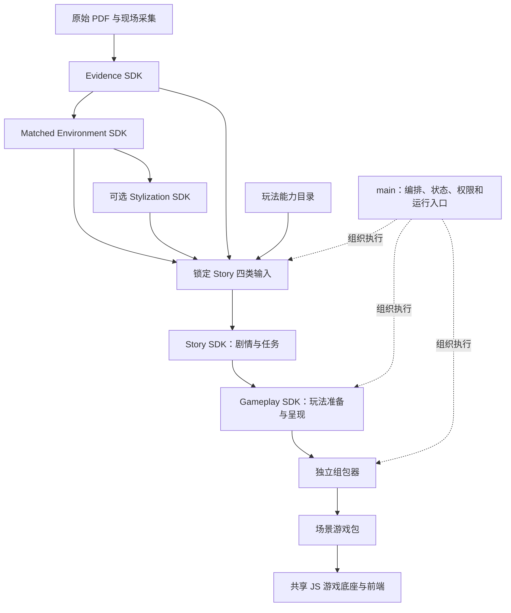
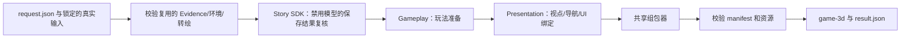

# PastPort 技术 PRD

**版本：1.0 · 唯一初稿 · 当前基线：2026-11-01**

本文统一说明当前 main、五个 SDK、共享运行时的职责、技术栈、输入输出、工作流与验收边界。本文不授权模型调用、公开发布或部署；具体运行仍受调用者权限和预算约束。安装和试玩从[根 README](../README.md)进入，各 SDK 的命令和 API 由其包内 README 说明。

## 目录

- [产品目标与当前状态](#product-and-status)
- [架构与职责](#architecture-and-ownership)
- [技术栈](#technology-stack)
- [工作流](#workflow)
- [输入输出与契约](#contracts-and-versions)
- [五个 SDK](#sdk-modules)
- [Story、模型与 Agent](#story-and-agents)
- [空间与导航](#space-and-navigation)
- [玩法、呈现与游戏运行](#gameplay-and-runtime)
- [组包与启动](#assembly-and-startup)
- [权限、预算与恢复](#permissions-and-recovery)
- [开发、测试与交付](#verification-and-delivery)
- [下一阶段](#next-steps)

<a id="product-and-status"></a>
## 1. 产品目标与当前状态

PastPort 把真实遗址材料、物件及空间转换为可浏览、可阅读、可完成任务的博物馆游戏。玩家应知道自己是谁、现在要做什么、为什么需要查看这个遗址物件，以及选择会带来什么后果。游戏不是资料卡顺序播放。

当前体验包括 360° 展示和生成的 3D 场景。3D 点位之间沿已登记导航切换，**没有把两份模型拼成一个实测连续模型**。保留原建筑、物件身份和布局；转绘改变材质、光照与动画风格，不把电脑等物件换成别的对象。

### 1.1 已验证与未验证

| 范围 | 当前结论 | 不能据此推断 |
|---|---|---|
| 五个 SDK 与共享运行时 | 已构建并共同安装；仓库外 wheel 联跑通过 | 已公开发布、所有输入均稳定 |
| 上游材料读取 | 真实 62 页 PDF 导出、两个 3D 点位及两份转绘结果通过读取和来源/资源校验 | 本轮重新做了识别、匹配、建模或绘图 |
| 新故事生成 | Story 阶段此前完成一次真实 Sol 新生成及下游验证 | 当前 main 入口会重新生成故事 |
| main 集成入口 | 保存的真实故事 → 复核 → 玩法准备 → 呈现 → 组包，零新增模型调用 | 从原始材料全量重生成已验收 |
| 实际试玩 | 三任务、三块板玩法、点位切换、结局；自动检查覆盖两种结局及恢复 | 剧情质量、趣味性已被玩家接受 |
| 质量检查 | main 523 项 Python 回归；127 文件严格类型检查；39 个 Schema/样例；JS 游戏与组包回归 35 项通过、1 项无关私有夹具跳过 | 性能、费用、设备覆盖和生产安全均已验收 |
| 仓库状态 | main 集成源码纳入 Git 管理 | GitHub 源码更新不等于游戏产品已部署 |

真实输入的未核实映射、校准和史料限制继续保留。原始 PDF 的 52 页有可提取文字，10 页仍有 OCR/图像阅读限制；不能把“未提取到文字”写成“原件没有内容”。

### 1.2 当前本地交付位置

| 项目 | 位置 |
|---|---|
| main 集成工作区 | `/Users/hanweijia/PastPort` |
| 本轮请求与证据 | `var/main-sdk-integration-20261101/` |
| 本轮游戏包 | `var/main-sdk-integration-20261101/run-02/game-3d/` |
| 当前预览 | `http://127.0.0.1:18838/?scene=3d`，仅在本地服务运行时可用 |
| 验收摘要 | `var/main-sdk-integration-20261101/ACCEPTANCE.json` |
| 六个发行文件 | `var/main-sdk-integration-20261101/wheels/` |

这些私有输入及运行产物不随 Git clone 提供。原来的应用仓库、旧 Demo 和其他工作区不等于本次集成工作区。

<a id="architecture-and-ownership"></a>
## 2. 架构与职责

采用 **modular monolith：同仓库、清晰模块边界、独立 SDK 发行包、一个共享运行时**。



| 模块 | 负责 | 不负责 |
|---|---|---|
| main | 组织 SDK 调用、输入锁、阶段恢复、错误与交付入口；已有共享权限/预算服务 | 每个遗址写一套定制游戏规则 |
| Evidence | 原件登记、提取、识别/证据整理及匹配文档 | 场景导航、游戏运行 |
| Matched Environment | 物件匹配、共享审核内容、VR/3D 挂载、空间与导航 | 编剧情、独立绘图生产 |
| Stylization | 全环境统一风格转绘、3D 外观处理 | 改写物件身份、审核文字或几何数据 |
| Story | 剧情、角色、任务意图、条件、选择、状态后果与空间引用 | 插件源码、UI 代码、建模、组包 |
| Gameplay Preparation & Presentation | 玩法匹配及精确参数、可执行性验证、物件/站位/视点/UI 绑定 | 私自修改剧情或发放全局奖励 |
| 组包器 | 验证完整依赖并封装游戏内容 | 生成故事、决定玩法、启动独立组包服务 |
| 游戏底座/前端 | 执行动作、维护剧情状态与存档、显示场景及交互 | 每次操作等待模型裁定 |

组包器是独立模块，**尚无独立 SDK 发行包**。游戏底座位于共享运行时，不复制进 Story 和 Gameplay 两个 SDK。两个 SDK 的发行包是公开调用门面，其实现依赖同一份 `pastport`。

### 2.1 生产源码归属与安装资源

| 位置 | 职责 | 调用关系 |
|---|---|---|
| `frontend/game/` | 游戏页面、对话、任务操作、3D交互和玩家会话 | 运行期调用插件与共享引擎 |
| `gameplay/contracts.mjs` | 共用快照身份与错误契约 | 玩法准备和组包器都引用它，避免反向依赖 |
| `gameplay/plugins/` | 本地玩法执行器、覆盖求解与能力目录 | Gameplay验证器调用；运行时代码进入游戏包 |
| `gameplay/gameplay.mjs` | 生成游戏宿主的插件绑定计划 | 前端会话与组包编译使用 |
| `gameplay/prepared-game.mjs` | 核对Story、玩法、空间与博物馆身份，生成呈现输入 | Gameplay呈现工具与组包器调用 |
| `tools/game-package/` | 故事适配、显式资源发布、独立组包与本地预览服务 | main适配器调用构建入口 |
| `src/pastport/player/` | 唯一维护的共享JS引擎源码 | 前端与制作工具导入；生成游戏时复制所需七个模块 |
| `tests/game/`、`tests/fixtures/game/` | 自动测试及人工编写的旧故事样例 | 不进入正式运行资源 |

SDK公开API、游戏规则与生成游戏包布局保持不变。共享运行时wheel把正式资源按源码的职责目录带入`runtime_assets`；SDK运行时读取已安装资源，不回原仓库查找。`runtime-assets.mjs`维护显式资源清单，将源码跨目录导入转换成游戏包内的相对路径；注入3D场景的脚本保留场景执行上下文。旧`prototype/story-agent-demo`目录不再是正式依赖。

源码搬迁后，旧运行目录和旧wheel不会自动变化，原有试玩保留。复测保持稳定的当前预览入口，生成时使用独立临时目录，验收后再切换到新产物，日常最多保留一份上一可用版；当前CLI不支持直接覆盖非空输出目录，不能原地覆盖未完成的游戏包。新候选wheel与验收产物放在`var/runtime-layout-20261101/`，最终游戏为`release-run/game-3d/`，本地预览端口为18839。保留的原始两份试玩是本次迁移的回退基线，不代表每次测试都要永久复制一份。相同候选版本的旧归档不覆盖。

本次验证：拆分后的安装资源与源码身份一致，仓库外安装六个包并用保存的真实故事完成玩法准备、呈现与组包；96项资源哈希、两种结局、失败重试和退出恢复检查通过。浏览器实际走完三任务、错误史料重试、拼板、跨点位导航和结局刷新恢复，未新增模型调用。验收记录为上述目录下的`ACCEPTANCE.json`和`BROWSER.json`；这是安装与保存故事复跑的证据，不是新故事生成或人类质量验收。

### 2.2 人员边界

| 负责人 | 主要边界 |
|---|---|
| wehan | main、共同契约、执行/预算服务、组包与游戏底座 |
| wcheung | 史料与现场匹配、审核数据、环境与外观生产；独立维护上游包 |
| maslan | Story、任务设计、玩法准备与呈现及其完整内容交付 |

接口变更需要固定输入输出和兼容性验证。独立维护 SDK 不要求拆成多个仓库，也不允许各自维护一份共享引擎。

<a id="technology-stack"></a>
## 3. 技术栈

| 层 | 当前技术 | 使用理由/约束 |
|---|---|---|
| 业务与接口 | Python 3.12、Pydantic v2、Protocol、依赖注入 | 强类型、边界校验、可替换适配器 |
| 已有服务 API | FastAPI、Uvicorn、HTTPX | 保留现有认证、请求和服务生命周期 |
| 工作流 | LangGraph | 阶段组织、条件路由与检查点，不等于每个节点都是 Agent |
| 持久化 | SQLite、SqliteSaver/AsyncSqliteSaver | 当前单机阶段状态、执行记录和恢复 |
| Story 模型 | Sol 6.1 Medium；Codex 登录通道 | 经共享受控执行；仅在明确授权生成时使用额度 |
| 玩法验证/呈现/组包 | Node.js 与现有 JS 模块 | 与浏览器实际运行规则共用实现 |
| 场景与界面 | 现有 HTML/CSS/JS；现有 360°/3D 查看器 | 不引入新的 Unity、Unreal 或前端框架 |
| 上游专用工具 | Poppler；部分工作流需要 ffmpeg、PDF/图像库 | 由各 SDK 声明，不能把安装等同于生成授权 |
| 包与依赖 | uv、pyproject、锁定版本与 wheel | 工作区依赖和仓库外安装分别验证 |

不为当前集成引入微服务、外部队列、另一套数据库或多 Agent 对话系统。需要扩展时由性能或实际功能缺口驱动。

<a id="workflow"></a>
## 4. 工作流

### 4.1 内容生产顺序

1. 登记原始材料、现场资源、项目和使用范围，锁定来源与版本。
2. Evidence 提供可追溯史料；Matched Environment 提供物件、审核内容、位置及导航；需要时应用 Stylization。
3. Story **生成前同时读取四类约束**：史料、审核文字/物件、空间/导航、玩法能力目录。
4. Story 生成剧情和任务的结构化要求；再做结构、引用、状态、空间和玩法一致性校验。
5. Gameplay 按这些要求编译插件参数，验证来源关联、有解性、完成/失败/退出和恢复；再生成呈现绑定。
6. 独立组包器校验依赖并输出完整游戏包。
7. 本地服务打开游戏，进行实际交互与人类体验验收。

不是先随意写任务、最后发现插件不支持；也不是把某一份固定拼板样例强塞给 Story。Story 在插件能力范围内创作，准备层必须精确承接其要求。

### 4.2 当前 main 命令的实际路径



`pastport-game-trial --request REQUEST.json` 当前只接受 `saved_response_only`。该命令自动组包，**不需要再单独启动一个组包器服务或把网页地址传给它**。组包完成后，仅在需要浏览时另行启动 `node serve3d.mjs`。

新故事生成仍使用 `pastport-story`；本次 main 集成验收没有走新的模型调用，也没有实现“一份 manifest 自动重新识别、建模、绘图和生成故事”。

### 4.3 工作流状态所有权

main 的外层 LangGraph 仅记录粗粒度阶段和产物引用。Story 内部复用共享 editorial graph，继续拥有其模型预算、审核和执行回执；外层不再建立第二套模型重试/预算循环。

外层检查点位于该次输出的 `checkpoints.sqlite3`，Story 内部记录位于该次 `story/application`。现有认证服务 API 继续存在；新的私有集成入口是 CLI，**尚不是一个新的 Web 制作后台**。

### 4.4 main 现有服务 API

main 保留原有 FastAPI editorial/player 服务，与私有集成 CLI、Node 试玩服务分开：

| 入口 | 输入与作用 | 输出/边界 |
|---|---|---|
| `python -m pastport --accounts ...` | 账户权限、数据目录、可选本地内容/资源和显式执行配置 | 本地认证 API；不是自动启动全部 SDK 的制作控制台 |
| `pastport-game-trial --request ...` | 本文 §5.2 的私有输入锁 | 自动阶段产物及游戏包；不重新调用模型 |
| `node serve3d.mjs` | 已生成游戏包及端口配置 | 玩家浏览器页面；不生成内容或再组包 |

服务账户配置以[API settings](../src/pastport/api/settings.py)为准；不在 PRD 或公共配置中存放真实 token。认证使用 Bearer token；变更请求使用相应 `Idempotency-Key`、预期 revision 和角色/项目权限。错误、版本冲突、撤销审核、取消及预算干预不能靠前端隐藏后强行继续。

[API app](../src/pastport/api/app.py)当前提供以下接口组，精确请求类型见[应用消息](../src/pastport/application/models.py)：

| 接口组 | 代表路径 | 内容 |
|---|---|---|
| 健康/项目 | `/api/v1/health`、`/api/v1/projects` | 服务及项目状态 |
| 创建/查看运行 | `/api/v1/projects/{project_id}/runs`、`/api/v1/runs/{run_id}` | CreateRun 与 RunRecord |
| 内容/证据 | `/api/v1/runs/{run_id}/artifacts`、`/api/v1/artifacts/{artifact_id}` | 带版本和权限的产物读取 |
| 审核与编排 | `candidate-selections`、`review-decisions`、`narrative-requests`、`revisions`、`locks` | 选择、审核、定向操作和人工锁 |
| 恢复与执行 | `resume`、`cancel`、`executions`、`interventions`、`budget` | 运行恢复、停止和可核对执行记录 |
| 人工干预 | `usage-reconciliations`、`budget-amendments`、`review-revocations` | 明确授权的用量、预算与审核操作 |
| 游戏与存档 | `/api/v1/projects/{project_id}/player-initial-state`、`player-saves` | 已发布/允许运行包的初始化、保存和动作处理 |

表中不带前缀的操作路径均位于 `/api/v1/runs/{run_id}/` 下。Main 现有 API 与独立 museum/stylization staff portals 不等于已经合并成同一个 Web 产品；本轮验收针对明确的 CLI 及产出的试玩包。

<a id="contracts-and-versions"></a>
## 5. 输入输出与版本契约

### 5.1 当前发行版本

| 发行包 | Python namespace | 本地候选版本 |
|---|---|---|
| shared runtime | `pastport` | `0.2.1rc4` |
| Evidence | `pastport_evidence` | `0.1.0` |
| Matched Environment | `pastport_matched_environment` | `0.1.0` |
| Stylization | `pastport_stylization` | `0.1.0` |
| Story | `pastport_story` | `0.1.0rc4` |
| Gameplay Preparation & Presentation | `pastport_gameplay` | `0.1.0rc2` |

Story 和 Gameplay 固定依赖同一版本运行时。Stylization 单向依赖 Matched Environment；上游包不反向导入 main。main 只在明确的可选适配器中调用 SDK，domain/application/ports 不导入其实现。

**软件包版本、游戏 wire、内容版本和插件能力版本是不同概念。** 当前核心 wire 保留 `0.1.0`；GameplayPlan 使用 `gameplay-preparation/0.4.0`；当前参考 host 为 `pastport.demo.activities/1`。不能因 wheel 版本变化就把旧 wire 或未实现的通用插件接口宣布升级。

### 5.2 main 请求字段

类型定义：[GameMakingRequest](../src/pastport/domain/game_making.py)。相对路径以请求文件所在目录为基准，不能依赖启动终端的位置。

| 字段 | 类型/内容 | 来源与用途 |
|---|---|---|
| `original_pdf` | Path | 原始史料；不是映射展示版 PDF |
| `source_document` | Path | Evidence `RegisteredPDF` 导出，包含页和原件身份 |
| `environment` | Path | 共享 `EnvironmentSnapshot`；审核文字、物件、引用和空间 |
| `media_directory` | Path | 已登记的来源资料卡图片 |
| `museum_directory` | Path | 可用博物馆目录，含 `data`、场景、几何和外观资源 |
| `saved_story_run` | Path | 完整保存的 Story 运行，含原始响应、锁与回执 |
| `skills_directory` | Path | 该 Story 对应的精确 Skill 快照 |
| `brief` | 非空文本 | 与保存结果绑定的原始创作要求 |
| `output_directory` | Path | 新的隔离运行目录；恢复时必须是原目录 |
| `mode` | `saved_response_only` | 默认且唯一可接受模式；不能借 manifest 授权付费 |

### 5.3 Story 和玩法之间的结构化契约

| 产物/字段 | 必须表达 |
|---|---|
| `NarrativeDraft.package` | 剧情、角色、任务、声明的变量、条件、规则、选择与结局 |
| `spatial_intents` | 每任务的 `task_id/object_number/view_id/station_id/interaction` |
| `gameplay_intents` | 每任务明确声明 `source_reading` 或 `coverage`，不能缺省兜底成阅读 |
| `capability_catalog_sha256` | 本次使用的玩法能力目录身份 |
| `authoring_report` | 史料关系、玩家已知前提、推理/动作、后果及限制 |
| `GameplayPlan.bindings` | 精确任务、插件身份、配置、站位与来源绑定 |
| lifecycle receipt | 插件代码、配置和验证器哈希；实际生命周期检查；拼板构造解 |
| presentation input | 同版本故事/玩法/环境的场景、物件、导航、界面绑定 |
| manifest | 游戏运行依赖、真实文件哈希、入口和候选验收状态 |

Story 提出任务规则；玩法准备把同一规则转换为可运行参数；界面数量、尺寸和提示从同源规则/求解结果生成。不得分别手写“四块板”“六块板”这类互相矛盾的文案。

### 5.4 main 输出目录

| 输出 | 含义 |
|---|---|
| `input-lock.json` | 请求、SDK/实现与输入内容身份 |
| `checkpoints.sqlite3` | 外层阶段恢复检查点 |
| `receipts/*.json` | 各阶段产物路径及哈希 |
| `upstream-validation.json` | 原件/场景/外观校验及明确的复用标记 |
| `story/` | 复核后的故事、证据索引、锁、预算及保存回执 |
| `gameplay/` | `gameplay-plan.json` 与精确编码的环境快照 |
| `presentation/story-input.json` | 给独立组包器的完整绑定输入 |
| `game-3d/` | 可独立启动的游戏包、场景和资源 |
| `result.json` | 游戏目录与入口；模型调用和审批边界 |

### 5.5 身份、空间与哈希

物件 ID 回答“是什么”，view/station/world 回答“在哪里”，来源定位回答“依据是什么”。同一物件在不同视点的多个 occurrence 共用档案，不算多个历史对象。

物件、来源、内容、几何、导航与外观保持各自版本。精确文件哈希与规范化 JSON 哈希不能混用；保留浮点空间编码和坐标系，不为通过检查修改坐标或放宽游戏规则。输入/代码变化后使用新输出目录。

生产契约以 [Python registry](../src/pastport/contracts.py)、`schemas` 和实际 typed models 为准。用 `python tools/check_contracts.py --write` 生成 Schema，不能手改。`tests/fixtures/reference` 中的合成样例用于当前兼容性测试，不是另一份 PRD，也不证明通用插件生产能力。

<a id="sdk-modules"></a>
## 6. 五个 SDK

### 6.1 Evidence SDK

- **输入**：原始 PDF、现场图片/识别范围、隔离 workspace、显式 grant 和 run ID。
- **输出**：登记的原件和逐页内容、来源图文/匹配资料、可追溯出处、待核实项及导出结果。
- **API**：`PhotoMappingWorkflow`、`SubscriptionGrant`、`OutputPaths`；其 typed `run(...)` 与可注入 reader/transport 以包内代码为准。
- **技术**：Python、PDF/图像处理、版本化提示词、受控语义执行和持久阶段记录。
- **限制**：提取/识别可以不完整；15 项是发现目标，不是强凑匹配的硬门槛。候选数量、实际有效对象数、故事引用数分开记录。
- **操作**：[Evidence README](../packages/evidence-sdk/README.md)。

### 6.2 Matched Environment SDK

- **输入**：匹配资料、已有 tour/现场资源及 3D 输入；挂载/审核/导航修改。
- **输出**：共享物件内容与核实状态、360° occurrences、3D 绑定/校准/碰撞引用、站位/导航/空间评估及可预览环境。
- **API**：`EnvironmentBuildWorkflow`、`StudioApplication`、`TourPreviewApplication`；具体参数见包内指南。
- **技术**：Python API/工作流、浏览器查看器、Node 空间分析；3D 生成服务属于上游独立能力，不是 Story 的职责。
- **导航**：独立导览入口复用 SDK 内部切换、可拖拽箭头、保存位置和到达朝向。main 提供场景输入，不另写导航算法。
- **审核**：一个物件档案支持多个视角；物件位置/箭头按场景记录。不能为 Story 重建审核数据库。
- **操作**：[Matched Environment README](../packages/matched-environment-sdk/README.md)。

### 6.3 Stylization SDK

- **输入**：已匹配环境、原始全景/3D 外观资源、风格参照与受控生成/应用配置。
- **输出**：风格化全景/3D 外观、来源绑定、`Style3DVariant`、检查与待验收状态。
- **技术**：受控图像通道、全景处理、SPZ 外观处理、浏览器预览；需要的外部工具由该包声明。
- **规则**：全环境统一动画风格，保留物件身份、布局、几何、审核内容和导航。未知视觉质量不能自动升级为通过。
- **操作**：[Stylization README](../packages/stylization-sdk/README.md)。

### 6.4 Story SDK

- **输入**：原始 PDF/Evidence、审核物件内容、匹配空间及导航、玩法能力目录、创作要求、范围与预算。
- **输出**：简短可读稿、`NarrativeDraft`、逐任务玩法/空间意图、作者报告、锁、校验结果、模型和用量回执。
- **API**：`StoryClient.generate(StoryRequest)`；命令 `pastport-story`。
- **技术**：共享 Python/FastAPI/LangGraph editorial workflow、Pydantic、受控 Codex transport、Skill 与输出检查。
- **边界**：不生成环境、插件源码或 UI；不组包。保存响应复核使用 `revalidate_saved_response=True`，禁用模型通道。
- **操作**：[Story README](../packages/story-sdk/README.md)。

### 6.5 Gameplay Preparation & Presentation SDK

- **输入**：同版本故事目录、证据/环境锁、已声明玩法、能力目录、现有 museum。
- **输出**：插件配置、生命周期/求解回执、精确环境与物件/站位绑定、可供组包的呈现输入。
- **API**：`GameplayClient.prepare(PreparationRequest)`、`present(PresentationRequest)`。
- **技术**：Python typed composition、受限 Node 验证器、共享实际 JS Activity、确定性绑定。
- **边界**：本地执行，无模型调用。没有未声明玩法的阅读兜底，不修改 Story 的目标、史料、规则和奖励。
- **操作**：[Gameplay README](../packages/gameplay-sdk/README.md)。

<a id="story-and-agents"></a>
## 7. Story、模型与 Agent

当前“已有环境 → 游戏”这段的主要模型决策在 Story：选择史料如何构成冲突、角色动机、任务顺序、能力范围内的动作，以及选择后果。SDK 是调用接口，LangGraph 是编排工具，Skill 是规则材料，三者都不等同于自主 Agent。

### 7.1 当前实际能力

Story 当前主要是**受约束的模型生成工作流**。用一次受控生成配合代码校验可以完成创作，不应为了称作 Agent 而增加多个模型角色、对话窗口或重复上下文。

上游识别/转绘工作流可以有其自己的模型执行；当前 main 集成复用了这些成果，没有重新调用。玩法配置、空间计算、呈现、组包和玩家动作不需要模型。

### 7.2 生成前的四类约束

| 输入 | 决定的边界 |
|---|---|
| PDF 与可引用史料 | 背景、年代、事实与出处 |
| 审核后台文字/物件 | 实际可用物件、介绍、映射关系与核实状态 |
| 匹配后的 3D 空间 | 视点、站位、可达/可观察信息及导航限制 |
| 玩法能力目录 | 可用动作、参数范围、完成/失败/退出与恢复能力 |

生成后再次检查只是复核，不能把第一次玩法约束推迟到生成之后。任务必须明确可被已有能力承接；超范围不得偷偷换成别的玩法。

### 7.3 校验和自动处理

| 问题 | 当前处理 |
|---|---|
| 格式、引用或物件编号错配 | 拒绝不合格产物，保留响应和具体错误 |
| 变量未声明、类型冲突 | 真正影响判断的缺项报错，不猜初始值或类型 |
| 确定性的冗余/标签问题 | 仅已实现的窄范围规则可自动规范化，保留审计记录 |
| 拼板数量、尺寸或求解不一致 | 能力检查、精确编译、求解和同源 UI 校验，不手补故事 |
| 模型超时且用量未知 | 保存调用身份和未知状态，不自动重试、不按零用量结算 |

一次通过不能证明长期稳定或故事好玩。故事目标、因果、信息量、遗址关联与选择后果仍需玩家体验验证。

### 7.4 后续 Agent 能力

定向修订和按需研究是后续优先方向：识别具体内容错误 → 只修受影响部分 → 再校验；确有证据缺口时决定检索工具和来源、保留引用与核实状态。已有研究/修订接口不等于实际 SDK 自主闭环已验收。

外部检索、自动插件编程、多 Agent 分工均不是当前 main 复跑入口的功能。未来接入必须有轮数、时间、预算与权限限制，不能无限自我重试，也不能自行批准史实或发布。

<a id="space-and-navigation"></a>
## 8. 空间、导航与任务连续性

### 8.1 输入来源

| 信息 | 权威来源 |
|---|---|
| 编号、介绍、史料和核实状态 | Evidence 与共享审核内容 |
| 每视点的物件挂载、坐标、坐标系、校准 | Matched Environment 的场景绑定 |
| 起点、碰撞/地面、可用站位、规则 | 匹配环境/宿主的空间计算 |
| 跨点位连接、箭头位置、到达朝向 | SDK 保存的导航记录 |
| 任务选择哪个物件/站位/视点 | Story 的结构化意图 |
| 实际绑定、动作与前端导航 | Gameplay/Presentation 与现有 host |

Story 不读取整个模型重新做识别，不重复确认所有已挂载物件；定位问题归环境模块处理。不能把“算出一个坐标”说成“身份及深度已确认”。

### 8.2 判断必须分开

定位正确、可走近、可观察、可读清某个细节、允许点击/触碰是不同事实。玻璃或护栏阻挡接近可以是正常结果；它既不证明定位错误，也不自动证明远观信息足够。

基础空间信息应尽量由环境先算出交给 Story，不能全部留空让模型猜。涉及“从此位置读清某一行小字”等任务特定要求时，再追加专项检查；未知继续带原因传递。

### 8.3 路线连续性

移动步骤须遵守连续地面、碰撞与落差限制。跨点位只能使用登记的有向连接和对应落点/朝向；两处独立生成场景不假定共用测量坐标系。直线路径受阻不等于不存在绕行路线。

远观任务不要求接触目标，但需要符合自己的观察条件。`inspect` 可能只是打开绑定资料卡，不代表在世界里触碰物件或看清铭文。当前包不能被宣传为已经验证这些未提供能力。

<a id="gameplay-and-runtime"></a>
## 9. 玩法、呈现与游戏运行

### 9.1 当前支持范围

| 项目 | 已验证 | 不代表 |
|---|---|---|
| `source-reading:1` | 阅读资料、记录来源暴露 | 已测量理解程度或解谜能力 |
| `source-gated-coverage:1` | 史料判断＋矩形覆盖；4×4 区域、1–16 块矩形、可选旋转与有界求解 | 任意形状拼图、任意第三方小游戏均可接入 |
| 当前 Story/3D 适配器 | 每个 game scene 一个正式任务；任务绑定精确对象与站位 | 游戏必须永远只有三任务或两种结局 |
| 当前场景构建器 | 已准备的双视点 museum | 任意视点数量或无缝模型拼接 |

当前三块板是该份故事的配置，不是插件固定数量。六块、四块等配置必须在能力范围内且实际有解，不能只检查总面积相同。

### 9.2 来源与任务关系

史料判断使用本任务对象的真实 claim 与有效对照，不生成虚构的“原文”。判断通过后才开放拼板；仅阅读或选对来源不能代替完成拼板。抽象模型练习必须标明不是历史结构复原。

任务要让遗址材料参与玩家推理与结果。先答一道无关题再玩通用小游戏，不能直接视为遗址玩法融合通过。

### 9.3 状态与生命周期

| 结果 | 本地插件行为 | 剧情行为 |
|---|---|---|
| running | 保存当前动作/进度 | 不提前完成任务 |
| completed | 返回合法完成结果 | host 按规则提交任务后果，且只提交一次 |
| failed | 明确失败，可重试 | 不发奖励、不跳过任务 |
| exited | 保留进度，可恢复 | 不算完成，也不等于失败结局 |

放错板、退出、刷新、存档恢复、重复完成和非法动作必须验证。插件拥有局部状态，底座拥有全局剧情与存档规则。玩家交互不等待模型；基础规则不能在 Python 和浏览器中各维护一套。

### 9.4 呈现

界面读取已编译规则和 Story 的空间引用，不从“第二个点位”之类自然语言猜编号。短对话、清晰当前目标、可选资料入口优先；不要把背景长文作为必须连续阅读的主玩法。

中英文共享对象、任务、规则与后果。错误/提示不能只靠颜色。没有完整设备与无障碍测试时明确保留未验收状态。

### 9.5 新插件

4399 类单人小游戏是扩展方向，不是现有网页代码可无修改接入的承诺。新增插件先定义动作、配置/状态/结果、保存恢复、资源和 host 能力；验证后注册进统一目录，再供 Story 创作使用。没有权限或可靠构建器时，生成“构建请求”不等于已有可玩插件。

<a id="assembly-and-startup"></a>
## 10. 组包、安装与启动

### 10.1 组包器的对象

组包器封装一款游戏的完整内容：故事与任务、环境及资料资源、插件和配置、呈现绑定、共享前端/运行组件和版本 manifest。检查同项目/同版本、依赖闭包、文件完整性及兼容性，不重写剧情或实现缺失玩法。

当前由独立共享工具 `build-story-package.mjs` 执行，没有单独的组包 SDK 或长期运行的组包服务。main 命令已经调用它。

### 10.2 本地工作区

```sh
cd /Users/hanweijia/PastPort
uv sync --extra authoring --extra game-making
.venv/bin/pastport-game-trial --request var/main-sdk-integration-20261101/request-02.json
```

`authoring` 安装上游三个包，`game-making` 安装 Story/Gameplay。共享运行时只有一份。此处 `game-trial` 复核保存结果，不调用模型；单独执行新的 `pastport-story` 生成命令则会消耗额度。

### 10.3 仓库外安装

需要 Python 3.12、Node.js 和独立提供的私有输入。wheelhouse 含六个项目发行包，**不含完整第三方离线依赖仓库**。

```sh
python3.12 -m venv .venv
.venv/bin/python -m pip install --no-cache-dir /absolute/path/wheels/*.whl
.venv/bin/pastport-game-trial --request /absolute/path/request.json
```

输入与产物均通过 manifest 指定，不硬编码旧 Demo 工作区。不能用已有同版本缓存代替本次发行文件的验证。

### 10.4 网页服务

```sh
PASTPORT_PORT=18838 node var/main-sdk-integration-20261101/run-02/game-3d/serve3d.mjs
```

浏览器打开 `http://127.0.0.1:18838/?scene=3d`。如果服务已运行，直接打开地址，不要重复启动。终端需要保持运行，Ctrl+C 停止。端口占用时只改 `PASTPORT_PORT`，不随意结束别人的服务。

完整游戏包可单独拷贝到另一台具备 Node.js/WebGL 的机器，从该目录运行 `node serve3d.mjs`；SDK 和旧工作区不是玩现成包的必要条件。当前只是本机预览，不是公网托管或稳定后台服务。

<a id="permissions-and-recovery"></a>
## 11. 权限、预算、失败与恢复

### 11.1 继续条件

私有候选可以保留“未核实”继续生产，不把它伪装成人工批准。缺失的必要可执行输入、错误的依赖/物件引用、不支持的玩法或使用范围不允许时，必须明确报错。公开发布、修改权限与历史批准是不同动作，不能由产物或模型输出授予。

复用审核内容和人工修改，不重建审核库、不覆盖未知用户存档。私人原件、场景、凭据、实时数据库和授权文件不进入代码发布。

### 11.2 预算与超时

生成使用已有共享执行/预算机制。记录实际模型调用与 token，用量未知就保留未知；账号额度的零美元记账不是免费调用。Story 现有模型等待上限为四分钟，调用身份尽早落盘；超时不证明未执行。

没有隐式模型切换、自动付费重试或不受控工具权限。空回执与已保存响应分开处理：只有经授权并有未执行/零用量证明的路径才允许既有受限重试，旧回执完整保留于审计；已有响应、未知用量及尝试次数限制不能绕过。

### 11.3 阶段恢复

相同输入/实现再次执行同一请求时，先验证完成阶段的回执哈希，再复用，不重复生成 Story。输入、Skill、SDK 或实现变化要求新运行目录。阶段失败保留产物与原因；不自动删掉半成品后假装成功。

外层阶段恢复不自动解决内层模型用量或审批问题。对已通关游戏的重新开始与工作流恢复也不是一回事；不擅自重置用户旧存档。

### 11.4 发布与回滚

本地候选、提交、推送、公开发行和部署分开。发布前准备可退回的代码、SDK/模型配置、资源与数据兼容方案，并演练；上线后由监控触发受控回退。只回滚代码不保证数据库或存档兼容。当前本地集成没有执行公开发布或生产回滚。

<a id="verification-and-delivery"></a>
## 12. 开发、测试与交付

### 12.1 流程

需求与验收标准 → 端到端实现 → 功能/边界与错误修复 → 性能/成本 → 安全/隐私验证 → 发布前验收及小范围运行 → 上线监控/回滚/持续改进。测试、安全与权限从设计开始贯穿，不等到最后才考虑。

当前已验证本地集成和一份真实材料的可玩链路，下一阶段仍需内容质量、更多材料复用、性能/成本与发布级验收。不能用“安装成功”代替这些结论。

### 12.2 常用检查

```sh
.venv/bin/python -m pytest tests -q
.venv/bin/python -m mypy --strict src packages/story-sdk/src packages/gameplay-sdk/src
.venv/bin/python -m ruff check src packages/story-sdk/src packages/gameplay-sdk/src
.venv/bin/python tools/check_contracts.py
.venv/bin/python tools/check_handoff.py
.venv/bin/python tools/check_repository.py
git diff --check
```

JS 插件、绑定和空间检查使用各自的 `node --test` 用例；实际浏览器必须检查受影响交互。CI 配置存在不等于 GitHub 上该次 CI 已通过，远端状态应另行核实。

### 12.3 分层证据

| 层次 | 需要记录 |
|---|---|
| 文档/Schema/静态检查 | 对应规则、命令、结果 |
| 单元/合成夹具 | 固定输入、预期行为；不能代表史实或真实审批 |
| wheel 安装与联跑 | 干净环境、依赖、实际安装文件身份与仓库外执行 |
| 真实材料 | 来源/版本、复用和新执行步骤、未知项 |
| 模型 | 请求身份、真实调用次数、响应、用量和错误 |
| 自动游戏验证 | 任务、分支、资源哈希、失败/退出/恢复 |
| 浏览器/玩家 | 设备、实际交互、体验问题与未覆盖项目 |
| 发布 | 提交/发行/部署对象及实际回滚方案 |

`tests/fixtures/reference` 中的史料、人物、审批和图像是合成测试资料，只能用于隔离测试数据库，不得回填真实审核后台。这些夹具不能宣传为所有小游戏的实现。

### 12.4 文档唯一性

- 根 `README.md`：项目现状、安装、运行与入口。
- 五个 `packages/*-sdk/README.md`：各包的依赖、API、输入输出、命令和限制。
- 本技术 PRD：main 与各 SDK 的统一架构、工作流、技术栈和契约说明。

不再维护其他用户操作指南、重复 PRD 或按模块拆开的说明性 README。机器使用的 AGENTS/Skill、许可证与来源通知、Schema 和测试夹具不属于第二份产品指南。旧说明的可恢复备份放在忽略的本地运行目录，不能作为现行要求。运行证据保留在忽略的产物目录，不复制成另一份长期规范。

<a id="next-steps"></a>
## 13. 下一阶段

| 优先项 | 当前边界 |
|---|---|
| 故事与任务质量 | 明确开场目标、减少必读长文，让空间/史料参与推理并产生可见后果 |
| main 新生成入口 | 当前 CLI 仅保存结果复跑；新模型调用需独立授权与验收，不默认开启 |
| 定向内容修订 | 值得增加的受控 Agent 闭环；不是已完成能力 |
| 外部史料检索 | 确有证据缺口时再接；来源、次数、时间、预算和未核实状态必须保留 |
| 更多小游戏 | 先验证能力、配置、生命周期与题材关联，再进入能力目录 |
| 组包 SDK | 现有组包模块已可用，是否独立发行以接口稳定与复用需求决定 |
| 多材料与设备复用 | 尚需独立来源项目、目标设备、性能与费用验证 |
| GitHub/正式发布 | 源码通过 Git 管理；本地试玩、私有输入和安装产物不等于线上产品发布 |
