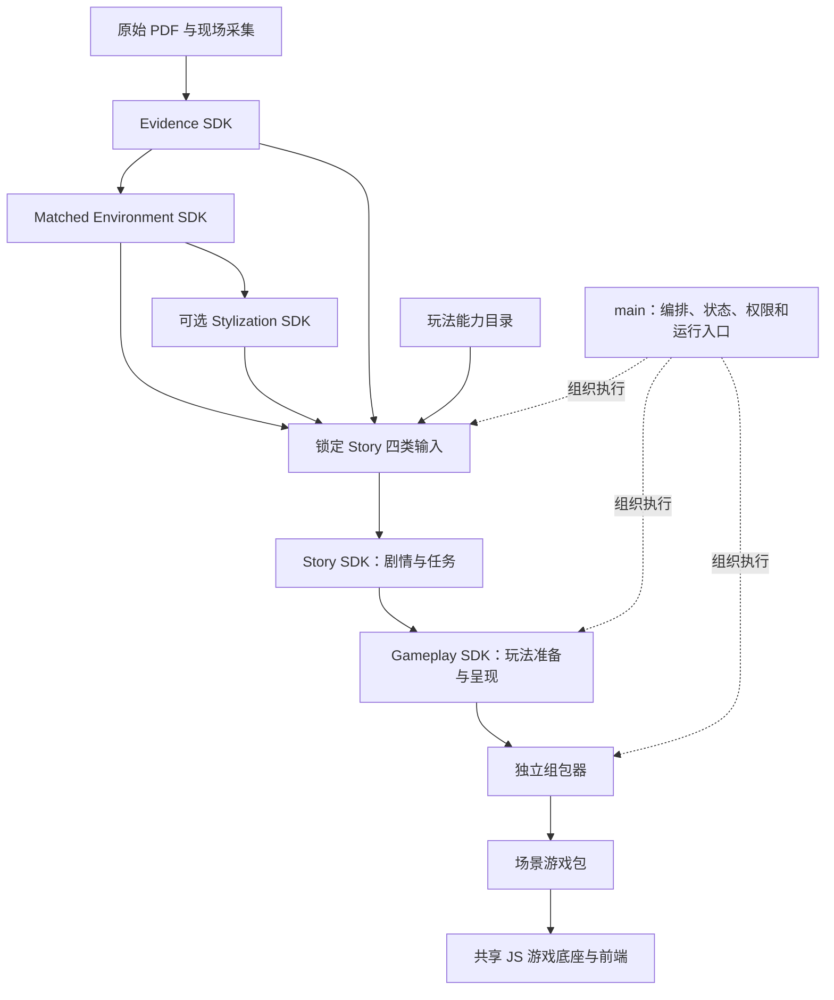
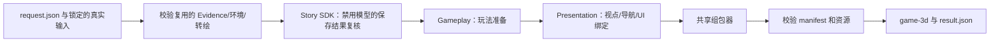
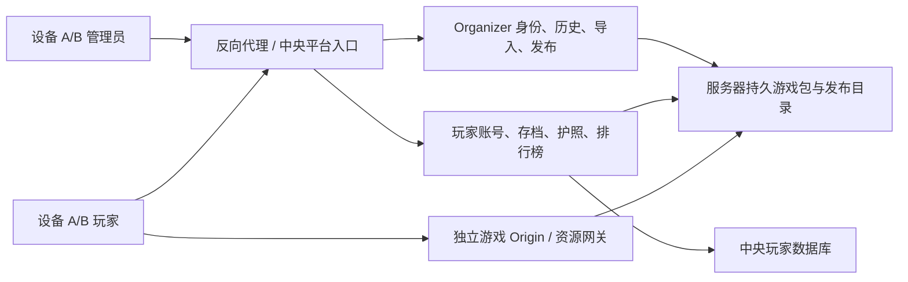

# PastPort 技术 PRD

中文 · [English](TECHNICAL_PRD_EN.md)

**版本：1.0 · 唯一初稿 · 当前基线：2026-11-01**

本文统一说明当前 main、五个 SDK、共享运行时的职责、技术栈、输入输出、工作流与验收边界。本文不授权模型调用、公开发布或部署；具体运行仍受调用者权限和预算约束。安装和试玩从[根 README](../README.md)进入，各 SDK 的命令和 API 由其包内 README 说明。

## 目录

- [产品目标与当前状态](#product-and-status)
- [架构与职责](#architecture-and-ownership)
- [技术栈](#technology-stack)
- [工作流](#workflow)
- [输入输出与契约](#contracts-and-versions)
- [五个 SDK](#sdk-modules)
- [Story、模型与 Agent](#story-and-agents)
- [空间与导航](#space-and-navigation)
- [玩法、呈现与游戏运行](#gameplay-and-runtime)
- [组包与启动](#assembly-and-startup)
- [权限、预算与恢复](#permissions-and-recovery)
- [开发、测试与交付](#verification-and-delivery)
- [下一阶段](#next-steps)

团队先在现有游戏包上打磨并试玩，验收后再将可复用的故事、玩法、绑定和组包改进接回 Main 与 SDK。目标是从素材生成可继续编辑的游戏初版。城市地图和公众发布接入仍待建设与验证，详细职责见[交接文档](../handoff.md#zh)。

<a id="product-and-status"></a>
## 1. 产品目标与当前状态

PastPort 把真实遗址材料、物件及空间转换为可浏览、可阅读、可完成任务的博物馆游戏。玩家应知道自己是谁、现在要做什么、为什么需要查看这个遗址物件，以及选择会带来什么后果。游戏不是资料卡顺序播放。

当前体验包括 360° 展示和生成的 3D 场景。3D 点位之间沿已登记导航切换，**没有把两份模型拼成一个实测连续模型**。保留原建筑、物件身份和布局；转绘改变材质、光照与动画风格，不把电脑等物件换成别的对象。

### 1.1 当前状态与验收边界

| 范围 | 当前实现 | 验收边界 |
|---|---|---|
| Organizer | 单管理员账号密码、中英文手动切换、上传/默认复用、审核、故事、制作进度与玩家预览 | 真实本机入口；不是Sites草图或公网部署 |
| 四种材料起点 | 原始PDF与照片、映射PDF与360、原生匹配VR、原生已挂载双点位3D | 调度/交接有回归与保存结果复用证据；不能等同四条外部生成服务均重新实测 |
| 资料审核 | 当前SDK共用VR/3D页面，原全景及3D定位、介绍和审核记录、位置与箭头保存 | 共享语义权威，空间分别保存；原资料未核实状态不变 |
| Story | 授权新生成、内容计划编译、旧故事来源/空间/玩法兼容检查及有限人工确认 | 有真实生成与下游执行证据；质量尚待打磨，不保证任意输入一次成功 |
| 玩法与组包 | 阅读、来源判断＋矩形覆盖、呈现绑定、共享组包器与浏览器运行 | 有通关、失败重试与恢复记录；不是通用小游戏库 |
| SDK与运行时 | 五个SDK依赖一个共享核心，曾有仓库外安装联跑验收 | 当前源码继续变化；旧wheel不代表已包含最新修复 |
| 风格转绘 | 有独立SDK及已有结果复用 | Organizer未接新转绘操作 |
| User与存档 | 玩家地图独立账号、SQLite 持久进度、浏览器缓存及恢复 | 跨设备需连接同一后端；存档按账号、站点和发布版本隔离 |

界面、结构、执行与内容质量分别验收；不得把旧全量测试数字当成每次更新都重新完成的检查。当前UI更新证据见 `var/organizer-integration/interface-language-acceptance.json`，其余运行记录在同级目录；它们不授权新的付费调用。原PDF的OCR、来源映射、空间校准和史料适用限制继续保留。

### 1.2 当前目录与入口

便携启动使用 `uv run python -m pastport organizer-init` 初始化本机账号，`uv run python -m pastport organizer` 在当前终端运行。默认私有目录为仓库下的 `var/organizer-integration`；支持 `--directory`、`--port`、`--player-assets`。已有账号保留；新电脑导入交付包建立历史。Windows 使用 WSL2。

| 项目 | 当前位置 |
|---|---|
| 应用源码 | 任意位置的 PastPort clone，本地main；命令均在仓库根目录运行 |
| Organizer入口 | `http://127.0.0.1:18840/organizer/` |
| 默认资料与账户配置 | `var/organizer-integration/catalog.json`、`staff-accounts.json`；均为私有配置 |
| Organizer记录库 | `var/organizer-integration/server/organizer/organizer.sqlite3` |
| 上传与任务缓存 | 上述 `organizer/` 目录内按项目/任务保存；网页显示实际路径 |
| 游戏成品 | `jobs/<任务>/builds/<构建>/game-3d/`，以任务记录中的位置和预览入口为准 |
| 共享审核库 | 环境项目的 `pastport_matching.sqlite3`；不在Organizer记录库中，审核页显示完整路径 |
| 保存结果CLI基线 | `var/runtime-layout-20261101/request-release.json` |
| 独立试玩回退基线 | `var/runtime-layout-20261101/release-run/game-3d/`，端口18839 |

私有输入与运行产物不随Git clone提供。早期 `var/main-sdk-integration-20261101/` 只保留为验收/回退记录，不再作为当前默认入口。当前源码说明不表示已重新构建或发布全部发行包。

<a id="architecture-and-ownership"></a>
## 2. 架构与职责

采用 **modular monolith：同仓库、清晰模块边界、独立 SDK 发行包、一个共享运行时**。



| 模块 | 负责 | 不负责 |
|---|---|---|
| main | 组织 SDK 调用、输入锁、阶段恢复、错误与交付入口；已有共享权限/预算服务 | 每个遗址写一套定制游戏规则 |
| Evidence | 原件登记、提取、识别/证据整理及匹配文档 | 场景导航、游戏运行 |
| Matched Environment | 物件匹配、共享审核内容、VR/3D 挂载、空间与导航 | 编剧情、独立绘图生产 |
| Stylization | 全环境统一风格转绘、3D 外观处理 | 改写物件身份、审核文字或几何数据 |
| Story | 剧情、角色、任务意图、条件、选择、状态后果与空间引用 | 插件源码、UI 代码、建模、组包 |
| Gameplay Preparation & Presentation | 玩法匹配及精确参数、可执行性验证、物件/站位/视点/UI 绑定 | 私自修改剧情或发放全局奖励 |
| 组包器 | 验证完整依赖并封装游戏内容 | 生成故事、决定玩法、启动独立组包服务 |
| 游戏底座/前端 | 执行动作、维护剧情状态与存档、显示场景及交互 | 每次操作等待模型裁定 |

组包器是独立模块，**尚无独立 SDK 发行包**。游戏底座位于共享运行时，不复制进 Story 和 Gameplay 两个 SDK。两个 SDK 的发行包是公开调用门面，其实现依赖同一份 `pastport`。

### 2.1 生产源码归属与安装资源

| 位置 | 职责 | 调用关系 |
|---|---|---|
| `frontend/organizer/` | Organizer真实本地制作页；按五种原生输入路由SDK | 只调用main的Organizer接口，复用其账户 |
| `frontend/game/` | 现有User游戏页面、对话、任务、3D交互和玩家会话；本轮不改 | 运行期调用插件与共享引擎 |
| `gameplay/contracts.mjs` | 共用快照身份与错误契约 | 玩法准备和组包器都引用它，避免反向依赖 |
| `gameplay/plugins/` | 本地玩法执行器、覆盖求解与能力目录 | Gameplay验证器调用；运行时代码进入游戏包 |
| `gameplay/gameplay.mjs` | 生成游戏宿主的插件绑定计划 | 前端会话与组包编译使用 |
| `gameplay/prepared-game.mjs` | 核对Story、玩法、空间与博物馆身份，生成呈现输入 | Gameplay呈现工具与组包器调用 |
| `tools/game-package/` | 故事适配、显式资源发布、独立组包与本地预览服务 | main适配器调用构建入口 |
| `src/pastport/player/` | 唯一维护的共享JS引擎源码 | 前端与制作工具导入；生成游戏时复制所需七个模块 |
| `tests/game/`、`tests/fixtures/game/` | 自动测试及人工编写的旧故事样例 | 不进入正式运行资源 |

SDK公开API、游戏规则与生成游戏包布局保持不变。共享运行时wheel把正式资源按源码的职责目录带入`runtime_assets`；SDK运行时读取已安装资源，不回原仓库查找。`runtime-assets.mjs`维护显式资源清单，将源码跨目录导入转换成游戏包内的相对路径；注入3D场景的脚本保留场景执行上下文。旧`prototype/story-agent-demo`目录不再是正式依赖。

源码搬迁后，旧运行目录和旧wheel不会自动变化，原有试玩保留。复测保持稳定的当前预览入口，生成时使用独立临时目录，验收后再切换到新产物，日常最多保留一份上一可用版；当前CLI不支持直接覆盖非空输出目录，不能原地覆盖未完成的游戏包。既有候选wheel与迁移验收产物保留在 `var/runtime-layout-20261101/`，其中 `release-run/game-3d/` 与端口18839是回退试玩基线；当前Organizer任务产物在 `var/organizer-integration/server/organizer/jobs/`，预览使用任务入口。保留的原始两份试玩是本次迁移的回退基线，不代表每次测试都要永久复制一份。相同候选版本的旧归档不覆盖。

本次验证：拆分后的安装资源与源码身份一致，仓库外安装六个包并用保存的真实故事完成玩法准备、呈现与组包；96项资源哈希、两种结局、失败重试和退出恢复检查通过。浏览器实际走完三任务、错误史料重试、拼板、跨点位导航和结局刷新恢复，未新增模型调用。验收记录为上述目录下的`ACCEPTANCE.json`和`BROWSER.json`；这是安装与保存故事复跑的证据，不是新故事生成或人类质量验收。

### 2.2 人员边界

| 负责人 | 主要边界 |
|---|---|
| wehan | main、共同契约、执行/预算服务、组包与游戏底座 / 用户端、账号、城市地图与平台自动化 |
| wcheung | 四二 Demo 与 Story 到可玩成品的流程优化 |
| maslan | 答辩主试玩 |

接口变更需要固定输入输出和兼容性验证。独立维护 SDK 不要求拆成多个仓库，也不允许各自维护一份共享引擎。

<a id="technology-stack"></a>
## 3. 技术栈

| 层 | 当前技术 | 使用理由/约束 |
|---|---|---|
| 业务与接口 | Python 3.12、Pydantic v2、Protocol、依赖注入 | 强类型、边界校验、可替换适配器 |
| 已有服务 API | FastAPI、Uvicorn、HTTPX | 保留现有认证、请求和服务生命周期 |
| 工作流 | LangGraph | 阶段组织、条件路由与检查点，不等于每个节点都是 Agent |
| 持久化 | SQLite、SqliteSaver/AsyncSqliteSaver | 当前单机阶段状态、执行记录和恢复 |
| Story 模型 | Sol 6.1 High；Codex 登录通道 | 经共享受控执行；仅在明确授权生成时使用额度 |
| 玩法验证/呈现/组包 | Node.js 与现有 JS 模块 | 与浏览器实际运行规则共用实现 |
| 场景与界面 | 现有 HTML/CSS/JS；现有 360°/3D 查看器 | 不引入新的 Unity、Unreal 或前端框架 |
| 上游专用工具 | Poppler；部分工作流需要 ffmpeg、PDF/图像库 | 由各 SDK 声明，不能把安装等同于生成授权 |
| 包与依赖 | uv、pyproject、锁定版本与 wheel | 工作区依赖和仓库外安装分别验证 |

不为当前集成引入微服务、外部队列、另一套数据库或多 Agent 对话系统。需要扩展时由性能或实际功能缺口驱动。

<a id="workflow"></a>
## 4. 工作流

### 4.1 内容生产顺序

1. 登记原始材料、现场资源、项目和使用范围，锁定来源与版本。
2. Evidence 提供可追溯史料；Matched Environment 提供物件、审核内容、位置及导航；需要时应用 Stylization。
3. Story **生成前同时读取四类约束**：史料、审核文字/物件、空间/导航、玩法能力目录。
4. Story 生成剧情和任务的结构化要求；再做结构、引用、状态、空间和玩法一致性校验。
5. Gameplay 按这些要求编译插件参数，验证来源关联、有解性、完成/失败/退出和恢复；再生成呈现绑定。
6. 独立组包器校验依赖并输出完整游戏包。
7. 本地服务打开游戏，进行实际交互与人类体验验收。

不是先随意写任务、最后发现插件不支持；也不是把某一份固定拼板样例强塞给 Story。Story 在插件能力范围内创作，准备层必须精确承接其要求。

### 4.2 当前 main 命令的实际路径



`pastport-game-trial --request REQUEST.json` 当前只接受 `saved_response_only`。该命令自动组包，**不需要再单独启动一个组包器服务或把网页地址传给它**。组包完成后，仅在需要浏览时另行启动 `node serve3d.mjs`。

该图只描述保存结果CLI，不代表main全部能力。主办方使用4.5节Organizer四步流程；新故事通过网页明确授权后调用Story SDK，亦可使用独立 `pastport-story` 命令。不得把保存结果CLI的零模型执行写成全新生成。

### 4.3 工作流状态所有权

main 的外层 LangGraph 仅记录粗粒度阶段和产物引用。Story 内部复用共享 editorial graph，继续拥有其模型预算、审核和执行回执；外层不再建立第二套模型重试/预算循环。

外层检查点位于该次输出的 `checkpoints.sqlite3`，Story 内部记录位于该次 `story/application`。现有认证服务 API 与保存结果复跑 CLI 保留；Organizer另提供认证的HTTP制作入口。五种新上传材料通过独立原生输入适配器交接，见4.5。

### 4.4 main 现有服务 API

main 保留原有 FastAPI editorial/player 服务，与私有集成 CLI、Node 试玩服务分开：

| 入口 | 输入与作用 | 输出/边界 |
|---|---|---|
| `python -m pastport --accounts ...` | 账户权限、数据目录、可选本地内容/资源和显式执行配置 | 本地认证 API；不是自动启动全部 SDK 的制作控制台 |
| `pastport-game-trial --request ...` | 本文 §5.2 的私有输入锁 | 自动阶段产物及游戏包；不重新调用模型 |
| `node serve3d.mjs` | 已生成游戏包及端口配置 | 玩家浏览器页面；不生成内容或再组包 |

服务账户配置以[API settings](../src/pastport/api/settings.py)为准；不在 PRD 或公共配置中存放真实 token。认证使用 Bearer token；变更请求使用相应 `Idempotency-Key`、预期 revision 和角色/项目权限。错误、版本冲突、撤销审核、取消及预算干预不能靠前端隐藏后强行继续。

[API app](../src/pastport/api/app.py)当前提供以下接口组，精确请求类型见[应用消息](../src/pastport/application/models.py)：

| 接口组 | 代表路径 | 内容 |
|---|---|---|
| 健康/项目 | `/api/v1/health`、`/api/v1/projects` | 服务及项目状态 |
| 创建/查看运行 | `/api/v1/projects/{project_id}/runs`、`/api/v1/runs/{run_id}` | CreateRun 与 RunRecord |
| 内容/证据 | `/api/v1/runs/{run_id}/artifacts`、`/api/v1/artifacts/{artifact_id}` | 带版本和权限的产物读取 |
| 审核与编排 | `candidate-selections`、`review-decisions`、`narrative-requests`、`revisions`、`locks` | 选择、审核、定向操作和人工锁 |
| 恢复与执行 | `resume`、`cancel`、`executions`、`interventions`、`budget` | 运行恢复、停止和可核对执行记录 |
| 人工干预 | `usage-reconciliations`、`budget-amendments`、`review-revocations` | 明确授权的用量、预算与审核操作 |
| 游戏与存档 | `/api/v1/projects/{project_id}/player-initial-state`、`player-saves` | 已发布/允许运行包的初始化、保存和动作处理 |

表中不带前缀的操作路径均位于 `/api/v1/runs/{run_id}/` 下。Main 现有 API 与独立 museum/stylization staff portals 不等于已经合并成同一个 Web 产品；本轮验收针对明确的 CLI 及产出的试玩包。

### 4.5 Organizer 实际接口与验收边界

`GET/POST /organizer/api/workspace`读写当前管理员的项目选择；输入只允许已登记source_id，经项目权限和来源检查后保存到Organizer记录库，不能指定磁盘路径。历史记录显示项目编号并提供“继续此项目”“查看资料与审核”；刷新、重新登录、服务重启后恢复环境及已有故事阶段。未准备故事不能解锁组包，运行中的新材料任务不能继承另一项目的环境或故事。选择与恢复不调用模型、不自动重试、不授予审核批准。

新照片任务采用紧凑策略：每批2张，最多12个新物件、24条观察；名称、特征及解释按Schema限制长度，单批最多120秒或授权的更短时限。发现超过本批容量时报告不完整并停止，不把缺失当成功。旧策略与已付费回执保持原样，失败不自动重试；此限制已通过离线回归，尚未完成真实模型速度验收。

Organizer右上角提供中文 / English手动切换，默认中文，语言偏好仅保存在当前浏览器；不跟随浏览器自动切换。界面词库位于 `frontend/organizer/i18n.mjs`，登录、制作、审核外层和进度按同一语言显示，共用审核内嵌页同步其已有界面标签。切换原位更新文字，不刷新、提交或重建表单，不触发模型、Marble或审核保存。PDF原文、物件名称、介绍、故事、路径和输入值保持原文；未收录的诊断原文保留。语言资源随运行时安装，版本指纹覆盖该模块，避免混用旧脚本。

本地 `frontend/organizer/` 由 main 的 `/organizer/` 提供，沿用账户角色和项目范围；静态 Sites 草图仍不接本机服务。User界面和玩家数据库没有改动。

| 输入/路径 | 实际行为 | 当前边界 |
| --- | --- | --- |
| 已登记材料 · 复用 | 校验来源、完整输入指纹和资源，调用现有保存结果复跑链 | 新模型调用为0；保留当次锁定的Skill，不把旧结果算作新生成 |
| 已登记材料 · 重新生成 | 确认后使用当前Skill调用Story SDK，再自动玩法、呈现和组包 | 复用登记环境，不重生成3D；单次预算、不自动重试；生成内容校验失败会停止 |
| 原PDF + 照片 + SPZ/PLY | `raw3d`：本地导入并渲染六向观察图 → Evidence → 单场景匹配/挂载 → 现有审核/Story/玩法/组包 | 零Marble；派生图不冒充原始照片；物件与尺度保持待审核/待校准 |
| 原PDF + 照片 | 调用Evidence生成映射，再交环境匹配与3D | 无360时保存映射并等待补充；不会冒充游戏完成 |
| 原PDF + 映射PDF + 360° | 校验360并调用环境构建、3D，再交Story | 映射PDF与原史料的页码、哈希和出处不能互换；不能仅看文件齐全就放行 |
| 已匹配VR | 验证原生VR导出包，保留审核数据，再生成3D | 需完整原生项目与审核身份，不能将普通全景当作已匹配项目 |
| 已挂载3D | 验证原生双点位3D导出包并从Story继续 | 检查子包哈希、共享审核一致性、物件绑定与导航；不重生成3D |


`raw3d`上传角色为 `original_pdf`、`photos`（图片或ZIP）、`scene_splat`（SPZ）、`scene_mesh`（二进制小端三角PLY）。复用现有 `materials/{project_id}/jobs`，不增加平行后台；单场景允许1个世界，不伪造第二视点。准备环境在 `environment_ready` 停止，审核保存自动衔接故事输入，故事就绪后才允许组包。恢复保留原始预算和执行回执，不要求Marble授权。VR和原始3D共用照片识别→同源PDF候选页检索→候选页图文匹配→本地原文定位校验→映射PDF导出的处理方式；只在环境导入、空间定位和挂载处分支。识别满20个不同物件停止；候选检索1次、最多12页，图文匹配最多4批，不再逐物件额外调用模型核验。历史关联保留待人工审核，不等于已证明实物同一。最小流程为3次，实际需要取决于识别与覆盖情况；默认8/20次不自动扩大。预算不足在任何模型调用前报错。当前零调用模拟回归和单物件真实审核交接不等于44张照片全量生成验收。

实际端点位于 `/organizer/api/`：`session` 登录，`sources` 校验登记材料，`materials` 与项目 `files` 流式保存上传，`jobs` 创建与查询制作，任务 `continue` 显式确认恢复，`open` 打开独立本机玩家预览。客户端不提交任意服务器路径，复用目录由 `--organizer-catalog` 登记，新上传文件由服务器生成私有路径；共享播放器 assets 由 `--organizer-player-assets` 登记。上传新制作入口为 `POST materials/{project_id}/jobs`，缺360可从 `jobs/{job_id}/mapping.pdf` 取映射PDF，补材料后通过原任务 `continue` 恢复。

认证后的制作页通过 `GET storage` 显示后台所在电脑的实际缓存根目录；每条任务记录显示属于该账户的缓存目录，成品就绪后显示游戏包目录。仅展示路径，不提供任意本地文件读取接口；远程访问时这些不是访问者电脑的路径。

Organizer元数据保存在main数据目录的 `organizer/organizer.sqlite3`，上传与执行记录同目录隔离存放；该库不替代、不重建物件审核数据库。重复请求按所有者、幂等标识与请求内容校验；同时仅允许一个制作任务。后台使用真实阶段回执显示进度，不用计时器假装完成。

中断后不自动重发模型：先展示保存的步骤和摘要，确认后才能恢复。缓存恢复复核输入及阶段哈希。新生成仅在已有完整故事回执时允许无模型复核继续；调用结果不明时需要原回执核对。模型用量从真实预算记录读取，未知保持未知。目标体验时长仅作为新生成的创作目标，不作为生成耗时或精确试玩时长。

验收分层：缓存来源校验、HTTP接线、原生导出/导入、真实新生成、保存结果恢复、组包资源检查及浏览器交互分别留证。相关记录位于忽略的 `var/organizer-integration/`；不在规范中重复逐次失败历史、板块数量或累计费用。新生成失败保留原响应与用量，不自动重试、不把恢复重放算成一次全新生成。未逐条重新实测的Evidence/Marble外部生成路径保持未验收。

构建产物按输入与实现指纹放在任务的 `builds/` 下；代码更新可复核同一份已付费Story并新建本地构建，不篡改旧执行锁或删除旧产物。预览与阶段回执通过受作用域检查的制作请求定位，稳定Organizer入口不随构建目录改变。

Organizer制作页按“资料与环境 → 资料与审核 → 故事 → 制作游戏”执行，移除重复的“已有项目与重新生成”入口：

展签 PDF 直连 3D 使用左栏带编号标框的实物照片和右栏的“现场所见”“用途与来源”。每件实物使用唯一 PP 编号，多角度照片放在同一主展签；编号补遗只补介绍。定位复核复用环境 SDK，跳过史料映射和 Marble。候选落点保留待审状态，无法确认同一实物的条目没有挂载点。环境就绪后登记 3D 预览和故事输入，由用户另行启动 Story。

1. **资料与环境**：灰框勾选仅复用登记的默认资料和已完成环境，零模型/Marble调用，不运行Story或组包。不勾选则按四种上传起点真实准备，禁止自动切换默认缓存；原始、映射与匹配VR起点需要Marble生成3D，上传完整3D只进行校验和交接。生成服务仍需明确授权和有限预算。
2. **资料与审核**：直接嵌入环境SDK随包携带的原编号审核界面，保留原布局与操作，不新做一套审核UI。已准备环境的项目与默认示例无需再上传；同一项目在列表合并展示。现场照片、史料原文和图片、介绍及图片/文字两个审核结论来自同一权威库。main认证代理读取和保存，媒体仅能访问项目登记清单；上传包中的HTML/脚本不执行。保存沿用SDK版本检查、历史事件及当前账号身份。上一步产出自动作为此处输入，不要求再次上传、选择项目或确认传递。原有未复核/待确认状态不变。
3. **故事**：只使用第一步返回的环境身份。灰框勾选复核该环境的已存故事；不勾选调用SOL 6.1 High生成新故事。不允许将默认故事套到另一个环境，没有配套故事时禁用复用框。两条路径都在故事通过校验后停止，不执行玩法、呈现或组包。
4. **开始制作**：仅在故事准备就绪后启用；使用第三步返回的已核验故事与环境，执行玩法、呈现和组包，不再次生成Story或3D。

审核API位于 `review/{source_id}`：读取实际资料；`objects/{number}` 保存审核或介绍；`apply` 本机导出审核后的新环境输入。原界面通过 `workbench/` 嵌入、`workbench/data` 读取、`workbench/save-review` / `save-introduction` 保存；其照片与证据仍采用严格清单路由。iframe只运行已安装SDK的可信模板，保留编辑中状态，成功保存后通知外层更新版本状态。

Story直接读取当前审核后的输入，不增加一轮传递确认。保存审核或介绍后，页面自动进行本机新输入导出；VR位置、3D锚点/校准与3D箭头的版本变化也会使旧空间输入过期，返回主页面时重新核对并同步。同步未完成时不允许Story读取陈旧版本。同步仅使用登记的原文提取和已有3D资源，不调用模型或Marble；旧环境快照、旧故事和旧成品保留。新输入没有可匹配的旧故事时只能明确生成新故事，不能偷偷套用旧故事。

共享审核界面取当前SDK的 `shared_review_markup`，沿用VR/3D共用介绍、原全景对照与3D定位入口。原环境编辑器也通过main认证与项目作用域接入，复用SDK的VR位置、VR导航、3D锚点/校准、3D导航箭头服务；只重写网页资源和端点的同源地址，不重写空间规则。全景与3D语义内容共用，位置记录分别保存。下载成品仍由制作流程统一组包。

`OrganizerStart.stop_after` 为 `environment | story | game`，旧API默认 `game` 保持兼容；页面始终显式提交。上传参数 `UploadedProductionStart.stop_after=environment` 在原生SDK交接后停止。任务状态 `environment_ready` / `story_ready` 和受账户作用域限制的 `prepared_source_id` 提供持久交接，`result_ready` 此时保持false；只有最终游戏完成才能打开玩家预览。请求与阶段选择纳入幂等摘要，故事校验失败不会降级复用或继续组包。浏览器刷新可用非敏感任务编号恢复当前步骤。

管理员通过单一账号密码登录，不开放注册；本机一次性初始化现有管理员密码，之后沿用账号密码与HttpOnly会话。SDK预算和开发者API认证独立保留，页面不要求填写Bearer令牌。

默认缓存是 `OrganizerCachedBundle`：以已登记的完整GameMakingRequest为入口，绑定原PDF、照片来源清单、全部照片、映射PDF、物件表、VR原件、native import与双点位3D文件。`CachedBundleValidator`逐文件核对哈希，再核对原件、页数、照片集合、映射/物件/VR的native输入哈希，以及3D的来源导览、点位与全景哈希。默认项必须且只能有一个完整登记；失效时禁止自动选择不相关资料集。每次执行保存并重验同一份bundle，不重构或改写原始审核。

全复用验收选用62页原件所对应的旧有完整结果；另一个34页来源的照片匹配缓存明确排除。三种起点验证的是各自缓存来源与保存结果复跑，不把它写成重新调用Evidence、环境模型或Marble的实测。

原生新输入经 `OrganizerInputPreparer` 注入，专用实现位于适配层；domain/application/ports不导入可选SDK。原生CLI子进程由main持有、限时并在关闭时回收；Marble pending只查询原operation，不重新提交。安装包随带离线投射资源，无需源码仓库node_modules。

原史料PDF提供Story证据；映射PDF保留自己的来源哈希与图像页码。`SourceLineageProjector`只在原史料能唯一找到同段引文时转换文字页码，否则保留缺口；不改上游审核库、不更换内部身份。两个导出视点的13张共享内容表必须一致，空间状态各自保留，入口与导航仍绑定原场景ID。只有缺失的自动候选与箭头才初始化，不覆盖人工位置、校准或审核。

当前宿主能力边界为两个独立3D点位，经箭头切换，不代表融合几何或任意N视点。原生ZIP数据有文件数/解压量/路径限制；禁止链接、跨目录和主动SQLite schema；上传脚本不执行，播放器使用服务器登记的可信资源。

审核保存后的本机输入同步采用元数据归档，不在中间ZIP中再次装入场景二进制；macOS支持的文件系统优先使用写时复制快照复用未变资源的数据块，新旧文件后续修改相互隔离，不使用硬链接。其它文件系统退回独立复制，耗时可能较长。空间和来源校验保留；该优化不触发模型或Marble。
审核同步的几何计算缓存以完整探测请求、碰撞几何和执行依赖哈希共同标识。文字修改可复用已有结果；位置、导航、校准、几何或算法变化必须重新计算。仅完整校验后的结果原子写入缓存，取消仍然生效。

<a id="contracts-and-versions"></a>
## 5. 输入输出与版本契约

### 5.1 当前发行版本

| 发行包 | Python namespace | 本地候选版本 |
|---|---|---|
| shared runtime | `pastport` | `0.2.1rc4` |
| Evidence | `pastport_evidence` | `0.1.0` |
| Matched Environment | `pastport_matched_environment` | `0.1.0` |
| Stylization | `pastport_stylization` | `0.1.0` |
| Story | `pastport_story` | `0.1.0rc4` |
| Gameplay Preparation & Presentation | `pastport_gameplay` | `0.1.0rc2` |

Story 和 Gameplay 固定依赖同一版本运行时。Stylization 单向依赖 Matched Environment；上游包不反向导入 main。main 只在明确的可选适配器中调用 SDK，domain/application/ports 不导入其实现。

**软件包版本、游戏 wire、内容版本和插件能力版本是不同概念。** 当前核心 wire 保留 `0.1.0`；GameplayPlan 使用 `gameplay-preparation/0.4.0`；当前参考 host 为 `pastport.demo.activities/1`。不能因 wheel 版本变化就把旧 wire 或未实现的通用插件接口宣布升级。

### 5.2 main 请求字段

类型定义：[GameMakingRequest](../src/pastport/domain/game_making.py)。相对路径以请求文件所在目录为基准，不能依赖启动终端的位置。

| 字段 | 类型/内容 | 来源与用途 |
|---|---|---|
| `original_pdf` | Path | 原始史料；不是映射展示版 PDF |
| `source_document` | Path | Evidence `RegisteredPDF` 导出，包含页和原件身份 |
| `environment` | Path | 共享 `EnvironmentSnapshot`；审核文字、物件、引用和空间 |
| `media_directory` | Path | 已登记的来源资料卡图片 |
| `museum_directory` | Path | 可用博物馆目录，含 `data`、场景、几何和外观资源 |
| `saved_story_run` | Path | 完整保存的 Story 运行，含原始响应、锁与回执 |
| `skills_directory` | Path | 该 Story 对应的精确 Skill 快照 |
| `brief` | 非空文本 | 与保存结果绑定的原始创作要求 |
| `output_directory` | Path | 新的隔离运行目录；恢复时必须是原目录 |
| `mode` | `saved_response_only` | 默认且唯一可接受模式；不能借 manifest 授权付费 |

### 5.3 Story 和玩法之间的结构化契约

| 产物/字段 | 必须表达 |
|---|---|
| `NarrativeDraft.package` | 剧情、角色、任务、声明的变量、条件、规则、选择与结局 |
| `spatial_intents` | 每任务的 `task_id/object_number/view_id/station_id/interaction` |
| `gameplay_intents` | 每任务明确声明 `source_reading` 或 `coverage`，不能缺省兜底成阅读 |
| `capability_catalog_sha256` | 本次使用的玩法能力目录身份 |
| `authoring_report` | 史料关系、玩家已知前提、推理/动作、后果及限制 |
| `GameplayPlan.bindings` | 精确任务、插件身份、配置、站位与来源绑定 |
| lifecycle receipt | 插件代码、配置和验证器哈希；实际生命周期检查；拼板构造解 |
| presentation input | 同版本故事/玩法/环境的场景、物件、导航、界面绑定 |
| manifest | 游戏运行依赖、真实文件哈希、入口和候选验收状态 |

新生成的 `authoring_report.heritage_refs` 仅从已锁定Evidence的claim/asset键选择；原生物件UUID从模型物件投影移除，由既有环境与资产映射在程序中解析。引用枚举在模型请求Schema哈希与预算预留前编译，返回后再校验；不通过时保留原始响应和真实用量，不自动替换成另一物件。旧保存结果保留原Schema与复核路径。

Story 提出任务规则；玩法准备把同一规则转换为可运行参数；界面数量、尺寸和提示从同源规则/求解结果生成。不得分别手写“四块板”“六块板”这类互相矛盾的文案。

### 5.4 main 输出目录

| 输出 | 含义 |
|---|---|
| `input-lock.json` | 请求、SDK/实现与输入内容身份 |
| `checkpoints.sqlite3` | 外层阶段恢复检查点 |
| `receipts/*.json` | 各阶段产物路径及哈希 |
| `upstream-validation.json` | 原件/场景/外观校验及明确的复用标记 |
| `story/` | 复核后的故事、证据索引、锁、预算及保存回执 |
| `gameplay/` | `gameplay-plan.json` 与精确编码的环境快照 |
| `presentation/story-input.json` | 给独立组包器的完整绑定输入 |
| `game-3d/` | 可独立启动的游戏包、场景和资源 |
| `result.json` | 游戏目录与入口；模型调用和审批边界 |

### 5.5 身份、空间与哈希

物件 ID 回答“是什么”，view/station/world 回答“在哪里”，来源定位回答“依据是什么”。同一物件在不同视点的多个 occurrence 共用档案，不算多个历史对象。

物件、来源、内容、几何、导航与外观保持各自版本。精确文件哈希与规范化 JSON 哈希不能混用；保留浮点空间编码和坐标系，不为通过检查修改坐标或放宽游戏规则。输入/代码变化后使用新输出目录。

生产契约以 [Python registry](../src/pastport/contracts.py)、`schemas` 和实际 typed models 为准。用 `python tools/check_contracts.py --write` 生成 Schema，不能手改。`tests/fixtures/reference` 中的合成样例用于当前兼容性测试，不是另一份 PRD，也不证明通用插件生产能力。

<a id="sdk-modules"></a>
## 6. 五个 SDK

### 6.1 Evidence SDK

- **输入**：原始 PDF、现场图片/识别范围、隔离 workspace、显式 grant 和 run ID。
- **输出**：登记的原件和逐页内容、来源图文/匹配资料、可追溯出处、待核实项及导出结果。
- **API**：`PhotoMappingWorkflow`、`SubscriptionGrant`、`OutputPaths`；其 typed `run(...)` 与可注入 reader/transport 以包内代码为准。
- **技术**：Python、PDF/图像处理、版本化提示词、受控语义执行和持久阶段记录。
- **限制**：提取/识别可以不完整；15 项是发现目标，不是强凑匹配的硬门槛。候选数量、实际有效对象数、故事引用数分开记录。
- **操作**：[Evidence README](../packages/evidence-sdk/README.md)。

### 6.2 Matched Environment SDK

- **输入**：匹配资料、已有 tour/现场资源及 3D 输入；挂载/审核/导航修改。
- **输出**：共享物件内容与核实状态、360° occurrences、3D 绑定/校准/碰撞引用、站位/导航/空间评估及可预览环境。
- **API**：`EnvironmentBuildWorkflow`、`StudioApplication`、`TourPreviewApplication`；具体参数见包内指南。
- **技术**：Python API/工作流、浏览器查看器、Node 空间分析；3D 生成服务属于上游独立能力，不是 Story 的职责。
- **导航**：独立导览入口复用 SDK 内部切换、可拖拽箭头、保存位置和到达朝向。main 提供场景输入，不另写导航算法。
- **审核**：一个物件档案支持多个视角；物件位置/箭头按场景记录。不能为 Story 重建审核数据库。
- **操作**：[Matched Environment README](../packages/matched-environment-sdk/README.md)。

### 6.3 Stylization SDK

- **输入**：已匹配环境、原始全景/3D 外观资源、风格参照与受控生成/应用配置。
- **输出**：风格化全景/3D 外观、来源绑定、`Style3DVariant`、检查与待验收状态。
- **技术**：受控图像通道、全景处理、SPZ 外观处理、浏览器预览；需要的外部工具由该包声明。
- **规则**：全环境统一动画风格，保留物件身份、布局、几何、审核内容和导航。未知视觉质量不能自动升级为通过。
- **操作**：[Stylization README](../packages/stylization-sdk/README.md)。

### 6.4 Story SDK

资料与审核页显示当前权威审核SQLite的完整本机路径并提供复制按钮；该路径属于后台运行电脑，随项目切换，不是制作元数据数据库，也不提供数据库公开下载。

审核同步的网页链路只检查当前来源：历史项目目录通过 `metadata_only=true` 返回名称与身份，不作就绪承诺；默认资料与当前来源分别按需校验，不重复扫描全部历史项目。审核导出返回后直接采用已登记的环境输入，不再提交一次环境准备任务。后续Story/制作入口仍执行完整资源与版本校验。保存成功与输入衔接中分别提示，不把未完成的衔接显示为已就绪。

审核变化后的旧故事不再按“版本变化即无故事”处理。main仅在同一授权来源链中寻找最近成功故事；对旧记录仅在审核权威根、双点位资源根与import哈希完全一致时认定为同源，先验证原故事锁、原始PDF、匹配身份和故事校验，再对当前物件、所用引用（含小游戏对比史料）、空间动作、路线、能力目录与插件配置进行零模型兼容检查。通过则创建独立复用目录，正文及父回执不改；更新环境/来源索引和本地检查，保留父故事哈希与旧用量来源。后续制作必须验证兼容凭据，不能把旧模型响应按新环境重新解释。

兼容提示分为“可以沿用旧故事”“介绍有改动，请确认是否沿用”“任务条件已变化，请先处理”。仅介绍内容变化且来源、空间与玩法检查均通过时返回 `needs_confirmation`；页面展示旧新介绍及关联任务，用户点击“我已核对，沿用旧故事”后调用 `confirm-story-reuse`。确认绑定报告哈希、环境哈希、父故事哈希和具体改动，记录确认人和时间；任一相关输入再变需重新确认。编号、原史料/映射或执行条件失效不可确认绕过。确认仅适用于沿用原文的私人试玩，不代表历史批准或发布授权。

页面在环境就绪后自动调用 `POST /organizer/api/sources/{source_id}/story-compatibility`，通过后解锁旧故事灰框；接口沿用项目权限、会话/CSRF检查和制作互斥。审核保存自动交接也执行该检查。新生成故事成功后作为当前故事来源。所用物件介绍或证据有变化且不能确定无影响时，显示相关任务，不自动改写或调用模型；未使用物件变化不应拦截全部故事。检查只覆盖已声明依赖和可执行性，不声称自然语言剧情质量或历史结论已获批准。

新建自动生成任务采用 `compiled_plan_v1` 内容计划：模型依据PDF、审核资料、空间与玩法目录设计双语任务、玩法要求和最终选择后果；程序统一生成内部编号、语言键、状态声明、完成规则及结局引用，再输出原有 `NarrativeDraft`。当前编译配置支持1–8个有序单任务场景与2–4个最终选择，不宣称支持任意中段分支。超出配置应明确返回不可表达，不能靠伪造规则扩展。来源、数量、空间和插件能力校验保持；结构固定不代表史料或可玩性自动通过。旧任务按输入锁中的结构版本复核，缺字段视为旧 `authored_graph`，不改写旧失败回执。内容编译器有本地及真实JS引擎验证，并经主办方实际生成后走通制作链；故事质量未验收，既有wheel未随每次源码更新重打。

### 可选调查分支编译配置

显式选择 `compiled_branch_v1`（Story CLI 的 `--structure-profile` 或 `StoryRequest.structure_profile`）可生成一次有界分流与会合：1–3个开场任务、2–4条互斥调查线（各1–3个任务）、1–3个会合任务及2–4个最终选择。模型提供各线名称、虚构调查笔记、会合反馈和按最终选项排序的结局后果；程序生成编号、路线及完成状态、调查笔记授予和条件反馈。只解锁所选路线，已完成任务、调查发现和选择跨会合及存读档保留。空间准备核对实际图边，不假设序列化列表中相邻支线可互通。玩家端展示条件反馈，并只继续到唯一已解锁的后继场景。默认仍为 `compiled_plan_v1`，旧输入锁保留原配置；更换配置使用新输出目录。此配置不支持嵌套分支、跨线探索、任意关系状态或新增证据拼图；来源与玩法能力检查不变。离线测试不等于新模型生成、真实场景验收或玩家认可，未因此发布新wheel或试玩包。

**玩家端阅读与角色入口**

制作包可提供开场已知的 `characterProfiles`，以稳定角色 ID 关联双语 `speakerNames`，不应泄露调查后才取得的秘密。人物介绍为纯展示字段，不改变游戏状态或使仅新增介绍的旧存档失效。一般探索任务使用左侧非模态面板；需要选择时置中并使用模态焦点，来源详情仍须明确确认。字号、按钮对比和点击反馈独立于3D画质／LOD；放大点击范围不等于批准未知空间交互或自动完成任务。

**可选玩家场景准备**


- **输入**：原始 PDF/Evidence、审核物件内容、匹配空间及导航、玩法能力目录、创作要求、范围与预算。
- **输出**：简短可读稿、`NarrativeDraft`、逐任务玩法/空间意图、作者报告、锁、校验结果、模型和用量回执。
- **API**：`StoryClient.generate(StoryRequest)`；命令 `pastport-story`。
- **技术**：共享 Python/FastAPI/LangGraph editorial workflow、Pydantic、受控 Codex transport、Skill 与输出检查。
- **边界**：不生成环境、插件源码或 UI；不组包。保存响应复核使用 `revalidate_saved_response=True`，禁用模型通道。
- **操作**：[Story README](../packages/story-sdk/README.md)。

### 6.5 Gameplay Preparation & Presentation SDK

- **输入**：同版本故事目录、证据/环境锁、已声明玩法、能力目录、现有 museum。
- **输出**：插件配置、生命周期/求解回执、精确环境与物件/站位绑定、可供组包的呈现输入。
- **API**：`GameplayClient.prepare(PreparationRequest)`、`present(PresentationRequest)`。
- **技术**：Python typed composition、受限 Node 验证器、共享实际 JS Activity、确定性绑定。
- **边界**：本地执行，无模型调用。没有未声明玩法的阅读兜底，不修改 Story 的目标、史料、规则和奖励。
- **操作**：[Gameplay README](../packages/gameplay-sdk/README.md)。

<a id="story-and-agents"></a>
## 7. Story、模型与 Agent

当前“已有环境 → 游戏”这段的主要模型决策在 Story：选择史料如何构成冲突、角色动机、任务顺序、能力范围内的动作，以及选择后果。SDK 是调用接口，LangGraph 是编排工具，Skill 是规则材料，三者都不等同于自主 Agent。

### 7.1 当前实际能力

Story 当前主要是**受约束的模型生成工作流**。用一次受控生成配合代码校验可以完成创作，不应为了称作 Agent 而增加多个模型角色、对话窗口或重复上下文。

上游识别/转绘工作流可以有其自己的模型执行；当前 main 集成复用了这些成果，没有重新调用。玩法配置、空间计算、呈现、组包和玩家动作不需要模型。

### 7.2 生成前的四类约束

| 输入 | 决定的边界 |
|---|---|
| PDF 与可引用史料 | 背景、年代、事实与出处 |
| 审核后台文字/物件 | 实际可用物件、介绍、映射关系与核实状态 |
| 匹配后的 3D 空间 | 视点、站位、可达/可观察信息及导航限制 |
| 玩法能力目录 | 可用动作、参数范围、完成/失败/退出与恢复能力 |

生成后再次检查只是复核，不能把第一次玩法约束推迟到生成之后。任务必须明确可被已有能力承接；超范围不得偷偷换成别的玩法。

### 7.3 校验和自动处理

| 问题 | 当前处理 |
|---|---|
| 格式、引用或物件编号错配 | 拒绝不合格产物，保留响应和具体错误 |
| 变量未声明、类型冲突 | 真正影响判断的缺项报错，不猜初始值或类型 |
| 确定性的冗余/标签问题 | 仅已实现的窄范围规则可自动规范化，保留审计记录 |
| 拼板数量、尺寸或求解不一致 | 能力检查、精确编译、求解和同源 UI 校验，不手补故事 |
| 模型超时且用量未知 | 保存调用身份和未知状态，不自动重试、不按零用量结算 |

一次通过不能证明长期稳定或故事好玩。故事目标、因果、信息量、遗址关联与选择后果仍需玩家体验验证。

### 7.4 后续 Agent 能力

定向修订和按需研究是后续优先方向：识别具体内容错误 → 只修受影响部分 → 再校验；确有证据缺口时决定检索工具和来源、保留引用与核实状态。已有研究/修订接口不等于实际 SDK 自主闭环已验收。

外部检索、自动插件编程、多 Agent 分工均不是当前 main 复跑入口的功能。未来接入必须有轮数、时间、预算与权限限制，不能无限自我重试，也不能自行批准史实或发布。

<a id="space-and-navigation"></a>
## 8. 空间、导航与任务连续性

### 8.1 输入来源

| 信息 | 权威来源 |
|---|---|
| 编号、介绍、史料和核实状态 | Evidence 与共享审核内容 |
| 每视点的物件挂载、坐标、坐标系、校准 | Matched Environment 的场景绑定 |
| 起点、碰撞/地面、可用站位、规则 | 匹配环境/宿主的空间计算 |
| 跨点位连接、箭头位置、到达朝向 | SDK 保存的导航记录 |
| 任务选择哪个物件/站位/视点 | Story 的结构化意图 |
| 实际绑定、动作与前端导航 | Gameplay/Presentation 与现有 host |

Story 不读取整个模型重新做识别，不重复确认所有已挂载物件；定位问题归环境模块处理。不能把“算出一个坐标”说成“身份及深度已确认”。

### 8.2 判断必须分开

定位正确、可走近、可观察、可读清某个细节、允许点击/触碰是不同事实。玻璃或护栏阻挡接近可以是正常结果；它既不证明定位错误，也不自动证明远观信息足够。

基础空间信息应尽量由环境先算出交给 Story，不能全部留空让模型猜。涉及“从此位置读清某一行小字”等任务特定要求时，再追加专项检查；未知继续带原因传递。

### 8.3 路线连续性

移动步骤须遵守连续地面、碰撞与落差限制。跨点位只能使用登记的有向连接和对应落点/朝向；两处独立生成场景不假定共用测量坐标系。直线路径受阻不等于不存在绕行路线。

远观任务不要求接触目标，但需要符合自己的观察条件。`inspect` 可能只是打开绑定资料卡，不代表在世界里触碰物件或看清铭文。当前包不能被宣传为已经验证这些未提供能力。

<a id="gameplay-and-runtime"></a>
## 9. 玩法、呈现与游戏运行

### 9.1 当前支持范围

| 项目 | 已验证 | 不代表 |
|---|---|---|
| `source-reading:1` | 阅读资料、记录来源暴露 | 已测量理解程度或解谜能力 |
| `source-gated-coverage:1` | 史料判断＋矩形覆盖；4×4 区域、1–16 块矩形、可选旋转与有界求解 | 任意形状拼图、任意第三方小游戏均可接入 |
| 当前 Story/3D 适配器 | 每个 game scene 一个正式任务；任务绑定精确对象与站位 | 游戏必须永远只有三任务或两种结局 |
| 当前场景构建器 | 已准备的双视点 museum | 任意视点数量或无缝模型拼接 |

板块数量由每份故事的结构化玩法要求决定，不固定为某个演示配置；准备层必须在能力范围内验证实际有解，不能只检查总面积相同。

### 9.2 来源与任务关系

史料判断使用本任务对象的真实 claim 与有效对照，不生成虚构的“原文”。判断通过后才开放拼板；仅阅读或选对来源不能代替完成拼板。抽象模型练习必须标明不是历史结构复原。

任务要让遗址材料参与玩家推理与结果。先答一道无关题再玩通用小游戏，不能直接视为遗址玩法融合通过。

### 9.3 状态与生命周期

| 结果 | 本地插件行为 | 剧情行为 |
|---|---|---|
| running | 保存当前动作/进度 | 不提前完成任务 |
| completed | 返回合法完成结果 | host 按规则提交任务后果，且只提交一次 |
| failed | 明确失败，可重试 | 不发奖励、不跳过任务 |
| exited | 保留进度，可恢复 | 不算完成，也不等于失败结局 |

放错板、退出、刷新、存档恢复、重复完成和非法动作必须验证。插件拥有局部状态，底座拥有全局剧情与存档规则。玩家交互不等待模型；基础规则不能在 Python 和浏览器中各维护一套。

### 9.4 呈现

界面读取已编译规则和 Story 的空间引用，不从“第二个点位”之类自然语言猜编号。短对话、清晰当前目标、可选资料入口优先；不要把背景长文作为必须连续阅读的主玩法。

中英文共享对象、任务、规则与后果。错误/提示不能只靠颜色。没有完整设备与无障碍测试时明确保留未验收状态。

### 9.5 新插件

4399 类单人小游戏是扩展方向，不是现有网页代码可无修改接入的承诺。新增插件先定义动作、配置/状态/结果、保存恢复、资源和 host 能力；验证后注册进统一目录，再供 Story 创作使用。没有权限或可靠构建器时，生成“构建请求”不等于已有可玩插件。

<a id="assembly-and-startup"></a>
## 10. 组包、安装与启动

### 10.1 组包器的对象

组包器封装一款游戏的完整内容：故事与任务、环境及资料资源、插件和配置、呈现绑定、共享前端/运行组件和版本 manifest。检查同项目/同版本、依赖闭包、文件完整性及兼容性，不重写剧情或实现缺失玩法。

当前由独立共享工具 `build-story-package.mjs` 执行，没有单独的组包 SDK 或长期运行的组包服务。main 命令已经调用它。

### 10.2 本地工作区

```sh
uv sync --extra authoring --extra game-making
.venv/bin/pastport-game-trial --request var/runtime-layout-20261101/request-release.json
```

`authoring` 安装上游三个包，`game-making` 安装 Story/Gameplay。共享运行时只有一份。此处 `game-trial` 复核保存结果，不调用模型；单独执行新的 `pastport-story` 生成命令则会消耗额度。

### 10.3 仓库外安装

需要 Python 3.12、Node.js 和独立提供的私有输入。wheelhouse 含六个项目发行包，**不含完整第三方离线依赖仓库**。

```sh
python3.12 -m venv .venv
.venv/bin/python -m pip install --no-cache-dir /absolute/path/wheels/*.whl
.venv/bin/pastport-game-trial --request /absolute/path/request.json
```

输入与产物均通过 manifest 指定，不硬编码旧 Demo 工作区。不能用已有同版本缓存代替本次发行文件的验证。

### 10.4 Organizer服务

依赖安装见10.2；已有服务时直接打开入口，不重复启动。每台电脑首次使用先运行 `organizer-init`：它在已被 Git 忽略的 `var/organizer-integration/staff-accounts.json` 创建唯一管理员（账号固定 `admin`，与登录页一致；权限 editor/evidence/narrative/publisher/operator；目录0700、文件0600；只存密码哈希），密码在终端输入两次且不显示，至少12个字符；文件已存在时拒绝覆盖。账户文件缺失时，启动错误会指出该文件和 `organizer-init`。

```sh
.venv/bin/python -m pastport organizer-init   # once per computer
.venv/bin/python -m pastport organizer          # start
```

`organizer` 等同于 `--accounts var/organizer-integration/staff-accounts.json --data-directory var/organizer-integration/server`、三个 `--*-mode disabled` 与 `--port 18840`；其后追加的参数会覆盖这些默认值。

仅在存有团队私有默认材料的电脑上追加 `--organizer-catalog var/organizer-integration/catalog.json` 与 `--organizer-player-assets <本机播放器资源目录>`；不追加时 Organizer 照常运行并可导入团队交付包。

打开 `http://127.0.0.1:18840/organizer/`，用 `admin` 和本机密码登录。启动命令不初始化或重置密码；改密码用 `account-password`。重启会使内存会话失效，需要重新登录。主办方不填写Bearer令牌。CLI只监听回环地址、单worker；不把此命令当公网部署方案。

这里关闭旧editorial演示通道，Organizer仍通过自己的受控SDK制作链执行。默认材料与播放器assets是私有环境材料，不是源码目录，只在需要它们的电脑上单独准备。源码仓库和当前生成文件不是一套可无条件分发的数据集。账户、凭据不进入网页静态资源、游戏包或Git。

### 10.5 独立游戏预览

日常从Organizer任务的预览入口打开对应游戏，由main管理本机预览子进程；不需要额外运行组包器。保留的独立回退基线可单独启动：

```sh
PASTPORT_PORT=18839 node var/runtime-layout-20261101/release-run/game-3d/serve3d.mjs
```

打开 `http://127.0.0.1:18839/?scene=3d`。该链接是保留的试玩基线，不是最新Organizer任务。保持终端打开，Ctrl+C停止；端口占用先核对服务归属，不结束未知进程。完整游戏包自带前端、插件、引擎与资源，在具备Node.js/WebGL的机器上运行其 `serve3d.mjs`；玩家无需安装Python SDK。

<a id="permissions-and-recovery"></a>
## 11. 权限、预算、失败与恢复

### 11.1 继续条件

私有候选可以保留“未核实”继续生产，不把它伪装成人工批准。缺失的必要可执行输入、错误的依赖/物件引用、不支持的玩法或使用范围不允许时，必须明确报错。公开发布、修改权限与历史批准是不同动作，不能由产物或模型输出授予。

复用审核内容和人工修改，不重建审核库、不覆盖未知用户存档。私人原件、场景、凭据、实时数据库和授权文件不进入代码发布。

### 11.2 预算与超时

生成使用已有共享执行/预算机制。记录实际模型调用与 token，用量未知就保留未知；账号额度的零美元记账不是免费调用。Story 现有模型等待上限为四分钟，调用身份尽早落盘；超时不证明未执行。

没有隐式模型切换、自动付费重试或不受控工具权限。空回执与已保存响应分开处理：只有经授权并有未执行/零用量证明的路径才允许既有受限重试，旧回执完整保留于审计；已有响应、未知用量及尝试次数限制不能绕过。

### 11.3 阶段恢复

相同输入/实现再次执行同一请求时，先验证完成阶段的回执哈希，再复用，不重复生成 Story。输入、Skill、SDK 或实现变化要求新运行目录。阶段失败保留产物与原因；不自动删掉半成品后假装成功。

外层阶段恢复不自动解决内层模型用量或审批问题。对已通关游戏的重新开始与工作流恢复也不是一回事；不擅自重置用户旧存档。

### 11.4 发布与回滚

本地候选、提交、推送、公开发行和部署分开。发布前准备可退回的代码、SDK/模型配置、资源与数据兼容方案，并演练；上线后由监控触发受控回退。只回滚代码不保证数据库或存档兼容。当前本地集成没有执行公开发布或生产回滚。

<a id="verification-and-delivery"></a>
## 12. 开发、测试与交付

### 12.1 流程

需求与验收标准 → 端到端实现 → 功能/边界与错误修复 → 性能/成本 → 安全/隐私验证 → 发布前验收及小范围运行 → 上线监控/回滚/持续改进。测试、安全与权限从设计开始贯穿，不等到最后才考虑。

当前已验证本地集成和一份真实材料的可玩链路，下一阶段仍需内容质量、更多材料复用、性能/成本与发布级验收。不能用“安装成功”代替这些结论。

### 12.2 常用检查

```sh
.venv/bin/python -m pytest tests -q
.venv/bin/python -m mypy --strict src packages/story-sdk/src packages/gameplay-sdk/src
.venv/bin/python -m ruff check src packages/story-sdk/src packages/gameplay-sdk/src
.venv/bin/python tools/check_contracts.py
.venv/bin/python tools/check_handoff.py
.venv/bin/python tools/check_repository.py
git diff --check
```

已挂载环境的审核预览由 API 通过 `MountedEnvironmentPreviews` Protocol 使用；`SDKMountedPreviewPool` 在 adapter 内首次打开时才加载可选 SDK，并保留同一 pool 的进程重用及关闭生命周期。API 模块不直接依赖 SDK 类型或实现。

CI 为主测试安装锁定的五个 SDK 和 extras，并用 `python -m pytest` 保留仓库模块入口；应用/测试 mypy 使用 `MYPYPATH=src:tests` 与 `--explicit-package-bases`，五个 SDK 另做严格类型检查。Lint、格式、类型、Schema、构建和各 SDK 回归独立报告；工具安装成功后，前一检查失败不掩盖后续诊断。最终 `ci` gate 仍要求全部 job 成功；不跳过既有错误或放宽断言。

JS 插件、绑定和空间检查使用各自的 `node --test` 用例；实际浏览器必须检查受影响交互。CI 配置存在不等于 GitHub 上该次 CI 已通过，远端状态应另行核实。

### 12.3 分层证据

| 层次 | 需要记录 |
|---|---|
| 文档/Schema/静态检查 | 对应规则、命令、结果 |
| 单元/合成夹具 | 固定输入、预期行为；不能代表史实或真实审批 |
| wheel 安装与联跑 | 干净环境、依赖、实际安装文件身份与仓库外执行 |
| 真实材料 | 来源/版本、复用和新执行步骤、未知项 |
| 模型 | 请求身份、真实调用次数、响应、用量和错误 |
| 自动游戏验证 | 任务、分支、资源哈希、失败/退出/恢复 |
| 浏览器/玩家 | 设备、实际交互、体验问题与未覆盖项目 |
| 发布 | 提交/发行/部署对象及实际回滚方案 |

`tests/fixtures/reference` 中的史料、人物、审批和图像是合成测试资料，只能用于隔离测试数据库，不得回填真实审核后台。这些夹具不能宣传为所有小游戏的实现。

### 12.4 文档唯一性

- 根 `README.md` 与 `README_EN.md`：同一份项目现状、安装、运行与入口的中英文版本。
- 五个 `packages/*-sdk/README.md`：各包的依赖、API、输入输出、命令和限制。
- 本技术 PRD 与 `TECHNICAL_PRD_EN.md`：同一份main与SDK架构、工作流、技术栈和契约说明的中英文版本。

根目录 `handoff.md` 由用户指定，记录团队职责、源码修改边界和后续任务；不复制系统规范或启动说明。英文文件是语言译本，不构成独立规范。不再维护其他用户操作指南、重复 PRD 或按模块拆开的说明性 README。机器使用的 AGENTS/Skill、许可证与来源通知、Schema 和测试夹具不属于第二份产品指南。旧说明的可恢复备份放在忽略的本地运行目录，不能作为现行要求。运行证据保留在忽略的产物目录，不复制成另一份长期规范。

<a id="next-steps"></a>
## 13. 下一阶段

决赛职责、试玩验收与交付规则见根目录 [handoff.md](../handoff.md)。本节只保留阶段目标。

下表为计划，不表示已实现，也不构成调用外部服务或公开发布的授权。

| 优先项 | 负责范围与验收目标 |
|---|---|
| 3D模型＋PDF输入 | 新增裸模型导入、坐标/尺度校验、物件与史料匹配、编号审核、站位与导航，再转换成现有环境契约；与当前“原生已挂载3D包”区分。先验证SpAItial Echo-3等服务的实际导出文件，再决定API接入；没有承诺任意模型自动可用 |
| 故事与玩法质量 · wcheung | 维护Story、Gameplay及main相关接线；用同一份材料改进目标、因果、线索推理、小游戏关联及选择后果，以完整试玩评估质量，不只看Schema通过 |
| 集成与交付 · 主项目维护者 | 保持制作页API和进度契约兼容，固定SDK/运行时配套版本，补多材料与手机性能验收，重新构建候选包并验证回退 |
| 后续阶段 | User界面完善、公共部署与游玩数据分析；Organizer风格转绘新生成操作 |
| 按需要扩展 | 定向内容修订、保留出处的受控外部检索、更多已验证插件、稳定后的组包SDK发行；不默认扩多Agent或重新生成所有资源 |

Admin制作流程已按用户授权取消累计token用量停机阈值，照片/史料与环境匹配均继续记录真实用量，不再因默认25万或旧100万阈值停止。已授权调用次数、超时、输入与史料校验、未知用量恢复保护仍保留。当前任务恢复采用新输出修订，复用成功回执，保留旧PDF及原始授权记录；独立SDK调用默认仍遵守其显式grant。

当保存故事仅因缺失几何结果而出现空间意图/出生点史料站点错误时，可在独立目录重算真实碰撞网格并重新绑定原故事；保留原始失败校验和锁，不调用模型。仅这两类旧空间错误允许进入重新校验，来源、版本、完整Story检查、玩法准备和资源检查仍须通过；不得把其他失败或未知空间直接改为通过。

游戏浏览资料与故事任务依据分别校验：原始PDF定位未对齐的候选仍可携带映射PDF的图片、页码和限制说明供浏览，但不能因此获得故事依据或完成任务。导出保留全部有资料图的候选，并核对可见编号均有资料入口；非任务物件可浏览，不放宽任务的站点/观察门槛。

原始3D自动定位使用全景概览、四个水平方向及上下80度细节图；普通VR流程保持不变。仍为定位加独立复核两次受预算约束的调用，不自动重试。每个编号的定位结论和原因写入localization-report.json，Admin交接显示候选数、已定位数和缺失编号，不能把部分定位显示为全部挂载。视角策略变更使用独立运行身份并保留旧结果；新定位需明确授权，本地取景不调用模型。

### 原始 PDF 到 3D 成品的技术诊断

目标入口是 Organizer 的原始 PDF、现场照片、已有 SPZ 和同场景三角 PLY。完整路径依次执行本地场景取景、照片识别、PDF 史料映射与引文校验、环境定位与挂载候选、故事、玩法和交付组包。

| 断点 | 代码现状与处理 |
| --- | --- |
| 提交只跑到环境 | 原按钮显式请求在环境阶段结束。完整流程入口请求游戏组包，每次提交生成独立任务。 |
| 识别到 20 项停止 | 大 PDF 新版识别使用全照片扫描。批次内未覆盖的物件记录为缺口，已取得的观察继续进入核验。 |
| 调用与超时 | 原始 PDF 3D 入口的证据调用预算默认 100 次，提交者可调整。应用授权、服务端额度、超时和回执核对仍会影响完成。 |
| 位置和史料 | 自动定位是候选。精确引文、实体去重及保存到真实表面需分别核验。 |
| 发布验收 | 使用真实 PDF、照片和 SPZ/PLY 新建任务，检查全部阶段回执、可打开的交付物，以及至少 15 个不同物件已保存并重开可见。当前真实整链验收待完成。 |

### IDML原生输入路径

IDML 逐批扫描照片，每批两张。保留批内覆盖缺口，复核时把越界引用标为待核对并继续处理有效观察。史料匹配和独立复核按每组最多 16 个物件执行，保留分组回执。重叠选区只提示定位时核对物件表面。不同现场物件可各自引用同一历史对象，并保留各自的引文及说明。

Organizer新增`idml3d`：原始IDML、Links历史配图ZIP、现场照片（或ZIP）、SPZ和三角PLY。历史配图与现场照片不得混为同一输入。使用既有认证上传、项目历史、任务轮询、授权账本及审核/Story/玩法/组包接口；不调用Marble，不将IDML转换后冒称原始PDF。Links ZIP按流式读取，最大3GiB、展开总量4GiB、单图128MiB；按需生成预览，不全量解压原图库。

IDML先本地读取原文、文本框前后连接、版面页和图片链接，保留Unicode；同组/同页/同跨页仅生成图文候选，不推定语义对应。完整文字流不被伪装成某一排版页。模型匹配覆盖每个识别物件，允许有依据的外形/功能类比与叙事替代；介绍只描述映射后的历史对象，匹配理由与限制分开。精确引文由程序绑定Story成员、段落及字符范围，独立复核不替代人工历史审核。来源单位的内部整数键不是PDF页码。已有PDF路径保持其原文投影方式。

未定位物件留在审核记录中。实际 IDML 运行识别 108 个候选、匹配 48 项、定位 34 项，并在 3D 中投射出 30 个待核对落点。已将该场景登记为 Organizer 历史记录，可直接预览或继续 Story。Story 和游戏已组包，解压后的试玩包已验证可启动。15 个正式锚点的表面验收仍待完成。

来源面板将查看方向与返回探索并排，将继续调查独立置于底部；案件文件保留文档分行，不把制作分类标签混进收据正文。推理预览复用已注册 question 插件与同一任务完成入口，错误答案不能完成任务或授予路线发现；改变玩法配置的新版包不假装兼容旧存档。

玩家启动准备及人物介绍期间使用不透明遮罩，场景仍在背后渲染以完成LOD；进入调查才揭示。保存的 viewer 以 player 模式在首屏隐藏导览／编辑工具，避免迟到的运行时隐藏产生闪现。

玩家物件编号可使用按原有3D位置投影的CSS文字层，避免低分辨率场景画布使文字模糊；保留物件编号、候选状态与既有点击范围，不把显示优化当作身份或空间审核。画面品质切换与已建立LOD独立。

案件文件使用独立纸张呈现及分行，人物对话保留底部展示，收起操作固定右上。完成试玩段落的续接必须验证精确旧包/旧存档、旧场景/规则/玩法/文本和来源身份，再通过单一共用引擎重播已有行为；禁止直接注入完成状态或迁移未完成任务。未完成旧局保留原包继续，完成后才解锁下一幕；新旧存档键独立保留。此人工 runtime-package 扩展不扩大自动 compiled_branch_v1 的生成边界。

玩家 JS host 另注册 `spot-difference`、`timeline`、`image-puzzle`、`scene-search` 四种有界活动。`tools/game-package/investigation-blueprint.mjs` 对已准备 runtime-package/museum 和本机 assetRoot 应用显式 blueprint：核对素材 bytes/hash/预算、双语配置、确定性解、保存/退出生命周期、已有物件和同一视点，再用 StoryPackageCompiler 封装。它只在无歧义的非决策边插入任务，保留既有剧情选择；不以文字选择冒充图片差异或图像拼图。 归类（routing）任务可选提供 `prompt`、`instruction`、`wrong` 双语文案，未提供时沿用默认说明；四种活动的界面提示不再引用特定故事内容。

场景搜索的完成依据来自 host 已记录观察，玩家端必须先实际点选场景物件；清单和资料册不能代收集。三种桌面活动用 DOM/SVG 和拖放／先选再放两套输入；有支持 hook 的 renderer 在居中活动打开时暂停背景绘制，关闭后恢复且不重建LOD，搜索时不暂停。功能测试、图片可读性、空间核验和实机FPS分别记录。

可复用规则和模板位于 Gameplay Preparation Skill 的 investigation-patterns reference / investigation-blueprint.template.json；Narrative Skill 负责指定推理问题、前提与后果。此 blueprint 路径并未扩大 Python typed Narrative/Gameplay catalog 的 source-reading/coverage intent union，不能因此宣称已跑过新 Story Agent 全链生成。

玩家開始畫面可獨立開關自動 LOD，裝置偏好優先於包內 `startupPreparation`（`lod` 或 `none`）。關閉只跳過最佳化，仍等待場景就緒，依次閱讀不劇透的 `briefing`、人物介紹，再進入遊戲；人物與畫質控制不依賴 LOD。`briefing` 包含雙語標題、1–10 組標題／內文及結語，僅屬呈現資料。小地圖採用同源場景的碰撞範圍、已登記物件位置與相機方向，以 SVG 每秒最多更新五次；只作方向示意，不授予觀察、不代收線索、不聲稱公尺校準。可收起，對話或模態任務期間隱藏。


小地圖採用簡單房間平面示意及資料驅動 `mapSymbols`（已登記物件編號、符號與雙語名稱），不顯示掃描截面、視線扇形或移動軌跡。圖形僅屬示意，非量度平面圖；不改動空間審核。頂部並排提供人物關係、故事背景、調查筆記。

可選 `stationRecords` 將已登記實物編號連到本次遊戲工作站名稱、雙語用途及本機參考PDF；僅屬呈現，不改動來源、claim或空間審核。原始資料與虛構工作站內容分開顯示。參考PDF只允許 assets/reference/ 下的固定本機檔名，不接受外部或跳出目錄路徑。

新的 compiled plan 可選 `opening_context`，包含雙語標題、時地、開場狀況、玩家立場、中央問題、已知人物介紹及每個已用 asset 的用途。Python 校驗與已選任務物件完全對應，compiler 寫入帶 opening-context/1 標記的 presentation locale keys，保持 NarrativeDraft／引擎 wire 結構不變。自動 present 投影為 briefing、人物及工作站卡，缺翻譯／物件不符明確失敗，不從隱藏角色目標生成介紹，不自動加入原始PDF下載。舊稿無標記時保留原行為。零模型契約復跑與新模型內容品質分開驗收。

Gameplay SDK 新增 `investigate`：消费既有 Story 桥接输入、固定 museum、明确批准的四类调查 blueprint 与图片根目录，完成验证、独立游戏组包及生命周期/hash receipt。NarrativeDraft 先经标准 schema/compiler 验证再转换；场景搜索要求明确的同视图绑定。图片冲突、hash 变化或输出已存在均失败。此命令不调用模型，不代表新生成质量、视觉验收或 Organizer 导入完成；基础 task-intent catalog 扩展与新模型生成验收仍属后续工作。

Compiled Story plan 新增可选 typed `activity_design`，表达四类有界玩法插段。Compiler 负责新 ID 并输出版本化 preparation metadata；Gameplay 消费一次，旧稿与基础 task-intent union 保持兼容。模型选择任务锚点与登记物件，不编写图规则或授予审核权限；图片实际文件和 hash 仍须提供。保存的模型响应复跑、本机真实 demo 重组，均不等于新模型生成质量或人工视觉验收。

玩家地图发布使用已完成交付的授权检查、站点目录 `frontend/player/sites.json` 和按站点原子保存的 `player-map-<site_id>.json`。发布身份包含实际交付文件摘要。玩家端按请求的站点加载已发布版本；登录、运行回执和印章按玩家与站点隔离。既有四二发布文件继续可读。新游戏缺少已知结局桥接时仍可打开；通关发章兼容性另行验证。


玩家账号、登录、印章与游戏进度保存在 `frontend/player/.local/players.sqlite`；用 `PLAYER_DATA` 指定固定数据目录，服务重启时继续使用同一路径。备份时应包含 SQLite 的完整一致性备份，不能只复制运行中的主数据库而遗漏 WAL。不要提交数据库或账号文件。

从地图登录后进入游戏，会自动恢复此账号、站点及已发布版本的存档；调查、选择、小游戏和游戏原有保存点会自动同步，返回地图前等待保存完成。状态栏显示保存/失败；失败可重试并下载未同步存档。另一页面或设备已更新时拒绝旧版本覆盖，需要返回地图重新打开；重开游戏会同步清除本版本进度。新发布版本从新存档开始，旧版存档保留，不自动强行迁移。未绑定账号的旧浏览器存档保留在原处，不自动认领。

当前支持已有 `GameSession` 格式的游戏及其续幕存档，仍由同一个游戏引擎校验恢复内容；不兼容的自定义包明确显示仅本机存档。后端接收经过格式校验的客户端快照，并非防作弊的服务端动作裁定。通关印章与进度是独立记录。跨设备必须访问同一后端与同一数据目录；默认 loopback 启动是本机开发模式，并未部署互联网云服务。关闭/刷新时会尝试同步并提示未保存；强制关闭、断网时只有已确认保存的进度保证能从服务器恢复。


Organizer 交付导入和地图发布同时支持现有 3D 包及静态二维包。二维包在根目录提供 `index.html` 与 `pastport-player.json`（`format: pastport-static-v1`、`entrypoint: 包内相对 HTML 路径`）；入口必须存在且不能越出包目录。预览沿用可信启动器、独立端口及后台登录校验，不运行导入包里的服务端脚本。`muradiye-ui-trial` 来自 `demo-muradiye-ui-trial` 的原版《最后两袋》，保留二维人物动画、玩法与素材，可在交付卡片选择地图站点发布。该旧版使用自己的浏览器本地存档，尚未接入新 `GameSession` 账号存档格式；平台已自动适配这份原版的结局显示：实际出现结局后发送当前玩家运行回执，护照发章并计入排行榜；普通阅读不会发章，同一站点重复完成不重复计分。已知旧版按运行时文件摘要识别，不修改原始剧情；新静态游戏通过 `pastport:completed` 事件提供非空 `endingId`。未知运行时不能仅凭“能打开”冒充已通关。旧版本机存档现在按玩家/站点/发布版本分开，仍不等于跨设备后台存档。


### 游戏包、后台历史与玩家平台如何共享

同一部署中的链路为：**游戏包 → Organizer 导入/生成历史 → 选择站点发布 → 玩家地图打开该发布版本 → 玩家账号保存进度、印章和排名**。Organizer 与玩家平台通过 `ORGANIZER_DATA` 指向同一份 `server/organizer` 数据，读取对应的发布记录与游戏文件；玩家端不需要登录 Organizer，也不需要每人下载、上传或导入游戏包。后台历史仍按工作人员权限和项目归属过滤，公众玩家只能访问已发布内容。

| 场景 | 是否需要单独交付游戏包 |
|---|---|
| 同一平台后台已有该包，新增玩家游玩 | 不需要。后台导入一次并发布，玩家统一从地图打开。 |
| 同一平台更新游戏版本 | 管理员导入或生成新版，再发布到所选站点；玩家进入该站点时读取新发布版本。不同版本存档不强行混用。 |
| 队友在自己的电脑独立运行 Organizer | 需要从 GitHub Release 下载游戏包并导入；各自的本机历史和数据库不会自动合并。 |
| 把本机平台迁到新的部署环境 | 将所需游戏包导入新后台，或单独迁移完整持久数据及资产；玩家数据库另行安全备份/迁移。 |

`git push/pull` 只同步源码和说明，不同步游戏文件、Organizer 历史、上传资料、玩家数据库或密码。GitHub Release 用于团队交付与换电脑；同一平台内已导入游戏的玩家访问不依赖反复下载 Release。

当前仍是本机开发模式，并非已经部署好的共享云后台。`PLAYER_DATA` 持久保存玩家账号、存档及印章，与 Organizer 工作人员账号/制作历史分开。要让多台真实设备共用同一平台，需要完成统一服务部署，并将目前返回的回环游戏地址改为客户端可访问的资源路由；仅复制网页或把 `127.0.0.1` 端口开放出去不会自动实现跨设备访问。当前任务没有执行公开部署。


<a id="shared-online-platform"></a>
## 14. 统一在线平台技术 PRD（Claude 执行交接）

状态：实施规格，尚未实现共享部署。负责人 wehan；执行者 Claude。本文以现有 main 为基线，不把本机验证当作跨设备验收。此节覆盖本任务，早先“本机/云部署待实施”的描述是现状，不是目标行为。

### 14.1 产品目标与四项交付

1. 同一 Organizer 管理账号在设备 A 导入/生成的历史和游戏包，在设备 B 登录同一中央服务后可见，无需重新导入。所有导入者使用同一管理账号时共享其历史；不同管理账号仍遵守现有 owner/project 权限，不向陌生管理账号开放私有资料。
2. 管理员将一个版本发布到指定地图站点后，所有玩家从中央平台打开这个版本，不需要访问管理员的电脑、不需要自行拿包、不需要登录 Organizer。
3. 每位玩家的剧情、已读线索、选择、小游戏和场景状态按账号保存在中央服务。另一设备登录同一玩家账号后自动续玩；不同玩家互不覆盖。实时保存指游戏保存点自动同步并有服务端确认，不承诺断网或强制关机前尚未确认的写入不会丢失。
4. 同一平台内不同玩家共享排行榜，按已获得的不同站点奖章数排名，同分并列。同一站点重复完成不重复计分。

非目标：本轮不重写故事、不重新识别/匹配/生成环境、不进行模型付费调用、不把本机数据库推到 Git、不自动合并不同电脑上身份冲突的账号、不执行未指定服务器的公网部署。

### 14.2 已有实现与明确缺口

| 位置 | 已有能力 | 本任务需要补齐 |
|---|---|---|
| `src/pastport/organizer_cli.py`、`src/pastport/__main__.py` | 便携初始化/启动，已有账号保留 | 配置中央服务绑定和公开地址，保留本机默认；不能简单开放端口后仍返回回环 URL |
| `src/pastport/adapters/organizer_store.py`、`src/pastport/application/organizer.py` | SQLite 历史与 owner/project 隔离 | 同一服务持久目录供所有设备访问；保留账号/项目/审核身份 |
| `organizer_delivery.py`、`organizer_map.py` | 导入、摘要、按站点发布 | 发布版本的稳定访问路由、原子切换、回滚和包能力检查 |
| `organizer_previews.py`、`tools/game-package/serve3d.mjs` | 私有预览和可信启动器，支持 2D/3D | 不把临时端口或管理员回环地址发给远程浏览器；进程生命周期和跨设备资源代理 |
| `frontend/player/server.mjs` | 账号、运行、存档、印章和排行榜 | 中央持久数据、可配置 Origin、稳定游戏 URL、会话恢复和明确错误 |
| `cloud-saves.mjs`、`save-sync.mjs`、`game-save-bridge.mjs` | 现代 GameSession 快照、乐观锁、幂等重试、启动前恢复 | 统一存档接口、多设备与断网恢复测试、续玩入口及适配旧格式 |
| `tools/game-package/player-completion.mjs` | 已知旧运行时结局桥接与账号本机缓存隔离 | 旧版 UI Trial 的服务器存档适配，不能把会盖章误称为已支持云存档 |
| `frontend/player/app.mjs` | 地图/护照/排行榜，中英切换 | 远程启动、明确“正在同步/已同步/未同步/冲突”、继续上次或体验新版 |

`GameSession` 类名不表示格式相同：现代快照为 version=2，含 identity/sequence/engine/local/notebook/positions/shotState；旧 UI Trial 保存 world version、chapter version/id、started、events、positions，依靠原引擎重放。不能把两者直接塞进同一校验器，不能通过跳过校验解决。

### 14.3 目标架构与部署配置

采用一个中央部署、一个可信平台数据源；多个浏览器访问它。首版保留 Python Organizer 与 Node 玩家服务，不另起第二套业务规则或另造同步平台。



配置由一处类型化入口读取并启动时校验，变量名为建议契约，允许按仓库现有规范调整，但必须同步说明：

| 配置 | 要求 |
|---|---|
| `PLATFORM_PUBLIC_ORIGIN` | 浏览器访问的中央平台 Origin；生产必须 HTTPS，明确允许的 Origin 列表 |
| `GAME_PUBLIC_ORIGIN` | 独立游戏 Origin，与平台/管理员 Origin 分离；发布游戏不能读取后台会话或调用后台写接口 |
| `BIND_HOST` | 本机默认回环；LAN/生产必须显式配置，不暗中向公网监听 |
| `ORGANIZER_DATA` | 中央 Organizer 的真实 `server/organizer` 持久目录；Python 和玩家服务指向同一份 |
| `PLAYER_DATA` | 独立的中央玩家数据目录；重启/重建容器不得换空目录 |
| trusted proxy 配置 | 只信任已配置代理的 Host/Forwarded 信息，不把任意 Host 直接拼进下载或回执 URL |

首版单机部署可继续用本地磁盘上的 SQLite/WAL 和持久文件卷。跨设备不等于必须上 PostgreSQL；先完成单实例共享。不得把 SQLite 放进多主机共享盘模拟多实例；水平扩展留给后续存储迁移。生产游戏与平台使用独立 Origin、host-only 会话 cookie；管理员历史和未发布预览不能通过公共游戏网关枚举。

公共启动/资源入口建议固定为游戏 Origin 下 `/games/{release_id}/...`，`release_id` 绑定实际包摘要与导入身份。网关只代理已发布或具备私有预览授权的版本，不接受客户端文件系统路径。内部临时端口留在服务器，服务重启后入口保持稳定。必须适配原包的相对/绝对资源 URL、`/world/...`、导航/场景 API、模块/worker、音视频和 SPZ/PLY；使用包适配器和共用启动器，不逐遗址硬编码。不得仅把公开页面地址替换一次就宣称资源全部远程可用。

Claude 可先交付 LAN 双设备验证配置，再交付生产配置。无服务器/域名时完成代码和隔离部署脚本，把真实地址作为 wehan 待提供配置；不要购买服务、公开数据或声称上线成功。

### 14.4 身份、历史、发布与持久数据

- Organizer 账号属于同一中央账号配置；同一 actor_id 在所有设备读同一份持久 store。浏览器登录凭据/会话不同不影响历史归属。保留现有 owner/project 授权，不能为共享而删除过滤器。
- 制作历史和玩家账号是两类数据。玩家只能浏览发布清单/已发布游戏，不能读取管理员上传的全部材料、审核库、任务目录或后台历史。
- 游戏包导入一次保存在服务器；重新导入相同包保留现有幂等行为。新版包产生新不可变版本，不能覆盖正在游玩的旧目录。
- 发布只原子更新站点到版本的指针。发布失败保持旧指针；已启动的一局固定旧版本，不能在中途换游戏文件。回滚指针不删除旧存档或印章。
- 首次部署搬迁本机数据前先做一致性备份，并演练还原。以现有管理员账号/actor、job/project/review 标识为准；不能新建空账号库再假装原账号已迁移。独立机器的同名玩家不是已确认同一个人，禁止按用户名自动合库。

### 14.5 对外接口与游戏桥接

沿用当前 `/organizer/api/...` 与玩家 `/api/...`，新增字段采用向后兼容迁移。以下是目标契约，不表示现已全部实现；Python 边界使用 Contract/Pydantic，不传无结构 dict 跨层。

| 接口 | 目标行为 |
|---|---|
| `GET /organizer/api/jobs` | 从中央 store 返回当前管理账号有权限的历史 |
| `POST /organizer/api/jobs/import-delivery` | 沿用原归属/摘要/安全解包；返回包版本及 completion/save 能力诊断 |
| `POST /organizer/api/jobs/{job_id}/publish-to-map` | 校验归属、入口、资源、站点与包能力，原子发布指定版本 |
| `GET /api/publications` | 只返回公众需要的站点/版本/游戏能力信息，不泄露服务器目录 |
| `POST /api/launch` | 输入 site_id 和 resume_mode（continue/latest）；从登录账号确定归属，返回稳定可访问 URL、run、固定版本、存档格式/版本及 revision |
| `POST /api/save` | 继续支持预期 revision、operation 幂等标识及存档内容；归属从 session/run 推导，不信任客户端 player_id/site_id |
| `POST /api/stamp` | 绑定当前玩家运行和站点，结束事件重复上报保持幂等；无效/跨账号/过期运行拒绝 |
| `GET /api/profile`、`GET /api/leaderboard` | 从中央数据库读取；排行榜只使用真实已保存的奖章 |

存档读取可以继续放在 launch 响应，不必重复增加同义接口。游戏 iframe 与平台间的消息必须校验精确 Origin、当前 iframe source、run 和固定版本；跨域保存经平台宿主转发，游戏脚本不持有管理员凭据。明确配置平台目标 Origin，移除生产路径中的硬编码回环地址。新包输出统一 completion/save 能力契约，已知旧包通过运行时适配器连接；未知格式返回不支持的诊断，不静默丢弃进度或伪造通关。

首版继续是客户端结局回执机制，不宣称有服务端防作弊裁定；伪造的消息来源、跨账号运行和重复回执必须被挡住。若以后引入真实奖品或更强竞技，另行设计可信动作验证，不能把客户端声明当安全证明。

### 14.6 存档规则与旧版适配

1. 存档身份至少绑定 player_id、site_id、release_id、adapter/schema version；数据库 revision 与游戏内部 sequence 分开。
2. 当前 save-sync 的合并队列/顺序写入/重试机制继续复用。正常动作后合并同步，推荐沿用约250ms窗口；返回地图/退出登录先等待保存确认。快照大小限制保留并给出可读错误，不能为“无限制”接收无界数据。
3. 服务端响应成功后才能显示“已同步”。失败保留待同步内容，支持显式重试/导出；会话过期提示重新登录，不能显示成功。强制退出时未确认的写入不作保证。
4. 两设备同时玩同一存档：expected revision 乐观锁，旧写返回409；不按最后写入强行覆盖。提示加载新版或先导出本机未同步进度。
5. 默认“继续”优先打开该账号上次未完成的固定版本；即使地图已发布新版，也应能继续仍保留的旧版。明确提供“体验新版”，新建独立存档。没有旧进度才进入当前发布版本；旧版本不可用时明确说明，不能偷偷重开。
6. 旧 UI Trial 增加独立存档适配器，保存并恢复完整事件流及位置，恢复时仍按原有版本/引擎校验重放。现代和旧版不能共用假格式。不得在服务器执行游戏包附带的未审计脚本来“验证存档”，不得复制每个遗址的规则实现。
7. 本机未绑定账号的历史浏览器存档不自动认领；可设计明确选择账号和版本的一次性导入，并保留原件。该迁移不是跨设备续玩的前提。
8. 所有对外发布的首批包 `wcheung`、`maslan`、`muradiye-ui-trial` 均需逐包验证账号保存/恢复；只验证其中一个或只出现印章不算全部通过。

### 14.7 排名与账号规则

沿用中央 player/session/game_save/stamp 数据。印章唯一键保留 `(player, site)`；更换版本、不同结局或重复刷新都不新增同一站点奖章。排行榜按奖章数降序，DENSE_RANK 同分并列；昵称/稳定标识只用于稳定显示顺序。无奖章玩家显示为未上榜；正式模式不展示虚构样例排名（如保留演示模式必须明确隔离并标注）。页面进入、获得印章后或用户刷新时重新取服务端结果；首版无需 WebSocket。多设备“共享”不意味着共享密码，不把密码或会话令牌打包传递。

### 14.8 分阶段实施与退出条件

| 阶段 | 改动范围 | 完成证据 |
|---|---|---|
| P0 配置与数据基线 | 核对代码/运行路径、账号标识、包/发布版本；只读备份；公共地址与持久目录配置 | 重启沿用原账号/历史/玩家数据；无私有文件进 Git |
| P1 稳定跨设备访问 | 入口/Origin 配置、独立游戏资源网关、后台预览授权、代理转发与资源路径适配 | 第二台真实设备打开后台和2D/3D包；所有资源走可访问地址，无生产回环 URL |
| P2 中央历史与发布 | 复用授权/幂等导入，原子站点指针与稳定版本 | A导入→B同管理账号可见→A发布→B玩家打开；失败发布不破坏旧版 |
| P3 全包账号存档 | 统一适配契约、旧版事件存档、并发冲突/失败状态、继续与新版入口 | 三份包分别A保存→B恢复；另一个玩家没有继承进度；冲突不会覆盖 |
| P4 印章与排行榜 | 统一结束回执、唯一奖章、真实排名与刷新 | 两个真实测试玩家分别完成，地图/护照/排名一致，重复完成不加分 |
| P5 部署与交接 | LAN/生产示例配置、启动/备份/恢复/回滚命令、文档与回归 | 真实双设备验收记录；若未部署，明确只达到代码或LAN验收，不标为上线 |

各阶段先完成必要代码和可复核结果，遇到服务器地址、域名权限、数据迁移冲突等真实缺项再记录给 wehan；不要反复要求批准已经授权的可逆实现。不得自行开付费模型、改故事或清空历史。使用现有服务，不留下重复后台实例；日常服务仍由用户自己的终端启动。

### 14.9 必须执行的验收矩阵

测试使用隔离数据；两台真实设备/独立浏览器会话连接同一个中央服务。改端口、同机双标签或复制 localStorage 只能算辅助测试，不能代替双设备证据。

| 编号 | 操作 | 必须观察到的结果 |
|---|---|---|
| A1 | A导入包；B同管理账号刷新历史 | 同一 job/包版本出现，不再上传 |
| A2 | 未登录或无权限管理账号请求历史/发布 | 拒绝，不泄露私有目录或材料 |
| A3 | A发布到站点；B仅登录玩家账号进入地图 | 看到发布版本并完整打开2D/3D资源，不需管理员登录 |
| A4 | 同站点发布新版；另一玩家正在玩旧局 | 已开局继续旧版，新开局按明确的继续/新版选择加载 |
| A5 | 三份包分别完成部分调查/选择/小游戏；等“已同步”后关闭A | B同玩家账号恢复对应状态，不是从头开始 |
| A6 | 另一个玩家进入相同游戏 | 没有前一玩家的进度、证据或奖章 |
| A7 | 两设备从同一revision写入不同进度 | 一次成功，旧写409；可导出/重载，不静默覆盖 |
| A8 | 断网、保存500或会话过期，再恢复 | 未同步可见，重试不重复写入，不虚报已保存 |
| A9 | 重启服务/容器，游戏临时进程端口变化 | 同一公开入口仍可访问；历史、发布、账号、存档、印章均保留 |
| A10 | 普通阅读/未完成任务/错误来源回执 | 不自动发章，跨账号和错误Origin回执拒绝 |
| A11 | 两玩家各自完成游戏 | 各自护照和地图盖章；排行榜读取真实奖章且排序正确 |
| A12 | 刷新结局、重开完成局、换版本再次通关 | 同一玩家同一站点仍只有一枚奖章 |
| A13 | 发布失败或回滚发布指针 | 原版仍可访问；存档和已有奖章不删除 |
| A14 | 上传危险压缩路径/符号链接，或请求未发布/越界文件 | 原有安全校验与私有预览权限保持有效 |
| A15 | 模拟持久目录丢失或数据库不可写 | 启动/写入明确失败，不自动创建空库伪装为成功迁移 |
| A16 | 用备份恢复到隔离部署 | 账号身份、游戏资产、发布版本和存档身份一致；不含凭据的验收报告可交接 |

### 14.10 Claude 交付清单

- 代码改动、配置样例、明确的一键/少步骤启动入口；不要另造与当前 PRD 冲突的平行规格。
- 中英文 README/技术 PRD、`handoff.md` 同步，说明开发/LAN/生产分别达到什么状态。
- 运行相关确定性测试、Ruff、strict mypy、JS语法、仓库/文档检查及 `git diff --check`；安装资源必须含新增适配器和公共前端，不含游戏私有数据。
- 在忽略目录保存输入版本、部署配置摘要（无密钥）、资源检查、A1–A16结果、真实双设备证据和剩余缺口。未执行/不通过的项逐条标记，不能用模拟回执填成通过。
- 交付分开写清源码提交、推送、Release游戏资产、实际部署。没有明确授权不上传数据库、不公开服务、不购买云资源；需要真实部署地址时只向 wehan 索取该缺项。

### 14.11 临时本机共享入口（本轮实现）

本轮新增 `frontend/player/remote.mjs`、`network.mjs` 和 `organizer-gateway.mjs`；既有玩家服务支持显式 `PLAYER_PUBLIC_ORIGIN` 与 `PLAYER_GAME_TUNNELS=quick`。共享命令前台启动独立18852玩家进程，复用指定持久目录；Organizer仍由用户自己的终端启动。Cloudflare隧道只连接本机回环监听，主平台、后台与各游戏分别使用独立临时Origin。游戏返回HTTPS入口，平台写操作继续精确检查Origin，公开入口显式检查Host，HTTPS cookie使用Secure。受信启动器的导航资源改用相对地址，导入包里的服务端脚本不会执行。

后台网关只转发既有受登录保护的 `/organizer/`；丢弃客户端代理身份头，固定正确Host/HTTPS转发信息，拒绝远程初始化及其他API。隧道使用隔离临时配置，不加载账号token；启动失败、异常退出或Ctrl+C回收本命令的隧道和子进程，不停用户原服务、不删除数据库。新的网络模块和启动入口需随源码分发/安装资源交付。

边界：该入口是P1的一部分，不代表P0–P5完成；未支持远程私有预览、固定游戏URL、跨重启运行会话（旧UI Trial云存档与继续旧发布版本见14.12）。重启后临时链接变化；数据仍在主机。大文件经分块上传（14.12）。Quick Tunnel依赖设备DNS及第三方网络，测试/开发用途和限制见README引用的官方说明。不得把单机HTTP回归或连接隧道成功写成真实双设备/完整公网游戏验收。具体运行证据另存忽略目录，A1–A16继续逐项验收。

<a id="shared-package-platform"></a>
### 14.12 共享游戏包版本、发布回退与续玩（本轮实现，按验收文档）

依据：根目录 `PastPort_Shared_Game_Platform_Acceptance_ZH.docx`。实现：

- **游戏包版本**（`src/pastport/adapters/organizer_packages.py`）：同一管理账号下的同名包是一条版本链。每次提交生成不可变的新 job，并保存原始 `delivery.tar.gz`。“当前版本”指针只在 `base_job_id` 等于当前版本时前移，否则返回 409 `DELIVERY_VERSION_CONFLICT`，文件不保存；同名包未带基线提交返回 409 `DELIVERY_NAME_EXISTS`。恢复旧版用 `expected_revision` 比较并交换。版本管理启用前的导入记录按时间自动登记为第 1…N 版。
- **分块上传**：`POST /organizer/api/delivery-uploads` → `PUT …/{id}?offset=`（每块16 MB，重复块确认而不重写，跳块拒绝）→ `POST …/{id}/import`。服务重启会丢弃未完成的上传。原单次上传接口保留，并支持 `base_job_id`。
- **获取**：`GET /organizer/api/jobs/{id}/download` 返回原包；没有原包的旧记录会生成一份可重新导入的包。`GET …/materials` 列出可获取与缺失的配套资料；上传项目的原始文件可从 `GET /organizer/api/materials/{project}/files/{file_id}` 下载。
- **发布**：`publish-to-map` 接受 `expected_version`（站点当前版本，或 `none` 表示尚未发布），不一致返回 409。每次发布追加到 `player-map-{site}.history.json`（最多50条），之后再原子切换指针。`GET /organizer/api/map-publications` 返回当前发布与历史，回退即重新发布历史中的版本。
- **玩家**：`GET /api/launch-options`；`POST /api/launch` 接受 `resume_mode`（continue/latest）和可选 `version`，只能启动该站点发布过的版本，旧版目录不可用时返回 410。会话有效期7天，单局运行12小时。旧 UI Trial 使用 `authored-adventure-v1` 格式：先补水再启动原模块，写入同步到账号，恢复时由原引擎重放。地图、护照和排行榜每4秒刷新，排行榜不再显示虚构示例。
- **数据保护**：`data-identity.json` / `.pastport-data-id` 绑定 Organizer 库和玩家库；目录丢失或被替换时拒绝启动。`organizer-backup` 用 SQLite 在线备份并复制游戏文件，备份目录可直接作为隔离恢复部署启动。

验收（2026-11-05，本机隔离数据，端口18870/18871，Chrome 独立浏览器会话模拟设备 A/B，三个真实包）：

| 验收项 | 结果 | 证据摘要 |
|---|---|---|
| 共享历史、自动更新 | 通过（同机） | 另一会话 0.8–3.3 秒内出现上传、新版和恢复 |
| 自行上传与进度 | 通过（同机） | wcheung 124 MB、maslan 148 MB 分块上传，显示进度与成功提示 |
| 获取资料 | 通过 | 下载文件与上传原文件 SHA-256 相同；缺失资料已标注 |
| 修改并共享、无需重生成 | 通过 | muradiye-ui-trial 第2版由另一会话提交，0 次模型调用 |
| 版本保留、冲突处理 | 通过 | 过期基线 409；恢复第1版后两个版本都保留 |
| 自行发布、统一生效 | 通过 | 三个包发布到三个站点，已打开的地图 2.7–3.8 秒内更新 |
| 进行中保护、继续旧局或体验新版 | 通过 | 发布新版后当前局 iframe 不变并显示提示；地点卡片提供两种明确选择 |
| 失败保护、回退 | 通过 | 过期发布 409；回退后历史3条，存档仍在 |
| 账号存档 A→B（3个包） | 通过（同机） | muradiye（旧版格式）、maslan、wcheung 均“已恢复账号进度”；另一玩家为新局 |
| 并发冲突、保存失败 | 通过 | 旧写入 409 显示“存档冲突”，可载入最新存档；500 时显示“未同步”，重试后才显示“已同步” |
| 普通打开不发章、真实排行榜 | 通过 | 打开和进行中均无印章；排行榜无虚构行 |
| 完整通关盖章、两名玩家排名、重复通关 | 浏览器未测试 | 接口自动化测试通过（唯一奖章、跨账号拒绝）；三个包均未在浏览器中完整通关 |
| 服务重启（A9） | 通过 | 包、版本、发布、玩家、存档一致；游戏端口改变后仍能续玩 |
| 持久目录丢失（A15） | 通过 | Organizer 和玩家服务均拒绝启动，未创建空库 |
| 备份恢复（A16） | 通过 | 隔离恢复部署的包、发布、玩家和存档与原部署一致 |
| 两台真实设备、不同 Wi-Fi、经隧道上传和游玩 | 未测试 | 需 wehan 用两台设备执行第七节步骤 |
| 音频、视频逐项远程加载 | 未测试 | 本机 Chrome 加载3D、人物与图片无页面错误 |

判定：代码与本机验收项完成，**共享平台整体验收尚未完成**。真实双设备、不同 Wi-Fi、隧道路径和完整通关盖章仍须实测。已知与本改动无关的失败：`tests/test_optional_source_click.mjs` 在改动前的 main 上同样失败。
