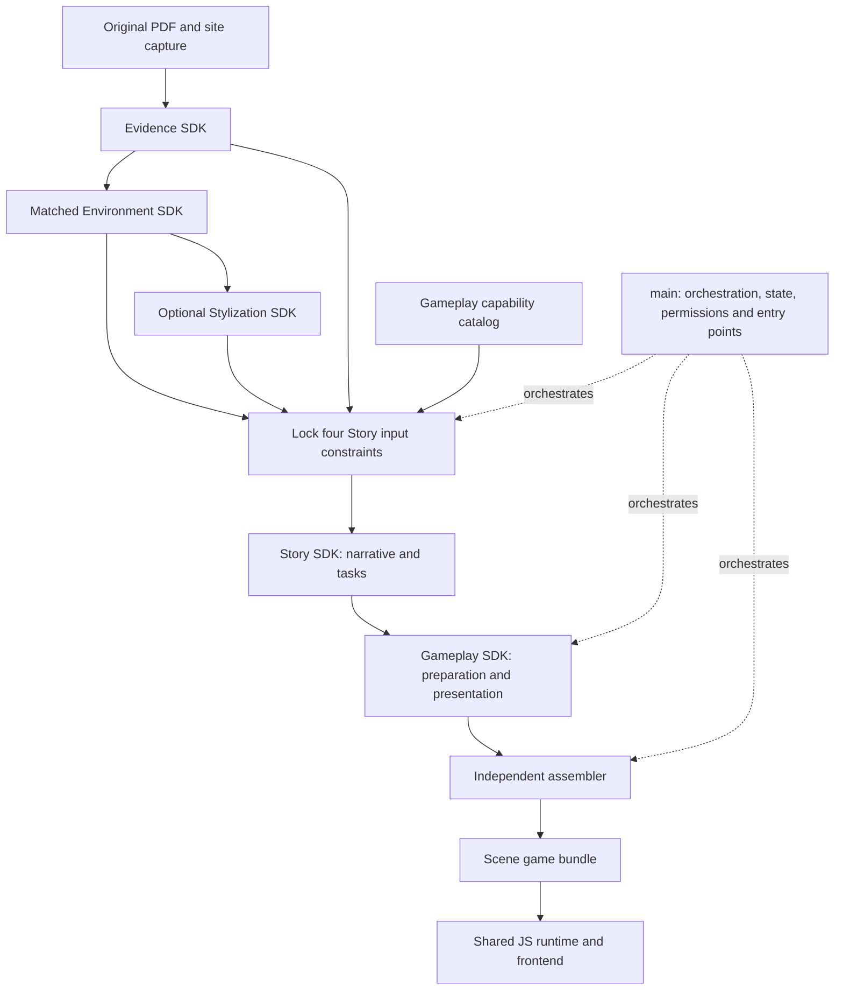
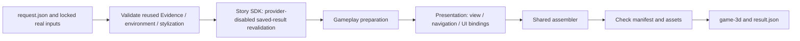

# PastPort Technical PRD

[中文](TECHNICAL_PRD.md) · English

**Version: 1.0 · Single initial specification · Current baseline: 2026-11-01**

This document defines the responsibilities, technology, inputs, outputs, workflows and acceptance boundaries of current main, the five SDKs and the shared runtime. It does not authorize model calls, publication or deployment; execution remains subject to caller permissions and budgets. Start with the [root README](../README_EN.md) for installation and play. Each SDK README documents its commands and API. This is the English translation of the same specification, not a separate product version.

## Contents

- [Product goal and current status](#product-and-status)
- [Architecture and ownership](#architecture-and-ownership)
- [Technology stack](#technology-stack)
- [Workflow](#workflow)
- [Inputs, outputs and contracts](#contracts-and-versions)
- [The five SDKs](#sdk-modules)
- [Story, models and agents](#story-and-agents)
- [Space and navigation](#space-and-navigation)
- [Gameplay, presentation and runtime](#gameplay-and-runtime)
- [Assembly and startup](#assembly-and-startup)
- [Permissions, budgets and recovery](#permissions-and-recovery)
- [Development, verification and delivery](#verification-and-delivery)
- [Next steps](#next-steps)

The team first polishes and play-tests existing bundles, then carries reusable story, gameplay, binding and packaging improvements back into Main and the SDKs after acceptance. The goal is an editable first game built from source materials. City map and public publishing integration remain to be built and validated. See the [handoff](../handoff.md#en) for ownership.

<a id="product-and-status"></a>
## 1. Product goal and current status

PastPort turns real heritage materials, objects and spaces into a museum game that can be explored, read and completed through tasks. Players should understand who they are, their current objective, why a particular heritage object matters and the consequences of their choices. The game is more than a sequence of information cards.

The current experience includes 360° presentation and generated 3D scenes. Registered navigation connects the 3D viewpoints; **the two models have not been merged into one continuously measured model**. Original buildings, object identities and layouts are retained. Stylization changes materials, lighting and animation style, rather than replacing objects such as computers with different objects.

### 1.1 Current implementation and acceptance boundaries

| Area | Current implementation | Acceptance boundary |
|---|---|---|
| Organizer | Single-admin password login, manual Chinese/English selection, uploads/default reuse, review, Story, production progress and player preview | Actual local service, distinct from the Sites sketch and public deployment |
| Four material entry points | Original PDF/photos, mapping PDF/360 tour, native matched VR, native mounted two-view 3D | Routing, handoff and saved-result reuse have regression evidence; this does not establish fresh external generation tests for every path |
| Material review | Current shared VR/3D SDK UI, panorama/3D positioning, descriptions/review records, saved positions/arrows | Shared semantic authority with separate spatial records; unresolved source status is retained |
| Story | Authorized generation, content-plan compilation, source/spatial/gameplay compatibility checks and limited human confirmation for reuse | Real generation and downstream execution evidence exists; quality still needs improvement and arbitrary inputs are not guaranteed to pass on the first attempt |
| Gameplay and assembly | Reading, source judgment plus rectangular coverage, presentation bindings, shared assembly and browser execution | Completion, failure/retry and recovery evidence exists; this is not a general minigame library |
| SDKs/runtime | Five SDKs depend on one shared core; external-checkout installation/integration has been tested | Source continues to change; old wheels do not necessarily include current fixes |
| Stylization | Independent SDK and reuse of existing results | Organizer has no new-stylization action yet |
| User/saves | Existing game frontend and browser-local recovery | New player accounts and cross-device backend saves are not implemented |

UI, structure, execution and content quality are separate acceptance layers. Old full-suite counts must not imply those checks were rerun for every update. Current interface evidence is in `var/organizer-integration/interface-language-acceptance.json`; other run records are in the same directory. They do not authorize additional paid calls. Original PDF OCR, source mapping, calibration and evidence-applicability limitations remain in force.

### 1.2 Current locations and entry points

| Item | Current location |
|---|---|
| Application source | `/Users/hanweijia/PastPort`, local main |
| Organizer | `http://127.0.0.1:18840/organizer/` |
| Default materials/account configuration | `var/organizer-integration/catalog.json` and `staff-accounts.json`; private configuration |
| Organizer records | `var/organizer-integration/server/organizer/organizer.sqlite3` |
| Uploads/task cache | Organized by project/task beneath that `organizer/` directory; actual paths appear on the page |
| Game output | `jobs/<task>/builds/<build>/game-3d/`; use the task's actual location and preview entry |
| Shared review database | The environment project's `pastport_matching.sqlite3`, separate from Organizer records; the review page shows its full path |
| Saved-result CLI baseline | `var/runtime-layout-20261101/request-release.json` |
| Standalone fallback preview | `var/runtime-layout-20261101/release-run/game-3d/`, port 18839 |

Private inputs and generated artifacts are not included in a Git clone. Earlier `var/main-sdk-integration-20261101/` output is retained as acceptance/fallback evidence, not the current default entry. Documentation of current source does not mean every distribution has been rebuilt or published.

<a id="architecture-and-ownership"></a>
## 2. Architecture and ownership

Use a **modular monolith: one repository, explicit module boundaries, independent SDK distributions and one shared runtime**.



| Module | Owns | Does not own |
|---|---|---|
| main | SDK calls, input locks, stage recovery, errors and delivery entry points; shared permissions/budgets | Separate custom game rules for each site |
| Evidence | Original registration, extraction, recognition/evidence and mapping documents | Scene navigation or game execution |
| Matched Environment | Object matching, shared review, VR/3D placement, space and navigation | Story writing or independent appearance production |
| Stylization | Consistent environment stylization and 3D appearance | Object identity, reviewed text or geometry changes |
| Story | Narrative, characters, task intents, conditions, choices, state consequences and spatial references | Plugin/UI source, modeling or assembly |
| Gameplay Preparation & Presentation | Exact plugin matching/configuration, executability and object/station/view/UI bindings | Unilateral story changes or global rewards |
| Assembler | Complete dependency validation and game packaging | Story generation, gameplay selection or a separate assembly service |
| Game runtime/frontend | Actions, narrative state/saves, scenes and interaction | Model adjudication for every player action |

The assembler is a separate module, **not yet a standalone SDK distribution**. The game runtime is shared, rather than duplicated into Story and Gameplay. Those SDK distributions are public facades depending on the same `pastport` implementation.

### 2.1 Production source and installed resources

| Location | Responsibility | Consumers |
|---|---|---|
| `frontend/organizer/` | Actual local production UI routing four native input types | Calls only main's Organizer API and reuses its accounts |
| `frontend/game/` | Existing User pages, dialogue, tasks, 3D interaction and player sessions; unchanged in this phase | Calls plugins and shared engine at runtime |
| `gameplay/contracts.mjs` | Shared snapshot identity/error contracts | Gameplay preparation and assembly; avoids reverse dependencies |
| `gameplay/plugins/` | Local executor, coverage solver and capability catalog | Gameplay verifier; runtime code enters the game bundle |
| `gameplay/gameplay.mjs` | Plugin binding plan for the generated host | Frontend sessions and assembly compiler |
| `gameplay/prepared-game.mjs` | Checks Story/gameplay/spatial/museum identities and prepares presentation input | Presentation tools and assembler |
| `tools/game-package/` | Story adaptation, explicit resource publication, assembly and preview service | main adapters call its build entry |
| `src/pastport/player/` | Single authoritative shared JS engine | Frontend/production tools import it; seven required modules are copied into generated games |
| `tests/game/`, `tests/fixtures/game/` | Automated tests and authored legacy story examples | Excluded from production runtime resources |

The source-layout split retains public SDK APIs, game rules and output layout. The runtime wheel bundles production resources under `runtime_assets` by responsibility; installed SDKs do not read the original checkout. `runtime-assets.mjs` maintains the explicit resource list and relocates cross-directory imports into bundle-relative imports. Scripts injected into 3D scenes retain scene execution context. The old `prototype/story-agent-demo` directory is no longer a production dependency.

Moving source does not update old run folders or wheels. Keep a stable preview entry during retesting, build into a separate temporary directory, then switch after acceptance. Normally retain at most one previous working version; the current CLI does not overwrite a nonempty output directory or an unfinished bundle. Existing wheels/migration evidence remain in `var/runtime-layout-20261101/`; its `release-run/game-3d/` on port 18839 is a fallback. Current Organizer artifacts live in `var/organizer-integration/server/organizer/jobs/` and use task previews. The original two retained previews are migration fallback baselines, not a requirement to permanently duplicate every test. Do not overwrite an existing archive of the same candidate version.

Migration evidence includes matching installed/source resources, six packages installed outside the checkout, and saved-real-Story preparation/presentation/assembly. Checks covered 96 resource hashes, both endings, failure/retry and exit/recovery. Browser interaction covered three tasks, wrong-source retry, the puzzle, viewpoint navigation and ending reload without new model calls. `ACCEPTANCE.json` and `BROWSER.json` in the stated artifact directory record installation/replay evidence, not fresh generation or human quality approval.

### 2.2 Team boundaries

| Owner | Primary scope |
|---|---|
| wehan | main, shared contracts, execution/budget services, assembly and game runtime / Player product, accounts, city map and platform automation |
| wcheung | 42 demo and Story-to-playable production improvements |
| maslan | Featured playable heritage demo |

Contract changes need fixed inputs/outputs and compatibility checks. Independent SDK maintenance does not require separate repositories or duplicate engines.

<a id="technology-stack"></a>
## 3. Technology stack

| Layer | Current technology | Rationale/constraint |
|---|---|---|
| Business/interfaces | Python 3.12, Pydantic v2, Protocol, dependency injection | Strong types, validated boundaries, replaceable adapters |
| Existing service API | FastAPI, Uvicorn, HTTPX | Retain authentication, requests and lifecycle |
| Workflow | LangGraph | Stages, conditional routing and checkpoints; nodes are not automatically agents |
| Persistence | SQLite, SqliteSaver/AsyncSqliteSaver | Current single-machine state, execution and recovery |
| Story model | Sol 6.1 Medium through the Codex login channel | Shared controlled execution; quota only with explicit generation authorization |
| Gameplay verification/presentation/assembly | Node.js and existing JS modules | Same rules as the browser runtime |
| Scenes/UI | Existing HTML/CSS/JS and 360°/3D viewers | No new Unity, Unreal or frontend framework |
| Upstream tools | Poppler; some workflows need ffmpeg and PDF/image libraries | SDK-declared requirements; installation is not generation authorization |
| Packaging/dependencies | uv, pyproject, pinned versions and wheels | Verify workspace use and external installation separately |

This integration does not add microservices, an external queue, another database or a multi-agent conversation system. Extend in response to measured performance or actual capability gaps.

<a id="workflow"></a>
## 4. Workflow

### 4.1 Content production order

1. Register original materials, site resources, project and usage scope; lock provenance/version.
2. Evidence supplies traceable sources; Matched Environment supplies objects, review, positions and navigation; apply Stylization when needed.
3. **Before generation, Story reads all four constraints:** evidence, reviewed objects/text, space/navigation, and gameplay capabilities.
4. Generate structured narrative/task requirements, then validate structure, references, state, space and gameplay consistency.
5. Gameplay compiles the requirements into parameters, verifies source relationships, solvability, completion/failure/exit/recovery, then creates presentation bindings.
6. The independent assembler validates dependencies and produces the full game bundle.
7. Open it locally and perform actual interaction and human experience acceptance.

Story designs within plugin capabilities and preparation must implement its requirements precisely. Do not write arbitrary tasks before discovering capability gaps, or constrain Story to one fixed sample puzzle.

### 4.2 Current main CLI execution path



`pastport-game-trial --request REQUEST.json` currently accepts only `saved_response_only`. It assembles automatically; **no separate assembler service or webpage address needs to be passed to it**. After assembly, start `node serve3d.mjs` separately only when browsing is needed.

This diagram describes the saved-result CLI, not every main capability. Organizers use the four-step web flow in §4.5. New Story calls are explicitly authorized on that page, or through `pastport-story`. A zero-call replay is not fresh generation.

### 4.3 Workflow state ownership

main's outer LangGraph owns coarse stages and artifact references. Story reuses the shared editorial graph and retains ownership of model budgets, review and execution receipts. The outer layer does not create another model retry/budget loop.

Outer checkpoints live in the run's `checkpoints.sqlite3`; Story records live in `story/application`. Existing authenticated APIs and saved-result CLI remain. Organizer adds authenticated production HTTP entry points; four uploaded-input types pass through native adapters (§4.5).

### 4.4 Existing main service API

The existing FastAPI editorial/player service remains distinct from the private integration CLI and Node preview:

| Entry | Input/purpose | Output/boundary |
|---|---|---|
| `python -m pastport --accounts ...` | Accounts, data directory, optional local content/resources and execution configuration | Local authenticated API; not an automatic launcher for all SDKs |
| `pastport-game-trial --request ...` | Private input lock in §5.2 | Stage artifacts and game; no new model calls |
| `node serve3d.mjs` | Generated game and port | Player page; no generation or reassembly |

Account configuration follows [API settings](../src/pastport/api/settings.py); never put real tokens in this PRD or public configuration. These APIs use Bearer authentication, appropriate `Idempotency-Key`, expected revision and role/project permissions. Errors, version conflicts, review revocation, cancellation and budget intervention cannot be bypassed by hiding frontend controls.

[API app](../src/pastport/api/app.py) exposes these groups; exact types are in [application messages](../src/pastport/application/models.py):

| Group | Representative paths | Purpose |
|---|---|---|
| Health/projects | `/api/v1/health`, `/api/v1/projects` | Service/project status |
| Create/read runs | `/api/v1/projects/{project_id}/runs`, `/api/v1/runs/{run_id}` | CreateRun and RunRecord |
| Content/evidence | `/api/v1/runs/{run_id}/artifacts`, `/api/v1/artifacts/{artifact_id}` | Versioned, authorized artifact access |
| Review/orchestration | `candidate-selections`, `review-decisions`, `narrative-requests`, `revisions`, `locks` | Selection, review, directed operations and human locks |
| Recovery/execution | `resume`, `cancel`, `executions`, `interventions`, `budget` | Recovery, cancellation and auditable execution |
| Human intervention | `usage-reconciliations`, `budget-amendments`, `review-revocations` | Explicitly authorized usage/budget/review operations |
| Game/saves | `/api/v1/projects/{project_id}/player-initial-state`, `player-saves` | Initialize, save and act on published/allowed packages |

Unprefixed operation paths belong under `/api/v1/runs/{run_id}/`. Existing main APIs and independent museum/stylization staff portals are not automatically one unified web product; the original integration evidence covers explicit CLI execution and its generated preview.

### 4.5 Organizer interfaces and acceptance boundaries

`GET/POST /organizer/api/workspace` reads or saves the authenticated operator's active project. Only a registered source_id is accepted; project permission and source identity are validated before storing the selection in Organizer metadata. Clients cannot supply disk paths. History identifies projects and offers Continue this project and View materials and review. Refresh, login and service restart restore saved environment and Story stages. An environment alone cannot unlock assembly, and pending new materials cannot inherit another project's environment or Story. Selection/restoration performs no model dispatch, automatic retry or historical approval.

New photo jobs use a compact policy: two photos per batch, at most 12 new entities and 24 sightings, schema-bounded names/features/explanations, and a 120-second deadline or the shorter authorized timeout. Overflow is reported as incomplete and stops acceptance. Existing policies and paid receipts stay unchanged; failures are not automatically retried. These bounds have offline regression evidence, not fresh-model speed acceptance.

The upper-right manual Chinese/English selector defaults to Chinese and stores a browser-local preference; it does not follow the browser locale. `frontend/organizer/i18n.mjs` localizes login, production, review wrapper and progress, including existing labels in the shared embedded review UI. It changes text in place without reload, form reconstruction/submission, model/Marble calls or review saves. PDF text, object names, descriptions, story, paths and input values retain their language; uncatalogued diagnostics retain original text. The module is bundled and included in resource fingerprints to avoid stale mixed scripts.

main serves `frontend/organizer/` at `/organizer/`, retaining roles/project scope. The static Sites sketch is not connected to this service. User UI/player databases are unchanged.

| Input/path | Execution | Boundary |
|---|---|---|
| Registered materials: reuse | Check provenance, complete input fingerprint and assets; run saved-result pipeline | Zero new model calls; retain the original pinned Skill |
| Registered materials: regenerate | After confirmation, call Story with the current Skill, then proceed to gameplay/presentation/assembly as requested | Reuse registered environment; no 3D regeneration, bounded single-call budget, no automatic retry; invalid content stops |
| Original PDF/photos + SPZ/PLY | `raw3d`: local import/six-face capture → Evidence → single-scene matching/attachment → existing review/Story/gameplay/assembly | Zero Marble; derived views are not source photos; identity and scale remain subject to review/calibration |
| Original PDF/photos | Evidence mapping, environment matching and 3D | Without 360, save mapping and wait; do not claim game completion |
| Original/mapping PDF plus 360 | Validate tour, build environment/3D, then hand off to Story | Mapping/original page numbers, hashes and provenance are distinct; file presence alone is insufficient |
| Matched VR | Validate native export, retain review, generate 3D | Complete native project and review identity required; an ordinary panorama is insufficient |
| Mounted 3D | Validate native two-view export and continue at Story | Check subpackage hashes, shared review, object bindings/navigation; no 3D regeneration |


`raw3d` roles are `original_pdf`, `photos` (images or ZIP), `scene_splat` (SPZ), and `scene_mesh` (binary little-endian triangle PLY). It uses the existing `materials/{project_id}/jobs` API, not a parallel admin service. A single scene has one world, without inventing another viewpoint. Environment preparation stops at `environment_ready`; review saves feed Story, and assembly starts after Story is ready. Recovery retains budgets/receipts and needs no Marble authorization. The shared Evidence flow uses source-bound candidate-page retrieval (one request, at most twelve pages), visual matching in at most four three-page batches, and local exact-quotation verification; it does not add one verification call per object. Photo recognition stops at twenty distinct objects. This automates the earlier mapping method for both VR and raw 3D; only environment import/localization/attachment branches. Historical associations remain pending human review. The minimum possible flow is three calls, while actual requirements depend on recognition and coverage. Default limits of 8/20 calls are not raised automatically; insufficient Evidence budgets fail before any model dispatch. Zero-call simulated regression and real single-object review handoff do not constitute fresh generation acceptance for all 44 photos.

Endpoints are under `/organizer/api/`: `session` signs in; `sources` validates registered materials; `materials` and project `files` stream uploads; `jobs` creates/reads production jobs; job `continue` explicitly resumes; `open` opens an independent local player preview. Clients cannot submit arbitrary server paths. Reuse directories come from `--organizer-catalog`; the server assigns private upload paths. Register player assets with `--organizer-player-assets`. Uploaded production starts at `POST materials/{project_id}/jobs`. Download a mapping via `jobs/{job_id}/mapping.pdf`, add a missing tour, and resume the same job via `continue`.

Authenticated `GET storage` displays the server computer's cache root. Each authorized task shows its own cache and, when ready, game directory. This is path display, not arbitrary local-file access; remote users are not seeing paths on their own computers.

Organizer metadata lives at `organizer/organizer.sqlite3` beneath main's data directory, with isolated uploads/execution records nearby. It neither replaces nor reconstructs object review databases. Check owner, idempotency key and content for duplicate submissions. Only one production job runs at a time. Progress uses actual receipts, not artificial timers.

Interrupted jobs show saved stages and a summary before explicit continuation; no automatic model redispatch. Recovery verifies inputs/stage hashes. New generation can continue without another model only when a complete Story receipt exists; uncertain dispatch needs original-receipt reconciliation. Usage comes from actual budgets and stays unknown when unknown. Target play time is a creative goal, not generation time or exact play duration.

Record cache provenance, HTTP integration, native export/import, fresh generation, saved-result recovery, assembly and browser interaction separately in ignored `var/organizer-integration/`. This specification does not repeat every failed attempt, puzzle count or cumulative charge. Preserve failed responses/usage; no automatic retry or relabeling replay as fresh generation. Unretested Evidence/Marble external paths remain unaccepted.

Builds live under a task's `builds/` by input/implementation fingerprint. Code updates can revalidate the same paid Story and create another build without modifying old locks or deleting artifacts. Scoped production requests resolve previews and receipts; the stable Organizer URL does not change with build folders.

The page follows **materials/environment → review → Story → build**, with no duplicate existing-project/regenerate selector:

1. **Materials/environment:** a checked grey box reuses registered default materials/environment only, with no model/Marble, Story or assembly. Unchecked executes the selected upload path without fallback to default caches. Raw, mapping and matched-VR starts require Marble for 3D; a complete 3D upload is validated/handed off. External generation still needs explicit authorization and a finite budget.
2. **Review:** embed the SDK's existing numbered-object UI and retain its layout/actions. Prepared projects/defaults need no reupload; merge entries for the same project. Photos, original text/images, descriptions and separate image/text verdicts use one authority. main proxies reads/saves with authentication; media is allowlisted. Uploaded HTML/scripts do not run. SDK revisions/history and current account identity govern saves. Previous-step outputs become inputs automatically, without reselecting/uploading or another transfer confirmation. Pending/unreviewed status remains intact.
3. **Story:** use the environment identity returned by preparation. Check the grey box to revalidate that environment's story; leave it unchecked to generate through SOL 6.1 Medium. Never attach the default story to another environment. Disable reuse when no matching story exists. Both paths stop after Story validation; they do not prepare gameplay, presentation or assembly yet.
4. **Build:** enable only after Story readiness. Use step three's checked Story/environment for gameplay, presentation and assembly without regenerating Story or 3D.

Review endpoints under `review/{source_id}` read materials; `objects/{number}` saves review/descriptions; `apply` exports new reviewed environment inputs locally. Embed via `workbench/`, read `workbench/data`, and save through `workbench/save-review` / `save-introduction`. Photos/evidence use strict manifest routes. The iframe runs only trusted installed SDK templates, retains edits, and notifies its parent after successful saves.

Story reads the current reviewed input without another transfer-confirmation step. Review/description saves trigger automatic local export. VR positions, 3D anchors/calibration and arrows can invalidate spatial inputs; returning to the main page rechecks/syncs them. Story cannot use stale inputs during sync. Sync uses registered extraction/existing 3D assets, with no model/Marble calls; old snapshots, Story and games remain intact. If no compatible story exists, require explicit new generation rather than substituting another story.

The shared UI comes from current SDK `shared_review_markup`, retaining shared VR/3D descriptions and panorama/3D positioning links. main's authenticated project-scoped proxy reuses VR positions/navigation, 3D anchors/calibration/arrows. It rewrites same-origin resource/endpoints, not spatial rules. Semantic content is shared, positions separate. Final downloads are assembled by the production pipeline.

`OrganizerStart.stop_after` is `environment | story | game`; the old API defaults to `game`, while the page always submits explicitly. `UploadedProductionStart.stop_after=environment` stops after native handoff. `environment_ready`, `story_ready` and account-scoped `prepared_source_id` provide persistent stage handoffs; `result_ready` stays false until the game is complete. Stage choice participates in idempotency. Story failure does not fall back to reuse or continue assembly. Non-secret task identifiers restore the page after refresh.

A single administrator signs in with username/password; no self-registration. Initial local setup sets the existing admin password once, then uses HttpOnly sessions. SDK budgets and developer API authentication remain separate; organizers do not enter Bearer tokens.

The default is an `OrganizerCachedBundle`: a complete registered `GameMakingRequest` tying together original PDF, photo provenance/all photos, mapping PDF, object table, original VR, native import and two-view 3D files. `CachedBundleValidator` verifies every file hash and cross-checks original/page count/photo set, native mapping/object/VR input hashes, and 3D source-tour/view/panorama hashes. Exactly one complete default is allowed. Never substitute an unrelated dataset if it becomes invalid. Each execution retains/revalidates the same bundle without reconstructing original reviews.

Full-reuse acceptance uses complete prior results for the 62-page original and excludes the photo-matching cache for a different 34-page source. The three tested starts establish their own cache provenance/replay, not fresh Evidence/environment/Marble generation.

Inject native input handling through `OrganizerInputPreparer`, implemented in adapters. Domain/application/ports do not import optional SDK implementations. main owns timed CLI child process groups and cleans them up; pending Marble operations are queried, not resubmitted. Installed packages carry offline projection resources without requiring checkout `node_modules`.

The original PDF supplies Story evidence; mapping PDFs retain separate hashes/image pages. `SourceLineageProjector` translates text-page references only when the original uniquely contains the same quotation; otherwise preserve the gap. It does not modify upstream review databases or internal identity. Both exported views must agree on the 13 shared-content tables while retaining separate spatial state and original scene IDs for entries/navigation. Initialize only missing automatic candidates/arrows; never overwrite manual positions, calibration or review.

The host supports two independent 3D viewpoints with arrows, not fused geometry or arbitrary N-view tours. Native ZIPs have file-count, expanded-size and path limits. Links, traversal and active SQLite schema are prohibited. Uploaded scripts never execute; player resources are trusted server registrations.

Review sync uses metadata archives instead of duplicating scene binaries in intermediate ZIPs. Supported macOS filesystems prefer copy-on-write snapshots for unchanged blocks; later changes remain isolated, with no hard links. Other filesystems use independent copies and may be slower. Spatial/provenance validation remains, without model/Marble calls. Geometry cache identity includes the full probe request, collision geometry and execution-dependency hashes. Text-only edits may reuse geometry results; position, navigation, calibration, geometry or algorithm changes require recomputation. Cache only fully checked results atomically; cancellation remains effective.

<a id="contracts-and-versions"></a>
## 5. Inputs, outputs and version contracts

### 5.1 Current distribution versions

| Distribution | Python namespace | Local candidate version |
|---|---|---|
| Shared runtime | `pastport` | `0.2.1rc4` |
| Evidence | `pastport_evidence` | `0.1.0` |
| Matched Environment | `pastport_matched_environment` | `0.1.0` |
| Stylization | `pastport_stylization` | `0.1.0` |
| Story | `pastport_story` | `0.1.0rc4` |
| Gameplay Preparation & Presentation | `pastport_gameplay` | `0.1.0rc2` |

Story and Gameplay pin the same runtime. Stylization depends one-way on Matched Environment; upstream packages do not import main. main uses optional adapters; domain/application/ports do not import SDK implementations.

**Package, game-wire, content and plugin-capability versions are separate concepts.** Core wire remains `0.1.0`, GameplayPlan uses `gameplay-preparation/0.4.0`, and the reference host is `pastport.demo.activities/1`. A wheel version change does not upgrade old wire formats or establish an unimplemented general plugin API.

### 5.2 main request fields

Definition: [GameMakingRequest](../src/pastport/domain/game_making.py). Relative paths resolve against the request file's directory, not the terminal's working directory.

| Field | Type/content | Source/purpose |
|---|---|---|
| `original_pdf` | Path | Original historical source, not a mapping presentation PDF |
| `source_document` | Path | Evidence `RegisteredPDF` export with pages/original identity |
| `environment` | Path | Shared `EnvironmentSnapshot`: review text, objects, references and space |
| `media_directory` | Path | Registered source-card images |
| `museum_directory` | Path | Usable museum directory with `data`, scenes, geometry and appearance |
| `saved_story_run` | Path | Complete saved Story including response, locks and receipts |
| `skills_directory` | Path | Exact Skill snapshot for that Story |
| `brief` | Nonempty text | Original creative brief bound to the saved result |
| `output_directory` | Path | New isolated run directory; recovery uses the original directory |
| `mode` | `saved_response_only` | Default and only accepted mode; a manifest cannot authorize payment |

### 5.3 Story-to-gameplay structured contract

| Artifact/field | Must express |
|---|---|
| `NarrativeDraft.package` | Narrative, characters, tasks, declared variables, conditions, rules, choices/endings |
| `spatial_intents` | Per-task `task_id/object_number/view_id/station_id/interaction` |
| `gameplay_intents` | Explicit `source_reading` or `coverage` per task, without implicit reading fallback |
| `capability_catalog_sha256` | Exact gameplay catalog identity |
| `authoring_report` | Heritage relationships, player premises, reasoning/actions, consequences and limitations |
| `GameplayPlan.bindings` | Exact task/plugin/configuration/station/source bindings |
| Lifecycle receipt | Plugin/configuration/verifier hashes, actual lifecycle checks and constructive puzzle solution |
| Presentation input | Same-version story/gameplay/environment scene, object, navigation and UI bindings |
| Manifest | Runtime dependencies, actual hashes, entry point and candidate acceptance status |

New `authoring_report.heritage_refs` selects only locked Evidence claim/asset keys. Native object UUIDs are removed from the model projection and resolved through registered environment/asset mappings in code. Compile reference enums before request-schema hashing and budget reservation, then validate returned values. Preserve invalid responses and actual usage; do not substitute another object automatically. Old saved runs retain their schema and revalidation path.

Story declares task rules; preparation compiles those same rules into runtime parameters. UI quantities, dimensions and hints derive from the same rules/solution. Do not independently write contradictory four-piece/six-piece descriptions.

### 5.4 main output directory

| Output | Meaning |
|---|---|
| `input-lock.json` | Request, SDK/implementation and input identity |
| `checkpoints.sqlite3` | Outer stage recovery checkpoints |
| `receipts/*.json` | Stage artifact paths/hashes |
| `upstream-validation.json` | Original/scene/appearance checks and explicit reuse markers |
| `story/` | Revalidated story, evidence index, locks, budget and retained receipts |
| `gameplay/` | `gameplay-plan.json` and precisely encoded environment snapshot |
| `presentation/story-input.json` | Complete assembler bindings |
| `game-3d/` | Independently runnable game, scenes and assets |
| `result.json` | Game directory/entry and model-call/approval boundaries |

### 5.5 Identity, space and hashes

Object IDs answer what an object is; view/station/world identifies where it is; source locators identify its evidence. Multiple occurrences of one object share its record rather than creating multiple historical objects.

Version objects, sources, content, geometry, navigation and appearance separately. Exact-file hashes and canonical-JSON hashes are not interchangeable. Preserve floating-point spatial encoding/coordinate systems; do not change coordinates or relax game rules to pass checks. Changed input/code requires a new output directory.

Production contracts are defined by the [Python registry](../src/pastport/contracts.py), `schemas` and actual typed models. Generate schemas with `python tools/check_contracts.py --write`, rather than editing them. Synthetic `tests/fixtures/reference` examples test compatibility; they are neither another PRD nor evidence of general plugin production capability.

<a id="sdk-modules"></a>
## 6. The five SDKs

### 6.1 Evidence SDK

- **Inputs:** original PDF, site images/recognition scope, isolated workspace, explicit grant and run ID.
- **Outputs:** registered original/pages, source text/images and mapping materials, provenance, unresolved findings and exports.
- **API:** `PhotoMappingWorkflow`, `SubscriptionGrant`, `OutputPaths`; code defines typed `run(...)` and injected reader/transport signatures.
- **Technology:** Python, PDF/image processing, versioned prompts, controlled semantics and durable stage records.
- **Limits:** extraction/recognition may be incomplete. Fifteen items is a discovery target, not a forced-match threshold. Record candidate, valid-object and story-reference counts separately.
- **Usage:** [Evidence README](../packages/evidence-sdk/README.md).

### 6.2 Matched Environment SDK

- **Inputs:** mapping materials, tours/site resources, 3D input and placement/review/navigation edits.
- **Outputs:** shared object content/review status, 360° occurrences, 3D bindings/calibration/collision references, stations/navigation/spatial assessments and a previewable environment.
- **API:** `EnvironmentBuildWorkflow`, `StudioApplication`, `TourPreviewApplication`; exact parameters are in its guide.
- **Technology:** Python API/workflow, browser viewers and Node spatial analysis. 3D generation is a separate upstream capability, not Story's responsibility.
- **Navigation:** reuse SDK viewpoint changes, draggable/saved arrows and arrival headings. main supplies scenes, not another navigation algorithm.
- **Review:** one object record supports multiple views; positions/arrows are scene-specific. Never reconstruct a review database for Story.
- **Usage:** [Matched Environment README](../packages/matched-environment-sdk/README.md).

### 6.3 Stylization SDK

- **Inputs:** matched environment, original panorama/3D appearance, style references and bounded generation/application configuration.
- **Outputs:** styled panorama/appearance, provenance, `Style3DVariant`, checks and pending acceptance.
- **Technology:** controlled image transport, panorama/SPZ appearance processing and browser preview; the package declares external tools.
- **Rules:** consistent environment-wide animation style; retain identity, layout, geometry, reviewed content and navigation. Unknown visual quality cannot become an automatic pass.
- **Usage:** [Stylization README](../packages/stylization-sdk/README.md).

### 6.4 Story SDK

The review page shows/copies the actual authoritative SQLite path for the current project. It belongs to the server computer, differs from Organizer metadata, and is not a public database download.

Review sync checks only the current source. Historical catalogs use `metadata_only=true` for names/identities without readiness claims; default/current sources are checked separately as needed, without rescanning every project. Adopt the registered environment returned by export directly instead of submitting another environment-preparation job. Story/build entry points still check complete resources/versions. Distinguish a saved review from an unfinished input handoff.

After review edits, a new revision does not automatically mean no reusable story. main finds a successful Story only within the authorized source lineage. Legacy records qualify as same-source only when review-authority roots, both viewpoint resource roots and import hash all match. Validate original locks/PDF/matching identity/checks, then check current objects, used references (including puzzle contrast evidence), spatial actions/routes, capabilities and plugin configuration without a model. Success creates a separate reuse directory with unchanged narrative/parent receipts, new environment/index checks and the parent hash/original usage provenance. Subsequent production verifies this proof instead of interpreting an old model response under changed inputs.

Compatibility messages distinguish: reusable; description changed and needs confirmation; or task conditions changed and need resolution. Only description changes with all source/spatial/gameplay checks passing yield `needs_confirmation`. Show before/after descriptions and tasks; the user's confirmation invokes `confirm-story-reuse`. Bind the decision to report/environment/parent hashes and exact changes, recording actor/time. Relevant changes invalidate the decision. Invalid identities, original-source/mapping or executable conditions cannot be overridden. Confirmation authorizes unchanged-text private reuse, not historical approval or publication.

The page automatically calls `POST /organizer/api/sources/{source_id}/story-compatibility` when the environment is ready and unlocks reuse on success. Permissions, session/CSRF and production mutual exclusion remain. Automatic post-review handoff also checks compatibility. A successful new story becomes the current source. Report affected tasks when used descriptions/evidence change; do not automatically rewrite or call models. Unused-object edits must not block unrelated tasks. These checks cover declared dependencies and executability, not narrative quality or historical approval.

New automated runs use `compiled_plan_v1`. The model designs bilingual task content, gameplay requirements and final-choice consequences from PDF/review/space/capabilities. Code generates internal IDs, locale keys, state declarations, completion rules and ending references, then emits the existing `NarrativeDraft`. The profile supports 1–8 ordered single-task scenes and 2–4 final choices, not arbitrary intermediate branching. Reject unrepresentable plans explicitly instead of inventing executable rules. Source/quantity/spatial/plugin checks remain. Fixed structure does not certify history or playability. Old runs follow locked profiles; absent fields mean legacy `authored_graph`. Preserve old failed receipts. The compiler has local/actual JS checks and organizer-driven generation-to-game evidence; story quality is unaccepted and wheels are not rebuilt after every source update.

- **Inputs:** original PDF/Evidence, reviewed objects, matched space/navigation, capabilities, brief, scope and budget.
- **Outputs:** readable script, `NarrativeDraft`, per-task gameplay/spatial intents, author report, locks, checks and model/usage receipts.
- **API:** `StoryClient.generate(StoryRequest)`; command `pastport-story`.
- **Technology:** shared Python/FastAPI/LangGraph editorial workflow, Pydantic, controlled Codex transport, Skills and validation.
- **Boundary:** no environment/plugin/UI generation or assembly. Saved-response revalidation uses `revalidate_saved_response=True` with model transport disabled.
- **Usage:** [Story README](../packages/story-sdk/README.md).

### 6.5 Gameplay Preparation & Presentation SDK

- **Inputs:** same-version story directory, evidence/environment locks, declared gameplay, capabilities and existing museum.
- **Outputs:** plugin parameters, lifecycle/solver receipts, precise environment/object/station bindings and assembler-ready presentation input.
- **API:** `GameplayClient.prepare(PreparationRequest)`, `present(PresentationRequest)`.
- **Technology:** typed Python composition, bounded Node verifier, shared real JS Activity and deterministic binding.
- **Boundary:** local execution without model calls. No missing-declaration reading fallback or changes to Story goals/evidence/rules/rewards.
- **Usage:** [Gameplay README](../packages/gameplay-sdk/README.md).

<a id="story-and-agents"></a>
## 7. Story, models and agents

For the existing-environment-to-game path, Story makes the main model decisions: conflict, motivations, task order, supported actions and choice consequences. SDKs are interfaces, LangGraph is orchestration and Skills are policy material; none alone constitutes an autonomous agent.

### 7.1 Current capability

Story is primarily a **constrained model-generation workflow**. A bounded call plus code validation can create content. Do not add model roles, conversations or duplicate context merely to call it an agent.

Upstream recognition/stylization can have their own model execution. The integration baseline reuses those outputs without rerunning them. Gameplay configuration, spatial calculation, presentation, assembly and player actions do not need models.

### 7.2 Four constraints before generation

| Input | Boundary |
|---|---|
| PDF/citable evidence | Background, dates, facts and provenance |
| Reviewed objects/text | Available objects, descriptions, mappings and verification state |
| Matched 3D space | Viewpoints, stations, accessibility/visibility and navigation limits |
| Gameplay capabilities | Available actions, parameter ranges, completion/failure/exit/recovery |

Post-generation checks are revalidation, not the first gameplay constraint. Existing capabilities must implement each task; never silently substitute another mechanic for unsupported requirements.

### 7.3 Validation and automatic handling

| Issue | Current response |
|---|---|
| Invalid structure/reference/object identity | Reject and retain the response and specific errors |
| Undeclared variables/type conflicts | Report missing dependencies that affect decisions; never guess defaults/types |
| Deterministic redundant fields/labels | Only implemented narrow normalizations, with audit records |
| Inconsistent puzzle quantity/dimensions/solution | Capabilities, exact compilation, solver and same-source UI checks; no manual story patch |
| Model timeout/unknown usage | Persist call identity/unknown status; no automatic retry or zero-usage assumption |

One success does not establish long-term reliability or engaging content. Goals, causality, information load, heritage relationships and consequences need player evaluation.

### 7.4 Future agent capability

Priorities include targeted revision (identify a content error, revise only affected parts, validate again) and research on actual evidence gaps (select tools/sources, retain citations and uncertainty). Existing research/revision APIs are not acceptance of an autonomous SDK loop.

External search, automatic plugin programming and multi-agent collaboration are not features of the current replay entry. Future integration needs round/time/budget/permission limits, without endless retries, self-approved history or self-authorized publication.

<a id="space-and-navigation"></a>
## 8. Space, navigation and task continuity

### 8.1 Input authorities

| Information | Authority |
|---|---|
| Object IDs/descriptions/evidence/review status | Evidence and shared review content |
| Per-view placement/coordinates/system/calibration | Matched Environment bindings |
| Start position, collision/floor, stations/rules | Environment/host spatial analysis |
| Cross-view links, arrows and arrival heading | SDK navigation records |
| Task-selected object/station/view | Story spatial intents |
| Actual bindings/actions/frontend navigation | Gameplay/Presentation and existing host |

Story does not re-recognize the full model or reconfirm every mounted object. Environment owns positioning. A computed coordinate is not proof of identity or depth.

### 8.2 Distinct spatial judgments

Correct placement, approachability, visibility, readable detail and permission to click/touch are different facts. A glass barrier may legitimately prevent approach; that neither proves wrong placement nor adequate distant visibility.

The environment should compute basic spatial information before handing it to Story instead of leaving everything for the model to guess. Task-specific requirements, such as reading small text from a station, need additional checks. Preserve unknown findings with reasons.

### 8.3 Route continuity

Movement respects continuous floors, collisions and elevation limits. Cross-view transitions use registered directed links and arrival positions/headings. Independently generated scenes do not imply a shared measured coordinate system. A blocked straight line does not prove that no alternative route exists.

Distant observation need not touch a target but must satisfy its own conditions. `inspect` may only open a bound information card, rather than physically touch an object or read an inscription. Do not claim verification of unavailable capabilities.

<a id="gameplay-and-runtime"></a>
## 9. Gameplay, presentation and runtime

### 9.1 Supported scope

| Item | Verified | Does not establish |
|---|---|---|
| `source-reading:1` | Reading and source exposure records | Measured comprehension or puzzle solving |
| `source-gated-coverage:1` | Source judgment plus rectangular coverage; 4×4 board, 1–16 rectangles, optional rotation, bounded solver | Arbitrary shapes or third-party minigames |
| Story/3D adapter | One formal task per game scene, exact object/station binding | A permanent limit of three tasks/two endings |
| Scene builder | Prepared two-view museum | Arbitrary view counts or seamless model fusion |

Piece counts come from each story's structured requirements, not a fixed demo. Preparation must verify a real solution within capabilities, not merely equal area.

### 9.2 Evidence and tasks

Source judgment uses real claims for the task object and valid contrast evidence; never invent original quotations. The puzzle opens only after that judgment passes. Reading/selecting the correct source does not complete the puzzle. Abstract model exercises must be labeled as distinct from historical reconstruction.

Heritage materials should participate in reasoning and consequences. An unrelated quiz followed by a generic minigame does not prove heritage/gameplay integration.

### 9.3 State and lifecycle

| Result | Local plugin | Narrative |
|---|---|---|
| running | Save current actions/progress | Do not complete early |
| completed | Return a valid completion result | Host applies consequences exactly once under the rules |
| failed | Explicit failure, retry available | No rewards or task skipping |
| exited | Retain recoverable progress | Neither completion nor a failure ending |

Test wrong placement, exit, reload, recovery, duplicate completion and invalid actions. Plugins own local state; the host owns global narrative/save rules. Interaction does not wait for models; do not maintain separate copies of basic rules in Python and browser code.

### 9.4 Presentation

UI reads compiled rules and spatial references, rather than guessing IDs from phrases such as the second viewpoint. Prefer short dialogue, a clear objective and optional evidence access. Long mandatory background reading is not the primary mechanic.

Chinese/English share object/task/rule/consequence identities. Errors and hints must not rely on color alone. Device/accessibility coverage remains unaccepted until tested.

### 9.5 New plugins

Single-player web minigames of the kind found on 4399 are an extension direction, not a promise of zero-change integration. Define actions, configuration/state/results, save/recovery, resources and host capabilities; verify/register them before Story uses them. A generated build request is not a playable plugin without authority and a reliable builder.

<a id="assembly-and-startup"></a>
## 10. Assembly, installation and startup

### 10.1 Assembler responsibilities

Assemble the complete game: narrative/tasks, environment/evidence assets, plugins/configuration, presentation, shared frontend/runtime and version manifest. Check project/version, dependency closure, integrity and compatibility. Do not rewrite narrative or implement missing gameplay.

The shared `build-story-package.mjs` tool performs assembly. There is no standalone assembly SDK or persistent assembly service; main already invokes it.

### 10.2 Local workspace

```sh
cd /Users/hanweijia/PastPort
uv sync --extra authoring --extra game-making
.venv/bin/pastport-game-trial --request var/runtime-layout-20261101/request-release.json
```

`authoring` installs the three upstream packages; `game-making` adds Story/Gameplay. There is one shared runtime. `game-trial` revalidates saved results without models; a separate new `pastport-story` generation consumes quota.

### 10.3 Installation outside the checkout

Requires Python 3.12, Node.js and separately supplied private inputs. The wheelhouse contains six project distributions, **not a full offline repository of third-party dependencies**.

```sh
python3.12 -m venv .venv
.venv/bin/python -m pip install --no-cache-dir /absolute/path/wheels/*.whl
.venv/bin/pastport-game-trial --request /absolute/path/request.json
```

Manifests specify inputs/outputs; do not hardcode old Demo workspaces. Existing same-version caches cannot replace verification of the actual release files.

### 10.4 Organizer service

For this computer's configuration, install dependencies as in §10.2, then run the command below. If the service is already running, open it instead of starting another instance.

```sh
cd /Users/hanweijia/PastPort
.venv/bin/python -m pastport \
  --accounts var/organizer-integration/staff-accounts.json \
  --data-directory var/organizer-integration/server \
  --organizer-catalog var/organizer-integration/catalog.json \
  --organizer-player-assets "/Users/hanweijia/Documents/ChatGPT/PastPort/work/main-integration/var/sdk-real-material-20261031-01/story-authoring/game-3d-open-roof-v3/assets" \
  --evidence-mode disabled --narrative-mode disabled --resources-mode disabled \
  --port 18840
```

Open `http://127.0.0.1:18840/organizer/` and use the existing administrator username/password. Initial setup is complete on this computer; this command does not initialize/reset it. Restart invalidates in-memory sessions, requiring another login. Maintainers configure accounts; organizers do not enter Bearer tokens or run terminal initialization. The CLI binds loopback with one worker; this is not a public deployment recipe.

The disabled options affect old editorial demo channels, not Organizer's bounded SDK chain. Player assets are registered private environment materials, not source; another machine must supply files and update configuration. The repository and generated materials are not an unrestricted distributable dataset. Accounts/credentials do not enter static web resources, game bundles or Git.

### 10.5 Independent game preview

Normally use the task's Organizer preview; main owns its local preview child process. No separate assembler is needed. To run the retained standalone fallback:

```sh
PASTPORT_PORT=18839 node var/runtime-layout-20261101/release-run/game-3d/serve3d.mjs
```

Open `http://127.0.0.1:18839/?scene=3d`. This is a retained baseline, not the latest Organizer task. Keep the terminal open; Ctrl+C stops it. Identify occupied-port ownership rather than killing unknown processes. A complete game bundles frontend/plugins/engine/assets and runs its own `serve3d.mjs` on a Node.js/WebGL-capable machine without Python SDKs.

<a id="permissions-and-recovery"></a>
## 11. Permissions, budgets, failure and recovery

### 11.1 Conditions for continuing

Private candidates can retain an unverified state and continue without pretending human approval. Required missing executable inputs, incorrect dependency/object references, unsupported gameplay or disallowed scope must fail explicitly. Publication, access changes and historical approval are distinct actions that artifacts/models cannot authorize.

Reuse reviews/human edits; never reconstruct review databases or overwrite unknown user saves. Private originals, scenes, credentials, live databases and grants stay out of source releases.

### 11.2 Budgets and timeout

Use existing shared execution/budgets. Record actual model calls/tokens; unknown stays unknown. Zero-dollar subscription accounting does not mean free calls. Story currently waits up to four minutes, persisting call identity early. Timeout does not prove nonexecution.

No implicit fallback models, automatic paid retries or uncontrolled tools. Distinguish empty receipts from saved responses: only authorized paths with proof of nonexecution/zero usage may use existing bounded retries, preserving audit records. Existing responses, uncertain usage and attempt limits cannot be bypassed.

### 11.3 Stage recovery

For the same request/input/implementation, verify completed-stage receipt hashes before reusing them; do not regenerate Story. Input/Skill/SDK/implementation changes need a new run directory. Failures retain partial outputs/reasons rather than deleting them and claiming success.

Outer recovery does not settle inner model usage/approval. Restarting a completed game differs from workflow recovery; do not reset existing saves without authority.

### 11.4 Release and rollback

Local candidates, commits, pushes, public releases and deployments are separate. Prepare/test rollback for code, SDK/model configuration, resources and data compatibility before release. Monitoring should trigger controlled rollback. Code rollback alone does not guarantee database/save compatibility. The local integration has not performed public release or production rollback.

<a id="verification-and-delivery"></a>
## 12. Development, verification and delivery

### 12.1 Process

Requirements/acceptance → end-to-end implementation → functional/boundary fixes → performance/cost → security/privacy validation → prerelease acceptance and limited operation → monitoring/rollback/improvement. Testing, security and permissions apply from design onward.

Local integration and a real-material playable pipeline have been verified. Quality, additional datasets, performance/cost and release-level acceptance remain. Installation success cannot substitute for them.

### 12.2 Common checks

```sh
.venv/bin/python -m pytest tests -q
.venv/bin/python -m mypy --strict src packages/story-sdk/src packages/gameplay-sdk/src
.venv/bin/python -m ruff check src packages/story-sdk/src packages/gameplay-sdk/src
.venv/bin/python tools/check_contracts.py
.venv/bin/python tools/check_handoff.py
.venv/bin/python tools/check_repository.py
git diff --check
```

Use the corresponding `node --test` cases for JS plugins/bindings/space and inspect affected browser interaction. A CI configuration does not prove a particular GitHub run passed; verify remote state separately.

### 12.3 Evidence layers

| Layer | Record |
|---|---|
| Documents/schemas/static checks | Rules, commands and results |
| Unit/synthetic fixtures | Fixed inputs/expected behavior, without historical or real-approval claims |
| Wheel installation/integration | Clean environment, dependencies, installed-file identities and execution outside the checkout |
| Real materials | Sources/versions, reused/new stages and unknowns |
| Models | Request identity, actual calls, response, usage and failures |
| Automated game verification | Tasks/branches, hashes, failure/exit/recovery |
| Browser/player | Device, actual interaction, experience issues and gaps |
| Release | Commit/distribution/deployment identity and tested rollback |

Evidence, characters, approvals and images in `tests/fixtures/reference` are synthetic. Use only isolated test databases; never populate real review data with them. They do not implement every minigame.

### 12.4 One documentation set, translated views

- Root `README.md` and `README_EN.md`: Chinese and English views of project status, installation, startup and navigation.
- Five `packages/*-sdk/README.md` guides: package dependencies, API, inputs/outputs, commands and limitations.
- `TECHNICAL_PRD.md` and this English translation: one system specification for main/SDK architecture, workflow, technology and contracts.

The user-requested root `handoff.md` records team ownership, change boundaries and next tasks, without duplicating system/startup instructions. Translated files are language counterparts, not independent specifications. Do not add competing guides, duplicate PRDs or per-source-module explanatory READMEs. AGENTS/Skills, licensing/provenance, schemas and fixtures are distinct machine/legal/test resources. Recoverable historical documentation lives in ignored local artifact directories and is not current policy. Keep run evidence there, not in another long-lived specification.

<a id="next-steps"></a>
## 13. Next steps

See root [handoff.md](../handoff.md) for finals ownership, playable acceptance and delivery rules. This section retains stage goals only. These are plans, not implemented capabilities or authorization to call services/publish.

| Priority | Scope and acceptance target |
|---|---|
| 3D model + PDF | Raw-model import, coordinate/scale checks, object/evidence matching, numbered review, stations/navigation and existing environment contracts. Distinct from mounted native 3D archives. Test actual SpAItial Echo-3 exports before deciding API integration; arbitrary model support is not promised. |
| Story/gameplay quality · wcheung | Story, Gameplay and related main integration; improve goals, causality, evidence reasoning, minigame relevance and consequences using the same materials; accept through complete play, not schema checks alone. |
| Integration/delivery: main maintainer | Compatible Organizer API/progress, pinned runtime/SDK combinations, multiple datasets/mobile performance, rebuilt candidate packages and rollback verification. |
| Later stages | User improvements, player accounts/cross-device saves/analytics, new stylization actions in Organizer. |
| As needed | Targeted revision, cited/bounded external research, verified plugins and eventual assembler SDK; do not default to more agents or regenerate every resource. |

The Admin production workflow disables cumulative recorded-token stop thresholds under explicit user authorization for both Evidence and environment matching. Actual usage remains recorded. Authorized call counts, timeouts, source validation and unknown-usage recovery checks remain enforced. Continuation creates a new output revision and reuses successful receipts, preserving old PDFs and original grants. Standalone SDK execution still honors its explicit grant by default.

A saved Story whose only failures are spatial intents or missing spawn source-inspection stations may be rebound in a separate directory after actual collider geometry is computed. Preserve the original failed check and locks; no model dispatch occurs. Only those spatial failures qualify for revalidation: provenance, identity, full Story validation, gameplay preparation and resource checks must still pass. Other failures and unknown geometry cannot be treated as approved.

Browsable museum material and executable Story evidence are separate checks. A candidate without an aligned original-PDF locator may retain mapping-PDF images, page references and explicit limitations for browsing, without gaining Story evidence or task completion permission. Exports retain every candidate with source media and ensure visible marker identities have browsing entries. Optional source browsing does not relax required-task station or observation checks.

Raw-3D automatic localization uses an overview, four horizontal headings and upward/downward detail views at 80 degrees; ordinary VR is unchanged. Localization and independent audit remain two budgeted requests without automatic retry. localization-report.json records per-object dispositions and reasons. Admin handoff reports candidate/located counts and missing numbers instead of implying complete mounting. Changed camera profiles use separate run identities and preserve previous results. Fresh localization requires authorization; local rendering makes no model call.

### Technical diagnosis for original PDF to 3D delivery

The Organizer entry takes an original PDF, site photos, an existing SPZ, and a triangular PLY of the same scene. The full path captures local scene views, recognizes objects, maps and verifies PDF citations, localizes mounting candidates, and then runs story, gameplay, and packaging.

| Breakpoint | Current behavior and change |
| --- | --- |
| Submission ends at environment | The existing button explicitly stops there. The full-run button requests game packaging and creates an independent task for each submission. |
| Recognition stops at 20 | The current large-PDF profile scans all photo batches. Incomplete observations are recorded as gaps, and collected observations proceed to verification. |
| Calls and timeouts | The original-PDF 3D entry defaults to 100 evidence calls, adjustable at submission. Application authorization, provider quotas, timeouts, and receipt reconciliation still affect completion. |
| Positions and historical evidence | Automatic localization yields candidates. Exact citations, identity deduplication, and saved positions on physical surfaces are checked separately. |
| Delivery acceptance | Submit a new task with real PDF, photos, SPZ, and PLY. Check every stage receipt, the openable deliverable, and at least 15 distinct saved objects still visible after reopening. Real end-to-end acceptance remains outstanding. |

### Native IDML input path

IDML scans photo batches of two and records coverage gaps. During recheck it flags out-of-batch references for review and processes valid observations. Historical matching and independent audit run in groups of at most 16 objects with separate receipts. Overlapping boxes prompt surface review. Distinct site objects may cite the same historical subject with separate citations and explanations.

Organizer adds `idml3d`: original IDML, linked historical graphics ZIP, site photographs (or ZIP), SPZ and triangular PLY. Historical graphics and site photos are separate roles. The path uses existing authenticated uploads, project history, task polling, authorization ledgers and review/Story/gameplay/assembly interfaces. It does not call Marble or relabel converted IDML as an original PDF. Graphics stream from a ZIP with limits of 3 GiB compressed, 4 GiB expanded and 128 MiB per graphic; previews are generated on demand without extracting the entire original collection.

Local ingestion retains Unicode text, frame threading, layout pages and graphic links. Shared groups/pages/spreads create association candidates, not semantic proof. A full threaded Story is not assigned to an invented composed page. Matching reports every recognized object, permitting supported visual/functional analogies and explicit narrative substitution. Introductions describe the historical target; proxy rationale and limitations remain separate. Code binds exact quotes to Story member, paragraph and character range. Independent review is not human historical approval. Internal source-unit integer keys are not PDF page numbers. The existing PDF path retains its original citation projection.

Unlocated objects stay in the review records. The real IDML run recognized 108 candidates, matched 48, localized 34, and projected 30 positions awaiting surface review. The scene is registered in Organizer history for preview and Story continuation. Story and game packaging completed, and startup from the extracted playable bundle was verified. Surface acceptance of 15 confirmed anchors remains open.
