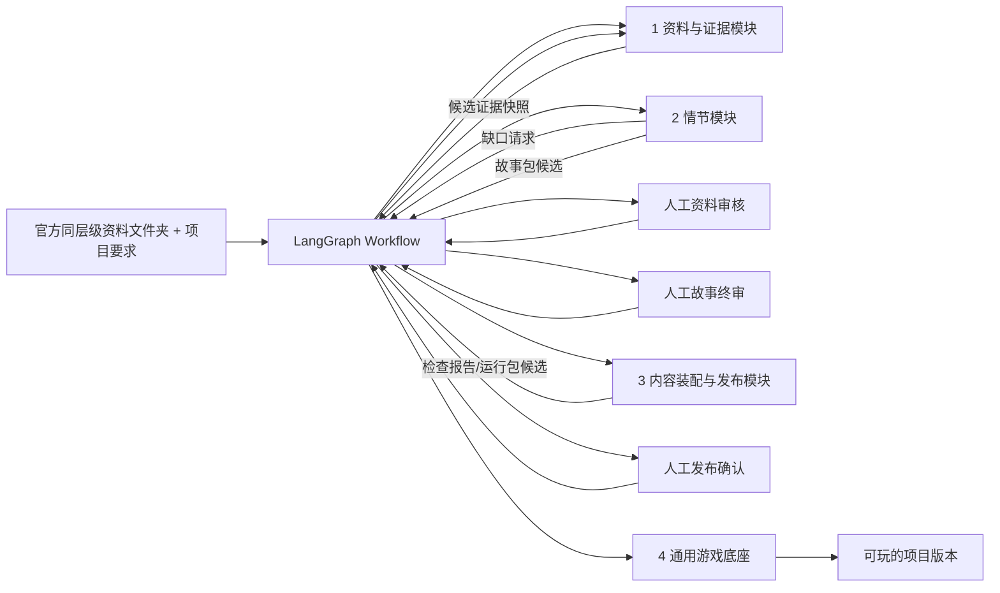

# 从 Muradiye 样板提炼可复用制作框架

版本：0.1 · 实施工作稿  
用途：把已经交付的 Muradiye 游戏拆解成可实现、可评审的模块和自动化流程；先按本文件实现框架，再用第二个官方资料文件夹做第一次完整制作验证。  
决策状态：本文件冻结模块边界、数据交接和 Workflow 行为；Weng、Matt 需要评审各自领域的字段与审核标准。供应商、实测预算和第二文件夹仍可配置。

实施入口：[Workflow 实现合同](workflow-contract.md) 唯一维护精确字段、节点/状态、数据库、API、重试计数和 T1–T7 任务。本文件说明方法和架构；不要复制合同细节到多个规范。Weng/Matt 调整专业政策，核心审批与恢复不变量按合同实现。

## 1. 目标与范围

目标不是重新制作 Muradiye，也不是先做一个泛化 Agent。目标是从 Muradiye 已有的资料、故事、规则、图片和测试中还原其制作方法，把可重复部分拆成四个模块，由一个持久化 Workflow 自动调度。框架完成后，第一次完整的新项目运行使用第二个官方文件夹；Muradiye 只作为参考样本、兼容性基准和自动化测试 fixture。

用户提交一个官方同层级文件夹和目标要求后，系统负责登记、整理、提出故事方向、定向补证、起草内容、往返修订、装配和技术检查。只有资料审核、故事终审和发布确认必须停下来等待人。人工审核不是由人手动执行每个工作步骤；审核决定保存后，Workflow 自动续跑。

P0 不包括玩家端 LLM、GPS 到访解锁、城市级路线规划、3D、公开 SDK 或为单个遗址生成新引擎代码。

## 2. Muradiye 当前参考基线

下表只记录仓库可验证的现状。Muradiye 的完整历史讨论和每轮人工修改日志没有全部保存在仓库；缺少证据的步骤标为“未留记录”，不推测成事实。

| 阶段 | 当前可验证产物 | 已实现能力与边界 |
|---|---|---|
| 来源与素材 | `sources/`、`data/drive_file_ids.csv`、`data/media_manifest.csv`、`sources/inventory/source-manifest.json` | 保存官方来源和原始照片索引；93 个 Drive 图像记录仍有不同映射状态，不能全部当作游戏资产 |
| 遗址证据 | `data/muradiye.json`、`data/schema.sql`、`data/seed.sql` | 保存来源、地点、建筑、主张、照片映射状态及关系；官方来源、事实准确性、图片许可仍需按新版规则逐项审核 |
| 故事内容 | `data/muradiye-story.json` | 保存五个场景、人物、虚构案情、照片、任务、选择和后果；虚构事件与遗址事实分开标识 |
| 照片加工 | `scripts/extract_scene_photos.py`、`prototype/assets/` | 五张出版物图片有页码、图像序号及建筑关联；这五张与 93 张 Drive 原图清单是两组不同记录 |
| 导入和装配 | `scripts/story_import.py`、`scripts/build_database.py`、`data/pastport.sqlite3` | 校验并导入当前 JSON，保存章节内容 hash 和照片出处；导入器仍包含 Muradiye 节点/任务槽 ID 映射，尚不是通用装配器 |
| 游戏运行 | `prototype/engine.mjs`、`prototype/app.js`、对应中文文件 | 浏览器运行确定性任务、证据、选择、后果和本地存档；旧规则和中英文前端仍有重复/地点专用逻辑 |
| 验证 | `tests/test_database.py`、`tests/test_story_engine.mjs` | 数据库 5 项、故事规则 8 项回归测试；不是新遗址端到端制作证明，也不代替真人试玩 |

从现有产物可以还原的参考链路是：**官方出版物/图片 → 来源和地点索引 → 有出处的主张与图片对应 → 故事与任务 JSON → SQLite 导入校验 → 确定性游戏引擎 → 回归测试和浏览器试玩。** 其中“如何从所有材料选中故事方向、每次改稿为何修改”的完整操作记录不全，属于需要在新 Workflow 中显式记录的缺口。

### 2.1 从项目对话提炼的制作方法

仓库能证明交付物和代码做了什么；对话记录能补足产品判断和取舍原则。以下是已经达成的工作方法，不表示 Muradiye 当时每一步都有完整日志。新系统应把这些原则变成有输入、有决策依据、有产物的工作步骤，并在每次运行时保存真实过程。

| 顺序 | 可复用方法 | 必须留下的记录 |
|---|---|---|
| 1. 先定制作范围 | 官方目录结构是资料入口和候选范围；先选定一个明确的官方同层级目录作为一个制作项目。目录名本身不代表它一定能支撑完整游戏，也不保证其中每个地点都进入主线。 | 官方 folder ID、目录快照、候选地点全集、项目边界、缺失/重复材料 |
| 2. 盘点再筛选 | 先纳入官方提供的出版物与图片，再补官方权威来源；逐项登记来源、页码/位置、事实主张、图片映射、许可、地点和空间信息。之后按可信度、可追溯性、可视化程度、人物/任务潜力、授权和空间可达性筛选。 | 每项材料的来源链、证据级别、用途、限制、待核查问题和排除理由 |
| 3. 先看“哪些故事值得做” | 不要把每条资料都塞进剧情。围绕已盘点材料提出少量故事方向，比较每个方向真实证据是否足够、遗址特征是否能进入玩法、角色冲突能否成立、玩家能否从线索推理、地点是否能连续游览。方向推荐是可解释的选择，不是模型自由发挥。 | 候选方向、逐项比较、引用的证据 ID、风险/缺口、推荐理由、未选原因 |
| 4. 证据和故事来回推进 | 情节不是资料审核完成后一次性“写上去”。先用候选资料提出方向，再围绕选中方向定向查证；新事实需求回资料模块。只有通过审核的史实才能进入锁定故事。证据支持不了时要改剧情或停止，不能补写成事实。 | 每次研究请求、支持/反证、资料审核结果、剧情修改差异、受影响的审批状态 |
| 5. 让遗址与人物共同驱动任务 | 每个主线任务都要落在具体遗址属性、照片/遗物或可观察线索上，并推动人物目标、关系或责任发生变化。任务形式可以是观察、比较、定位、整理或选择；形式服务于线索和人物变化。虚构人物与事件明确标记，不能把虚构行为归给真实历史人物。 | `任务 → 场景/地点 → 真实线索/证据 → 人物目标 → 玩家推理 → 状态后果` 的追踪链 |
| 6. 先定游览空间，再定玩家顺序 | 资料归档可以按官方行政/目录层级，玩家路线则按可核实位置和实际游览顺序组织。优先邻接、连续、少折返；不为了顺路伪造地点间历史联系。整份项目保留候选地点全集，明确哪些进主线、支线、后续路线或暂不纳入，避免选中的三处让同范围其他两处无记录地消失。 | 坐标/位置来源、路线顺序、邻接依据、未知通行条件、覆盖清单、纳入/排除理由 |
| 7. 内容完成后再进入通用运行底座 | 资料与故事阶段交付结构化、版本锁定的内容；装配只做确定性转换和机械检查；通用底座读取包运行。第二个官方同层级目录用来证明“换内容包即可接入”，而不是复制 Muradiye 的专属代码。 | 三种包的版本/hash、兼容检查、遗址专用代码差异报告、第二项目完整运行结果 |

这套方法把“目录覆盖范围”和“玩家实际路线”分开：官方文件夹定义制作项目的候选边界，路线定义玩家在项目中如何连续体验。若一个目录资料不足以支撑可玩主线，Workflow 应报告缺口、建议有依据的缩小范围或选择相邻目录；不能只因为目录同名就判定足够，也不能静默丢弃目录中的其他地点。

## 3. 架构总览



Workflow 是跨模块的状态调度器，不是第五个业务模块，也不需要额外的“总控 Agent”。资料与情节阶段可以往返；装配模块只做确定性转换和检查；游戏底座只解释通用玩法规则，不按 `site_id` 写分支。

## 4. 四个模块的职责与接口

### 模块一：资料与证据（Evidence）

**目的：** 将一个官方来源文件夹整理为可检索、可追溯、带状态的证据包。数据库保存原始来源、候选主张、审核记录和版本；模型可作审核判断并给出依据，但不能伪造来源或自行授予人工批准状态。

**输入：** `project_id`、来源提供方与文件夹稳定 ID、原始文件清单/hash、项目范围要求。  
**处理：** 清点、去重、解析与页码定位；建立地点/建筑/遗物候选；提取事实主张及支持/反证；记录图片可见内容、建筑映射、许可状态；基于候选证据和空间约束回应故事模块的定向研究请求。文件解析、格式、ID/hash、权限校验由程序完成；需要语义判断时调用 Evidence Agent/Skill。  
**输出：** 有版本和 hash 的 `EvidencePackage` 候选，以及缺口/冲突/不可用清单。

每条主张至少保存：`claim_id`、文本、实体/地点、时间范围、来源 ID、原文定位、支持与反证摘要、模型判断及理由、人工审核状态/理由。图片映射和版权状态独立于史实审核；来源已通过不代表图片可用于发布。状态建议分开保存：证据判断 `supported / qualified / conflicting / insufficient`；人工决定 `pending / approved / changes_requested / rejected`；图片映射 `unmapped / provisional / verified`；许可 `unknown / restricted / permitted_for_scope`。

**禁止：** 把模型结论直接写成 `approved`；把未核对图片作为答案；把未批准关键主张交给正式情节生成；把官方提供等同于允许公开再分发。

**完成条件：** 故事实际引用的关键主张、解题证据、图片映射、空间依据和许可均有可复核依据及人工审核决定；未决项明确留在包内但不能成为正式故事依据。通过后生成不可变证据快照。

#### 外部补证：官方材料不足时主动研究

如果当前资料不足以支撑有趣、可解且符合史实边界的故事，情节模块提交具体缺口，资料模块可主动上网查找权威资料；研究不限于现有数据库。请求须说明缺少什么、影响哪个人物/任务/地点、什么证据可以解决问题，避免无目标地全网搜集。先检索已有索引和已缓存来源，再按缺口扩展外部检索；新材料沿用同一套提取、判定、许可检查和人工审核流程。

| 建议来源类别 | 用途与采用条件 | 当前状态 |
|---|---|---|
| 官方文化、文物与遗址管理机构 | 核实地点身份、年代、建筑特征、修缮与开放信息；追到具体原文或出版物 | 类别建议，具体机构/域名待逐项筛选 |
| 官方博物馆、档案馆、图书馆与馆藏目录 | 查遗物、题记、历史文献和原图；记录馆藏号、页码及使用许可 | 同上 |
| 大学、学术出版机构及可追溯研究论文 | 补充历史背景、争议解释和研究结论；区分原始证据与作者解释 | 同上 |
| 官方地方政府及旅游机构 | 辅助核实地理位置、入口与游览信息；宣传文字不能替代关键历史依据 | 同上 |
| 博客、聚合站与搜索结果 | 仅用于找到上述原始来源；不独立支撑关键史实或解题答案 | 不作为正式证据来源 |

建立可配置的“外部参考来源登记表”：`source_id`、机构/作者、标题、URL/域名、来源类别、出版/获取时间、引用位置/快照 hash、对应缺口与 claim ID、支持/反证、许可依据、筛选状态、判断理由及审核者。每条来源明确标注 `official_provided / external_supplement`；外部来源不是因为域名获准就自动可信。P0 可由研究角色发现并提出新来源，但抓取边界校验后才能访问，来源采用仍受证据审核约束；经人工筛选的机构/域名清单后续独立维护，不硬编码进故事 Skill。

外部检索计入同一个 run 的研究轮次、访问数和现金预算，不能因换来源而重置。找不到可靠证据时，缩小或改写故事方向，或给出停止报告。

### 模块二：情节与任务（Narrative）

**目的：** 基于已审核证据，自动提出并打磨一个有角色成长、可玩、有空间连续性的遗址故事。

**输入：** `EvidencePackage` 的已批准快照、项目范围和地点清单、连续路线候选、语言/体验要求、当前人工反馈。  
**处理：** 先生成 2–3 个有依据的故事方向；对方向逐项比较证据强度、可视化程度、人物冲突、任务可解性、地点连续性和资料缺口，给出推荐及理由。Workflow 采用最高分合格方向；若均不合格，定向补证或结束为 `no_feasible_story`。然后生成主线、角色目标、场景、任务、选择后果和双语内容。发现事实缺口时返回模块一，不用虚构填补。  
**输出：** `NarrativePackage` 候选及证据引用、虚构标记、自动检查结果和修改记录。

每个场景须关联 `site_id/building_id` 或明确标为非空间过场，并保留路线顺序。每个主线任务须包含：`task_id`、类型、目标、场景、照片/观察要求、证据引用、答案规则、对应人物目标、正确/错误反馈、状态效果和无障碍替代。重要选择必须有可测试的后续状态效果。历史主张只能引用批准的 `claim_id`；原创人物、对话、单据、事件、数量和结局必须标记为虚构。玩家端不调用 LLM。

**禁止：** 把真实人物的虚构行为写成历史；为谜题捏造遗物含义；仅为“顺路”编造历史联系；产出无法从玩家已获得线索推导的答案；静默修改审核锁定字段。

**完成条件：** 人工终审确认史实边界、故事因果、任务可解性、人物成长和玩家反馈完整；绑定当前 `EvidencePackage` hash。故事修改后，旧终审自动失效。

### 模块三：内容装配与发布（Assembly / Publication）

**目的：** 把已审核的证据包和故事包转换为游戏底座可读取的不可变运行包；不再做资料研究、史实裁决或剧情创作。

**输入：** 已批准 `EvidencePackage`、已终审 `NarrativePackage`、目标运行时版本。  
**处理：** 确定性映射和打包；检查 schema/版本兼容、引用存在且审批 hash 一致、媒体文件/hash/许可满足分发、场景和任务字段完整、路线顺序可解释、ID 唯一、双语 key 完整、所有规则路径能通关。每个失败以稳定错误码、文件/字段路径、责任模块和修复建议返回。仅可自动做一次无语义影响的格式规范化；不能自动改故事来绕过错误。  
**输出：** `RuntimePackage` 候选、完整机器检查报告和内容 manifest/hash。

**禁止：** 自动批准内容；根据常识补事实；改写角色、答案、状态效果或路线；用通过的静态检查冒充试玩通过。

**完成条件：** 所有阻塞错误清零，审批快照与包 hash 匹配；人工确认发布后创建不可覆盖的发布版本。发布失败保留旧版本，支持回滚。

### 模块四：通用游戏底座（Game Runtime）

**目的：** 读取 `RuntimePackage` 并运行不同遗址游戏，不含 Muradiye 专属故事内容。

**输入：** 运行包、玩家存档和运行时兼容版本。  
**处理：** 渲染通用地点/场景/照片/任务/角色/选择；用确定性解释器处理观察、道具、证据、选择、解锁和后果；按 `project_id + package_id/version + player/session_id` 隔离存档。  
**输出：** 玩家可玩的场景、确定性的状态变化、存档和脱敏反馈。

**规则原语：** 首版支持 `has_evidence`、`observed_all`、`choice_equals` 等条件，以及 `grant_item`、`set_relationship`、`add_story_time`、`unlock_scene` 等效果。规则数据通过 schema 校验；禁止 `eval`、包内脚本或 `if site_id == ...` 特判。

**完成条件：** 相同底座加载 Muradiye 和第二项目的运行包；故事状态与答案完全由包驱动；无需为第二个地点复制页面或新增地点判断代码。确实需要新的玩法时，增加并测试通用 Handler，而非遗址专属分支。

## 5. 三份交接契约

契约用 Python Pydantic 2 模型在 API/文件边界校验，并导出带 `schema_version` 的 JSON；SQLite 保存业务记录和审核事实，LangGraph checkpoint 只保存可恢复的运行状态。审核记录不能只存在 checkpoint 中。

| 契约 | 必备内容 | 版本与审批绑定 |
|---|---|---|
| `EvidencePackage` | `project_id`、`source_folder_id`、来源/文件 hash、地点全集、主张、图片/许可/映射、空间记录、研究缺口、审核快照 | `schema_version`、`content_version`、包 hash；每条审核绑定 claim/asset ID 与内容 hash |
| `NarrativePackage` | `project_id`、地点与路线、章节/人物/场景/任务/选择/状态规则、双语资源、事实引用、虚构引用 | 绑定 `evidence_package_hash`、叙事版本与人工终审；证据包变化使受影响内容审批失效 |
| `RuntimePackage` | 项目/内容包 ID、引擎兼容范围、场景与规则、资源 manifest、全部依赖 hash、检查报告摘要 | 绑定证据快照、终审故事版本、schema/runtime 版本及发布版本；发布后不可变 |

`project_id` 是本地稳定 ID；官方文件夹稳定 ID 放在 `source_folder_id`，不能只用可变文件夹名。目录名相同不自动合并，多个目录指向同一建筑时通过显式映射共用 `site_id`。一项目可有多个地点/路线；不能把单点 Demo 的 `site_id` 结构直接当成项目边界。

最小工作台/API 操作：创建/查看项目、导入文件夹、启动/查看/取消 run、查看阶段产物与缺口、提交证据审核、提交故事修改/终审、查看装配报告、确认发布/回滚、读取已发布包。玩家公开接口不能读取草稿或候选包。

## 6. 自动 Workflow 规范

LangGraph 负责路由和持久状态；普通代码节点负责文件处理、数据库写入、门禁、计数和发布副作用；模型节点只能返回结构化候选和理由。ResearchRole 与 StoryRole 可共用一个 ModelGateway 和同一供应商模型，但输入上下文、Skill、工具权限和输出类型隔离。不建立额外 LLM 总控 Agent。

### 6.1 顺序与停点

| 节点 | 自动动作 | 成功后去哪 | 人工停点 |
|---|---|---|---|
| `register_project` | 固定项目 ID、文件夹 ID、范围要求、政策/预算配置 | `inventory_sources` | 无 |
| `inventory_sources` | 列文件、去重、算 hash、识别类型/页数/解析状态；保留失败明细 | `extract_candidates` | 无；来源不可访问可停为 blocked |
| `extract_candidates` | 程序解析/全文定位；必要时调用模型抽取候选实体、主张、图片内容 | `discover_story` | 无；所有输出默认 candidate |
| `discover_story` | 给出 2–3 个故事方向、证据/图片/空间依据、缺口与风险 | `select_candidate` | 无 |
| `select_candidate` | 按版本化政策确定性比较并记录推荐理由 | `research_selected_direction` | 无；无合格方向则有界补证或 `no_feasible_story` |
| `research_selected_direction` | 只针对推荐方向找支持/反证、核出处和图像/空间问题；模型给判断及依据 | `evidence_review` | 无；研究至多 2 轮总计 |
| `evidence_review` | 验证引用版本未变，生成待审列表 | `awaiting_evidence_review` | **人审核**关键史实、争议、任务证据、路线/图像和许可；决定按 claim/asset 逐条记录 |
| `draft_narrative` | 只用已批准证据生成故事包和规则；验证每个事实有引用、每个任务有人物目标关系 | `narrative_review` | 无；自动修订最多 2 轮 |
| `narrative_review` | 显示故事、依据、虚构标记、任务链和选择效果 | `awaiting_story_review` | **人终审**故事质量、史实边界、空间顺序、答案可推导性 |
| `assemble_package` | 确定性转换证据/故事包为运行包候选 | `validate_package` | 无 |
| `validate_package` | 执行 schema、引用、授权、媒体、路由、可达性、规则路径、中英完整检查 | 通过到 `publish_review`；失败按错误责任返回 | 无；一次纯格式修复后仍失败就返对应模块/交人，不增加 LLM 轮次 |
| `publish_review` | 展示候选运行包 hash、审批快照、检查报告和发布影响 | `awaiting_publish_confirmation` | **人确认发布**；不同意退回指定模块 |
| `publish_package` | 原子发布不可变版本，记录操作者/时间/版本，保留旧版回滚 | `published` | 无 |

### 6.2 自动分支与返工规则

- 情节提出新史实需求或资料不支持任务：创建带上下文的 `EvidenceRequest`，回 `research_selected_direction`。新证据必须重新过资料审核；审核通过后故事草稿及终审状态更新。
- 资料审核选择 `changes_requested`：只针对指定主张/图片/路线补证；锁定的其他项不重做。选择 `rejected`：相关故事方向和引用自动失效。冲突/证据不足可以保留，但不能作为事实或解题答案。
- 故事终审选择 `changes_requested`：按反馈修订；若反馈涉及新事实则回 Evidence，否则留在情节模块。每次修改使旧终审失效。审核者可锁定具体字段，模型不得覆盖。
- 装配失败按稳定错误码回到对应模块：`EVIDENCE_*` 回资料、`NARRATIVE_*` 回情节、`PACKAGE_*` 由确定性装配器修复。不能让 Agent 自由猜责任方。
- 候选方向均不满足证据/路线/玩法门槛时，Workflow 给出有依据的停止报告；不得强行产出故事。
- 研究最多 2 轮、叙事自动修订最多 2 轮、无语义格式修复最多 1 次。每个 run 有调用数、输入/输出 token、来源访问数、现金预算及时间上限；上限耗尽转 `budget_exhausted` 等待人决定，不自行换供应商或清零重跑。
- 每个节点幂等；外部副作用有唯一 operation ID。持久化已完成产物与审批，恢复时复用有效结果，避免重复发布、写审批或无必要的付费调用。远端调用响应丢失时不能保证供应商未扣费，须核对调用记录或转人工处理，不能盲目重试。状态只由合法转换更新；不能通过 API 直接跳过门禁。
- 工程状态用 `node + status` 表示；字段、枚举与路由统一按[实现合同 §4](workflow-contract.md#4-图状态节点与路由)。界面可以显示“等待资料审核”等组合文本，不另外维护 drafting/generating 等同义状态。失败保留错误码、责任模块和可恢复动作。

### 6.3 从失败步骤恢复，按依赖局部返工

**恢复默认不新建 run、不从项目登记重新开始。** LangGraph 持久 checkpoint 配合业务产物记录保存节点输入版本、已完成子任务、输出位置/hash、错误、尝试次数和累计费用。节点内部也须拆成可保存结果的小步骤；仅保存整条图的状态，不能避免一个大节点内部的重复付费。

| 情况 | 恢复行为 | 保留什么 |
|---|---|---|
| 网络/解析等可重试故障，输入没变 | 只重试失败节点中未完成的小步骤；成功后继续后续节点 | 之前节点和已成功文件/批次的结果、审批、预算累计 |
| 模型输出格式不合法 | 先做确定性校验；只修复当前输出，必要时有界重新调用该步骤 | 资料索引、已批准证据、其他已完成章节 |
| 某条证据变化或人提出局部修改 | 通过 claim/asset/task 依赖关系标记受影响片段失效，重做对应研究/章节及其后续检查 | 未受影响证据、章节及绑定内容 hash 仍有效的审批 |
| 发布失败 | 核对发布操作是否已成功；从发布步骤恢复或报告待处理 | 已通过校验的不可变运行包和旧发布版本 |

缓存键包含输入 hash、Skill/Schema/模型配置及审批依赖；命中时不重复调用模型。一次合法重跑仍按实际消耗扣减原预算，不重置研究/修订计数。证据改变影响故事时，必须重做相关终审与包校验，不能为了节省 token 复用已失效结果。

验收用故障注入证明：在某章节生成后、后续校验前停止并恢复，已成功章节不再调用模型；只修改一个证据条目，只有关联内容重新生成/审核；发布响应未知时不盲目重复发布。报告实际节点调用数、缓存命中和费用，不能只展示“可恢复”的流程图。

## 7. 代码边界与建议目录

```text
src/pastport/
  domain/          # Evidence, Narrative, Package, Project, Review, Workflow 状态与不变量
  application/     # 导入、审核提交、Discovery、研究、生成、装配、发布用例
  ports/           # Repository、SourceReader、ModelGateway、Checkpoint、Clock 等协议
  adapters/        # Drive/文件/PDF、SQLite、模型供应商、checkpoint、媒体存储实现
  workflow/        # LangGraph 状态、节点封装、路由、暂停/恢复
  api/             # FastAPI 项目/run/review/package 接口
skills/
  evidence-review/ # Weng 维护的审核方法与输出要求
  narrative/       # Matt 维护的 Discovery/叙事方法与输出要求
tests/
  fixtures/        # 小型、可公开的 Muradiye 参考 fixture；模型使用 fake gateway
  contracts/       # Evidence/Narrative/Runtime schema 与兼容测试
  workflow/        # 所有分支、暂停、恢复、重试和预算边界
  integration/     # 文件夹输入到运行包的第二项目端到端测试
prototype/        # 逐步改为只读取 RuntimePackage 的通用玩家端
```

领域层不依赖 FastAPI、LangGraph 或具体模型 SDK；数据库访问封装在 Repository；第三方 JSON/PDF/模型输出在 adapter 边界转成强类型对象。新 Python 模块按严格类型、不可变 DTO、依赖注入和显式异常实现。没有必要把当前整个仓库一次性重写；按用例逐步迁移并保持可运行。

## 8. 实施阶段、责任和交付

| 阶段 | 具体工作与负责人 | 交付与通过条件 |
|---|---|---|
| A 参考样板复盘 | Weijia 列代码/文件/测试证据和硬编码点；Matt 标故事决策、任务因果与质量标准；Weng 标来源、审核、照片/授权/空间依据及缺口 | `Muradiye Reference Map`：每一步输入、人工决定、产物、证据路径、可自动化项和未知项；只陈述可核查事实 |
| B 契约评审 | Weng 定 Evidence 字段/证据状态/审核理由；Matt 定 Narrative、任务、角色/选择和内容终审；Weijia 定项目/run/包版本/API 状态和通用规则边界 | 三份 JSON Schema/Pydantic 模型示例、版本兼容策略、字段 owner；领域负责人签字确认 |
| C 架构骨架 | Weijia：FastAPI、SQLite migration/repository、LangGraph checkpoint、ModelGateway 接口、run 状态/事件/审核 API；三人给小型 Muradiye fixture | 无真实模型也能用 fake gateway 演示自动推进、人工暂停/恢复、分支和幂等；所有依赖可替换 |
| D 四模块 MVP | Weng 完成资料索引/证据提取审核；Matt 完成 Discovery/叙事 Skill 与故事包；Weijia 完成装配器、验证器、发布流程和 runtime 适配；共享接口下并行开发 | 每模块单测/契约测试通过；失败能定位责任模块；人工批准状态不能被模型/接口绕过 |
| E 第二文件夹完整试跑 | Weng 确认第二个同层级官方文件夹的访问、地点全集、资料/许可/路线状态；全组通过同一 Workflow 产出并试玩新内容 | **第一次完整端到端制作验证**：原始文件夹进入，工作流自动到达审核关口，审核后自动续跑，最终同一底座加载游戏；不新增地点专用代码 |
| F 复盘和成本优化 | Matt 汇总试玩质量与任务卡点；Weng 汇总证据错误/未知；Weijia 汇总失败率、延迟、费用、人工修改分钟和系统错误 | 只对实测问题迭代框架；质量门槛先满足，再选综合成本最低的模型/提示方案 |

第二文件夹选择标准：与官方目录同层级且边界清楚；有可辨认的地点全集；足够支撑有依据的连续体验；核心素材有可追溯来源，照片许可可判断。距离/分钟数无法可靠确认时记录未知，不作为淘汰或伪造路线依据。最终候选由 Weng 提供资料成熟度、Matt 评估可玩性、Weijia 评估接入风险，三人共同冻结。

## 9. 复用验收清单

### 架构/Workflow

- [ ] 输入文件夹后自动建项目、生成文件清单、hash、解析状态和缺口报告。
- [ ] Discovery 输出多个可追溯方向和比较依据；不把候选事实当已批准事实。
- [ ] Evidence Agent 可作明确判断并给原文位置、来源等级、支持/反证与不确定性；人工审核留身份、理由和版本。
- [ ] Story Agent 只用通过审核的事实，发现缺口能自动返回资料模块；角色目标、地点、照片、任务、证据和后果可互相追踪。
- [ ] Workflow 自动分支、按上限返工；人工关口暂停后可恢复；预算耗尽、模型失败、审核拒绝、取消和重启均有可解释结果。
- [ ] 装配器拒绝审批失配、缺媒体、无效规则和断链内容；只产出不可变可回滚运行包。

### 新遗址 Minimum Playable Standard

第二项目不需照搬 Muradiye 的人物、谜题或固定场景数，但应达到相同核心质量：

- [ ] 至少一条有依据、空间连续、可说明取舍的玩家路线；未知通行条件如实标明。
- [ ] 有明确人物目标和可见成长，主线任务连接人物处境与真实遗址属性。
- [ ] 至少一组已授权且已映射的真实图片/遗物线索实际参与玩家推理，不只是背景装饰。
- [ ] 关键史实可回到来源与页码；虚构内容明确标注，任务答案能由玩家获得的线索推出。
- [ ] 重要选择改变后续证据、关系、职责或服务后果；所有关键路径可通关。
- [ ] 中英文规则和选择结果一致；浏览器刷新/恢复存档不串项目。
- [ ] 从新项目内容包加载，不添加 `site_id` 判断、复制整套页面或专属引擎分支。

程序通过不等于好玩。Matt 组织至少一轮目标用户试玩并记录完成率、卡点、遗产理解和选择后果理解；未测前标注“未验证”。

## 10. 冻结决策与可调参数

**首期已冻结：** 四个业务模块及其责任边界；LangGraph/Python 作为 Workflow；FastAPI；SQLite 业务数据加独立 checkpoint；原生前端；无玩家端 LLM；三个人工审核关口；证据、故事、运行包分版本和 hash；Muradiye 作为参考基准，第二个官方文件夹作为首个完整运行样本。

**允许在接口评审后调整，但须记录变更理由：** claim/asset/narrative schema 的具体字段；审核理由枚举和故事评分权重；第二文件夹名称；模型供应商、调用/现金预算、超时；路线距离/时长阈值；API 请求细节。不能以“待定”为理由推迟稳定 ID、版本/hash、人工审批状态、来源引用、项目隔离和 Workflow 暂停/恢复等硬边界。

上述工程字段与默认政策现已在[实现合同](workflow-contract.md)给出首期基线；后续专业政策可调整，跨模块字段/状态改变须显式升级版本，不由 Coding Agent 自行猜测。

**禁止实现时偷偷改变：** 用模型文本冒充已审核事实；把人工审核做成由人手工跑每个节点；让装配器创作或裁决；在玩家行动中调用模型；把 Muradiye 专用 ID/路径复制进第二项目运行代码；把同一模型/工具的调用次数当成唯一成本指标。
