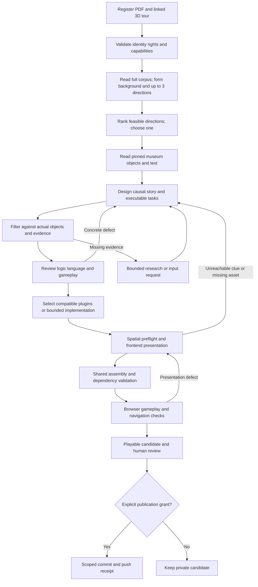

# Story Agent Automation: Implementation PRD and Technical Design

Status: proposed implementation contract, not implemented automation. Owner: Story workflow implementer; shared contracts/runtime: wehan. Branch: `story-agent-automation`, based on `story-agent-demo` at `5ee92b8`. Updated: 2026-10-26.

## 1. Product boundary and authority

One production request accepts a complete historical PDF and a prepared 3D museum tour already connected to its review backend. It produces one runnable game candidate and validation evidence. The user does not manually move artifacts between internal modules. A candidate is not a human-accepted or publicly released game.

The Story Agent is one content-producing component. A LangGraph production coordinator invokes Story, gameplay preparation, frontend presentation and shared assembly. It owns orchestration and delivery completeness, not all their implementation. The game host remains a separate deterministic system. This distinction preserves an end-to-end user experience without making Story responsible for geometry, UI code, physics, saves or publication.

Normative references:

- [Integrated PRD](../PastPort_PRD_EN.md): product, contracts, ownership and approval boundaries.
- [Game-making supplement](../PastPort_PRD_EN.md#part-topic): story exploration, museum filtering, plugin selection and complete delivery.
- [Demo interaction specification](../../prototype/story-agent-demo/PRD.md) and [verified behavior/limits](../../prototype/story-agent-demo/README.md): experience baseline.
- Later explicit user corrections take priority over an older Demo statement. Current 3D Demo removes the central 2D standee while retaining dialogue portraits. Do not reintroduce it simply because an older staging paragraph requests a world actor.

This document defines the implementation plan and proposed extension boundaries; it does not redefine the SDK or silently upgrade its versions. Conflicts involving shared interfaces require an explicit versioned decision by their owner. A Demo bug is not an acceptance requirement.

### User-visible input and output

**Input:** (1) complete PDF; (2) already prepared original/stylized 3D museum tour with stable object IDs and linked review content. User preferences, language and execution authorization are run settings, not a third material package. A separate manually copied object spreadsheet or duplicate review backend is unnecessary.

**Output:** runnable private preview plus a downloadable, dependency-complete game bundle; narrative, task/object bindings, exact gameplay plugins/configuration, presentation, registered assets, provenance, validation report and unresolved limits. Public redistribution requires separate rights/authorization. Missing mandatory capabilities yield a blocked result, not a story-only output mislabeled playable.

## 2. Verified engineering baseline

Remote refs were fetched during this document's preparation. These hashes identify inspected source baselines, not proven functional integration.

| Remote branch | Revision | Relevance and boundary |
|---|---|---|
| `main` | `5dd5f32` | Existing editorial workflow, metered execution, typed ports and shared engine; current executable wire 0.1.0. |
| `story-agent-demo` | `5ee92b8` | Source-only 3D story player, interactions and focused tests; private input assets excluded. |
| `codex/environment-stylization` | `1ae38d4` | Prepared styled-tour delivery and progress; visual/geometry limitations remain. |
| `codex/matched-environment` | `0b52cd5` | Shared review authority across VR and independent 3D views. |
| `Game-Environment-Demo` | `65df8c4` | Historical manual reference with working review/VR data; not generic automation. |
| `demo-muradiye-ui-trial` | `6e65a44` | UI/animation reference; not a fresh project input or production contract. |
| `database` | `c48802f` | Source extraction implementation candidate; adapter compatibility requires verification. |
| `codex/pdf-to-vr-standalone` | `59b59e2` | Upstream matched-PDF/VR candidate, not Story-owned preprocessing. |

No branch is merged wholesale merely because its name matches a requirement. Integration pins an exact counterpart, validates format/capabilities, and preserves review edits. The two uncommitted style-display modifications discarded by the user are not dependencies of this design.

Existing reusable code: `workflow/worker.py` (StateGraph/SqliteSaver/interrupt and owned-worker lifecycle), `ports/modules.py` (NarrativePort, EvidencePort, AssemblyPort, PackageValidatorPort), `ports/execution.py` (ModuleServices), and `application/execution_runtime.py` (controlled model/source/tool execution). Existing local JSON adapters are not proof of a live generative Agent.

SDK schema 1.0.0, plugin API 1.0.0 and wire 0.2.0 under `docs/technical/sdk-v1/` are target references. Their sample validators do not constitute a production plugin host. New 3D and presentation extensions must not be stuffed into legacy wire 0.1.0 fields.

## 3. Component responsibilities

| Component | Input | Output | Owns / does not own |
|---|---|---|---|
| Production coordinator | Run request, immutable input refs, grants | Run state, stage artifacts, final candidate or blocker | Routing/checkpoints/costs; no story prose or game-rule duplication. |
| Source and museum adapter | PDF; tour's authenticated review connection | Registered corpus, museum snapshot, scene capability inventory | Read/validate/pin provenance; no fixture DB rebuild, rematching or new stylization. |
| Story Agent | Corpus, requirements, then museum capabilities | Background/cast, selected direction, causal story, tasks, semantic staging cues | Fiction/history separation, motives, task actions and consequences; no 3D coordinates or UI implementation. |
| Gameplay preparation | Filtered tasks, host capabilities, registry | Plugin selections/configs or explicit missing-mechanic specification | Compatibility/cost selection; bounded Coding Worker only when necessary. |
| Frontend Presentation Agent | Story/task package, scene/accessibility inventory, plugin view capabilities | Versioned PresentationPackage and staging/layout configuration | Reachable positions, observation modes, cast continuity, dialogue/window timing; no mutation of approved story rules. |
| Shared assembly and host | Approved compatible artifacts/plugins/assets | Validated bundle, playable preview, authoritative action/save state | Installation, navigation, picking, execution, saves; no per-line model calls. |
| Validation and release adapter | Exact candidate and evidence, publication grant | Scoped checks, human review request; optionally authorized Git delivery | Never treats model scores or browser smoke tests as human acceptance. |

These are logical roles and ports. They do not require six permanent processes, six conversational agents or six different paid models. A single owned worker runs sequential graph nodes; isolated Coding/JS workers are separate security boundaries.

## 4. Workflow architecture

The graph is not a fixed Murat story template: every project can change theme, ordinary protagonist, chronology, cast, route, task composition, mechanic and visual layout. Only controlled orchestration, typed interfaces, validation and compatible infrastructure are reused.

### Node contract and bounded routing

| Stage | Required result and failure routing |
|---|---|
| Register/preflight | Pin PDF, tour, review revision and capabilities. Reject missing/foreign/unreadable references; permission or rights gaps wait for the correct owner. |
| Background/discover | Full-document chronology, place, events, historical figures, uncertainty and plausible ordinary-person life conditions. Up to three directions, reasons and task opportunities; unsupported customs remain gaps. |
| Select | Hard failures first, then heritage dependence, causal potential, playable actions and supported presentation. Choose one in authorized auto mode. Store alternatives without drafting three stories. |
| Design/filter | Read actual museum after high-level discovery; build/revise tasks and their clue dependencies from available objects. Record keep/revise/drop/request-material decisions. Optional information never gates a mandatory task. |
| Content review | Check causal closure/motives/foreshadowing, strong contrast and earned revelation; then clear concise language and gameplay interest. Return targeted defects, not an unbounded full rewrite. |
| Gameplay | Reuse compatible registry first; for a missing simple mechanic specify bounded implementation, for complex mechanics compare at most three open-source candidates once. No compatible safe host means capability gap. |
| Presentation | Before generating UI, validate walkable areas, occlusion, barriers, interaction regions, camera spawn, portal directions and available assets. No unchecked straight-line approach through glass, walls or voids. |
| Assembly/validate | Pin all dependencies; shared assembly does not rewrite narrative meaning. Missing dependencies fail the candidate. |
| Browser review | Exercise the actual exact bundle, not only JSON/program tests. Diagnose source/task/presentation/navigation failures separately and repair only affected stages. |
| Delivery | Playable candidate plus reports and acceptance state; human review and publication remain separate. |

Default proposed run policy: at most three directions, one initial recommendation, two targeted repair rounds per affected stage and at most two fallback switches. Fallback requires a documented hard blocker after local repair, not a slightly lower self-score. Limits are configurable only within an explicit authorized grant. Stop on exhaustion and preserve partial artifacts. Do not apply the style-transfer Agent's one-repair policy to Story implicitly.

Legacy discovery currently requires authenticated human direction confirmation in the first pilot. Auto-selection is a new policy-gated behavior: retain that gate until the corresponding owner accepts the policy extension; the user's present preference authorizes proposing it, not fabricating a review authority record.

## 5. Input/output interfaces

All interfaces below marked **proposed** need frozen Pydantic models and JSON Schemas before integration. External JSON is validated into immutable models; unknown fields and invalid enum/version/ref combinations fail. Existing canonical types remain authoritative. Do not create a second incompatible ArtifactRef with the same name.

### 5.1 External request: `StoryProductionRequest` (proposed 0.1.0)

| Field | Type / requirement | Validation |
|---|---|---|
| `request_id`, `project_id` | Nonempty stable identifiers | Request idempotency belongs to one project and request body hash. |
| `pdf_ref` | Registered resource reference | Exact version/hash, PDF type, bounded size; full text/provenance available or extraction requested. |
| `tour_ref` | Registered package reference | Complete 3D tour manifest; carries scene/object identity and review binding. |
| `requirements_ref` | Versioned authored requirements | Locale, audience, duration target, history/fiction constraints, desired tone and accessibility. |
| `runtime_capabilities_ref` | Versioned host capability inventory | Actual supported scene adapters, rules, plugin API and device limits. |
| `policy_ref` | Immutable run policy | Candidate/repair/research/time/call/token limits, selection mode, permitted tools. |
| `execution_grant_ref` | Authenticated authorization reference | Existing authority validates scope/provider/model/cost; absence permits only authorized no-cost preflight. |
| `publication_grant_ref` | Optional authority reference | Null by default; exact repository/branch/path/artifact scope if Git output authorized. |

A URL alone is not a complete tour contract. The resolver registers the package and derives its review binding; users do not hand-copy introduction text. Missing connection information is an input error, not permission to scan arbitrary localhost services.

### 5.2 Linked review and scene boundary

The tour must resolve a `ReviewBinding` (proposed adapter envelope): `project_id`, backend identity, export capability/version, content revision, authentication reference and museum snapshot reference/hash. Credentials stay server-side. `MuseumSnapshotReader` is a read-only Protocol, injected by the composition root; the adapter pins the reviewed text actually used.

Each object requires stable `object_id`, historical binding/provenance, reviewed text resource/version, review status, scene occurrence IDs and original/styled display refs. Text and position revisions are separate. Same object in two views reads the same review authority; it is not copied into independent editable descriptions. Review writes use the owning service's existing authenticated version checks. A run never writes review content.

The **proposed** `SceneCapabilities` extension contains scene identity/revision, coordinate frame and units, original/stylized render refs, default spawn pose, walkable/collision refs, object occurrences and navigation links. Each occurrence includes object ID, scene ID, transform/region, visibility/accessibility status and confidence/provenance. Each navigation link includes source/target scenes, departure region, arrival pose and original direction metadata. An unknown frame or missing valid ground cannot be labeled navigable.

Existing upstream packages may expose these through different fields. Implement explicit versioned adapters, preserve source IDs and pin the conversion mapping. A panorama package must not silently claim 3D capability. A generated collider is not a historically surveyed floor plan.

### 5.3 Internal artifact interfaces

| Producer → consumer | Artifact / minimum semantic payload | Existing vs proposed |
|---|---|---|
| Source adapter → Story | SourceCorpus with document/page/span refs, chronology/entities, extraction gaps and rights | SDK target; source extraction adapters need compatibility validation. |
| Story discovery → coordinator | CandidateSetDraft with up to three premises, ordinary protagonist, evidence refs, risks, selection reasons | Existing NarrativePort discovery shape; exact fields from current typed code. |
| Story → filter/review | NarrativeDraft plus cast, scene/beat/task IDs, clue premises, actions, conditions/effects, choice consequences and fact/fiction labels | Existing canonical draft, extended only through versioned owner-approved contract. |
| Filter → gameplay/presentation | FilterReport decisions per task; missing refs, required capabilities, keep/revise/drop reason | SDK target 1.0.0 reference. |
| Story → presentation | Semantic cues: who is present, why/when enters/exits, speaking order/actions, task/overlay timing, preferred observation mode | Proposed staging extension; not unrestricted executable scripts. |
| Gameplay → assembler | Plugin manifest refs, exact versions/hashes, validated config/assets, required capabilities and acceptance evidence | Target API 1.0.0; missing host implementation is explicit. |
| Presentation → assembler | PresentationPackage binding game scenes/tasks/objects to actual views, access regions, camera/navigation, actor/portrait cues, layout and trigger order | Existing SDK reference plus proposed 3D/staging extension. |
| Assembler → host | Complete bundle closure, resource/plugin lock and compatible runtime version | Shared AssemblyPort; production generic plugin integration pending. |
| Validators → coordinator | Scoped report with check ID, status, severity, artifact refs, reproduction and evidence | Proposed authoring report extensions; no self-issued human approval. |

Narrative declares intent such as “talk after arriving in a valid nearby area”; presentation determines a safe reachable region using scene capability data. Neither invents a new historical object to make a task feasible. A required clue must be directly available in the scene/dialogue/task feedback, not buried in optional source reading.

### 5.4 External result: `StoryProductionResult` (proposed 0.1.0)

Required: `run_id`, `project_id`, `status`, `input_lock_ref`, stage report refs, unresolved issues, usage receipt refs and `next_action`. Status is one of `running`, `awaiting_input`, `awaiting_review`, `blocked`, `failed`, `cancelled`, `candidate_ready`, `published`.

For `candidate_ready`, require `bundle_ref`, `preview_ref`, narrative/filter/presentation refs, plugin lock ref and validation report. Preview uses a registered same-origin route or scoped access token, not arbitrary filesystem exposure. Every validation item is `passed`, `failed` or `not_run`; human play acceptance is separate. `published` additionally requires exact Git delivery scope, commit and verified remote receipt; Git failure does not erase the private candidate or imply successful publication.

### 5.5 Service transport (proposed, not existing endpoints)

| Operation | Request | Result |
|---|---|---|
| `POST /api/story-production/runs` | StoryProductionRequest; idempotency key | 202 with run/status/events refs, or typed input/authorization error. Same key/different body: 409. |
| `GET /api/story-production/runs/{run_id}` | Project-scoped authenticated read | Current result/status, artifacts, usage and actionable blockers. |
| `GET /api/story-production/runs/{run_id}/events` | Authenticated SSE, resumable event cursor | Monotonic stage events; sanitized status/progress, never prompts/secrets. |
| `POST /api/story-production/runs/{run_id}/resume` | Expected run revision, review/input references | Validated command receipt; cannot reset unknown usage or raise budget. |
| `POST /api/story-production/runs/{run_id}/cancel` | Expected revision and action ID | Idempotent cancellation acknowledgement; worker stops safely. |
| `POST /api/story-production/runs/{run_id}/publish` | Exact candidate ref, publication grant and target | Scoped Git delivery receipt; separate from game release/deployment. |

Service errors contain `code`, safe message, `stage`, `retryable`, issue references and next action. Required categories: input invalid/version mismatch, review conflict/unavailable, missing material, incompatible host, unreachable mandatory clue, budget exceeded, provider unavailable, save conflict, validation failed and unauthorized publication. No implicit provider substitution or image-only “success”.

## 6. Runtime and presentation acceptance

- Single click opens optional historical introduction; double click approaches when safe. A shared arbiter prevents a double click opening two overlapping windows.
- Required reachable observations complete only inside a valid area, after opening/reading and explicit confirmation. High or genuinely inaccessible objects permit safe visual/click confirmation. Model uncertainty alone does not bypass every arrival gate; reachability/observation mode is precomputed and reported.
- Viewing a later task's material is allowed but does not prematurely complete that task. First task appears after guidance. Completion advances exactly once; no fallback to the old objective after all required observations.
- Focus turns toward the object and closes obstructing source/task layers without hiding markers or destroying progress. Offscreen objective gets an edge hint, not a wall of text.
- Spawn retains source default horizontal location and valid floor height. WASD obeys walkable space. Portal/arrow/boundary crossing retains source arrival orientation in both directions and in original/stylized modes.
- Small dialogue remains unobtrusive with correct speaker portrait; ordinary lines auto-play, continue/back/history work. Meaningful choices require input. Long choices, games and endings are centered. One foreground task hides and later restores covered panels.
- Character identity and relationships appear before they matter. Speaker uses first person; other referents use clear names. No editorial evidence limits, numeric object IDs or operational instructions in character speech. Names retain original spelling.
- Use existing valid portraits/dialogue when world-character assets are unavailable. Do not introduce black rectangles, sudden unexplained people or camera-following 2D standees. Natural actor staging requires supported assets/routes.
- Each core heritage task has a removal/substitution test and an understandable player action with later visible consequence. Optional unrelated facts remain optional. No forced fourteen-object checklist and no invented budget puzzle without prior stakes/premises.
- Ending has an explicit centered story-end marker. All losing/retry/branch routes terminate or offer a valid recovery; no invisible compulsory next task.
- Gesture/effects capabilities are optional registered mechanics, not mandatory infrastructure. A future fountain/kitchen effect requires supported evidence/assets and accessible pointer/keyboard equivalent; camera access needs explicit user consent, no default recording/upload. No food/custom claim without appropriate period evidence.

## 7. Technical track and failure safety

Use repository-pinned Python 3.12, Pydantic 2.12.3, LangGraph 1.2.15, SQLite checkpointer 3.1.2 and FastAPI 0.143.2. Keep existing lock files. Use ES modules and the shared JS rule engine; no Python copy of game rules. Browser verification uses a declared browser harness and real assets; do not introduce a new frontend framework simply to orchestrate generation.

Implement ports with dependency injection and immutable typed models. Reuse ModuleServices and ExecutionRuntime for all paid/research/tool calls. Current runtime recognizes research/story roles; frontend/gameplay roles initially use scoped task-specific skills within authorized story execution, or require an explicit metering-policy extension before introducing new role values. Coding Worker has a separate controlled execution contract, network/filesystem allowlist, timeout and no production secrets.

Graph state contains run identity and artifact references, not repeated PDFs/whole scenes/chat histories. Business records authorize transitions; checkpoints preserve execution. SQLite starts as a single owned worker, short transactions and CAS revisions; no Redis/Celery/vector database until measured demand justifies them. PDF extraction is bounded CPU work outside the event loop; validated text reuse avoids redundant extraction.

A node's recorded invocation key binds run, stage, exact input hashes, skill/model/config versions and revision. Persist completed model/tool results before progressing. Replay does not inherently guarantee exactly-once paid calls: reconcile uncertain provider/ledger receipts; do not automatically repeat an unknown charge. Separate approval interrupts from side-effect execution. LangGraph can replay a node from its beginning after resume; effects need idempotent receipts. [Official interrupt documentation](https://github.com/langchain-ai/docs/blob/main/src/oss/langgraph/interrupts.mdx).

When review text changes, create a new snapshot and invalidate only artifacts whose dependency hashes changed. Keep manual narrative locks; report incompatible edits. Preview uses its pinned revision; shared review viewing can show that a newer edit exists. Cross-tab player writes use existing CAS conflict reporting, never silent overwrite or clearing progress.

Models recommend content and presentation; deterministic services select valid graph transitions, enforce limits and execute approved rules. No model grants rights, marks its own human acceptance or raises its budget. Cost policy selects the least expensive adequate configured model for bounded extraction/language/mapping; difficult causality or capability planning uses the configured stronger model only within the grant. Record actual available usage; do not promise reduced tokens from delegation.

Generated plugins require schema/type/behavior/license/isolation checks. A JS vm is not a security sandbox. Until the host and OS isolation exist, use only supported trusted built-ins; a missing necessary plugin blocks delivery rather than loading arbitrary generated modules in a privileged process.

## 8. Implementation sequence and ownership

Suggested new module: `src/pastport/adapters/narrative_maslan/automation/` for Story-owned adapters/coordinator integration, with focused tests. New shared 3D/schema/host work is separately owned and versioned; exact directories/interfaces are agreed at M0. Do not transplant site-specific prototype code as a generic SDK implementation.

| Milestone | Owner/dependencies | Deliverable | Acceptance |
|---|---|---|---|
| M0 Contracts and input counterpart | Story + shared owner; fixed real tour/review/PDF sample | Frozen request/result and adapter schemas; existing/target compatibility map | Read linked review without copies; reject wrong project/hash/frame; explicit host gaps. |
| M1 Persistent generation slice | Story; M0, execution grants | Register → background/discover → select → design/filter → content review | One new input produces typed task package; targeted repair and restart with retained receipts. |
| M2 Gameplay preparation | Plugin owner + shared host owner; M1/API compatibility | Registry matcher, exact config/asset lock; bounded missing-mechanic specification | Actual plugin starts/pauses/restores/finishes on compatible host; no forged completion reward. |
| M3 Presentation integration | Presentation implementer + 3D owner; M0–M2 | Spatial preflight, safe observation modes, staging/overlay package | Demo interaction checks on exact generated presentation, including both directions and both styles. |
| M4 End-to-end private candidate | Coordinator + assembly/host owner; M1–M3 | One request → validated bundle → standalone preview/download | Real PDF/tour, complete story route and consequences; user play feedback, limits explicit. |
| M5 Reuse and Git delivery | Coordinator; M4 and second authorized project | Second project, cost report, optional scoped push receipt | Different PDF/tour/theme/tasks/UI; same infrastructure without site-ID code; exact allowed files only. |

An M1 story artifact is useful but not M4 delivery. Production generic plugin host/isolation gaps must be scheduled alongside M2; they are not presumed solved by installing LangGraph. Default execution remains local/private until explicit publication authorization.

## 9. Verification and release evidence

Contract checks cover exact hashes/revisions, wrong project, stale review, missing objects/resources, blocked paths, unsupported APIs and dependency closure. Workflow tests cover cancel/restart, replayed commands, bounded repairs/fallback, unknown paid receipts and manual locks. Rule tests cover task ordering, observation area versus point, inaccessible/high-object policy, repeat completion, choice consequences and branch termination. Browser tests cover first task, marker picking, focus without reappearing layers, arrival/read confirmation, portal walking both ways, original/styled mode/arrival pose, foreground restoration, centered games/endings and save conflicts.

Keep validation layers separate: static/schema, deterministic rule tests, fixture orchestration, real materials, live provider, actual browser, target devices and human enjoyment. Store exact artifact versions and evidence for each. No passing fixture proves a real model or playable final bundle.

Run affected checks and `tools/check_repository.py`. Known main documentation gate limitations (four-file layout and explicit anchors) remain tracked under ENG-DOC; report actual failures, never suppress checks to make this document pass. Documentation-only delivery does not need paid generation or a full gameplay rerun.

Git delivery uses an isolated authorized branch, selected files, no private PDF/media/large scene bundles, secrets, machine-specific paths or unrelated modifications. Preserve legal private assets in external registered storage. Re-fetch target refs before push, inspect the actual staged diff and verify the remote commit. No force push, automatic merge or deployment. Run publication authority binds exact candidate/target; a future run cannot inherit unlimited publication rights from this chat.

## 10. Document delivery state

This revision delivers architecture, responsibilities, proposed I/O, failure handling, implementation milestones and acceptance requirements only. The automation branch exists. No new production endpoints, schema implementation, generative Story Agent, plugin host or runnable automated bundle are claimed implemented by this document. The retained Demo is the regression counterpart; local material files moved during user-authorized cleanup must be deliberately re-registered from valid storage before another real-input run.

Document verification: local target-file links, Markdown fence balance and `git diff --check` passed. The repository gate was executed and failed on explicit-anchor resolution, including the existing `part-topic` anchor used by this document. No gate suppression or runtime-validation claim was added.
