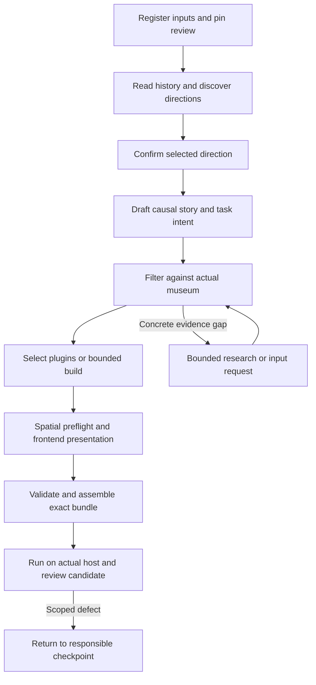

# Story Workflow Architecture and Acceptance Contract

Status: implementation proposal; documentation delivery only. Inspected baseline: Main `5dd5f32`, 2026-10-26. Owner: maslan for Story/game-making; wehan for shared contracts, execution, assembly and host; wcheung for source/museum production. This document does not authorize paid calls, publication or changes to another owner's code.

## 1. Scope and evidence

A production request supplies historical material and a prepared museum/tour already connected to its authoritative review content. The coordinator produces a private runnable candidate and complete downloadable bundle. Story prose is an intermediate artifact. Human acceptance and public release are separate gates.

Normative requirements are [PRD ownership](../PastPort_PRD_EN.md#s2-9), [acceptance](../PastPort_PRD_EN.md#s2-10) and [game making](../PastPort_PRD_EN.md#s3-1). Existing signatures live in [domain messages](../../src/pastport/domain/modules.py), [ports](../../src/pastport/ports/modules.py) and [execution services](../../src/pastport/ports/execution.py). The [SDK reference](sdk-v1/README.md) describes targets rather than installed production capabilities.

Additional inspected counterparts, outside this checkout:

- `work/story-agent-demo-publish/docs/technical/STORY_AGENT_AUTOMATION.md`: proposed production coordinator, request/result envelopes, failure handling and milestones.
- `work/story-agent-demo-publish/prototype/story-agent-demo/PRD.md`: interaction/acceptance requirements and latest 3D exceptions.
- `work/story-agent-demo-publish/prototype/story-agent-demo/README.md`: recorded implementation evidence and explicit limits. Its reported checks were not rerun for this document.

The product currently prefers registered IDML/Links text where available; the Story-specific automatic pilot accepts a complete PDF plus prepared reviewed tour. Normalize either through the source adapter with original provenance. Do not make PDF mandatory for an otherwise complete registered corpus, or silently substitute a PDF for the user's designated source.

### Actual implementation versus target

| Area | Observed baseline | Required work before claiming integrated delivery |
|---|---|---|
| Main contracts/player | Executable wire 0.1.0; `t1a-single-task`, native inspect/caseboard; immutable strict Pydantic contracts. | Shared SDK museum/presentation/plugin models, generated schemas and compatible loader/host. |
| Editorial workflow | Existing StateGraph, SQLite checkpointer, candidate/review interrupts, execution services and JS rules. | Story production graph nodes, typed adapters and recovery integration. A JSON content adapter is not a generative Story Agent. |
| SDK reference | SDK 1.0.0, plugin API 1.0.0, wire 0.2.0 synthetic examples/checkers. | Production shared Python models, installation/isolation, complete reference validation and real host integration. |
| Evidence/Matched Environment/Stylization packages | Three optional 0.1.0 SDK distributions now have local build/install, strict typing and offline regression evidence in the Change Log. They are not mounted into Main runtime. | Pin each delivered distribution/version and implement explicit Main adapters. Neither installation nor offline tests establish Main runtime integration. |
| Story Demo | Hand-authored, source-only 3D interaction counterpart; private assets excluded. Recorded 22 deterministic plus 7 focused checks and partial browser checks. | Automatic Story-to-Presentation generation, full chapter/browser/device checks, reverse walking transition and human acceptance remain open. |
| Final product | No integrated automatic Story production bundle established by this review. | Complete dependency closure on actual compatible host, real source/tour, bounded generation, user play review and separate release authorization. |

Do not copy the Demo wholesale, revive removed world-space 2D standees, or impose its historical character/object count on a new project. Dialogue portraits remain valid. A panorama reference package cannot claim freely navigable 3D capability.

## 2. Architecture and ownership

Use one owned production worker with dependency-injected typed boundaries. Logical roles do not require permanent agents or separate paid models. Keep domain/ports independent of SDKs, LangGraph, provider clients and database drivers.

| Boundary | Responsibility | Authoritative output |
|---|---|---|
| Input/source adapter | Register original files, resolve corpus, read located historical text and extraction gaps. | Source refs/corpus; no new story or source approvals. |
| Read-only museum adapter | Resolve the tour's existing review connection; export/pin reviewed entries, object identity and scene capabilities. | Museum snapshot and review receipt; no fixture DB rebuild or review writes. |
| Story module | Discover direction, draft/revise causal narrative, use actual museum, review heritage dependence and consequences. | NarrativeDraft, FilterReport and semantic presentation intent. |
| Gameplay preparation | Match registry capabilities, pin configuration/assets; request a bounded implementation only for a genuine gap. | Plugin lock/specification/build receipt. |
| Frontend presentation | Convert semantic intent to reachable observation, dialogue, overlays and navigation configuration. | PresentationPackage plus versioned 3D/staging extensions when approved. |
| Shared assembly/host | Validate dependencies/reviews/resources, assemble immutable package, execute rules/actions and persist saves. | Bundle, validation, private preview and authoritative completion state. |
| Coordinator | Enforce transitions, quotas, checkpoints, cancellation and delivery completeness. | Run/result and stage receipts; cannot approve its own history, rights or human experience. |

Story-owned implementation should begin under `src/pastport/adapters/narrative_maslan/`; plugin implementations use separate plugin directories. Shared type/host changes are wehan-owned PRD T0/T4/T6 work. Freeze an exact corpus/museum/bundle counterpart before joint integration; owner-confirmed shared changes include generated schemas, fixtures and compatibility notes.

## 3. Contracts, fields and version strategy

### Reuse existing executable contracts

All existing `Contract` subclasses are frozen/strict and reject extra fields. Reuse canonical definitions rather than create an incompatible local type with the same name.

| Contract/interface | Concrete fields or signature to preserve |
|---|---|
| `ArtifactRef` | `artifact_id, project_id, kind, schema_version, content_version, sha256`. Resolve through controlled registry; verify actual payload/hash/project/kind. |
| `SourceLocator` | `source_id, source_version, file_sha256, page_index, printed_page, paragraph_or_region`; original page or region required. IDML uses original member/story/ranges, not fabricated PDF pages. |
| `Claim` | `claim_id, version, text, site_id, structure_id, time_scope, content_kind, support, refute, judgment, reason, approved_wording`. Preserve historical_fact/interpretation/original_fiction and conflicting/insufficient judgments. |
| `DiscoverRequest` | `index, requirements, runtime_capabilities`; `discover(request, context) -> ModuleResult[CandidateSetDraft]`. |
| `StoryCandidate` | `candidate_id, premise, source_refs, supported_opportunities, blocking_gaps, proposed_player_actions, human_work_estimate_minutes, dimension_scores, recommendation_reason, reversal_conditions`; five distinct evidence/visual/character/solvability/spatial scores. |
| `SelectedCandidate` | `project_id, candidate_set_ref, candidate_id, requirements_ref, policy_ref, actor_id, reason`; existing human direction authority remains until an explicit policy change is implemented. |
| `DraftRequest` | `evidence: ApprovedEvidenceView, selected_candidate, requirements, runtime_capabilities, locked_fields`. The view's hash binding is not authority; consult review service. |
| `NarrativeDraft` | `package, authoring_report, unresolved_items`. Current NarrativePackage: version/project envelope plus `evidence_package_hash, candidate_id, routes, game, fiction_notice`. |
| Per-task authoring report | `task_id, player_action_id, heritage_refs, property_used, premise_source_ids, player_premises, inference_steps, accepted_answer, character_goal, effect_ids, consequence_read_scene_id, observable_feedback, removal_test, substitution_test, counterexample`. |
| Revision/review | Reuse `ReviseRequest(draft_request, narrative, revision_request, impact)` and `NarrativeReviewRequest(narrative, evidence, requirements, runtime_capabilities)`. `NarrativeReview.human_review_required` remains true. |
| `NarrativePort` | Async `discover/draft/revise/review(typed_request, ExecutionContext) -> ModuleResult[concrete payload]`. ModuleResult carries `outcome, payload, issues, evidence_requests, changed_ids, reason`; completed requires payload. |
| Execution | `ExecutionContext(metadata, cancellation)`; injected `ModuleServices(models, sources, tools, research, usage)`. No direct provider/research bypass. |
| Assembly/validation | Existing synchronous `AssemblyPort.assemble(AssemblyRequest) -> AssemblyResult` and `PackageValidatorPort.validate(PackageValidationRequest) -> ValidationReport`. Existing requests are legacy wire; new bundle dependencies require an explicit versioned extension. |

### Target reference contracts; not executable Main declarations

The canonical [reference schema](sdk-v1/sdk-contracts.schema.json) is the field authority for SDK 1.0.0/API 1.0.0/wire 0.2.0. Main's legacy ArtifactKind and NarrativePackage cannot already carry all these fields. No unknown-field tunneling or changing schema_version to make an old payload appear upgraded.

| Target artifact | Required semantic payload |
|---|---|
| `SourceCorpus` | SDK envelope (`contract_family, schema_version, kind, project_id, artifact_id, content_version`), `records, unresolved_items`; preserve source associations and locations. |
| `MuseumPackage` | Envelope plus `source_corpus_ref, tour_ref, state, views, connections, objects, entries, anchors, unmatched_record_ids, unresolved_items`. `ready_for_review` is not human approval. |
| `MuseumEntry` | `entry_id, object_id, text, language, source_record_ids, claim_ids`; read this text directly rather than a second manual list. |
| `MuseumAnchor` | `anchor_id, object_id, view_id, panorama_sha256, yaw, pitch, radius_degrees, match_state, visual_check, legible_features, basis_refs`. Candidate match is not confirmed; text attachment does not prove visible lettering. |
| `FilterReport` | Envelope plus `museum_ref, decisions`. Each decision: `task_id, decision: keep/revised/blocked, reason, missing_refs, required_plugin_id`. Narrative prose may call a task rejected/dropped; serialize it as blocked/excluded under this schema, never invent a `reject` enum. |
| `PresentationPackage` | Envelope plus `museum_ref, museum, chapter_id, scene_bindings, task_bindings, navigation_bindings`; embedded museum and ref must match. GameContent does not contain museum. |
| `GameBuildRequest` | `request_id, project_id, source_corpus_ref, museum_ref, evidence_ref, route_refs, requirements_ref, run_policy_ref`. Proposed GameMakerPort.build coordinates NarrativePort/checks/assembly; does not replace it. |
| `GameBuildResult` | `request_id, project_id, draft_ref, presentation_ref, filter_report_ref, plugin_refs, bundle_ref`; require actual complete bundle for successful build. |
| Plugin building | Request: `request_id, project_id, plugin_id, spec_ref, plugin_api_version, run_policy_ref`; result: `request_id, project_id, plugin_ref, build_receipt_ref`. |
| `PluginManifest` | `plugin_id, plugin_version, plugin_api_version, runtime_profile, required_host_capabilities, logic_entry, view_entry, schemas, resource_ids, license, files`; hash every code/dependency file. |

Freeze production Python types/schema dispatch before implementation against target-only shapes. Preserve wire 0.1.0 load/action/save behavior with separate dispatch. Breaking released field/lifecycle/result changes require a major version; optional capabilities still require negotiation. A 3D/staging extension needs its own explicit schema/capability version rather than invented fields in SDK 1.0.0.

### Proposed production envelope and 3D adapter extensions

These are proposed application DTOs version 0.1.0, not existing endpoints or canonical SDK types. M0 must freeze exact names/enums/ref kinds and generated schemas.

- `StoryProductionRequest`: `request_id, project_id, source_input_ref, tour_ref, requirements_ref, runtime_capabilities_ref, policy_ref, execution_grant_ref, publication_grant_ref?`. `source_input_ref` resolves registered PDF or corpus; the earlier proposal's `pdf_ref` is mapped explicitly by the transport adapter. Scope the idempotency key to project plus canonical request hash; same key/different body conflicts.
- `InputLock`: exact source/corpus/tour/museum/review/capability/policy refs, adapter version and conversion receipt. Never store credentials in it.
- `ReviewBinding`: `project_id, backend_id, export_version, content_revision, authentication_ref, museum_snapshot_ref`; authenticate server-side. Review text and spatial revisions remain distinct; the same object in multiple views shares review authority.
- `SceneCapabilities`: `scene_id, revision, coordinate_frame, units, original_render_ref, styled_render_ref, spawn_pose, walkable_ref, collision_ref, occurrences, navigation_links`. Occurrences bind stable object/scene IDs, transform/region, visibility/reachability status and provenance. Links pin departure region, destination and arrival pose/original direction. Unknown geometry cannot be called traversable.
- `StagingIntent`: stable cast/scene/beat/task IDs, presence/entrance/exit conditions, speaking order, actions, overlay timing and requested observation mode. Declarative validated data only; no arbitrary scripts or invented coordinates from Story.
- `StoryProductionResult`: `run_id, project_id, revision, status, input_lock_ref, stage_report_refs, unresolved_issues, usage_receipt_refs, next_action`; statuses running/awaiting_input/awaiting_review/blocked/failed/cancelled/candidate_ready. Candidate-ready additionally requires bundle/preview/narrative/filter/presentation/plugin-lock/validation refs. Publication is a separate command/receipt, not an inherited run permission.
- `StageReceipt`: stage/invocation identity, exact input/output refs, implementation/skill/model versions, attempt, status, usage receipt refs and safe error. Report checks as passed/failed/not_run, with evidence refs; do not embed fabricated human approvals.

A tour URL alone is insufficient. Use its authenticated configured resolver rather than scan localhost services. If review export, frame mapping or rights are missing, return a specific actionable blocker.

## 4. Source and museum flow

1. Register original PDF or reuse the registered corpus; bound input bytes/pages/images and run CPU-heavy extraction outside the event loop. Preserve complete located text, inaccessible/needs-OCR states and original hashes. Do not resend all images for text-only discovery.
2. Build a chronology/entity/uncertainty view from located material, preserving fact, interpretation and fiction boundaries. Research only concrete gaps using EvidencePort.inventory/index/research and the shared metered research executor.
3. Resolve the supplied prepared tour and its review binding read-only. Export reviewed museum entries and object/view identity at one pinned revision. Preserve existing human edits; never rebuild a review database from fixtures.
4. Cross-check project/source/tour/museum refs and historical object binding. Two views of one object are occurrences, not new historical entities. Ambiguous matches, unmatched records and unavailable details stay explicit.
5. Freeze the museum snapshot used for filtering. Verify original/styled appearances, confirmed anchors, legible features and safe navigation separately. Stylization may change visible detail; generated content cannot establish historical evidence.
6. If source/review changes later, create a new snapshot, compute dependency impact, invalidate affected tasks/presentation/approvals and preserve unrelated approved artifacts/manual locks. Preview stays pinned and can announce a newer revision; it must not mix old tasks with new text silently.

Rights follow every source, portrait, audio, code and original/derived image through packaging. Reuse Asset `rights_state, allowed_uses, rights_basis`, original/derivative hashes and source locator. Unknown/restricted public rights block public distribution; an authorized internal preview still needs rights permitting that scope. Online visibility or a successful download grants no reuse permission. Keep private materials outside source publication while retaining registered provenance and exact content hashes.

## 5. Ordered checkpoints and bounded routing



| Checkpoint | Required artifact/check before advancing | Failure/repair boundary |
|---|---|---|
| CP0 Input lock | Readable source, exact reviewed museum and supported capabilities; scope/rights/grants verified. | Await owner/input; do not fabricate approvals or reprepare tour implicitly. |
| CP1 Discovery | Full-source historical context; up to three candidate directions with evidence/action/causality risks and reasons. | Bounded evidence request or no_feasible_story. Keep existing authenticated human selection gate until policy extension is accepted. |
| CP2 Story | Selected direction, character goals/conflict/choices/clues, causal effects and ending paths; authoring report per task. | Review logic, language and heritage dependence. Preserve locks; target affected IDs rather than rewrite everything. |
| CP3 Museum filter | Every formal task uses the pinned museum text/object and available observation detail; keep/revised/blocked decision and missing refs. | Revise dependencies and recheck; exclude blocked tasks from final narrative. Optional reading cannot hide a mandatory premise. |
| CP4 Gameplay | Compatible registered plugin/config/assets first; exact API/version/hash/capabilities pinned. | Missing mechanic gets explicit specification and bounded implementation/search; unsupported host blocks delivery. |
| CP5 Frontend | Read filtered story and selected plugin capabilities; spatial preflight precedes UI generation. Bind scene/task/navigation, safe observation regions, dialogue and overlays. | Unreachable clue returns to filter; missing host capability to owner; display defect stays here. Do not change approved rules to suit layout. |
| CP6 Assembly | Complete dependency DAG and reviews, exact plugin/resource closure, generated types/checks and compatible runtime. | Shared assembly preserves approved content; incompatible/missing dependency fails candidate. |
| CP7 Actual host | Load exact bundle; exercise first task, meaningful consequence, saved restore, branch termination and navigation. | No screenshot-only playable claim. Human experience acceptance remains explicit. |

Proposed default policy: at most three directions, two targeted repair rounds per affected stage and two documented hard-blocker direction switches. These limits are configurable authorized policy, not already enforced Main behavior. Prefer one initial direction, not three fully written stories. For complex missing mechanics compare at most three open-source candidates once; include understanding/license/dependency/adaptation/testing cost. Stop on exhaustion and retain partial artifacts.

A mechanic specification must define goal, player actions, local rules, completion/failure, configuration/assets, state/commands, accessibility, time/randomness, evidence use and host capabilities. New code requires bounded filesystem/network access, timeout, no production secrets, license/type/behavior/install/isolation checks and a verified build receipt. A JavaScript VM alone is not a security sandbox. Until safe host/isolation exists, use supported trusted built-ins or report a blocker. Completion/reward/story advancement are host-authoritative, never plugin/model claims alone.

## 6. Execution, cancellation and recovery

Reuse the owned [workflow worker](../../src/pastport/workflow/worker.py), shared execution runtime and authoritative review/usage stores. Keep graph state small: IDs/refs/revisions, not repeated PDFs or complete scenes. Checkpoints track execution; database authority determines grants, reviews, budget and legal transitions.

- Existing BudgetPolicy fields are `max_model_requests, max_input_tokens, max_output_tokens, max_search_requests, max_fetch_requests, max_active_seconds, max_cost_microusd`. Reserve before external work, settle actual available usage and inspect RemainingLimits. Source/model/Skill text cannot increase these limits.
- Existing ExecutionMetadata carries project/run/operation/execution key, input/policy/skill/model refs, reservation, actor, UTC deadline, remaining limits and allowed tools. Reuse it with cancellation; current metered roles are research/story. New role values need a shared extension; scoped frontend/gameplay skills may use authorized story execution initially.
- Bind invocation identity to run/stage, input hashes, policy/skill/model/adapter versions and revision. Persist successful artifacts and usage receipts before advancing. Model results are reused only for the same identity; no implicit provider fallback.
- Check cancellation before and after external operations, between bounded chunks and before artifact publication. Cancel child work, release owned resources with context managers/finally, preserve completed refs and settle outstanding reservations. An already incurred charge remains visible.
- Resume uses authenticated project/run identity, expected revision and action idempotency. Revalidate grants, review changes and remaining budget; do not reset unknown usage, replay settled effects or invent exactly-once external billing. Reconcile unknown provider outcomes before retrying.
- Isolate approval interrupts from side effects; resumed graph nodes may execute again. CAS/transactions and durable operation receipts protect assembly/installation/save writes. Keep locks and incompatible revision edits explicit.
- Bound concurrency and I/O; begin with a single owned worker and short SQLite transactions. Introduce queues/distributed workers only for measured need. Player rules stay in shared JS, not a duplicate Python engine.

Errors must identify input/version/ref mismatch, review unavailable/conflict, missing evidence/object, rights scope, unreachable clue, host incompatibility, budget exhaustion, cancellation, provider unavailability, validation and save conflicts. Include safe message, stage, retryability, affected refs and next action; exclude secrets/private source payloads. Never report a generic success after fallback prose.

## 7. Acceptance checklist and evidence

Each check records candidate/input lock, implementation/runtime/plugin versions, environment/device, commands or steps, actual result, evidence refs, owner and unresolved limits. An unchecked item is not_run. Offline package, fixture, real material, paid provider, browser, performance and human evidence are separate layers.

| ID / PRD mapping | Executable acceptance | Owner / evidence |
|---|---|---|
| S01 / C01,C15 | Reject unknown/extra fields, wrong project/kind/hash/schema, stale review and legacy payload misreading; preserve wire 0.1.0 actions/saves. | wehan; positive/negative contract vectors and generated-schema diff. |
| S02 / C02–C05 | Real registered source has reproducible located text; museum reads same reviewed entries, preserves IDs/return links and reports ambiguous/missing matches; styled details rechecked. | wcheung + adapter owner; real extraction/review/snapshot receipts, visual sample denominator. SDK fixtures alone insufficient. |
| S03 / C06 | Remove a required object, obscure detail or alter reviewed text: filter revises/blocks task; no invented object, stale answer or inaccessible mandatory clue survives. | maslan; table-driven filter tests plus one real sample. |
| S04 / C06 | Every task has player-known premises, inference/action, removal/substitution/counterexample tests and later observable state consequence; branch endings terminate/recover. | maslan; authoring report, JS rule paths and human comprehension feedback. |
| S05 / C07 | Native inspect/caseboard plus 3×3 non-rotating jigsaw (or agreed substantially different mechanic) run through same actual API/host; no site-specific branch. | maslan + wehan; real host/browser evidence. Pair matching reference alone insufficient. |
| S06 / C08,C09 | Start/pause/exit/retry/restore plugin; duplicate completion/action and stale revision cannot duplicate rewards; reject foreign package/project/save and partial effects. | wehan + plugin owner; state vectors, concurrent/CAS and restart tests. |
| S07 / C10,C14 | Optional browsing never completes task. First task follows guidance; reachable observation needs valid arrival/read/confirm; high/inaccessible objects use explicit safe view-only mode; missing identity/distance alone never completes. | presentation + host; actual browser steps on pinned bundle. |
| S08 / C10,C14 | Single/double click arbitration, focus closes obstructing panels but preserves markers/progress; correct source reopens. One foreground game/ending is centered; panels restore; meaningful choices wait for input. | presentation; desktop/touch and keyboard evidence, no click-through. |
| S09 / C03,C05,C10 | Both directions of portal/button/walking transition in original/styled modes preserve source arrival pose and render mode; safe spawn/ground/collision validated. | 3D/host owner; browser evidence for every direction, not assumed from one. |
| S10 / C11 | Unknown plugin, forged receipt, undeclared file/resource, traversal/symlink/hash change, API mismatch and resource/time excess fail before execution; no privileged generated-code load. | wehan + plugin owner; install/isolation negative tests and cleanup evidence. |
| S11 / C12 | Cancel at model/research/plugin/assembly boundaries; restart after completed stage and uncertain charge; retries/repairs stop at caps, usage persists, no false success. | all; deterministic fault injection, separate live-provider evidence only if authorized. |
| S12 / C13 | A second source/tour changes theme/tasks/presentation/config without site-ID branches or manual repackaging; exact versions remain reproducible. | all; second complete bundle, dependency and cost receipts. |
| S13 / C14 | Full story route and main endings, readable CN/EN, correct speakers/portraits, touch/keyboard, saves/conflicts and device layouts; later clues do not prematurely finish tasks. | all; exact bundle browser walkthrough and user play feedback. |
| S14 / release | Rights per output scope, no private source/media/secrets in publication, exact closure and rollback target/owner/steps validated. Public/Git/deploy actions require their own authorization. | delivery owner; scoped rights/release/rollback receipts. |

Frontend acceptance follows latest Demo corrections: no central world-space 2D standee; supported portraits remain. Do not require unnatural approach through glass/walls/voids. Natural multi-character choreography requires real supported assets/routes and separate evidence. Gesture/camera/fountain/kitchen effects remain optional future capability work with evidence, explicit camera consent, deterministic cleanup and accessible alternatives.

Measure browser/version/device/resolution. PRD initial targets are stable 30 fps interaction animation and P95 feedback at most 200 ms excluding external network waits; confirm on agreed devices and realistic museum size. Repeat mount/exit and cancel cycles for leaks. Tiny synthetic fixtures establish neither performance nor enjoyable play.

Existing offline regression entrypoints, after installing locked dependencies:

```sh
uv run --no-sync pytest tests/test_contracts.py tests/test_module_check.py tests/test_module_integration.py tests/test_shared_execution.py tests/test_workflow_control.py tests/test_workflow_branches.py
python3 docs/technical/sdk-v1/check_contracts.py --owner all
node docs/technical/sdk-v1/check_plugin.mjs
python3 -m unittest discover -s docs/technical/sdk-v1 -p test_reference_contracts.py -v
uv run --no-sync python tools/check_repository.py
```

These commands are existing foundations, not new Story acceptance coverage or a claim that they passed in this document delivery. Add focused implementation tests for S01–S14 in the owning modules, run strict typing on new Python and affected tests/checks, then inspect the diff. Run the repository/handoff gates, which recognize explicit anchors and registered reference material while retaining negative checks. Do not run generation or paid calls for documentation verification.

## 8. Implementation order and completion boundary

| Milestone | Owner / dependency | Concrete deliverable and exit gate |
|---|---|---|
| M0 Freeze boundaries | maslan + wehan + wcheung; actual counterpart selection | Confirm PDF/corpus normalization, review export/3D capability mapping, DTO/schema/ref versions, exact offline SDK distributions, trusted plugin host availability and human direction policy. Contract vectors include stale/foreign/missing cases. |
| M1 Read-only adapters | source/museum owners; M0 | Registered corpus + pinned reviewed museum + InputLock; rights and extraction gaps. Offline tests first, then one authorized real material. No new stylization or review DB writes. |
| M2 Persistent Story slice | maslan; M1, existing execution authority | Discover/confirm/draft/filter/review with durable receipts, targeted repairs, source/fiction separation, cancel/resume and per-task reports. A typed story alone is not complete delivery. |
| M3 Plugin readiness | maslan + wehan; T0/T4 and M2 | Registry matcher, exact config/assets, bounded builder where authorized; actual host lifecycle/isolation and distinct mechanic evidence. Implement shared host gaps in parallel, never pretend a test host is production. |
| M4 Frontend binding | presentation + 3D owners; M2–M3 | Spatial preflight, semantic staging conversion, PresentationPackage and browser observation/navigation/overlay checks. Bind exact same museum revision. |
| M5 Complete private candidate | coordinator + assembly owner; T2–T5/M1–M4 | One request to immutable complete bundle/private preview, integrity/rights/rule/recovery checks, full route and human feedback. No manual artifact copying between internal modules. |
| M6 Reuse/release readiness | all; M5 accepted + second project | Second complete game, measured cost/performance/security, supported legacy regression and rehearsed rollback. Release/publication only under separate explicit authorization. |

Open decisions for M0: exact approved tour/review export and fixture; whether pilot supports PDF-only plus corpus reuse; shared extension version/ref-kind allocation; production 3D coordinate/collision authority; first safe plugin host/isolation scope; auto-selection policy; real-sample rights; fixed desktop/mobile devices and human acceptance owner. Each unresolved capability has an owner and next action before claiming integrated readiness.

This document adds architecture, implementation order and acceptance criteria only. It does not implement Story automation, integrate the offline SDKs, change Demo/UI/shared code, generate a story, run providers, or establish runtime/human/release acceptance.

Documentation verification: repository/handoff checks now pass after the SDK integration corrected explicit-anchor and registered-reference handling; negative cases still reject missing files/sections and unregistered parallel documents. Markdown links, fence balance and `git diff --check` pass. This Story document remains an implementation proposal; SDK/Main regression evidence does not certify the proposed automatic Story workflow.
