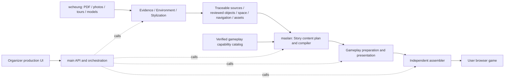

# PastPort Development Handoff

Use the current `main` as the integration baseline. **wcheung owns the pipeline before Story; maslan owns Story and the downstream game-production pipeline.** The current implementation is available in main; neither developer needs to recover implementation from historical Demo branches. This does not mean every commit on every historical branch has been merged.

See the [Technical PRD](docs/TECHNICAL_PRD.md) for system architecture and contracts, and the [README](README.md) for installation, startup, accounts and storage locations. This handoff covers ownership, source locations, inputs, outputs, change impact and next tasks.

## 1. Ownership and handoff boundary



| Owner | Modules | Handoff responsibility |
|---|---|---|
| wcheung | Evidence, Matched Environment, Stylization and their upstream main adapters | Deliver the original PDF and extracted sources, stable object/source mappings, saved descriptions and review state, environment snapshot, viewpoints/stations/navigation, and scene/media manifests and hashes for the same project. |
| maslan | Story, Gameplay Preparation & Presentation, their main adapters, assembly and player runtime integration | Consume the canonical upstream inputs and produce checked narrative tasks, executable gameplay, presentation bindings and a complete playable bundle. |
| Both | Shared contracts, main's public production API and compatible SDK/runtime versions | Identify all consumers before changing a contract; update and test affected consumers together. |

Organizer is the organizer-facing production UI; User is the player-facing game UI. Preserve the existing Organizer workflow. New player accounts, cross-device saves and analytics are later work.

## 2. wcheung: where to change code

| Change | Primary source location |
|---|---|
| PDF extraction, photo identification, evidence mapping and mapping-PDF export | [Evidence SDK](packages/evidence-sdk/README.md): `packages/evidence-sdk/src/pastport_evidence/`, especially `application/`, `adapters/`, `domain/` and `ports/`; public entry points are `sdk.py` and `cli.py`. |
| Environment building, object placement, shared VR/3D review and navigation | [Matched Environment SDK](packages/matched-environment-sdk/README.md): `packages/matched-environment-sdk/src/pastport_matched_environment/`. |
| Review and spatial implementation | That SDK's `application/review_repository.py`, `vr_content.py`, `vr_positions.py`, `scene3d_review.py`, `scene3d_arrows.py`, `scene3d_projection.py` and `spatial_analysis.py`. Trusted review markup lives in `reference_environment/review.html`. |
| Style and appearance processing | [Stylization SDK](packages/stylization-sdk/README.md): `packages/stylization-sdk/src/pastport_stylization/`. Keep style execution separate from the environment SDK. |
| Upload/import and upstream-to-main integration | [organizer_native.py](src/pastport/adapters/organizer_native.py), [organizer_review.py](src/pastport/adapters/organizer_review.py), [organizer_review_environment.py](src/pastport/adapters/organizer_review_environment.py), [matched_environment.py](src/pastport/adapters/matched_environment.py), [environment_spatial.py](src/pastport/adapters/environment_spatial.py), and [source_lineage.py](src/pastport/application/source_lineage.py). |

### Inputs and outputs

Current inputs depend on the entry point: original PDF plus photos; original PDF plus mapping PDF and 360 tour; original PDF plus a native matched-VR archive; or original PDF plus a native mounted two-view 3D archive. Generation requires explicit, bounded authorization; installation and upload do not authorize model or Marble calls.

The Story handoff is more than a screenshot or raw model. Deliver traceable source documents, an environment snapshot, object records and assets. The shared snapshot contract is `EnvironmentSnapshot` in [story_inputs.py](src/pastport/domain/story_inputs.py); [story_materials.py](src/pastport/adapters/story_materials.py) implements the reading/projection boundary. Actual typed models are authoritative; do not create a parallel unvalidated JSON format.

Preserve project, object, source and scene identities; separate original-PDF and mapping-PDF hashes/page references; review/spatial revisions; coordinate systems; calibration; and navigation. Unknown identity, scale or location must remain explicitly unknown rather than being guessed for downstream convenience.

### Next task: a raw 3D model plus PDF entry point

1. Obtain a real export from a phone-capture service. Verify file format, textures/dependencies, units, axes, origin, scale, collision/floor support and usage rights. SpAItial Echo-3 is a candidate, not an integrated provider. Validate exported files first, then determine whether API integration is available and appropriate.
2. Add an input adapter for a raw model plus PDF, distinct from the existing native mounted-3D archive. Identify and locate objects, match them to source evidence, and send candidates through the existing shared VR/3D review workbench. Do not create a second review authority.
3. Prepare stations, task-relevant visibility/accessibility and navigation, then emit the existing environment contract. The current game host supports two viewpoints; arbitrary model/viewpoint counts require explicit adaptation, not a renamed file extension.
4. With maslan, run the same environment through Story, gameplay, presentation and assembly. Verify saved/reopened object positions and arrows, source mappings, navigation and resource integrity. Distinguish captured geometry from generated completion. A rendered model alone does not prove a playable, evidence-matched environment.

## 3. maslan: where to change code

| Change | Primary source location |
|---|---|
| Public Story SDK | [Story SDK](packages/story-sdk/README.md): `packages/story-sdk/src/pastport_story/client.py` and its CLI. |
| Story generation, compilation and reference constraints | [story_workflow.py](src/pastport/adapters/story_workflow.py), [story_authoring.py](src/pastport/application/story_authoring.py), [story_compiler.py](src/pastport/application/story_compiler.py), [story_plan_schema.py](src/pastport/application/story_plan_schema.py), and [story_reference_contract.py](src/pastport/application/story_reference_contract.py). |
| Story models, Skill and compatibility/reuse | [story_plan.py](src/pastport/domain/story_plan.py), [modules.py](src/pastport/domain/modules.py), [narrative Skill](skills/narrative/SKILL.md), and [story_reuse.py](src/pastport/adapters/story_reuse.py). The Skill is maintained once as source and bundled by the shared runtime; do not hand-maintain another installed copy. |
| Gameplay SDK and preparation | [Gameplay SDK](packages/gameplay-sdk/README.md): `packages/gameplay-sdk/src/pastport_gameplay/`, plus shared [gameplay_preparation.py](src/pastport/application/gameplay_preparation.py) and [gameplay_verifier.py](src/pastport/adapters/gameplay_verifier.py). |
| Plugin rules, capabilities and presentation | [gameplay/plugins](gameplay/plugins/), [gameplay.mjs](gameplay/gameplay.mjs), [prepared-game.mjs](gameplay/prepared-game.mjs), and [prepare_presentation.mjs](tools/prepare_presentation.mjs). Keep capability declarations aligned with the real plugin implementation. |
| Assembly, player frontend and engine | [tools/game-package](tools/game-package/), [frontend/game](frontend/game/), and [src/pastport/player](src/pastport/player/). Maintain a single authoritative engine implementation. |
| main orchestration and stage handoffs | [game_making.py](src/pastport/adapters/game_making.py), [organizer_production.py](src/pastport/adapters/organizer_production.py), and [organizer.py](src/pastport/application/organizer.py). The public HTTP boundary is [api/organizer.py](src/pastport/api/organizer.py). |

The Story and Gameplay packages are public facades backed by shared `src/pastport/` implementation. Changing only a facade is insufficient when the real behavior lives in the shared runtime. Update the implementation and rebuild compatible runtime/SDK packages together. Installed packages use bundled resources rather than loading files from a working checkout.

### Inputs and outputs

| Stage | Input | Output and consumer |
|---|---|---|
| Story | `StoryRequest`: original PDF, source document, environment snapshot, media directory, brief, Skill and a new output directory. Generation also reads the gameplay capability catalog. | `StoryResult`: readable story, `NarrativeDraft`, validation, input lock and budget receipts. New runs generate content plans; the compiler creates internal structure. Saved runs retain their pinned contract. |
| Gameplay preparation | Checked Story, source/environment identity, explicit gameplay intents and capabilities. | `GameplayPlan`, exact plugin parameters, solver/lifecycle checks and canonical environment. Missing gameplay declarations must not silently fall back to reading. |
| Presentation | The same Story version, preparation, existing museum and spatial bindings. | `story-input.json` and exact task/object/station/view/UI bindings. |
| Assembly | Presentation outputs, story/environment/media, frontend, plugins and shared JS engine. | A browser-playable game bundle and resource manifest. Python SDKs remain on the production side; they are not shipped to players. |

### Next task: story and gameplay quality

1. Use one existing real material set to create a short, complete experience. Clarify player identity, opening goal, conflict, task sequence and visible choice consequences; reduce mandatory consecutive reading.
2. Make actual heritage evidence necessary for reasoning and progression. Reading and source checks must serve the task. An unrelated quiz followed by a generic puzzle is not sufficient integration.
3. Design within verified plugin capabilities. For a new mechanic, define configuration, actions, state and completion/failure/exit behavior, then verify/register it before allowing Story to use it. Do not let the model invent executable state-machine rules.
4. Test fresh generation, compatible reuse, failure/retry, exit/reload recovery, viewpoint transitions and endings. Evaluate quality through actual play. Schema validity is not human acceptance of story quality or historical accuracy.

## 4. Change rules and downstream impact

| Change | Required delivery | Potential impact |
|---|---|---|
| Internal implementation changes with compatible input/output semantics | Update the module and its real shared implementation, build matching packages and integrate through main. Include new dependencies/resources in the distribution. | Organizer usually stays unchanged. |
| wcheung changes environment/source output | Document field, identity, unit, revision, resource-layout and semantic changes; adapt actual consumers. | Story, spatial checks, gameplay/presentation, assembly and main upload/review adapters may all be affected. |
| maslan changes Story output | Update compiler contracts, schemas, Gameplay readers, presentation and main wiring; preserve old locks or define an explicit migration. | Gameplay, assembly and runtime rules; coordinate with wcheung if new requirements exceed environment capabilities. |
| A new plugin requires new player controls | Update plugin capabilities, verifier, User frontend and assembly resources together. | A compatible Organizer API can remain unchanged; the player frontend does not gain new controls automatically. |
| main changes its Organizer API or progress states | Coordinate and preserve compatibility where possible; version and migrate incompatible changes. | `frontend/organizer/` must be adapted when its contract actually changes. |

Avoid changing established project/object/source identities, review authority, separation of VR and 3D positions, input locks, usage receipts, global reward ownership, successful game snapshots, or public production API semantics unnecessarily. Do not make a pipeline pass by removing validation, hardcoding a sample quantity, substituting caches implicitly or retrying models automatically. Do not copy an engine from an old Demo branch or mix frontend, plugins and assembly back into one directory.

An unchanged interface means compatible types, required fields, units, coordinates, identity meanings, states, resource layout and error behavior—not merely unchanged field names. Determine affected consumers from code and integration checks rather than owner names. Shared runtime changes can still affect both Story and Gameplay.

## 5. Collaboration and delivery checks

- Start from current main and work on a development branch. Historical branches are not required dependencies; avoid two people editing main directly at the same time. Integrate completed changes back into main and verify the combined workflow.
- State the changed modules, contract changes, affected consumers, matching runtime/SDK versions, test evidence and remaining limits. Existing wheels do not update when source changes: rebuild and verify installation contents.
- Do not trigger model or Marble calls without authorization. Use the same-source default materials for zero-call regression first. Real generation needs an explicit budget and retained receipts; preserve previous failures.
- wcheung runs the relevant SDK offline suites using each package README. maslan runs Story/Gameplay and real JS lifecycle checks. Both run the root checks below, verify installed packages outside the checkout, and inspect any affected rendered UI.

```sh
.venv/bin/python -m pytest -q tests
.venv/bin/mypy --strict src
node --test tests/test_organizer_i18n.mjs
node tools/check_javascript.mjs
.venv/bin/python tools/check_repository.py
.venv/bin/python tools/check_handoff.py
git diff --check
```

Installation, offline tests, saved-result replay, fresh model generation, browser playability, human quality acceptance and public release are separate evidence levels. Do not substitute one for another. README owns startup/navigation, the technical PRD owns system specification, and this file owns team responsibilities; do not duplicate them into competing guides.
