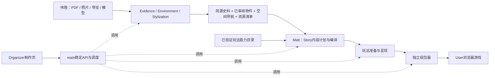

# PastPort 开发交接

以当前 `main` 为唯一集成基线。伟胜负责Story之前的材料、环境和外观链路；Matt从Story开始负责剧情、玩法及下游制作。现有实现已在main，不需要回历史Demo分支取代码；这不表示所有历史分支的每个提交都已合并。

系统架构和约束见[技术PRD](docs/TECHNICAL_PRD.md)，安装、启动、账号及缓存位置见[README](README.md#启动与使用)。本文件只说明分工、修改位置和下一步任务。

## 1. 交接边界



| 负责人 | 负责模块 | 与另一方交接什么 |
|---|---|---|
| 伟胜 | Evidence、Matched Environment、Stylization，以及这些模块接入main的上游适配 | 同一项目的原PDF及提取来源、物件身份/史料对应、已保存介绍与审核状态、环境快照、站位/视点/导航、场景与媒体清单/哈希 |
| Matt | Story、Gameplay Preparation & Presentation、相关main适配、组包和玩家运行接线 | 接收伟胜的规范环境输入，产出可校验的故事任务、可执行玩法、呈现绑定与完整游戏包 |
| 共同维护 | 共享契约、main的公共制作API、SDK配套版本 | 改动前确认真正消费者；兼容性变化必须同时更新受影响方并联调 |

Organizer是主办方制作页，User是玩家游戏页，两者不是同一份UI。当前优先维护既有Organizer闭环；新的User账号、跨设备存档和统计另排阶段。

## 2. 伟胜：在哪里改

以下目录可点击，具体文件用途见对应SDK的README。

| 修改内容 | 首选位置 |
|---|---|
| 史料提取、照片识别/证据映射、映射PDF | [Evidence SDK](packages/evidence-sdk/README.md)：`packages/evidence-sdk/src/pastport_evidence/` 的 `application/`、`adapters/`、`domain/`、`ports/`；公共入口 `sdk.py` / `cli.py` |
| 环境构建、物件绑定、VR/3D审核与导航 | [Environment SDK](packages/matched-environment-sdk/README.md)：`packages/matched-environment-sdk/src/pastport_matched_environment/` |
| 共用审核和空间实现 | 上述SDK的 `application/review_repository.py`、`vr_content.py`、`vr_positions.py`、`scene3d_review.py`、`scene3d_arrows.py`、`scene3d_projection.py`、`spatial_analysis.py`；可信界面在 `reference_environment/review.html` |
| 风格与外观处理 | [Stylization SDK](packages/stylization-sdk/README.md)：`packages/stylization-sdk/src/pastport_stylization/`；不把风格执行重新放回环境SDK |
| 上传、原生输入及上游结果接入main | [organizer_native.py](src/pastport/adapters/organizer_native.py)、[organizer_review.py](src/pastport/adapters/organizer_review.py)、[organizer_review_environment.py](src/pastport/adapters/organizer_review_environment.py)、[matched_environment.py](src/pastport/adapters/matched_environment.py)、[environment_spatial.py](src/pastport/adapters/environment_spatial.py)、[source_lineage.py](src/pastport/application/source_lineage.py) |

### 输入与输出

- 输入依起点而定：原PDF＋照片；原PDF＋映射PDF＋360导览；原PDF＋原生匹配VR；原PDF＋原生已挂载双点位3D包。模型/Marble授权和预算另行确认，安装或上传不代表调用授权。
- 输出交给Story的不是一张截图或一个裸模型，而是可追溯且可读取的来源文档、环境快照、物件及资源数据。共享边界模型在 [story_inputs.py](src/pastport/domain/story_inputs.py) 的 `EnvironmentSnapshot`；读取/投射边界在 [story_materials.py](src/pastport/adapters/story_materials.py)。以实际typed模型为准，不能另造一份松散JSON绕开它。
- 稳定保留项目、物件、来源、场景身份，原PDF/映射PDF各自的哈希和页码，审核/空间版本、坐标系、校准与导航。未知保持未知，不为满足下游而猜编号或坐标。

### 下一步任务：3D模型＋PDF新入口

1. 先取得一份真实手机拍摄服务导出的3D文件，确认格式、纹理/依赖、单位、坐标轴、原点、尺度、碰撞/地面能力及使用范围。SpAItial Echo-3是候选来源，尚未接入；先验证文件导入，再决定API集成，不假设已有可用API权限。
2. 新增“裸模型＋PDF”的输入适配，区别于现有“原生已挂载3D包”。完成物件识别/定位和史料映射，把候选交给现有VR/3D共用审核，不新造第二套审核库。
3. 建立站位、任务所需可观察条件与可达性、导航，输出既有环境契约。当前宿主是双点位，任意单模型/点位数量的支持需要明确适配，不能靠改文件扩展名假装兼容。
4. 和Matt一起用同一份环境跑到Story、玩法和可玩包，验证编号/箭头保存重开、来源对应、路径与资源完整性，记录哪些是真实拍摄、哪些由生成模型补全。3D能显示不等于场景可玩或史料匹配正确。

## 3. Matt：在哪里改

| 修改内容 | 首选位置 |
|---|---|
| Story公共SDK接口 | [Story SDK](packages/story-sdk/README.md)：`packages/story-sdk/src/pastport_story/client.py` 与CLI |
| Story生成、结构编译与引用约束 | [story_workflow.py](src/pastport/adapters/story_workflow.py)、[story_authoring.py](src/pastport/application/story_authoring.py)、[story_compiler.py](src/pastport/application/story_compiler.py)、[story_plan_schema.py](src/pastport/application/story_plan_schema.py)、[story_reference_contract.py](src/pastport/application/story_reference_contract.py) |
| Story数据、Skill与兼容复用 | [story_plan.py](src/pastport/domain/story_plan.py)、[modules.py](src/pastport/domain/modules.py)、[narrative Skill](skills/narrative/SKILL.md)、[story_reuse.py](src/pastport/adapters/story_reuse.py)；Skill是可编辑源文件，由共享运行时打包，不手工维护第二份安装副本 |
| 玩法SDK及准备实现 | [Gameplay SDK](packages/gameplay-sdk/README.md)：`packages/gameplay-sdk/src/pastport_gameplay/`；实现还包括 [gameplay_preparation.py](src/pastport/application/gameplay_preparation.py)、[gameplay_verifier.py](src/pastport/adapters/gameplay_verifier.py) |
| 插件规则、能力目录和呈现绑定 | [gameplay/plugins](gameplay/plugins/)、[gameplay.mjs](gameplay/gameplay.mjs)、[prepared-game.mjs](gameplay/prepared-game.mjs)、[prepare_presentation.mjs](tools/prepare_presentation.mjs)；能力目录的生成方式与实际插件保持同源 |
| 组包与玩家前端/引擎 | [tools/game-package](tools/game-package/)、[frontend/game](frontend/game/)、[src/pastport/player](src/pastport/player/)；引擎只维护这一份权威源码 |
| main调用与阶段交接 | [game_making.py](src/pastport/adapters/game_making.py)、[organizer_production.py](src/pastport/adapters/organizer_production.py)、[organizer.py](src/pastport/application/organizer.py)；公共HTTP入口在 [api/organizer.py](src/pastport/api/organizer.py) |

Story和Gameplay包不是各自包含全部专用实现的封闭目录，它们依赖共享 `src/pastport/`。修改生成或准备逻辑时只改SDK门面不够；需要更新实际实现，并配套构建共享运行时与SDK。安装后读取随包资源，不回仓库临时取代码。

### 输入与输出

| 阶段 | 输入 | 输出与下游 |
|---|---|---|
| Story | `StoryRequest`：原PDF、来源文档、环境快照、媒体目录、brief、Skill与新输出目录；生成时同时参考玩法能力目录 | `StoryResult`：可读故事、`NarrativeDraft`、校验、输入锁及预算回执。新生成模型只写内容计划，由编译器生成内部结构；旧故事按锁定契约复核 |
| 玩法准备 | 已校验Story、来源/环境身份、明确的玩法意图和能力目录 | `GameplayPlan`、插件参数、求解/生命周期检查和规范环境；不能缺声明就默认阅读 |
| 呈现 | 同一版本Story、玩法计划、现有museum与空间绑定 | `story-input.json` 等精确任务、物件、站位、视点及UI绑定 |
| 组包 | 呈现产物、故事/环境/媒体、前端、插件和共享JS引擎 | 完整浏览器游戏包与资源manifest；Python SDK留在制作端，不打入玩家浏览器 |

### 下一步任务：故事与玩法质量

1. 选一套现有真实资料，先做一段短而完整的体验。明确玩家身份、开场目标、冲突、任务顺序和选择后果，减少连续必读长文。
2. 让真实遗址线索成为解谜依据。阅读和来源判断必须服务于任务；先答一道无关题再玩通用拼板不算内容融合。
3. 在已有插件能力范围内编织任务。需新增玩法时，先定义配置/动作/状态/完成失败退出协议，验证并注册能力，再让Story使用；不让模型直接自由编写运行规则。
4. 检查新生成、旧故事兼容复用、失败重试、退出/刷新恢复、点位切换和结局；实际试玩评估质量。Schema通过只证明部分结构正确，不代表故事或历史内容被接受。

## 4. 改动规则与影响范围

| 改动 | 怎么交付 | 可能影响谁 |
|---|---|---|
| 内部实现变化，输入输出与语义保持兼容 | 更新本模块及其实际共享实现，构建配套包并通过main联调 | 制作页通常不改；新增的内部依赖也必须随包带齐 |
| 伟胜改环境/来源输出 | 先列字段、身份、单位、版本、资源布局和语义变化；同步适配消费方 | 不止Story：还可能影响空间验证、玩法呈现、组包和main上传/审核适配 |
| Matt改Story输出 | 同步编译契约、Schema、Gameplay读取、呈现与main接线；保留旧锁兼容或明确迁移 | 下游玩法、组包、运行规则；若需求超出环境能力，还要与伟胜协作 |
| 新插件需要新玩家操作 | 插件和能力声明、验证器、User前端/组包资源一起改 | 制作页在通用输入输出兼容时仍可保持不变，不代表玩家前端自动支持 |
| main给Organizer的API/状态变化 | 两人协调，优先向后兼容；不可兼容时明确版本与迁移 | `frontend/organizer/`；不能只改后端后要求页面猜新字段 |

尽量不改：已有项目/物件/来源身份、审核库权威和空间分离规则、输入锁与用量回执、全局剧情奖励所有权、已有成功成品、公共制作API的输入输出及状态语义。不要通过删校验、改固定数量、隐式缓存替换或自动重试来“修通”链路。不要从旧Demo复制另一份引擎或把前端、插件与组包代码重新混回一个目录。

接口不变不仅是字段名相同，也包括类型、必填性、单位/坐标系、ID含义、状态、资源布局及错误行为兼容。变更的实际消费者通过代码引用与联调确定，不能只按负责人名字推断。共享运行时改动仍可能同时影响Story和Gameplay。

## 5. 协作与交付检查

- 从最新main拉取，在各自开发分支改；不必回历史分支继续叠加，也不建议两人同时直接改main。改好后合回main并联调。
- 提交前写清：修改模块、输入输出是否变、影响的消费方、配套运行时/SDK版本、真实与离线验证范围、未解决限制。旧同版本wheel不会随源码更新，需要重新构建并核对安装内容。
- 未授权不触发模型/Marble。先用同源默认资料做零调用回归；需要真实生成时单独明确预算，保留回执和旧失败记录。
- 伟胜运行其SDK包的离线测试（命令见包内README）；Matt运行Story、Gameplay和实际JS生命周期测试。共同执行下列根仓库检查，并用安装包在仓库外验证资源齐全和main联调；有UI改动时实际检查对应页面。

```sh
.venv/bin/python -m pytest -q tests
.venv/bin/mypy --strict src
node --test tests/test_organizer_i18n.mjs
node tools/check_javascript.mjs
.venv/bin/python tools/check_repository.py
.venv/bin/python tools/check_handoff.py
git diff --check
```

安装成功、离线回归、保存结果复跑、全新模型生成、浏览器可玩、人类质量验收和公开发布是不同结论。不要用其中一层替代其它层。根README负责运行入口，技术PRD负责系统规范，本交接文件负责团队分工；不要复制成多套操作指南。
